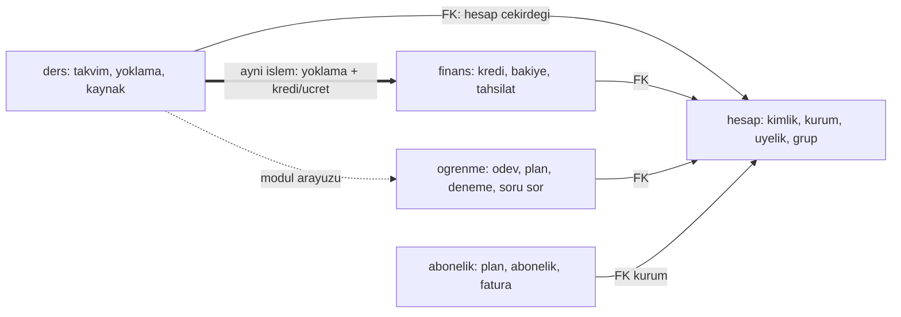
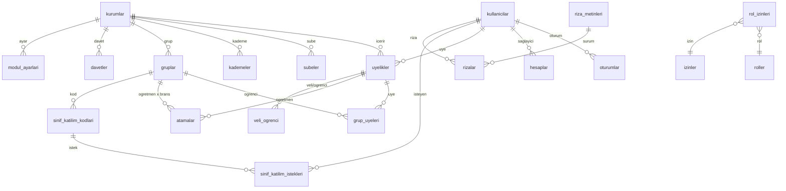
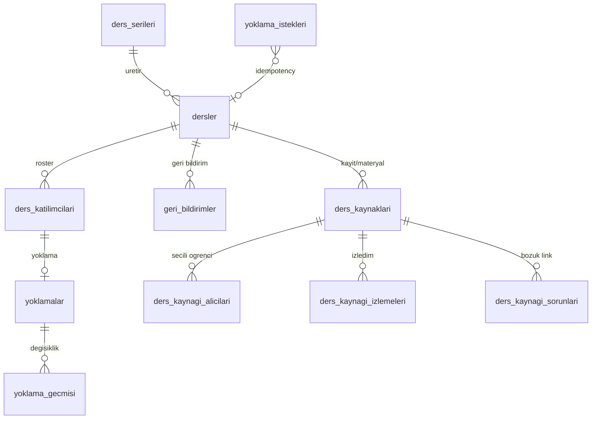
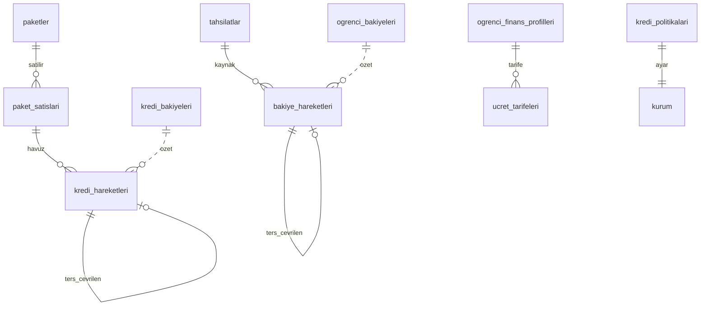
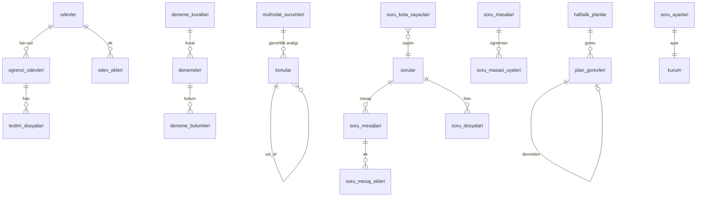
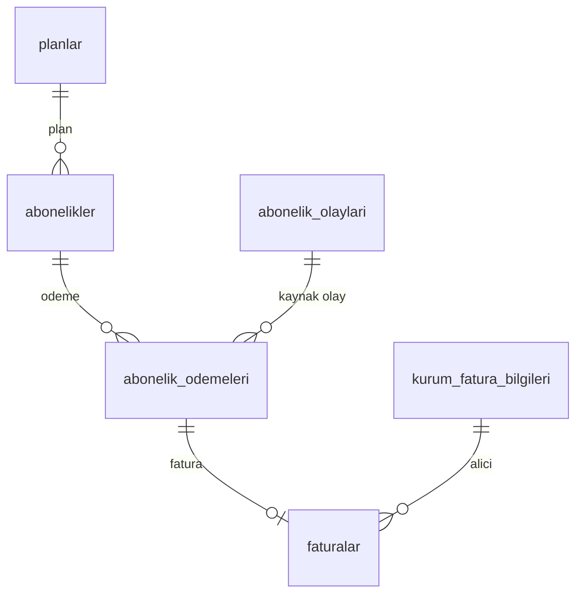

# `api` veritabanı şeması

`api` servisinin PostgreSQL veritabanı. Modüler monolit: her modül ayrı şemadır (`hesap`, `ders`, `finans`, `ogrenme`, `abonelik`) ve ortak yardımcılar `ortak` şemasındadır. Ortak kurallar, profil kodları (`K`, `KS`, `D`, `G`, `GS`), RLS şablonu ve outbox DDL'i [README.md](README.md) içindedir. Olay yükleri [olaylar.md](olaylar.md) içindedir.

Okuma kuralı: Tablo bölümlerinde "Profil" ortak sütunları verir, bu sütunlar sütun tablosunda tekrarlanmaz. "Olaylar" satırı, tablo yazımıyla aynı işlemde outbox'a yazılan olayları listeler.

## İçindekiler

- [Modüller arası ilişki](#modüller-arası-ilişki)
- [`ortak`](#ortak)
- [`hesap`](#hesap)
- [`ders`](#ders)
- [`finans`](#finans)
- [`ogrenme`](#ogrenme)
- [`abonelik`](#abonelik)
- [Çapraz kurallar özeti](#çapraz-kurallar-özeti)

## Modüller arası ilişki



Kural: bir modül başka modülün tablosuna yazmaz. İstisna `ders -> finans`: yoklama işlemi, `finans` modülünün dışa açtığı `krediVeUcretiUygula(tx, yoklama)` fonksiyonunu aynı `tx` ile çağırır. Bu fonksiyon yalnızca `finans` tablolarına yazar.

## `ortak`

### `ortak.bransler`

Ders branşları referans listesi. Tüm modüller `brans_kodu` ile başvurur.

Profil: `G` (RLS: hayır, global referans). PK: `kod`.

| Sütun | Tip | Null | Varsayılan | Not |
| --- | --- | --- | --- | --- |
| `kod` | text | hayır |  | PK. `matematik`, `fizik`, `kimya`, `biyoloji`, `turkce`, `edebiyat`, `tarih`, `cografya`, `felsefe`, `din_kulturu`, `ingilizce`, `fen_bilimleri`, `sosyal_bilgiler`, `geometri`, `inkilap_tarihi`, `almanca`, `diger` |
| `ad` | text | hayır |  | Görünen ad |
| `sira` | smallint | hayır | 100 | |
| `aktif` | boolean | hayır | true | |
| `created_at`, `updated_at` | timestamptz | hayır | now() | `id` yok, PK `kod` |

Kısıtlar: `CHECK (kod ~ '^[a-z_]+$')`. Olaylar: yok (tohum verisi migrasyonla gelir).

### `ortak.medya_dosya_kopyalari`

`medya` servisindeki dosyanın yerel okuma kopyası. Bir dosyayı ödev teslimine ya da soruya bağlamadan önce sahibi, türü ve hazır olduğu doğrulanır.

Profil: `K` eksiği: `id` = medya `dosya_id` (üretici `medya`). RLS: evet (`kurum_id`).

| Sütun | Tip | Null | Varsayılan | Not |
| --- | --- | --- | --- | --- |
| `id` | uuid | hayır | | PK. Medya `dosya_id`. |
| `kurum_id` | uuid | hayır | | |
| `sahip_kullanici_id` | uuid | hayır | | |
| `tur` | text | hayır | | `medya.dosyalar.tur` değeri |
| `durum` | text | hayır | | CHECK `IN ('hazir','islenemedi','silindi')` |
| `mime_tipi` | text | hayır | | |
| `boyut_bayt` | bigint | hayır | | |
| `genislik`, `yukseklik`, `sure_sn` | int | evet | | |
| `kucuk_resim_var` | boolean | hayır | false | |
| `kaynak_olay_id` | uuid | hayır | | Son işlenen olay |
| `created_at`, `updated_at` | timestamptz | hayır | now() | |

İndeks: `(kurum_id, sahip_kullanici_id)`. Tüketilen olaylar: `medya.dosya.hazir.v1` (insert/upsert), `medya.dosya.islenemedi.v1` (`durum`), `medya.dosya.silindi.v1` (`durum='silindi'`). Yarış: ilgili olay henüz gelmemişse bağlama isteği `409 dosya_hazir_degil` döner, istemci yeniden dener.

## `hesap`

Kimlik, kurum yapısı, üyelik, yetki ve ayarlar.



Kavramlar: kullanıcı global kimliktir. Kiracı verisi `uyelik`e bağlanır. `ogrenci_id`, `ogretmen_id`, `veli_id`, `yonetici_id` sütunlarının hepsi `hesap.uyelikler.id` değeridir.

### Kimlik tabloları (Better Auth eşlemesi)

> **Uygulama notları (`feat/hesap-kimlik`).** Aşağıdaki tasarımdan bilinçli sapmalar:
> - `oturumlar`: Better Auth belirteci düz saklar; `belirtec_hash bytea` yerine `belirtec text UNIQUE` kullanılır. İstemciye giden değer Better Auth sırrıyla imzalıdır, veritabanı sızıntısı tek başına oturum açmaya yetmez.
> - `hesaplar`: `saglayici` değerlerine Better Auth'un e-posta/parola sabiti `credential` eklendi; belirteç sütunları `text` (OAuth belirteçleri Better Auth tarafından şifrelenir), `parola_hash` eklendi.
> - `dogrulamalar`: Better Auth'un `identifier/value/expiresAt` yapısı (`tanimlayici`, `deger`, `expires_at`) kullanılır; `kod_hash/amac/deneme_sayisi` yoktur (deneme sayısı ve süre `deger` içinde, 5 dakika / 5 deneme). Telefon başına saatlik OTP sınırı için `hesap.otp_istekleri` tablosu eklendi.
> - `kullanicilar`: Better Auth `image` alanı için `avatar_url`; `eposta_dogrulandi_at` / `telefon_dogrulandi_at` Better Auth'a boolean olarak görünür. Telefonla kayıtta geçici e-posta (`...@telefon.invalid`) veritabanına yazılmaz (`eposta` NULL kalır).
> - Oturum iptali (`feat/guvenlik-sid-iptal`): Better Auth çıkışta `oturumlar` satırını **siler**; `iptal_at` doldurulmaz. Erişim belirteci iptali tabloda değil NATS KV `iptal` kovasında tutulur ([ADR 0008](../adr/0008-erisim-belirteci-iptali-sid-listesi.md)).
> - E-posta doğrulama: `kullanicilar.eposta_dogrulandi_at` doğrulama bağlantısıyla (`GET /auth/eposta/dogrula`) dolar; giriş doğrulamaya zorlanmaz. `GET /v1/hesap/ben` `eposta_dogrulandi` döner.
> - `jwks`: Better Auth `jwt` eklentisi yerine access JWT'yi api kendisi üretir (claim seti ve kurum/üyelik seçimi gerektiği için); anahtarlar bu tabloda, `id` = `kid`. Özel anahtar `BETTER_AUTH_SECRET`'tan HKDF ile türetilen anahtarla AES-256-GCM şifreli.
> - `rizalar.kurum_id` NULL olabilir (hesap düzeyi rıza: ilk girişte henüz kurum yoktur). Politika: kullanıcı kendi kayıtlarını görür/ekler; kurum kayıtlarını ayrıca kurum bağlamı görür.
> - `uyelikler` ve `kurumlar` RLS: kullanıcı kolu yalnızca `SELECT` içindir (yazma yalnızca kurum bağlamında).
> - `davet_coz` / `katilim_kodu_coz`: `FORCE RLS` sahibi de kapsadığı için tablolara yalnızca `api_owner` rolü için `SELECT` politikası eklendi; fonksiyonlar `api_owner` sahipliğinde `SECURITY DEFINER`'dır (api_app bu politikadan yararlanamaz).
> - Kurum `tur` değerleri `bireysel`, `ekip`, `kurum` (ürün dilindeki "butik" = `ekip`). `ayarlar` jsonb'ye `vurgu_rengi` ve `logo_url` eklendi (medya servisi gelene kadar logo adresi).
> - Rıza hata kodu `riza_gerekli` (ADR 0006 alan hata kodu kuralı).
> - Olaylar: mevcut `@kopru/contracts` zarfı (`kurumId`, `type`, `version`) kullanılır; `hesap.kullanici.*` olayları zarf kullanıcı düzeyini desteklemediği için henüz yayımlanmaz. Outbox tablosu service-kit şablonudur (`ortak.outbox`: `subject`, `payload`, `sent_at`).

Better Auth tabloları [ADR 0004](../adr/0004-kimlik-dogrulama-ve-yetkilendirme.md) uyarınca bu adlarla eşlenir. Better Auth'ın kendi zorunlu sütunları (ör. `emailVerified`, `createdAt`) `fields` yapılandırmasıyla aşağıdaki sütunlara bağlanır. Aşağıdaki liste Better Auth sütunlarının üst kümesidir.

#### `hesap.kullanicilar`

Global kullanıcı kimliği (Better Auth `user`). Bir kişi tek satırdır, birden çok kurumda üye olabilir.

Profil: `GS`. RLS: hayır (giriş öncesi sorgulanır; erişim yalnızca `AuthRepository` ve `KullaniciRepository` üzerinden).

| Sütun | Tip | Null | Varsayılan | Not |
| --- | --- | --- | --- | --- |
| `ad` | text | evet | | |
| `soyad` | text | evet | | |
| `gorunen_ad` | text | evet | | Listelerde gösterilen ad |
| `ad_arama` | text | evet | | Küçük harf, Türkçe karakter normalleştirilmiş (`i/ı` tek biçim) |
| `telefon_e164` | text | evet | | `+905xxxxxxxxx`. OTP girişi. |
| `telefon_dogrulandi_at` | timestamptz | evet | | |
| `eposta` | citext | evet | | |
| `eposta_dogrulandi_at` | timestamptz | evet | | |
| `avatar_dosya_id` | uuid | evet | | Medya `dosya_id` |
| `dil` | text | hayır | `'tr'` | |
| `saat_dilimi` | text | hayır | `'Europe/Istanbul'` | |
| `durum` | text | hayır | `'aktif'` | CHECK `IN ('aktif','askida','silindi')` |
| `platform_rolu` | text | hayır | `'yok'` | CHECK `IN ('yok','destek','yonetici')` |
| `son_giris_at` | timestamptz | evet | | |
| `anonimlestirildi_at` | timestamptz | evet | | |

Kısıtlar: `UNIQUE (telefon_e164)` ve `UNIQUE (eposta)` (NULL'lar serbest). `CHECK (telefon_e164 ~ '^\+[1-9][0-9]{7,14}$')`. `CHECK (telefon_e164 IS NOT NULL OR eposta IS NOT NULL OR durum = 'silindi')`. İndeks: `ad_arama gin_trgm_ops`.
Olaylar: `hesap.kullanici.degisti.v1` (oluşturma ve güncelleme), `hesap.kullanici.silindi.v1` (anonimleştirme). Olay yükü yalnızca `kullanici_id`, `dil`, `durum` taşır. Telefon/e-posta/ad `GET /ic/kullanicilar/:id/iletisim` iç uç noktasıyla (yalnızca `scope=iletisim.oku` servis JWT'si, çağrı denetim günlüğüne yazılır) `bildirim`e verilir.

#### `hesap.oturumlar`

Better Auth `session`. Yenileme belirteci oturumu.

Profil: `G`. RLS: hayır.

| Sütun | Tip | Null | Varsayılan | Not |
| --- | --- | --- | --- | --- |
| `kullanici_id` | uuid | hayır | | FK `kullanicilar(id)` ON DELETE CASCADE |
| `belirtec_hash` | bytea | hayır | | SHA-256. Düz belirteç saklanmaz. |
| `etkin_kurum_id` | uuid | evet | | Son seçilen kurum |
| `etkin_uyelik_id` | uuid | evet | | |
| `ip` | inet | evet | | |
| `user_agent` | text | evet | | |
| `cihaz_adi` | text | evet | | |
| `expires_at` | timestamptz | hayır | | Kayan, 30 gün |
| `son_kullanim_at` | timestamptz | hayır | now() | |
| `iptal_at` | timestamptz | evet | | |
| `taklit_kayit_id` | uuid | evet | | Taklit oturumu ise `taklit_kayitlari.id` |

Kısıtlar: `UNIQUE (belirtec_hash)`. İndeks: `(kullanici_id, iptal_at)`, `(expires_at)` (temizlik). Olaylar: yok.

#### `hesap.hesaplar`

Better Auth `account`: sosyal giriş ve telefon bağlantıları.

Profil: `G`. RLS: hayır.

| Sütun | Tip | Null | Varsayılan | Not |
| --- | --- | --- | --- | --- |
| `kullanici_id` | uuid | hayır | | FK `kullanicilar(id)` ON DELETE CASCADE |
| `saglayici` | text | hayır | | CHECK `IN ('apple','google','telefon')` |
| `saglayici_hesap_id` | text | hayır | | Apple/Google `sub`, telefonda E.164 |
| `erisim_belirteci_sifreli` | bytea | evet | | Uygulama düzeyinde AES-256-GCM, gerekmedikçe boş |

Kısıtlar: `UNIQUE (saglayici, saglayici_hesap_id)`. İndeks: `(kullanici_id)`.

#### `hesap.dogrulamalar`

Better Auth `verification`: OTP ve e-posta doğrulama kodları.

Profil: `G`. RLS: hayır.

| Sütun | Tip | Null | Varsayılan | Not |
| --- | --- | --- | --- | --- |
| `tanimlayici` | text | hayır | | Telefon veya e-posta |
| `kod_hash` | bytea | hayır | | HMAC-SHA-256 (sunucu sırrıyla) |
| `amac` | text | hayır | | CHECK `IN ('giris_otp','telefon_dogrula','eposta_dogrula')` |
| `deneme_sayisi` | smallint | hayır | 0 | CHECK `<= 5` |
| `expires_at` | timestamptz | hayır | | 5 dakika |
| `kullanildi_at` | timestamptz | evet | | |

İndeks: `(tanimlayici, amac, created_at DESC)`. Süresi dolanlar saatlik işle silinir.

#### `hesap.jwks`

JWT imza anahtarları (Better Auth `jwks`).

Profil: `G`. RLS: hayır. Sütunlar: `acik_anahtar text NOT NULL` (JWK JSON), `ozel_anahtar_sifreli bytea NOT NULL` (AES-256-GCM, anahtar ortam sırrında), `algoritma text NOT NULL DEFAULT 'EdDSA'`, `expires_at timestamptz NULL`. Döndürme: 90 gün ([ADR 0004](../adr/0004-kimlik-dogrulama-ve-yetkilendirme.md)).

### Kurum yapısı

#### `hesap.kurumlar`

Kiracı kökü. `id`, diğer tüm tablolardaki `kurum_id`dir.

Profil: `GS` (`kurum_id` sütunu yok, `id` kiracıdır). RLS: evet, `id = ortak.aktif_kurum()`. Yeni kurum oluşturma `withSistem` ile yapılır (kiracı henüz yoktur).

| Sütun | Tip | Null | Varsayılan | Not |
| --- | --- | --- | --- | --- |
| `ad` | text | hayır | | |
| `tur` | text | hayır | | CHECK `IN ('bireysel','ekip','kurum')` |
| `kisa_ad` | citext | evet | | URL dostu, `UNIQUE` |
| `vergi_no` | text | evet | | |
| `telefon_e164`, `eposta` | text | evet | | |
| `adres` | jsonb | evet | | `{il, ilce, acik_adres, posta_kodu}` |
| `logo_dosya_id` | uuid | evet | | |
| `saat_dilimi` | text | hayır | `'Europe/Istanbul'` | |
| `durum` | text | hayır | `'aktif'` | CHECK `IN ('aktif','askida','kapali')`. `askida`: abonelik nedeniyle salt okunur. |
| `ayarlar` | jsonb | hayır | `'{}'` | Zod ile doğrulanır: `sessiz_saat_varsayilan`, `ders_hatirlatma_dk`, `yoklama_kilit_gun` |
| `olusturan_kullanici_id` | uuid | hayır | | FK `kullanicilar(id)` |
| `kapatildi_at` | timestamptz | evet | | |

Olaylar: `hesap.kurum.degisti.v1`. Not: `kurum_id` sütunu olmadığı için olay zarfında `kurum_id = id`.

#### `hesap.subeler`

Profil: `KS`. RLS: evet. Sütunlar: `ad text NOT NULL`, `adres jsonb NULL`, `telefon_e164 text NULL`, `arsivlendi_at timestamptz NULL`. Tekillik: `UNIQUE (kurum_id, ad) WHERE arsivlendi_at IS NULL`. `UNIQUE (kurum_id, id)` (bileşik FK hedefi). Olaylar: yok (şube kopyası gerekmez; üyelik olayında `sube_id` taşınır).

#### `hesap.kademeler`

Sınıf düzeyi. Bireysel öğretmenlerde isteğe bağlıdır.

Profil: `KS`. RLS: evet.

| Sütun | Tip | Null | Varsayılan | Not |
| --- | --- | --- | --- | --- |
| `ad` | text | hayır | | Ör. `8. Sınıf`, `Mezun` |
| `seviye` | smallint | evet | | 1-12 sınıf, 13 = mezun. Müfredat önerisi için. |
| `sira` | smallint | hayır | 100 | |
| `arsivlendi_at` | timestamptz | evet | | |

Kısıtlar: `UNIQUE (kurum_id, ad) WHERE arsivlendi_at IS NULL`, `UNIQUE (kurum_id, id)`, `CHECK (seviye BETWEEN 1 AND 13)`. Olaylar: `hesap.kademe.degisti.v1`.

#### `hesap.uyelikler`

Kullanıcının kurumdaki rolü. Rol ve kapsam kaynağı.

Profil: `KS`. RLS: evet, iki kollu (kurum VEYA kendi kullanıcısı; giriş sonrası kurum listesi için).

| Sütun | Tip | Null | Varsayılan | Not |
| --- | --- | --- | --- | --- |
| `kullanici_id` | uuid | hayır | | FK `kullanicilar(id)` |
| `rol` | text | hayır | | CHECK `IN ('sahip','yonetici','ogretmen','ogrenci','veli')` |
| `durum` | text | hayır | `'aktif'` | CHECK `IN ('davetli','aktif','askida','ayrildi')` |
| `sube_id` | uuid | evet | | Bileşik FK `(kurum_id, sube_id)`. Doluysa yönetici/öğretmen kapsamı `sube`. |
| `kademe_id` | uuid | evet | | Bileşik FK. Öğrenci kademesi. |
| `ogrenci_no` | text | evet | | |
| `gorunen_ad` | text | evet | | Kuruma özel ad (yoksa kullanıcının adı) |
| `katildi_at` | timestamptz | evet | | |
| `ayrildi_at` | timestamptz | evet | | |

Kısıtlar: `UNIQUE (kurum_id, kullanici_id, rol)` (bir kullanıcı aynı kurumda farklı rollerle birden fazla üyelik taşıyabilir). `UNIQUE (kurum_id, id)`. `CHECK (kademe_id IS NULL OR rol = 'ogrenci')`. `CHECK (durum <> 'ayrildi' OR ayrildi_at IS NOT NULL)`. Kurumun en az bir etkin `sahip` üyeliği olmalıdır: uygulama doğrular ve ertelenmiş kısıt tetikleyicisi (`uyelikler_sahip_var_trg`) son sahibin ayrılmasını reddeder.
İndeks: `(kullanici_id)`, `(kurum_id, rol, durum)`, `(kurum_id, kademe_id) WHERE rol = 'ogrenci'`, `(kurum_id, sube_id)`.
Olaylar: `hesap.uyelik.degisti.v1` (oluşturma, rol/durum/kademe değişimi, ayrılma).

#### `hesap.veli_ogrenci`

Veli-öğrenci bağlantısı. Rol veri modelinde vardır, Faz 1'de arayüz yoktur.

Profil: `K`. RLS: evet. Sütunlar: `veli_id uuid NOT NULL`, `ogrenci_id uuid NOT NULL` (ikisi de bileşik FK `uyelikler`), `yakinlik text NULL` (`anne`, `baba`, `vasi`, `diger`), `birincil boolean NOT NULL DEFAULT false`, `onaylandi_at timestamptz NULL`. Kısıtlar: `UNIQUE (veli_id, ogrenci_id)`, `CHECK (veli_id <> ogrenci_id)`. Rol denetimi tetikleyicide: `veli_id` rolü `veli`, `ogrenci_id` rolü `ogrenci` olmalı (`veli_ogrenci_rol_trg`). İndeks: `(ogrenci_id)`. Olaylar: yok (Faz 1).

#### `hesap.gruplar`

Ders gruplarının tümü: birebir, grup, sınıf, etüt.

Profil: `KS`. RLS: evet.

| Sütun | Tip | Null | Varsayılan | Not |
| --- | --- | --- | --- | --- |
| `tur` | text | hayır | | CHECK `IN ('birebir','grup','sinif','etut')` |
| `ad` | text | hayır | | |
| `sube_id` | uuid | evet | | Bileşik FK |
| `kademe_id` | uuid | evet | | Bileşik FK. Modül ayarı çözümünde kullanılır. |
| `kapasite` | smallint | evet | | `birebir` için 1 |
| `renk` | text | evet | | `#RRGGBB` |
| `durum` | text | hayır | `'aktif'` | CHECK `IN ('aktif','arsiv')` |
| `arsivlendi_at` | timestamptz | evet | | |

Kısıtlar: `UNIQUE (kurum_id, id)`. `CHECK (tur <> 'birebir' OR kapasite = 1)`. `CHECK (kapasite IS NULL OR kapasite > 0)`. `CHECK ((durum = 'arsiv') = (arsivlendi_at IS NOT NULL))`. Kapasite aşımı `grup_uyeleri` yazımında uygulama + `SELECT ... FOR UPDATE` ile doğrulanır (bkz. `grup_uyeleri`).
İndeks: `(kurum_id, tur, durum)`, `(kurum_id, kademe_id)`, `(kurum_id, sube_id)`.
Olaylar: `hesap.grup.degisti.v1`. Kapsam süzgeci: `kurum` hepsi, `sube` aynı `sube_id`, `grup` (öğretmen) etkin ataması olan gruplar, `kendi` (öğrenci) etkin üyesi olduğu gruplar.

#### `hesap.grup_uyeleri`

Grubun öğrenci üyeleri (zaman aralıklı).

Profil: `KS`. RLS: evet.

| Sütun | Tip | Null | Varsayılan | Not |
| --- | --- | --- | --- | --- |
| `grup_id` | uuid | hayır | | Bileşik FK `gruplar` |
| `ogrenci_id` | uuid | hayır | | Bileşik FK `uyelikler`; rol `ogrenci` (tetikleyici) |
| `baslangic_tarihi` | date | hayır | `current_date` | |
| `bitis_tarihi` | date | evet | | Dolu = çıkarıldı |
| `katilim_yolu` | text | hayır | `'yonetici'` | CHECK `IN ('yonetici','davet','sinif_kodu')` |

Kısıtlar: `UNIQUE (grup_id, ogrenci_id) WHERE bitis_tarihi IS NULL` (aynı anda tek etkin üyelik). `CHECK (bitis_tarihi IS NULL OR bitis_tarihi >= baslangic_tarihi)`. Kapasite: ekleme işlemi önce `gruplar` satırını kilitler (`FOR UPDATE`), etkin üye sayısını sayar. İndeks: `(kurum_id, grup_id) WHERE bitis_tarihi IS NULL`, `(kurum_id, ogrenci_id) WHERE bitis_tarihi IS NULL`.
Olaylar: `hesap.grup_uyesi.degisti.v1`. Yan etki: yeni etkin üye için açık ödevlerin fan-out'u (`ogrenme` iç işleyicisi, aynı işlemde).

#### `hesap.atamalar`

Öğretmen x grup x branş ataması.

Profil: `KS`. RLS: evet.

| Sütun | Tip | Null | Varsayılan | Not |
| --- | --- | --- | --- | --- |
| `grup_id` | uuid | hayır | | Bileşik FK |
| `ogretmen_id` | uuid | hayır | | Bileşik FK `uyelikler`; rol `ogretmen` (tetikleyici) |
| `brans_kodu` | text | hayır | | FK `ortak.bransler(kod)` |
| `baslangic_tarihi` | date | hayır | `current_date` | |
| `bitis_tarihi` | date | evet | | |
| `ana_ogretmen` | boolean | hayır | false | Soru sor yönlendirmesinde öncelik |

Kısıtlar: `UNIQUE (grup_id, ogretmen_id, brans_kodu) WHERE bitis_tarihi IS NULL`. `CHECK (bitis_tarihi IS NULL OR bitis_tarihi >= baslangic_tarihi)`. Bir `(grup_id, brans_kodu)` için en çok bir `ana_ogretmen`: `UNIQUE (grup_id, brans_kodu) WHERE ana_ogretmen AND bitis_tarihi IS NULL`. İndeks: `(kurum_id, ogretmen_id) WHERE bitis_tarihi IS NULL`, `(kurum_id, grup_id)`.
Olaylar: `hesap.atama.degisti.v1`.

#### `hesap.davetler`

Davet bağlantısı ve SMS davetleri. **Düz belirteç saklanmaz.**

Profil: `KS`. RLS: evet. Belirteçten kiracı bulma: `hesap.davet_coz(token_hash bytea)` (`SECURITY DEFINER`) yalnızca `kurum_id, davet_id, durum, expires_at` döner.

| Sütun | Tip | Null | Varsayılan | Not |
| --- | --- | --- | --- | --- |
| `kanal` | text | hayır | | CHECK `IN ('baglanti','sms','eposta')` (`eposta` migration 0004 ile eklendi) |
| `rol` | text | hayır | | CHECK `IN ('yonetici','ogretmen','ogrenci','veli')` (sahip davet edilmez) |
| `belirtec_hash` | bytea | hayır | | SHA-256(32 bayt rastgele belirteç). UNIQUE. Belirteç yalnızca oluşturma yanıtında ve SMS'te görünür. |
| `hedef_telefon_e164` | text | evet | | `kanal='sms'` ise zorunlu |
| `hedef_eposta` | citext | evet | | `kanal='eposta'` ise zorunlu (migration 0004) |
| `hedef_ad` | text | evet | | |
| `grup_id`, `kademe_id`, `sube_id` | uuid | evet | | Katılımda atanacak bağlam (bileşik FK) |
| `davet_eden_id` | uuid | hayır | | `uyelikler` |
| `max_kullanim` | int | hayır | 1 | `baglanti` kanalında çok kullanımlı olabilir (en çok 100) |
| `kullanim_sayisi` | int | hayır | 0 | |
| `durum` | text | hayır | `'bekliyor'` | CHECK `IN ('bekliyor','kullanildi','iptal','suresi_doldu')` |
| `expires_at` | timestamptz | hayır | | Varsayılan 7 gün |
| `sms_gonderim_sayisi` | smallint | hayır | 0 | CHECK `<= 3`. SMS ve e-posta kanallarında ortak gönderim sayacıdır (ilk gönderim dahil). |
| `son_sms_at` | timestamptz | evet | | |
| `kabul_eden_kullanici_id` | uuid | evet | | Son kabul eden |

Kısıtlar: `UNIQUE (belirtec_hash)`. `CHECK (kullanim_sayisi <= max_kullanim)`. `CHECK (kanal <> 'sms' OR hedef_telefon_e164 IS NOT NULL)`. `CHECK (kanal <> 'eposta' OR hedef_eposta IS NOT NULL)`. `CHECK (max_kullanim BETWEEN 1 AND 100)`. Kabul işlemi `UPDATE ... SET kullanim_sayisi = kullanim_sayisi + 1 WHERE durum='bekliyor' AND expires_at > now() AND kullanim_sayisi < max_kullanim` ile atomik yapılır. Etkilenen satır 0 ise `410 davet_gecersiz`. İndeks: `(kurum_id, durum, expires_at)`.
Olaylar: `hesap.davet.kabul_edildi.v1`. Davet SMS'i/e-postası olay değil, `bildirim` iç çağrısıdır; `bildirim` gelene kadar `SmsGonderici` ve `EpostaGonderici` arayüzleri log uygulamasıyla çalışır (e-posta logunda yalnızca `davet_id`).

Uygulama kuralları:

- Durum `suresi_doldu` okumada türetilir: `durum='bekliyor' AND expires_at <= now()` olan kayıt yanıtlarda ve `durum` süzgecinde `suresi_doldu` sayılır. Periyodik durum güncellemesi yoktur (worker'da iş tanımlı değil); kabul zaten `expires_at > now()` ile korunur.
- Yeniden gönderme düz belirteç saklanmadığı için **yeni belirteç üretir** (`belirtec_hash` değişir, eski bağlantı geçersizleşir), `expires_at` 7 gün uzar, sayaç artar; 4. gönderim `429 gonderim_siniri_asildi`. `baglanti` kanalı yeniden gönderilemez (`422`).
- Tek kullanımlık (`max_kullanim=1`) kanallar `sms` ve `eposta`; çok kullanımlı yalnız `baglanti`. `grup_id`/`kademe_id` yalnız `rol='ogrenci'` davetinde verilebilir; kabulde öğrenci gruba `katilim_yolu='davet'` ile eklenir. Faz 1'de `veli` davet edilmez.
- Bireysel kurumda `grup_id`'siz öğrenci daveti kabul edilince öğrenciye otomatik `birebir` grup açılır (ad sabit: "Birebir ders"; olay yükünde kişisel ad olmasın diye).
- Yetki: `davet.yaz`. `yonetici` davet etmek ayrıca `rol.yonet` (yalnız sahip) ister. Öğretmen (`grup` kapsamı) yalnız atandığı gruba öğrenci davet eder; davet listesi/iptal/yeniden gönderme yalnız atandığı gruplara bağlı davetleri görür (kapsam dışı: 404).

#### `hesap.sinif_katilim_kodlari`

Sınıf (`gruplar.tur='sinif'`) için öğrenci katılım kodu. Düşük entropili kısa koddur, bu yüzden hız sınırı, süre ve yenileme vardır.

Profil: `KS`. RLS: evet. Kod çözme: `hesap.katilim_kodu_coz(kod text)` (`SECURITY DEFINER`, hız sınırı uygulamada) yalnız `kurum_id, grup_id, kod_id` döner; pasif, süresi dolmuş, kullanımı dolu ve bulunamayan kod aynı biçimde boş döner (varlık sızmaz).

| Sütun | Tip | Null | Varsayılan | Not |
| --- | --- | --- | --- | --- |
| `grup_id` | uuid | hayır | | Bileşik FK |
| `kod` | text | hayır | | 8 karakter, Crockford base32 büyük harf, `0O1IL` hariç. Global `UNIQUE`. |
| `aktif` | boolean | hayır | true | |
| `expires_at` | timestamptz | evet | | |
| `max_kullanim` | int | evet | | NULL = sınırsız |
| `kullanim_sayisi` | int | hayır | 0 | |
| `iptal_at` | timestamptz | evet | | |

Kısıtlar: `UNIQUE (kod)`, `UNIQUE (kurum_id, id)` (isteklerin bileşik FK'si için). Bir grup için tek etkin kod: `UNIQUE (grup_id) WHERE aktif`. Yenileme eski kodu `aktif=false` yapar. `grup_id` türü `sinif` olmalıdır (tetikleyici `sinif_katilim_kodlari_tur_trg`). Kod çözme hız sınırı: IP başına dakikada 10, başarısız çözüm 5'te 15 dakika bekleme (IP ve kullanıcı anahtarlı, süreç belleğinde sayılır; ilk sürümde çok kopyalı çalışmada her kopya kendi sayacını tutar).
Olaylar: yok. Öğretmen onayından sonra katılım `grup_uyeleri` yazımıyla (`katilim_yolu='sinif_kodu'`) olay üretir.

**Karar (8 Kasım 2026).** Kod 8 karakterdir ve katılım **öğretmen onaylıdır**: öğrenci kodu girince `sinif_katilim_istekleri`ne bekleyen istek yazılır; sahip/yönetici ya da gruba atanmış öğretmen onaylar (öğrenci gruba `katilim_yolu='sinif_kodu'` ile eklenir) ya da reddeder (eklenmez). `kullanim_sayisi` onayda artar; `max_kullanim` hem katılımda (kod çözme) hem onayda denetlenir (onayda dolmuşsa `409 kod_kullanim_doldu`). Kod kapatılsa ya da yenilense de bekleyen istekler korunur ve onaylanabilir; yeni istek yalnız etkin koda yapılır.

#### `hesap.sinif_katilim_istekleri`

Sınıf koduyla gelen, onay bekleyen/karara bağlanmış katılım istekleri.

Profil: `KS`. RLS: evet (`kiraci_izolasyonu`) + kullanıcı düzeyi iki politika: `kendi_istekleri_okuma` (SELECT, `kullanici_id = aktif_kullanici()`) ve `kendi_istekleri_iptal` (UPDATE; yalnız `bekliyor -> iptal`). Kullanıcı henüz hiçbir kurumun üyesi değilken kendi isteklerini bu politikalarla görür ve iptal eder.

| Sütun | Tip | Null | Varsayılan | Not |
| --- | --- | --- | --- | --- |
| `grup_id` | uuid | hayır | | Bileşik FK `gruplar` |
| `kod_id` | uuid | hayır | | Bileşik FK `sinif_katilim_kodlari` (isteğin geldiği kod) |
| `kullanici_id` | uuid | hayır | | FK `kullanicilar` (üyelik henüz olmayabilir) |
| `durum` | text | hayır | `'bekliyor'` | CHECK `IN ('bekliyor','onaylandi','reddedildi','iptal')` |
| `karar_veren_id` | uuid | evet | | Bileşik FK `uyelikler` (onaylayan/reddeden) |
| `karar_at` | timestamptz | evet | | |

Kısıtlar: `UNIQUE (grup_id, kullanici_id) WHERE durum = 'bekliyor'` (grup başına tek bekleyen istek). `CHECK`: `onaylandi/reddedildi` iken `karar_veren_id` ve `karar_at` dolu, `bekliyor/iptal` iken boş. İndeks: `(kurum_id, grup_id, durum, id)`, `(kullanici_id, durum)`.
Olaylar: yok. Onay, aynı işlemde `ogrenci` üyeliği (yoksa; `hesap.uyelik.degisti`) ve `grup_uyeleri` satırı (`hesap.grup_uyesi.degisti`) üretir; olaylar kişisel veri taşımaz. Onay ve ret `hesap.denetim_kayitlari`na yazılır (`hesap.sinif_katilim_onayla|reddet`), kod yönetimi de (`hesap.sinif_kodu_olustur|kapat`).

#### `hesap.modul_ayarlari`

Modül açık/kapalı ayarları. Öncelik **kurum > kademe > grup** ve alt düzey yalnızca daraltır ([ADR 0004](../adr/0004-kimlik-dogrulama-ve-yetkilendirme.md#modül-açıkkapalı-önceliği)).

Profil: `KS`. RLS: evet.

| Sütun | Tip | Null | Varsayılan | Not |
| --- | --- | --- | --- | --- |
| `modul_kodu` | text | hayır | | CHECK `IN ('takvim','yoklama','geri_bildirim','kayitlar','finans','odev','haftalik_plan','deneme','soru_sor','oyunlastirma','duyuru')` |
| `kapsam` | text | hayır | | CHECK `IN ('kurum','kademe','grup')` |
| `kapsam_id` | uuid | hayır | | `kurum` ise `kurum_id`, `kademe` ise `kademeler.id`, `grup` ise `gruplar.id` |
| `acik` | boolean | hayır | | |
| `degistiren_id` | uuid | evet | | |

Kısıtlar: `UNIQUE (kurum_id, modul_kodu, kapsam, kapsam_id)`. `CHECK (kapsam <> 'kurum' OR kapsam_id = kurum_id)`. Kayıt yok = miras. "Mirasa dön" satırı siler (olay `acik=null` taşır). Alt düzey `acik=true` satırı, üst düzey kapalıyken API tarafında `422 ust_duzey_kapali` ile reddedilir. Çekirdek modüller (hesap, bildirim gelen kutusu, medya) kapatılamaz ve listede yoktur. Plan hakkı olmayan modül açılamaz.

Çözümleme fonksiyonu `hesap.modul_acik_mi(kurum uuid, modul text, kademe uuid, grup uuid) RETURNS boolean`:

```sql
-- sözde kod: etkin = plan_hakki AND kurum_acik AND kademe_acik AND grup_acik
-- her düzey için: satır yoksa true, varsa acik değeri
SELECT coalesce(bool_and(coalesce(acik, true)), true) AND :plan_hakki
FROM (VALUES ('kurum', :kurum), ('kademe', :kademe), ('grup', :grup)) AS d(kapsam, kid)
LEFT JOIN hesap.modul_ayarlari m
  ON m.kurum_id = :kurum AND m.modul_kodu = :modul
 AND m.kapsam = d.kapsam AND m.kapsam_id = d.kid
WHERE d.kid IS NOT NULL;
```

İndeks: `(kurum_id, modul_kodu)`. Olaylar: `hesap.modul_ayari.degisti.v1`.

### Rol ve izin sözlüğü

Global tohum tabloları. Faz 1'de özel rol yoktur. RLS: hayır. `packages/izinler` bu tablolardan üretilir.

- `hesap.roller` (`G`): `kod text UNIQUE` (`sahip`,`yonetici`,`ogretmen`,`ogrenci`,`veli`), `ad text`, `sistem boolean DEFAULT true`.
- `hesap.izinler` (`G`): `kod text UNIQUE` (`yoklama.yaz`, `odev.ver`, ...), `modul_kodu text NULL`, `aciklama text`.
- `hesap.rol_izinleri` (`G`): `rol_kodu text` FK `roller(kod)`, `izin_kodu text` FK `izinler(kod)`, `kapsam text CHECK IN ('kendi','grup','sube','kurum')`. `UNIQUE (rol_kodu, izin_kodu)`. Tek kapsam satırı; en geniş kapsam yazılır, dar kapsamlar ondan türer.

Olaylar: yok. Değişiklik `pv` sürümünü artırır.

### Rıza (KVKK)

#### `hesap.riza_metinleri`

Sürümlü KVKK metinleri. Yayınlanmış sürüm değiştirilemez; düzeltme yeni sürümdür.

Profil: `G`. RLS: hayır (herkese açık içerik).

| Sütun | Tip | Null | Varsayılan | Not |
| --- | --- | --- | --- | --- |
| `tur` | text | hayır | | CHECK `IN ('kvkk_aydinlatma','acik_riza','kullanim_kosullari','veli_onayi')` |
| `surum` | text | hayır | | Ör. `2026-11-01`. Artan sırada sözlüksel sıralanır. |
| `dil` | text | hayır | `'tr'` | |
| `baslik` | text | hayır | | |
| `govde_markdown` | text | hayır | | |
| `govde_sha256` | bytea | hayır | | Yayında hesaplanır; rıza kaydında kanıt |
| `rol_kapsami` | text[] | hayır | `'{ogrenci,ogretmen,yonetici,sahip,veli}'` | Hangi roller onaylamalı |
| `gecerli_baslangic_at` | timestamptz | hayır | | |
| `yayinlandi_at` | timestamptz | evet | | Dolu olunca değiştirilemez (tetikleyici) |

Kısıtlar: `UNIQUE (tur, surum, dil)`. Güncel sürüm: aynı `tur` için `yayinlandi_at <= now()` ve `gecerli_baslangic_at <= now()` olan en yüksek `surum`. İndeks: `(tur, dil, gecerli_baslangic_at DESC)`.

#### `hesap.rizalar`

Rıza kararları. Yalnızca ekleme.

Profil: `D`. RLS: evet, iki kollu (`kurum_id = aktif_kurum() OR kullanici_id = aktif_kullanici()`).

| Sütun | Tip | Null | Varsayılan | Not |
| --- | --- | --- | --- | --- |
| `kullanici_id` | uuid | hayır | | FK `kullanicilar(id)` |
| `riza_metni_id` | uuid | hayır | | FK `riza_metinleri(id)` |
| `karar` | text | hayır | | CHECK `IN ('kabul','ret','geri_cekildi')` |
| `veli_kullanici_id` | uuid | evet | | Reşit olmayan adına onay veren |
| `kaynak` | text | hayır | | CHECK `IN ('web','ios','android')` |
| `ip` | inet | evet | | |
| `user_agent` | text | evet | | |
| `govde_sha256` | bytea | hayır | | Kabul anındaki metin özeti (kopya) |

Güncel durum, `(kullanici_id, riza_metni_id)` için `created_at` en yeni satırdır. Giriş denetimi **hesap düzeyindedir** ([ADR 0004 değişiklik notu](../adr/0004-kimlik-dogrulama-ve-yetkilendirme.md#değişiklik-notu-2026-11-07-kvkk-rızası-hesap-düzeyinde)): kullanıcının zorunlu türlerin (`kvkk_aydinlatma`, `kullanim_kosullari`) güncel sürümünü `kabul` etmiş olması. Bu akışta `kurum_id` NULL yazılır. Dolu `kurum_id` kuruma özgü metinler için ayrılmıştır (Faz 2). Yeni sürüm yayınlanınca bir sonraki istekte `403 riza_gerekli` döner. İndeks: `(kullanici_id, kurum_id, riza_metni_id, created_at DESC)`.
Olaylar: yok (Faz 1'de tüketicisi yoktur).

### Denetim ve taklit

#### `hesap.taklit_kayitlari`

Platform yöneticisinin salt okunur taklit oturumları. En çok 15 dakika.

Profil: `G` (`kurum_id` sütunu `hedef_kurum_id`). RLS: hayır; yalnızca `_sistem` rolü yazar/okur.

| Sütun | Tip | Null | Varsayılan | Not |
| --- | --- | --- | --- | --- |
| `platform_kullanici_id` | uuid | hayır | | `kullanicilar`, `platform_rolu <> 'yok'` |
| `hedef_kullanici_id` | uuid | hayır | | |
| `hedef_kurum_id` | uuid | hayır | | |
| `neden` | text | hayır | | CHECK `char_length(neden) >= 10`. Zorunlu. |
| `baslangic_at` | timestamptz | hayır | now() | |
| `bitis_at` | timestamptz | hayır | | CHECK `bitis_at <= baslangic_at + interval '15 minutes'` |
| `sonlandirildi_at` | timestamptz | evet | | Erken sonlandırma |
| `ip` | inet | evet | | |

İndeks: `(hedef_kurum_id, baslangic_at DESC)`, `(platform_kullanici_id, baslangic_at DESC)`. Olaylar: yok.

#### `hesap.denetim_kayitlari`

Güvenlik ve yönetim eylemlerinin değişmez günlüğü.

Profil: `D` (`kurum_id` NULL olabilir: platform eylemleri). RLS: evet (`kurum_id = aktif_kurum()`; NULL satırları yalnızca `_sistem` görür). Aylık bölümlenir.

| Sütun | Tip | Null | Varsayılan | Not |
| --- | --- | --- | --- | --- |
| `aktor_kullanici_id` | uuid | evet | | |
| `aktor_uyelik_id` | uuid | evet | | |
| `taklit_kayit_id` | uuid | evet | | Taklit sırasındaki işlemler |
| `eylem` | text | hayır | | Ör. `uyelik.rol_degistir`, `taklit.baslat`, `sistem.kurum_olustur`, `veri.disa_aktar` |
| `hedef_turu` | text | evet | | |
| `hedef_id` | uuid | evet | | |
| `once`, `sonra` | jsonb | evet | | Hassas alanlar maskelenir |
| `neden` | text | evet | | `withSistem` çağrılarında zorunlu |
| `istek_id` | uuid | evet | | `korelasyon_id` |
| `ip` | inet | evet | | |

İndeks: `(kurum_id, created_at DESC)`, `(hedef_turu, hedef_id)`, `(aktor_kullanici_id, created_at DESC)`. Olaylar: yok.

## `ders`

Takvim, yoklama, geri bildirim, kayıtlar ve materyaller.



### `ders.ders_serileri`

Tekrarlayan ders kuralı. Dersler, kuraldan 12 hafta ileriye kadar `dersler` satırı olarak üretilir (gece işi + oluşturma anı). Kural değişikliği yalnızca gelecekteki, `seri_istisna=false` dersleri etkiler.

Profil: `KS`. RLS: evet.

| Sütun | Tip | Null | Varsayılan | Not |
| --- | --- | --- | --- | --- |
| `grup_id` | uuid | hayır | | Bileşik FK `hesap.gruplar` |
| `ogretmen_id` | uuid | hayır | | Bileşik FK `hesap.uyelikler` |
| `brans_kodu` | text | hayır | | FK `ortak.bransler` |
| `baslik` | text | evet | | |
| `tekrar_kurali` | text | hayır | | RFC 5545 alt kümesi: `FREQ=WEEKLY;BYDAY=MO,WE;INTERVAL=1`. Yalnızca `WEEKLY` ve `DAILY`. |
| `baslangic_tarihi` | date | hayır | | Yerel tarih |
| `bitis_tarihi` | date | evet | | `adet` ile birlikte kullanılmaz |
| `adet` | int | evet | | Toplam ders sayısı |
| `baslangic_saati` | time | hayır | | Yerel saat (`saat_dilimi`) |
| `sure_dk` | smallint | hayır | | CHECK `BETWEEN 10 AND 480` |
| `saat_dilimi` | text | hayır | `'Europe/Istanbul'` | |
| `online_baglanti` | text | evet | | |
| `yer` | text | evet | | |
| `uretildi_son_tarih` | date | hayır | | Dersleri üretilmiş son yerel gün |
| `durum` | text | hayır | `'aktif'` | CHECK `IN ('aktif','bitti','iptal')` |

Kısıtlar: `CHECK (bitis_tarihi IS NULL OR adet IS NULL)`, `CHECK (adet IS NULL OR adet > 0)`, `CHECK (bitis_tarihi IS NULL OR bitis_tarihi >= baslangic_tarihi)`. `UNIQUE (kurum_id, id)`. İndeks: `(kurum_id, durum, uretildi_son_tarih)`, `(kurum_id, grup_id)`.
Olaylar: yok (üretilen dersler `ders.ders.degisti.v1` yayımlar).

Uygulama notları (migration `0006`, `services/api/src/modules/ders`):

- `tekrar_kurali` kanonik biçimde saklanır: `FREQ=WEEKLY;INTERVAL=1;BYDAY=MO,WE` (`BYDAY` boşsa yazılmaz). `INTERVAL` 1-52. `DAILY` + `BYDAY` günleri süzer. Ayrıştırıcı `packages/contracts/src/ders/tekrar.ts`.
- `saat_dilimi` seri oluşturulurken kurumun `saat_dilimi`nden kopyalanır. Her dersin UTC anı, yerel tarih + `baslangic_saati` ile `saat_dilimi`ne göre hesaplanır (yaz saatine doğru; `Intl.DateTimeFormat`).
- `uretildi_son_tarih`: dersleri üretilmiş son yerel gün, `min(ufuk, bitis_tarihi)`. Oluştururken ufuk `max(bugün, baslangic_tarihi) + 84 gün`; gece işi ufku `bugün + 84 gün`a taşır. Adet dolunca ya da bitiş tarihi geçilince `durum='bitti'` olur. "Bu ve sonrakileri iptal" seriyi bu dersten bir gün öncesine keser (`bitis_tarihi` yazılır, `adet` NULL olur; hiç ders kalmazsa `durum='iptal'`).
- `bu_ve_sonrakiler` ile saat değişince `baslangic_saati`, bilgi değişince `baslangic`/`online_baglanti`/`yer` seri satırında da güncellenir. Bu kapsamda gün değiştirilemez (`422 tarih_degisikligi_yalniz_bu`): `seri_sirasi` ile kural arasındaki eşleşme bozulmasın.

### `ders.dersler`

Takvimdeki tek ders. Hem tekil hem seri dersleri.

Profil: `KS`. RLS: evet.

| Sütun | Tip | Null | Varsayılan | Not |
| --- | --- | --- | --- | --- |
| `grup_id` | uuid | hayır | | Bileşik FK |
| `seri_id` | uuid | evet | | Bileşik FK `ders_serileri` |
| `seri_sirasi` | int | evet | | Serideki yerel tarih sırası |
| `ogretmen_id` | uuid | hayır | | Bileşik FK |
| `brans_kodu` | text | hayır | | |
| `konu_id` | uuid | evet | | `ogrenme.konular.id` (FK yok) |
| `baslik` | text | evet | | |
| `baslangic_at` | timestamptz | hayır | | |
| `bitis_at` | timestamptz | hayır | | |
| `durum` | text | hayır | `'planli'` | CHECK `IN ('planli','tamamlandi','iptal')` |
| `iptal_nedeni` | text | evet | | |
| `iptal_eden_id` | uuid | evet | | |
| `iptal_at` | timestamptz | evet | | |
| `ilk_baslangic_at` | timestamptz | hayır | | İlk planlanan zaman. Erteleme `baslangic_at`'i değiştirir, bu sütun sabit kalır. |
| `ertelendi_sayisi` | smallint | hayır | 0 | |
| `telafi` | boolean | hayır | false | Telafi dersi |
| `telafi_kaynak_ders_id` | uuid | evet | | İptal/gelmedi edilen özgün ders |
| `seri_istisna` | boolean | hayır | false | Seri kuralından elle ayrılmış |
| `online_baglanti` | text | evet | | |
| `yer` | text | evet | | |
| `cakisma_onayli` | boolean | hayır | false | Öğretmen çakışması bilerek onaylandı |
| `iptal_kaynagi` | text | evet | | CHECK `IN ('ogretmen','ogrenci','yonetici')`. İptalde zorunlu. |
| `gec_iptal` | boolean | hayır | false | Öğrenci iptali `baslangic_at - gec_iptal_saat` sınırından sonra yapıldı (sunucu hesaplar) |

Kısıtlar:
- `CHECK (bitis_at > baslangic_at)` (`dersler_zaman_chk`).
- `CHECK (durum <> 'iptal' OR (iptal_at IS NOT NULL AND iptal_kaynagi IS NOT NULL))`.
- `CHECK (NOT gec_iptal OR COALESCE(iptal_kaynagi = 'ogrenci', false))` (`iptal_kaynagi` NULL iken de `gec_iptal` reddedilir; yalın `iptal_kaynagi = 'ogrenci'` NULL'da CHECK'ten geçerdi).
- `CHECK (telafi OR telafi_kaynak_ders_id IS NULL)`.
- `UNIQUE (kurum_id, id)`.
- `UNIQUE (seri_id, seri_sirasi) WHERE seri_id IS NOT NULL` (seri üretiminin idempotent olması).
- `CHECK ((seri_id IS NULL) = (seri_sirasi IS NULL))` (`dersler_seri_sirasi_chk`), `CHECK (ertelendi_sayisi >= 0)`. Bileşik FK: `iptal_eden_id` ve `telafi_kaynak_ders_id` (`(kurum_id, ...)`).
- Öğretmen çakışması: `EXCLUDE USING gist (ogretmen_id WITH =, tstzrange(baslangic_at, bitis_at) WITH &&) WHERE (durum = 'planli' AND NOT cakisma_onayli)`. Uygulama önce çakışmayı sorgular ve `409 ders_cakismasi` (çakışan ders listesiyle) döner. Kullanıcı onaylarsa `cakisma_onayli=true` ile yazılır. Gerekli: `btree_gist`.
- Öğrenci çakışması veritabanı kısıtı değildir. Uygulama uyarı döner.

Zaman davranışı: `baslangic_at` UTC saklanır. Seri dersleri `saat_dilimi` yerel saatine göre üretilir (yaz saati uygulanmıyor olsa da kural tanımlıdır, Türkiye 2016'dan beri UTC+3). Erteleme `baslangic_at`/`bitis_at`'i günceller, `ertelendi_sayisi` artar, `seri_istisna=true` olur.
Uygulama notları:

- `ilk_baslangic_at` ilk planlanan zamandır; `NOT NULL`, oluşturulurken `baslangic_at`e eşitlenir.
- `seri_istisna=true` olan dersler (bir dersi tek başına taşıma, bilgi güncelleme ya da iptal) `bu_ve_sonrakiler` işlemlerinden etkilenmez.
- Çakışma: önce sorgu, `409 ders_cakismasi` (`details.cakisanlar`); yarış durumunda EXCLUDE ihlali (`23P01`) de aynı `409`a çevrilir. Seri üretiminde `INSERT ... ON CONFLICT DO NOTHING` çakışan/yinelenen satırı atlar, `atlanan` olarak döner.
- `gec_iptal` sunucuda `gecIptalSaati()` ile hesaplanır: bu pakette sabit 24 saat; sonraki paket bunu `finans` iptal/ücret politikasına bağlar. Bu pakette kredi ve ücret etkisi yoktur.
- `iptal_kaynagi='ogrenci'` yalnızca `birebir` türündeki grupta kabul edilir (`422 iptal_kaynagi_gecersiz`).

Yoklama kilidi: tamamlanmış ders için yoklama düzenleme `kurumlar.ayarlar.yoklama_kilit_gun` (varsayılan 14) sonra kilitlenir, yalnızca `yonetici` düzeltir.
İndeks: `(kurum_id, baslangic_at)`, `(kurum_id, grup_id, baslangic_at)`, `(kurum_id, ogretmen_id, baslangic_at)`, `(seri_id)`.
Olaylar: `ders.ders.degisti.v1` (`degisim_turu`: `planlandi`, `ertelendi`, `iptal_edildi`, `tamamlandi`, `guncellendi`).

### `ders.ders_katilimcilari`

Dersin beklenen öğrenci listesi. Ders oluşturulurken grubun etkin üyelerinden dondurulur. Telafi veya misafir öğrenci elle eklenir. Yoklama yalnızca katılımcı için girilebilir.

Profil: `K`. RLS: evet.

| Sütun | Tip | Null | Varsayılan | Not |
| --- | --- | --- | --- | --- |
| `ders_id` | uuid | hayır | | Bileşik FK `dersler` |
| `ogrenci_id` | uuid | hayır | | Bileşik FK `uyelikler` |
| `tur` | text | hayır | `'uye'` | CHECK `IN ('uye','misafir','telafi')` |

Kısıtlar: `UNIQUE (ders_id, ogrenci_id)`. İndeks: `(kurum_id, ogrenci_id, ders_id)`. Olaylar: yok (`ders.ders.degisti` yükü `ogrenci_idleri` taşır).
Katılımcılar ders oluşturulurken `grupEtkinOgrencileri` ile dondurulur (seri derslerinde her dersin üretildiği andaki etkin üyeler). Misafir/telafi öğrenci `POST .../katilimcilar` ile eklenir. `ders_katilimcilari` `surum` taşımaz (`kiraci_tablosu_koru(..., false)`).

### `ders.yoklamalar`

Öğrenci x ders yoklaması. Tek satır, durum değişince güncellenir; geçmiş `yoklama_gecmisi`nde.

Profil: `KS`. RLS: evet.

| Sütun | Tip | Null | Varsayılan | Not |
| --- | --- | --- | --- | --- |
| `ders_id` | uuid | hayır | | |
| `ogrenci_id` | uuid | hayır | | |
| `durum` | text | hayır | | CHECK `IN ('geldi','gelmedi','izinli','gec')` |
| `gec_dakika` | smallint | evet | | Yalnızca `gec` ise zorunlu, 1-240 |
| `not` | text | evet | | CHECK `char_length <= 500` |
| `isaretleyen_id` | uuid | hayır | | `uyelikler` (öğretmen/yönetici) |
| `isaretlenme_at` | timestamptz | hayır | | **İstemci** saati (çevrimdışı). Sunucu doğrulaması: `<= now() + 5 dk`. |
| `sunucu_at` | timestamptz | hayır | now() | Sunucuda işlendiği an |

`surum` (profilden) yoklama değiştikçe artar ve kredi/ücret düşümünün `yoklama_surumu` alanını belirler.
Kısıtlar:
- `UNIQUE (ders_id, ogrenci_id)` (`yoklamalar_ders_id_ogrenci_id_uniq`): idempotency'nin ana dayanağı. İstemci yeniden denese bile ikinci satır oluşmaz.
- Bileşik FK `(ders_id, ogrenci_id)` -> `ders_katilimcilari(ders_id, ogrenci_id)`.
- `CHECK ((durum = 'gec') = (gec_dakika IS NOT NULL))`.
- `UNIQUE (kurum_id, id)`.

Güncelleme kuralı (son-yazan-kazanır, istemci zamanıyla): gelen `isaretlenme_at`, mevcut satırdan eskiyse güncelleme **yapılmaz**, yanıt `{sonuc:'eski', mevcut:{...}}` olur (çevrimdışı kuyruk eski bir işaretlemeyi yeni işaretlemenin üzerine yazmasın diye). Eşit ya da yeniyse güncellenir, `surum` artar, `yoklama_gecmisi` satırı eklenir.
Aynı işlemde (tek `tx`):
1. `yoklamalar` insert/update + `yoklama_gecmisi` insert,
2. `finans.krediVeUcretiUygula` (kredi `dusum`/`iade` veya bakiye `ders_ucreti`/`ters_kayit`),
3. outbox: `ders.yoklama.kaydedildi.v1` (+ finans olayları),
4. `yoklama_istekleri` satırının yanıtının doldurulması.
Hiçbir adım ayrı işlemde yapılmaz.
Aynı ders için toplu istek (`PUT /v1/dersler/{id}/yoklamalar`) tek işlemde tüm satırları yazar; tek hata hepsini geri alır.
İndeks: `(kurum_id, ogrenci_id, ders_id)`, `(kurum_id, ders_id)`.
Olaylar: `ders.yoklama.kaydedildi.v1`.

### `ders.yoklama_gecmisi`

Yoklama değişikliklerinin değişmez günlüğü.

Profil: `D`. RLS: evet. Sütunlar: `yoklama_id uuid NOT NULL`, `ders_id uuid NOT NULL`, `ogrenci_id uuid NOT NULL`, `yoklama_surumu bigint NOT NULL`, `onceki_durum text NULL`, `yeni_durum text NOT NULL`, `degistiren_id uuid NOT NULL`, `istek_id uuid NULL`, `istemci_zamani timestamptz NOT NULL`. Kısıtlar: `UNIQUE (yoklama_id, yoklama_surumu)`. İndeks: `(kurum_id, yoklama_id, yoklama_surumu)`. Olaylar: yok.

### `ders.yoklama_istekleri`

İstemci istek kimliği tablosu (idempotency). Çevrimdışı kuyruk her isteği `Idempotency-Key` başlığıyla (istemcinin ürettiği UUIDv7) gönderir.

Profil: `K` (tekil). RLS: evet.

| Sütun | Tip | Null | Varsayılan | Not |
| --- | --- | --- | --- | --- |
| `istek_id` | uuid | hayır | | `Idempotency-Key` |
| `ders_id` | uuid | hayır | | |
| `kullanici_id` | uuid | hayır | | |
| `govde_sha256` | bytea | hayır | | Normalleştirilmiş gövde özeti |
| `durum_kodu` | smallint | hayır | | İlk yanıtın HTTP durumu |
| `yanit` | jsonb | hayır | | İlk yanıt gövdesi |

Kısıtlar: `UNIQUE (kurum_id, istek_id)`. Akış: istek işlenmeden önce `INSERT ... ON CONFLICT (kurum_id, istek_id) DO NOTHING RETURNING`. Çakışma varsa: aynı `govde_sha256` ise kayıtlı `yanit` aynen döner (`200`, başlık `Idempotent-Replayed: true`), farklıysa `422 idempotency_anahtar_cakismasi`. Satır, yoklama işlemiyle aynı `tx` içinde yazılır (işlem geri alınırsa istek kaydı da gider). Temizlik: 14 gün sonra silinir. İndeks: `(created_at)`. Olaylar: yok.

### `ders.geri_bildirimler`

Öğrencinin ders sonrası anlama bildirimi.

Profil: `K`. RLS: evet.

| Sütun | Tip | Null | Varsayılan | Not |
| --- | --- | --- | --- | --- |
| `ders_id`, `ogrenci_id` | uuid | hayır | | Bileşik FK `ders_katilimcilari` |
| `deger` | text | hayır | | CHECK `IN ('anladim','kismen','anlamadim')` |
| `konu_id` | uuid | evet | | |
| `not` | text | evet | | ≤ 500 |

Kısıtlar: `UNIQUE (ders_id, ogrenci_id)`. Güncelleme dersten sonra 24 saat içinde izinli. Yalnızca `yoklamalar.durum IN ('geldi','gec')` olan öğrenci verebilir (uygulama). İndeks: `(kurum_id, ders_id)`, `(kurum_id, ogrenci_id, created_at DESC)`. Olaylar: `ders.geri_bildirim.verildi.v1`.

### `ders.ders_kaynaklari`

Ders kayıtları ve materyaller. Dosya yüklemesi değil, **harici bağlantıdır**.

Profil: `KS`. RLS: evet.

| Sütun | Tip | Null | Varsayılan | Not |
| --- | --- | --- | --- | --- |
| `tur` | text | hayır | | CHECK `IN ('kayit','materyal')` |
| `ders_id` | uuid | evet | | Bileşik FK `dersler` |
| `grup_id` | uuid | hayır | | Bileşik FK (derse bağlıysa dersin grubu) |
| `baslik` | text | hayır | | ≤ 200 |
| `saglayici` | text | hayır | | CHECK `IN ('zoom','drive','youtube','onedrive','diger')` |
| `url` | text | hayır | | `https://` zorunlu, ≤ 2000. Sağlayıcı alan adıyla doğrulanır; `diger` için yalnızca şema denetimi. |
| `parola_sifreli` | bytea | evet | | Uygulama düzeyinde AES-256-GCM (görüntülenmesi gerektiği için hash değil). API yalnızca yetkili öğrenciye çözer. |
| `gecerlilik_bitis_at` | timestamptz | evet | | Süre sonu |
| `gorunurluk` | text | hayır | `'grup'` | CHECK `IN ('ogretmen','grup','secili_ogrenciler')` |
| `konu_id` | uuid | evet | | |
| `durum` | text | hayır | `'aktif'` | CHECK `IN ('aktif','suresi_doldu','bozuk','gizli')` |
| `ekleyen_id` | uuid | hayır | | |
| `silindi_at` | timestamptz | evet | | Yumuşak silme |

**Görünürlük kuralı** (öğrenci bir kaynağı ancak hepsi doğruysa görür):
1. `silindi_at IS NULL` ve `durum IN ('aktif','bozuk')` (bozuk işaretli kaynak listelenir, uyarıyla). `suresi_doldu` ve `gizli` öğrenciye gösterilmez.
2. `gecerlilik_bitis_at IS NULL OR gecerlilik_bitis_at > now()`. Süre geçince okuma anında da filtrelenir (iş gecikse bile).
3. `gorunurluk = 'grup'`: `ders_id` doluysa öğrenci o dersin katılımcısıdır (`ders_katilimcilari`, yoklaması `gelmedi` olsa bile, telafi izlemek için); `ders_id` boşsa öğrenci grubun etkin üyesidir.
4. `gorunurluk = 'secili_ogrenciler'`: öğrenci `ders_kaynagi_alicilari`ndadır.
5. `gorunurluk = 'ogretmen'`: yalnızca öğretmen/yönetici.
6. `kayitlar` modülü o öğrenci için açıktır (modül kuralı).
Öğretmen kapsamı: `ekleyen_id` kendisi ya da grup atamasındaki öğretmen. Yönetici kapsam dahilinde hepsi.
Parola yalnızca 1-5 kurallarına uyan öğrenciye ve ekleyene döner.
Süre sonu işi: saatlik, `durum='aktif'` ve `gecerlilik_bitis_at <= now()` olanları `suresi_doldu` yapar.
Kısıtlar: `CHECK (url ~ '^https://')`, `UNIQUE (kurum_id, id)`. İndeks: `(kurum_id, grup_id, created_at DESC) WHERE silindi_at IS NULL`, `(kurum_id, ders_id)`, `(kurum_id, durum, gecerlilik_bitis_at)`.
Olaylar: `ders.kaynak.eklendi.v1`.

### `ders.ders_kaynagi_alicilari`

`gorunurluk='secili_ogrenciler'` için alıcı listesi. Profil: `K`. RLS: evet. Sütunlar: `kaynak_id uuid`, `ogrenci_id uuid` (bileşik FK'ler). `UNIQUE (kaynak_id, ogrenci_id)`. İndeks: `(kurum_id, ogrenci_id)`.

### `ders.ders_kaynagi_izlemeleri`

"İzledim" işareti. Profil: `K`. RLS: evet. Sütunlar: `kaynak_id uuid NOT NULL`, `ogrenci_id uuid NOT NULL`, `izledi_at timestamptz NOT NULL DEFAULT now()`. `UNIQUE (kaynak_id, ogrenci_id)`: ikinci işaret sessizce yok sayılır (`ON CONFLICT DO NOTHING`), olay yalnızca ilk eklemede yayımlanır. İşareti geri almak yoktur. İndeks: `(kurum_id, ogrenci_id, izledi_at DESC)`. Olaylar: `ders.kaynak.izlendi.v1`.

### `ders.ders_kaynagi_sorunlari`

Bozuk bağlantı bildirimleri.

Profil: `K`. RLS: evet.

| Sütun | Tip | Null | Varsayılan | Not |
| --- | --- | --- | --- | --- |
| `kaynak_id` | uuid | hayır | | |
| `bildiren_id` | uuid | hayır | | Öğrenci üyeliği |
| `neden` | text | hayır | | CHECK `IN ('acilmiyor','parola_yanlis','suresi_doldu','diger')` |
| `aciklama` | text | evet | | ≤ 500 |
| `durum` | text | hayır | `'acik'` | CHECK `IN ('acik','cozuldu')` |
| `cozen_id` | uuid | evet | | |
| `cozuldu_at` | timestamptz | evet | | |

Kısıtlar: `UNIQUE (kaynak_id, bildiren_id) WHERE durum = 'acik'` (aynı öğrenci aynı kaynak için tek açık bildirim). İlk açık bildirim kaynağı `durum='bozuk'` yapar; tüm bildirimler çözülünce (`cozuldu`) ve kaynak güncellenince `aktif`e döner. İndeks: `(kurum_id, kaynak_id, durum)`. Olaylar: `ders.kaynak.sorun_bildirildi.v1`.

## `finans`

Paket/kredi, ücret, tahsilat ve defterler. Kurallar [ADR 0007](../adr/0007-para-ve-defterler.md)'dedir.



Modül bağımlılığı: `finans` modülü kapalıysa (kurum/kademe/grup) kredi ve ücret düşümü yapılmaz; yoklama yine kaydedilir.

### `finans.kredi_politikalari`

**Kurum bazlı** kredi düşüm politikası. Hangi yoklama durumlarının ve iptal türlerinin kredi düşeceğini belirler. Paket bazlı geçersiz kılma `paketler.kredi_politikasi` (jsonb) ile yapılır.

Profil: `KS` (kurum başına tek satır). RLS: evet. `UNIQUE (kurum_id)`. Satır yoksa varsayılanlar kullanılır.

| Sütun | Tip | Null | Varsayılan | Not |
| --- | --- | --- | --- | --- |
| `geldi_dusurur` | boolean | hayır | true | |
| `gec_dusurur` | boolean | hayır | true | |
| `gelmedi_dusurur` | boolean | hayır | true | |
| `izinli_dusurur` | boolean | hayır | false | |
| `ogrenci_gec_iptal_dusurur` | boolean | hayır | true | Öğrenci kaynaklı **geç** iptalde kredi düşer |
| `gec_iptal_saat` | smallint | hayır | 24 | Ders başlangıcına bu kadar saatten az kala yapılan öğrenci iptali "geç"tir. CHECK `BETWEEN 0 AND 168` |
| `dusuk_kredi_esigi` | smallint | hayır | 2 | |

**Politika çözümü** (yoklama veya iptal anında, alan alan): ilgili paket satışının `paketler.kredi_politikasi` anahtarı varsa o, yoksa kurum satırı, yoksa varsayılan. Düşüm hangi paket havuzundan yapılacaksa o havuzun paketi esas alınır; havuz yoksa kurum politikası.

**İptal kuralları** (ders `durum='iptal'` olduğunda, `finans.krediVeUcretiUygula` aynı işlemde çalışır; katılımcı başına):
- `iptal_kaynagi = 'ogretmen'` veya `'yonetici'`: **hiçbir koşulda kredi/ücret düşmez.** Dersin katılımcıları için etkin bir düşüm varsa ters çevrilir (`iade`).
- `iptal_kaynagi = 'ogrenci'` ve `gec_iptal = false`: düşmez.
- `iptal_kaynagi = 'ogrenci'` ve `gec_iptal = true` ve politika `ogrenci_gec_iptal_dusurur`: katılımcı için `tur='iptal_dusum'` kredi satırı eklenir (yoklama olmadığı için `ders_id` + `ogrenci_id` ile tekil: `UNIQUE (ders_id, ogrenci_id) WHERE tur = 'iptal_dusum'`). `ders_basi` modelinde aynı kural ücret satırı için geçerlidir (`tur='ders_ucreti'`, `kaynak_turu='ders_iptal'`).
- Gruplu derste öğrenci tek başına ders iptal edemez; kendi devamsızlığı yoklamada `izinli`/`gelmedi` ile işlenir. Öğrenci iptali `birebir` gruplarda ders iptali olarak çalışır.

Olaylar: yok.

### `finans.ogrenci_finans_profilleri`

Öğrencinin faturalama modeli.

Profil: `KS`. RLS: evet. Sütunlar: `ogrenci_id uuid NOT NULL` (bileşik FK), `model text NOT NULL DEFAULT 'paket'` (CHECK `IN ('paket','ders_basi','yok')`), `odeyen_ad text NULL` (CHECK ≤ 200), `odeyen_telefon text NULL` (CHECK ≤ 32). Faz 1'de veli hesabı olmadığı için ödeyen kişi öğrenci kartında düz bilgidir ([şartname](../urun/ozellik-sartnamesi.md#paket-kredi-ve-tahsilat)). **Ödeyen bilgisi hiçbir olaya, loga, denetim kaydının değerlerine ve Excel dışında dış çıktıya girmez; öğrenci rolüne dönmez.** `UNIQUE (kurum_id, ogrenci_id)`. `paket`: yoklama kredi düşürür. `ders_basi`: yoklama `ucret_tarifeleri`ne göre bakiye borçlandırır. `yok`: hiçbir finans etkisi yoktur. Satır yoksa model `yok`tur. Paket satışı, profil yoksa `paket` modeliyle profil açar; model `paket` değilse `409 ogrenci_modeli_paket_degil` döner (`ders_basi` öğrenci aynı ders için hem ücret hem paket borcu yazardı). Olaylar: yok.

### `finans.paketler`

Satışa sunulan paket şablonları.

Profil: `KS`. RLS: evet.

| Sütun | Tip | Null | Varsayılan | Not |
| --- | --- | --- | --- | --- |
| `ad` | text | hayır | | |
| `kredi_adedi` | int | hayır | | CHECK `> 0` |
| `fiyat_kurus` | bigint | hayır | | CHECK `>= 0` |
| `kredi_politikasi` | jsonb | evet | | Paket bazlı geçersiz kılma: `kredi_politikalari` anahtarlarından (`geldi_dusurur`,`gec_dusurur`,`gelmedi_dusurur`,`izinli_dusurur`,`ogrenci_gec_iptal_dusurur`) bir alt küme. NULL = kurum politikası. |
| `gecerlilik_gun` | int | evet | | NULL = süresiz |
| `grup_turu` | text | evet | | CHECK `IN ('birebir','grup','sinif','etut')`, NULL = hepsi |
| `brans_kodu` | text | evet | | FK `ortak.bransler` |
| `aktif` | boolean | hayır | true | |
| `arsivlendi_at` | timestamptz | evet | | |

Kısıtlar: `UNIQUE (kurum_id, id)`. İndeks: `(kurum_id, aktif)`. Olaylar: yok.

### `finans.paket_satislari`

Bir öğrenciye satılan paket (kredi havuzu).

Profil: `KS`. RLS: evet.

| Sütun | Tip | Null | Varsayılan | Not |
| --- | --- | --- | --- | --- |
| `ogrenci_id` | uuid | hayır | | Bileşik FK `uyelikler` |
| `paket_id` | uuid | evet | | Bileşik FK. Şablon silinse de kayıt kalır (ad/fiyat kopyası). |
| `ad` | text | hayır | | Satış anındaki paket adı |
| `toplam_kredi` | int | hayır | | CHECK `> 0` |
| `fiyat_kurus` | bigint | hayır | | |
| `baslangic_tarihi` | date | hayır | `current_date` | |
| `bitis_tarihi` | date | evet | | `baslangic + gecerlilik_gun` |
| `durum` | text | hayır | `'aktif'` | CHECK `IN ('aktif','tukendi','suresi_doldu','iptal')` |
| `satan_id` | uuid | hayır | | |
| `iptal_at` | timestamptz | evet | | |

Satış, aynı işlemde: `paket_satislari` insert, `kredi_hareketleri` `satin_alma` (+`toplam_kredi`), `bakiye_hareketleri` `paket_satisi` (`-fiyat_kurus`; ücret borcu), `kredi_bakiyeleri` artırımı. Tahsilat ayrı kayıttır. İptal: ters kayıtlar (kredi ve bakiye) + `durum='iptal'`.
Düşüm havuz seçimi: `durum='aktif'` ve bitişi geçmemiş satışlar arasında `bitis_tarihi` en yakın olan (NULL en sona), yetersizse bir sonraki. Havuz bulunamazsa `paket_satisi_id NULL` ile **negatif bakiye** olarak düşülür (yoklama asla kredi yok diye reddedilmez).
Kısıtlar: `UNIQUE (kurum_id, id)`. İndeks: `(kurum_id, ogrenci_id, durum, bitis_tarihi)`.
Olaylar: `finans.paket.satildi.v1`.

### `finans.kredi_hareketleri`

Kredi defteri (yalnızca ekleme).

Profil: `D`. RLS: evet.

| Sütun | Tip | Null | Varsayılan | Not |
| --- | --- | --- | --- | --- |
| `ogrenci_id` | uuid | hayır | | |
| `paket_satisi_id` | uuid | evet | | NULL = havuzsuz (negatif bakiye) |
| `tur` | text | hayır | | CHECK `IN ('satin_alma','dusum','iptal_dusum','iade','duzeltme','son_kullanma','ters_kayit')`. `iade`: yoklama/iptal değişikliğinde ters kayıt; `ters_kayit`: diğer iptaller; `iptal_dusum`: öğrenci kaynaklı geç ders iptali. |
| `miktar` | int | hayır | | İşaretli. CHECK `miktar <> 0`. `satin_alma`/`iade` pozitif, `dusum`/`iptal_dusum`/`son_kullanma` negatif. |
| `ders_id` | uuid | evet | | |
| `yoklama_id` | uuid | evet | | |
| `yoklama_surumu` | bigint | evet | | |
| `ters_cevrilen_id` | uuid | evet | | FK `kredi_hareketleri(id)` |
| `neden` | text | evet | | `duzeltme` ve `ters_kayit` için zorunlu |

Kısıtlar:
- **Kredi düşümü tekilliği:** `UNIQUE (yoklama_id, yoklama_surumu) WHERE tur = 'dusum'` (`kredi_hareketleri_dusum_uniq`). Aynı yoklama sürümü için ikinci düşüm eklenemez.
- **Tek ters kayıt:** `UNIQUE (ters_cevrilen_id) WHERE ters_cevrilen_id IS NOT NULL`.
- `CHECK (tur <> 'dusum' OR (yoklama_id IS NOT NULL AND yoklama_surumu IS NOT NULL AND miktar < 0))`.
- `CHECK (tur NOT IN ('iade','ters_kayit') OR ters_cevrilen_id IS NOT NULL)` ve `CHECK (ters_cevrilen_id IS NULL OR tur IN ('iade','ters_kayit'))`. Ters kayıt özgün satırın tersidir: `miktar = -(özgün.miktar)`.
- Etkin düşüm tanımı: ters çevrilmemiş `dusum` satırı.
- **Satın alma tekilliği:** `UNIQUE (paket_satisi_id) WHERE tur = 'satin_alma'`. Süresi dolan paketin kalanı `son_kullanma` ile düşülür (gece işi, her çalışmada yalnız kalan > 0 ise; tekrar çalışması yeni satır eklemez).
- Ek işaret CHECK'i: `satin_alma`/`iade` pozitif, `dusum`/`iptal_dusum`/`son_kullanma` negatif; `duzeltme`/`ters_kayit` için `neden` zorunlu. `iade` hem `dusum` hem `iptal_dusum` satırını ters çevirir.
Yoklama değişikliği algoritması (aynı `tx`, `yoklamalar` satırı `FOR UPDATE` kilitliyken):
1. Bu yoklamanın ters çevrilmemiş `dusum` satırını bul. Varsa ve yeni durum artık düşürmüyorsa ya da yoklama silindiyse: `iade` ekle (`ters_cevrilen_id = dusum.id`, `miktar = -dusum.miktar`), `kredi_bakiyeleri` +.
2. Yeni durum çözümlenen kredi politikasına (paket > kurum > varsayılan) göre düşürüyorsa ve etkin düşüm yoksa: `yoklama_surumu = yoklamalar.surum` ile `dusum` ekle.
3. Durum değişmediyse (`geldi` -> `geldi`) hiçbir şey eklenmez.
İndeks: `(kurum_id, ogrenci_id, created_at DESC)`, `(kurum_id, paket_satisi_id)`, `(kurum_id, yoklama_id)`.
Görünüm: `v_kredi_hareketleri_net`. Olaylar: `finans.kredi.azaldi.v1` (bakiye eşiğe ya da altına inince, yalnızca eşiği geçtiği hareketle: önceki bakiye > eşik ve yeni bakiye ≤ eşik. Rozet kuralıyla tutarlıdır: eşik 2 iken "2 ders kaldı" uyarı verir).

### `finans.kredi_bakiyeleri`

Öğrenci kredi özeti (türetilmiş).

Profil: `KS` (kurum+öğrenci başına tek satır). RLS: evet. Sütunlar: `ogrenci_id uuid NOT NULL`, `bakiye int NOT NULL DEFAULT 0` (negatif olabilir). `UNIQUE (kurum_id, ogrenci_id)`. Güncelleme: defter yazımıyla aynı işlemde `INSERT ... ON CONFLICT DO UPDATE SET bakiye = kredi_bakiyeleri.bakiye + EXCLUDED.bakiye`. Gece işi `SUM(miktar)` ile karşılaştırır. Olaylar: yok.

### `finans.ucret_tarifeleri`

`ders_basi` modelinde ders başına ücret.

Profil: `KS`. RLS: evet.

| Sütun | Tip | Null | Varsayılan | Not |
| --- | --- | --- | --- | --- |
| `ogrenci_id` | uuid | evet | | En özel |
| `grup_id` | uuid | evet | | |
| `brans_kodu` | text | evet | | |
| `ucret_kurus` | bigint | hayır | | CHECK `>= 0` |
| `gecerlilik_baslangic` | date | hayır | | |
| `gecerlilik_bitis` | date | evet | | |

Seçim önceliği: `ogrenci_id` eşleşen > `grup_id` eşleşen > yalnızca `brans_kodu` eşleşen > üçü de boş olan (kurum varsayılanı). Aynı özgüllükte `gecerlilik_baslangic` en yeni olan. Dersin yerel günü aralıkta olmalı. Eşleşen tarife yoksa ücret 0 (satır yazılmaz) ve yoklama yanıtı `uyari: ucret_tarifesi_yok` taşır. Yoklama anında seçilen tutar `bakiye_hareketleri`ne **kopyalanır** (sonradan tarife değişse geçmiş etkilenmez). Kısıtlar: `CHECK (gecerlilik_bitis IS NULL OR gecerlilik_bitis >= gecerlilik_baslangic)`, aynı kapsamda çakışan aralık uygulama tarafından engellenir. İndeks: `(kurum_id, ogrenci_id)`, `(kurum_id, grup_id)`. Olaylar: yok.

### `finans.tahsilatlar`

Öğrenciden alınan ödeme kaydı.

Profil: `KS`. RLS: evet.

| Sütun | Tip | Null | Varsayılan | Not |
| --- | --- | --- | --- | --- |
| `ogrenci_id` | uuid | hayır | | |
| `tutar_kurus` | bigint | hayır | | CHECK `> 0` |
| `yontem` | text | hayır | | CHECK `IN ('nakit','havale','kart','diger')` |
| `tahsilat_tarihi` | date | hayır | `current_date` | |
| `makbuz_no` | text | evet | | Kurum içinde benzersiz |
| `paket_satisi_id` | uuid | evet | | Hangi satış için alındığı (bilgi) |
| `aciklama` | text | evet | | |
| `alan_id` | uuid | hayır | | Tahsil eden üyelik |
| `durum` | text | hayır | `'gecerli'` | CHECK `IN ('gecerli','iptal')`. Tek yönlü: `gecerli` -> `iptal`. |
| `iptal_at` | timestamptz | evet | | |
| `iptal_nedeni` | text | evet | | |
| `istek_id` | uuid | evet | | Çift gönderim koruması |

Kısıtlar: `UNIQUE (kurum_id, makbuz_no) WHERE makbuz_no IS NOT NULL`, `UNIQUE (kurum_id, istek_id) WHERE istek_id IS NOT NULL`, `CHECK ((durum = 'iptal') = (iptal_at IS NOT NULL))`. Ekleme: `tahsilatlar` insert + `bakiye_hareketleri` `tahsilat` (+tutar). İptal: `durum='iptal'` + `bakiye_hareketleri` `ters_kayit` (-tutar, `ters_cevrilen_id`). Tahsilatın silinmesi yoktur. İndeks: `(kurum_id, ogrenci_id, tahsilat_tarihi DESC)`, `(kurum_id, tahsilat_tarihi)`.
Olaylar: `finans.tahsilat.alindi.v1`.

### `finans.bakiye_hareketleri`

Öğrenci parasal hesabı defteri (yalnızca ekleme). **Negatif bakiye = öğrenci borçlu.**

Profil: `D`. RLS: evet.

| Sütun | Tip | Null | Varsayılan | Not |
| --- | --- | --- | --- | --- |
| `ogrenci_id` | uuid | hayır | | |
| `tur` | text | hayır | | CHECK `IN ('ders_ucreti','paket_satisi','tahsilat','duzeltme','ters_kayit')` |
| `tutar_kurus` | bigint | hayır | | İşaretli. CHECK `<> 0`. `ders_ucreti`/`paket_satisi` negatif, `tahsilat` pozitif. |
| `para_birimi` | text | hayır | `'TRY'` | CHECK `= 'TRY'` |
| `kaynak_turu` | text | hayır | | `yoklama`, `paket_satisi`, `tahsilat`, `elle`, `ders_iptal` |
| `kaynak_id` | uuid | evet | | |
| `ders_id` | uuid | evet | | Eklendi (0007): ders iptali kaynaklı ücretin ders + öğrenci tekilliği ve dersin ücretlerini bulmak için |
| `yoklama_id` | uuid | evet | | |
| `yoklama_surumu` | bigint | evet | | |
| `ters_cevrilen_id` | uuid | evet | | FK `bakiye_hareketleri(id)` |
| `neden` | text | evet | | `duzeltme`, `ters_kayit` için zorunlu |

Kısıtlar: `UNIQUE (yoklama_id, yoklama_surumu) WHERE tur = 'ders_ucreti'` (ücret düşümü tekilliği), `UNIQUE (ters_cevrilen_id) WHERE ters_cevrilen_id IS NOT NULL`, `UNIQUE (kaynak_turu, kaynak_id) WHERE tur IN ('tahsilat','paket_satisi')`, `UNIQUE (ders_id, ogrenci_id) WHERE tur = 'ders_ucreti' AND kaynak_turu = 'ders_iptal'` (öğrenci kaynaklı geç iptal ücreti bir kez), `CHECK (tur NOT IN ('ters_kayit') OR ters_cevrilen_id IS NOT NULL)`. Yoklama değişikliğinde ücret, kredi ile aynı algoritmayla ters çevrilir/yeniden eklenir. İndeks: `(kurum_id, ogrenci_id, created_at DESC)`, `(kurum_id, yoklama_id)`. Olaylar: yok (`tahsilat.alindi` yeterli).

### `finans.ogrenci_bakiyeleri`

Parasal bakiye özeti (türetilmiş). Profil: `KS`. RLS: evet. Sütunlar: `ogrenci_id uuid NOT NULL`, `bakiye_kurus bigint NOT NULL DEFAULT 0`. `UNIQUE (kurum_id, ogrenci_id)`. Kredi özeti ile aynı güncelleme ve denetim kuralları. Olaylar: yok.

## `ogrenme`

Müfredat, ödev, haftalık plan, deneme ve "soru sor".



### Müfredat kataloğu

Sürümlü katalog: LGS, TYT, AYT, YDT. Konular **silinmez, kullanımdan kaldırılır** (deprecated). Konu kimliği sürümler arasında sabittir. Bir sürüm, o sürümde geçerli konular kümesidir.

#### `ogrenme.mufredat_surumleri`

Profil: `G`. RLS: hayır (global içerik). Sütunlar: `katalog_kodu text NOT NULL` (CHECK `IN ('lgs','tyt','ayt','ydt')`), `surum_no int NOT NULL`, `ad text NOT NULL` (ör. `2026-2027 LGS`), `aciklama text NULL`, `yayinlandi_at timestamptz NULL`. Kısıtlar: `UNIQUE (katalog_kodu, surum_no)`. Yayınlanmış sürüm değiştirilemez; yeni sürüm açılır. Olaylar: yok.

#### `ogrenme.konular`

Konu ağacı. Hem global katalog (`kurum_id IS NULL`) hem kurum özel konuları (`kurum_id` dolu).

Profil: `GS` + `kurum_id uuid NULL`. RLS: evet, karma politika ([README](README.md#rls-politika-sablonu)): herkes global satırları okur, yalnızca kendi kurumunun satırlarını yazar. Global satırları yalnızca `api_owner` (migrasyon/tohum) yazar.

| Sütun | Tip | Null | Varsayılan | Not |
| --- | --- | --- | --- | --- |
| `kurum_id` | uuid | evet | | NULL = global katalog |
| `katalog_kodu` | text | evet | | Global için zorunlu (`lgs`,`tyt`,`ayt`,`ydt`) |
| `brans_kodu` | text | hayır | | FK `ortak.bransler` |
| `ust_id` | uuid | evet | | FK `konular(id)`. Hiyerarşi: ünite > konu > alt konu. |
| `seviye` | text | hayır | | CHECK `IN ('unite','konu','alt_konu')` |
| `ad` | text | hayır | | |
| `kazanim_kodu` | text | evet | | Ör. MEB kazanım kodu |
| `sira` | int | hayır | 0 | |
| `gecerli_surum_baslangic` | int | evet | | Global için zorunlu. İlk geçerli `surum_no`. |
| `gecerli_surum_bitis` | int | evet | | Dolu = bu sürümden itibaren **kullanımdan kalktı** (bu sürümde artık yok). NULL = hâlâ geçerli. |
| `yerine_gecen_id` | uuid | evet | | Önerilen yeni konu |
| `arsivlendi_at` | timestamptz | evet | | Kurum konusu için arşiv |

Kısıtlar:
- `CHECK (kurum_id IS NOT NULL OR (katalog_kodu IS NOT NULL AND gecerli_surum_baslangic IS NOT NULL))`.
- `CHECK (kurum_id IS NULL OR (katalog_kodu IS NULL AND gecerli_surum_baslangic IS NULL AND gecerli_surum_bitis IS NULL))`.
- `CHECK (gecerli_surum_bitis IS NULL OR gecerli_surum_bitis > gecerli_surum_baslangic)`.
- Kullanımdan kaldırma `gecerli_surum_bitis` yazılarak yapılır. `DELETE` yetkisi `api_app`ten alınmıştır. Başka kayıtlar `konu_id` ile başvurmaya devam eder, geçmiş veri bozulmaz.
- Üst-alt aynı kapsamda olmalı: kurum konusunun `ust_id`si global veya aynı kurumun konusu olabilir, global konunun üstü global olmalıdır (tetikleyici).
Sürüm sorgusu: sürüm `v` için geçerli konular: `gecerli_surum_baslangic <= v AND (gecerli_surum_bitis IS NULL OR gecerli_surum_bitis > v)`. Yeni konular yeni sürüm numarasıyla eklenir; ad değişikliği yeni konu + eskinin `yerine_gecen_id` bağlanmasıdır. Mevcut ödev/plan/ders kayıtları eski `konu_id`yi korur; arayüz kullanımdan kalkmış konuyu rozetle gösterir ve yeni seçimde sunmaz.
İndeks: `(katalog_kodu, brans_kodu, ust_id, sira)` global için; `(kurum_id, brans_kodu, ust_id) WHERE kurum_id IS NOT NULL`; `(ust_id)`; `ad gin_trgm_ops`.
Olaylar: yok.

#### `ogrenme.mufredat_atamalari`

Kurumun/kademenin/grubun hangi katalog sürümünü kullandığı (liste sabit kalsın diye).

Profil: `KS`. RLS: evet. Sütunlar: `kapsam text NOT NULL` (CHECK `IN ('kurum','kademe','grup')`), `kapsam_id uuid NOT NULL`, `katalog_kodu text NOT NULL`, `surum_no int NOT NULL`. `UNIQUE (kurum_id, kapsam, kapsam_id, katalog_kodu)`. Kayıt yoksa en yüksek yayınlanmış sürüm. Olaylar: yok.

### Ödev

#### `ogrenme.odevler`

Öğretmenin verdiği ödev tanımı. Hedefe göre öğrenci satırlarına açılır (fan-out).

Profil: `KS`. RLS: evet.

| Sütun | Tip | Null | Varsayılan | Not |
| --- | --- | --- | --- | --- |
| `baslik` | text | hayır | | |
| `aciklama` | text | evet | | |
| `brans_kodu` | text | hayır | | |
| `konu_id` | uuid | evet | | |
| `hedef_turu` | text | hayır | | CHECK `IN ('ogrenci','grup','kademe','kurum')` |
| `hedef_id` | uuid | hayır | | `ogrenci`: `uyelikler.id`, `grup`: `gruplar.id`, `kademe`: `kademeler.id`, `kurum`: `kurum_id` |
| `veren_id` | uuid | hayır | | Öğretmen/yönetici üyeliği |
| `son_teslim_at` | timestamptz | evet | | |
| `hedef_soru_sayisi` | int | evet | | CHECK `> 0` |
| `fotograf_gerekli` | boolean | hayır | false | |
| `durum` | text | hayır | `'taslak'` | CHECK `IN ('taslak','yayinda','kapali')` |
| `yayin_at` | timestamptz | evet | | |
| `fan_out_durum` | text | hayır | `'bekliyor'` | CHECK `IN ('bekliyor','calisiyor','tamamlandi')` |
| `atanan_sayisi` | int | hayır | 0 | Fan-out sonrası öğrenci satırı sayısı |

Kısıtlar: `CHECK (hedef_turu <> 'kurum' OR hedef_id = kurum_id)`, `CHECK (durum = 'taslak' OR yayin_at IS NOT NULL)`, `UNIQUE (kurum_id, id)`. Yetki: öğretmen yalnızca atandığı gruplara/öğrencilere ödev verir; `kademe` ve `kurum` hedefi `yonetici`/`sahip`. İndeks: `(kurum_id, veren_id, created_at DESC)`, `(kurum_id, hedef_turu, hedef_id, durum)`, `(kurum_id, durum, son_teslim_at)`.

**Fan-out kuralı.** Yayın (`durum: taslak -> yayinda`) tek işlemde `fan_out_durum='bekliyor'` yazar. Hedefteki etkin öğrenciler çözülür: `ogrenci` -> tek öğrenci; `grup` -> `grup_uyeleri` etkin üyeleri; `kademe` -> `uyelikler.kademe_id` eşleşen etkin öğrenciler; `kurum` -> tüm etkin öğrenciler. Öğrenci satırları `INSERT INTO ogrenci_odevleri ... ON CONFLICT (odev_id, ogrenci_id) DO NOTHING` ile 500'lük gruplar halinde açılır; ≤ 500 öğrencilik hedefler yayın işleminde, daha büyükleri pg-boss işinde (`odev.fan_out`). İş yeniden çalışsa çoğaltmaz (tekillik). Bittiğinde `fan_out_durum='tamamlandi'`, `atanan_sayisi` yazılır ve `ogrenme.odev.yayinlandi.v1` (öğrenci listesi 200'lük parçalar) yayımlanır. Yayından sonra gruba katılan öğrenci için `grup_uyesi` işleyicisi, açık (`yayinda`, `son_teslim_at` geçmemiş veya NULL) ödevlerin satırını aynı `ON CONFLICT` ile açar. Gruptan/kademeden ayrılan öğrencinin `atandi` durumundaki satırı `iptal` olur; teslim edilmiş satır korunur.
Olaylar: `ogrenme.odev.yayinlandi.v1`.

#### `ogrenme.ogrenci_odevleri`

Öğrenci başına ödev satırı (fan-out çıktısı). Teslim ve inceleme burada.

Profil: `KS`. RLS: evet.

| Sütun | Tip | Null | Varsayılan | Not |
| --- | --- | --- | --- | --- |
| `odev_id` | uuid | hayır | | Bileşik FK `odevler` |
| `ogrenci_id` | uuid | hayır | | Bileşik FK `uyelikler` |
| `durum` | text | hayır | `'atandi'` | CHECK `IN ('atandi','teslim_edildi','incelendi','tekrar_istendi','iptal')` |
| `son_teslim_at` | timestamptz | evet | | Başlangıçta `odevler.son_teslim_at`. Bireysel uzatma burada. |
| `yapilan_soru_sayisi` | int | evet | | Teslim sayısı. CHECK `>= 0` |
| `dogru_sayisi` | int | evet | | İsteğe bağlı. CHECK `<= yapilan_soru_sayisi` |
| `ogrenci_notu` | text | evet | | ≤ 1000 |
| `teslim_at` | timestamptz | evet | | |
| `gec_teslim` | boolean | hayır | false | `teslim_at > son_teslim_at` |
| `inceleme_sonucu` | text | evet | | CHECK `IN ('tamam','eksik','tekrar')` |
| `inceleme_notu` | text | evet | | ≤ 1000 |
| `inceleyen_id` | uuid | evet | | |
| `incelendi_at` | timestamptz | evet | | |

Kısıtlar: `UNIQUE (odev_id, ogrenci_id)` (`ogrenci_odevleri_odev_id_ogrenci_id_uniq`: fan-out idempotency), `UNIQUE (kurum_id, id)`, `CHECK ((durum IN ('teslim_edildi','incelendi','tekrar_istendi')) = (teslim_at IS NOT NULL) OR durum = 'iptal')`, `CHECK ((durum = 'incelendi') = (incelendi_at IS NOT NULL) OR durum IN ('tekrar_istendi','iptal'))`. Teslim yalnızca `atandi` veya `tekrar_istendi` durumunda; `tekrar_istendi` öğrenciyi yeniden teslime açar. En az bir kanıt kuralı: `fotograf_gerekli` ise teslimde `teslim_dosyalari` ≥ 1 (uygulama); aksi halde `yapilan_soru_sayisi` yeterlidir.
İndeks: `(kurum_id, ogrenci_id, durum, son_teslim_at)`, `(kurum_id, odev_id, durum)`.
Olaylar: `ogrenme.odev.teslim_edildi.v1`, `ogrenme.odev.incelendi.v1`.

#### `ogrenme.odev_ekleri`

Öğretmenin ödeve eklediği dosyalar. Profil: `K`. RLS: evet. Sütunlar: `odev_id uuid NOT NULL` (bileşik FK), `medya_dosya_id uuid NOT NULL`, `sira smallint NOT NULL DEFAULT 0`. `UNIQUE (odev_id, medya_dosya_id)`. En çok 10 ek (uygulama). Bağlama: `ortak.medya_dosya_kopyalari` doğrulaması + `ortak.dosya.baglandi.v1`. Olaylar: `ortak.dosya.baglandi.v1`.

#### `ogrenme.teslim_dosyalari`

Öğrencinin teslim fotoğrafları. Profil: `K`. RLS: evet. Sütunlar: `ogrenci_odev_id uuid NOT NULL` (bileşik FK), `medya_dosya_id uuid NOT NULL`, `sira smallint NOT NULL DEFAULT 0`. `UNIQUE (ogrenci_odev_id, medya_dosya_id)`. En çok 10 dosya. Dosyanın sahibi teslim eden öğrenci olmalıdır. Olaylar: `ortak.dosya.baglandi.v1`.

### Haftalık plan

Haftalar **Pazartesi** başlar (`Europe/Istanbul` yerel takvimi).

#### `ogrenme.haftalik_planlar`

Öğrenci x hafta plan başlığı.

Profil: `KS`. RLS: evet.

| Sütun | Tip | Null | Varsayılan | Not |
| --- | --- | --- | --- | --- |
| `ogrenci_id` | uuid | hayır | | Bileşik FK |
| `hafta_baslangic` | date | hayır | | **Pazartesi** |
| `hazirlayan_id` | uuid | hayır | | Öğretmen ya da öğrenci üyeliği |
| `durum` | text | hayır | `'taslak'` | CHECK `IN ('taslak','yayinda')` |
| `yayin_at` | timestamptz | evet | | |
| `not` | text | evet | | |

Kısıtlar: **`CHECK (EXTRACT(ISODOW FROM hafta_baslangic) = 1)`** (`haftalik_planlar_pazartesi_chk`). `UNIQUE (kurum_id, ogrenci_id, hafta_baslangic)`. `UNIQUE (kurum_id, id)`. İndeks: `(kurum_id, ogrenci_id, hafta_baslangic DESC)`.
Olaylar: yok.

#### `ogrenme.plan_gorevleri`

Plan görevleri. Hedef bir soru sayısı ya da dakikadır. **Öğrenci yalnızca gerçekleşen değeri girer.**

Profil: `KS`. RLS: evet.

| Sütun | Tip | Null | Varsayılan | Not |
| --- | --- | --- | --- | --- |
| `plan_id` | uuid | hayır | | Bileşik FK |
| `ogrenci_id` | uuid | hayır | | Plan sahibi (denormalize, indeks için) |
| `hafta_baslangic` | date | hayır | | Plan ile aynı (denormalize; bileşik FK `(plan_id, hafta_baslangic)` -> `haftalik_planlar` için plan tablosunda `UNIQUE (id, hafta_baslangic)`) |
| `gun` | date | hayır | | Haftanın günü |
| `brans_kodu` | text | hayır | | |
| `konu_id` | uuid | evet | | |
| `baslik` | text | evet | | Serbest görev adı |
| `hedef_turu` | text | hayır | | CHECK `IN ('soru','dakika')` |
| `hedef_miktar` | int | hayır | | CHECK `> 0` |
| `gerceklesen_miktar` | int | evet | | Öğrenci girer. CHECK `>= 0` |
| `durum` | text | hayır | `'bekliyor'` | CHECK `IN ('bekliyor','tamam','kismen','yapilmadi','devredildi')` |
| `tamamlandi_at` | timestamptz | evet | | |
| `devreden_gorev_id` | uuid | evet | | Bu görev, başka bir görevin devridir |
| `sira` | smallint | hayır | 0 | |
| `ekleyen_id` | uuid | hayır | | |

Kısıtlar: `CHECK (gun >= hafta_baslangic AND gun < hafta_baslangic + 7)`. `UNIQUE (devreden_gorev_id) WHERE devreden_gorev_id IS NOT NULL` (bir görev yalnızca bir kez devredilir). `CHECK (devreden_gorev_id IS NULL OR devreden_gorev_id <> id)`. `UNIQUE (kurum_id, id)`.
Yetki ayrımı (uygulama, izin anahtarları): görev ekleme/düzenleme/silme `plan.gorev.yaz` (öğretmen, ve öğrenci kendi planında `ogrenci_plani` açıksa); `gerceklesen_miktar` ve `durum` yazma `plan.gerceklesen.yaz` (öğrenci `kendi`). Öğrenci `hedef_*` alanlarını değiştiremez. Öğretmen `gerceklesen_miktar`ı değiştiremez.
Devretme: `durum IN ('bekliyor','kismen','yapilmadi')` görev, `devret` isteğiyle sonraki haftanın planına (yoksa açılır) yeni görev olarak kopyalanır: `hedef_miktar` = kalan (`hedef - gerceklesen`, en az 1), `devreden_gorev_id` = eski görev; eski görev `durum='devredildi'`. Aynı gün/hafta sınırı kuralı geçerlidir. Haftanın geçmişi (hafta sonu + 14 gün) kilitlenir.
İndeks: `(kurum_id, ogrenci_id, hafta_baslangic, gun)`, `(plan_id, sira)`, `(devreden_gorev_id)`.
Olaylar: `ogrenme.plan_gorevi.guncellendi.v1` (`gerceklesen_miktar` veya `durum` değişince).

### Deneme sınavı

#### `ogrenme.deneme_kurallari`

Sınav türü ve net hesap kuralı.

Profil: `GS` + `kurum_id uuid NULL`. RLS: karma (global okur, kurum özel kuralı yazar). Global satırlar migrasyonla gelir.

| Sütun | Tip | Null | Varsayılan | Not |
| --- | --- | --- | --- | --- |
| `kurum_id` | uuid | evet | | NULL = global |
| `kod` | text | hayır | | `lgs`, `tyt`, `ayt_say`, `ayt_ea`, `ayt_soz`, `ayt_dil`, `ydt`, `ozel_*` (kurum) |
| `ad` | text | hayır | | |
| `yanlis_katsayisi` | numeric(5,4) | hayır | | LGS `0.3333`, TYT/AYT/YDT `0.2500`. Net = doğru - yanlış x katsayı. |
| `bolumler` | jsonb | hayır | | `[{brans_kodu, ad, soru_sayisi}]` Zod ile doğrulanır |
| `toplam_sure_dk` | int | evet | | |
| `gecerli_yil` | int | evet | | Kural yılı (ör. 2026). Yıl değişince yeni satır, eskisi kalır. |
| `aktif` | boolean | hayır | true | |

Kısıtlar: `UNIQUE (COALESCE(kurum_id, '00000000-0000-0000-0000-000000000000'), kod, COALESCE(gecerli_yil, 0))`. `CHECK (yanlis_katsayisi >= 0 AND yanlis_katsayisi <= 1)`. Tohum notu: LGS 1/3, TYT/AYT/YDT 1/4 değerleri **resmi kılavuzdan doğrulanacak** (doğrulanana kadar yer tutucudur). İndeks: `(kurum_id, aktif)`. Olaylar: yok.

#### `ogrenme.denemeler`

Öğrencinin girdiği deneme sonucu başlığı.

Profil: `KS`. RLS: evet.

| Sütun | Tip | Null | Varsayılan | Not |
| --- | --- | --- | --- | --- |
| `ogrenci_id` | uuid | hayır | | |
| `kural_id` | uuid | hayır | | FK `deneme_kurallari(id)` |
| `kural_kodu` | text | hayır | | Kopya (olay ve rapor için) |
| `yanlis_katsayisi` | numeric(5,4) | hayır | | Kural anındaki değer (kopya). Sonradan kural değişse eski net değişmez. |
| `ad` | text | hayır | | Ör. `Özdebir TYT-3` |
| `yayinevi` | text | evet | | |
| `sinav_tarihi` | date | hayır | | |
| `toplam_net` | numeric(6,2) | hayır | 0 | Bölüm netlerinin toplamı. Bölüm yazımıyla aynı işlemde hesaplanır. |
| `giren_id` | uuid | hayır | | Giren üyelik (öğrenci veya öğretmen) |
| `kaynak` | text | hayır | | CHECK `IN ('ogrenci','ogretmen')` |
| `sure_dk` | int | evet | | |
| `not` | text | evet | | |

Kısıtlar: `UNIQUE (kurum_id, id)`. İndeks: `(kurum_id, ogrenci_id, sinav_tarihi DESC)`.
Olaylar: `ogrenme.deneme.girildi.v1`.

#### `ogrenme.deneme_bolumleri`

Bölüm (branş) bazında doğru/yanlış/boş.

Profil: `K`. RLS: evet.

| Sütun | Tip | Null | Varsayılan | Not |
| --- | --- | --- | --- | --- |
| `deneme_id` | uuid | hayır | | Bileşik FK |
| `brans_kodu` | text | hayır | | |
| `soru_sayisi` | smallint | hayır | | Kuraldan |
| `dogru` | smallint | hayır | | |
| `yanlis` | smallint | hayır | | |
| `bos` | smallint | hayır | | |
| `katsayi` | numeric(5,4) | hayır | | Başlıktaki `yanlis_katsayisi` kopyası (üretilmiş sütun aynı satırdaki değeri kullansın diye) |
| `net` | numeric(6,2) | hayır | üretilmiş | `GENERATED ALWAYS AS (round(dogru - yanlis * katsayi, 2)) STORED` |

Kısıtlar: `CHECK (dogru >= 0 AND yanlis >= 0 AND bos >= 0)`, `CHECK (dogru + yanlis + bos = soru_sayisi)` (`deneme_bolumleri_toplam_chk`), `UNIQUE (deneme_id, brans_kodu)`. `denemeler.toplam_net` bölüm yazımında `SUM(net)` ile güncellenir. İndeks: `(kurum_id, deneme_id)`, `(kurum_id, brans_kodu, deneme_id)`. Olaylar: yok.

### Soru sor

Öğrenci fotoğraflı soru gönderir. Yönlendirme: öğrencinin ilgili branştaki **atanmış öğretmeni** (`atamalar`, `ana_ogretmen` öncelikli), yoksa o branşın **soru masası**, o da yoksa `yonetici` kuyruğu (`masa_id NULL`, `atanan_ogretmen_id NULL`).

#### `ogrenme.soru_masalari`

Branş soru masası. Profil: `KS`. RLS: evet. Sütunlar: `brans_kodu text NOT NULL`, `ad text NOT NULL`, `aktif boolean NOT NULL DEFAULT true`, `arsivlendi_at timestamptz NULL`. `UNIQUE (kurum_id, brans_kodu) WHERE arsivlendi_at IS NULL`, `UNIQUE (kurum_id, id)`. Olaylar: yok.

#### `ogrenme.soru_masasi_uyeleri`

Masada cevap veren öğretmenler. Profil: `K`. RLS: evet. Sütunlar: `masa_id uuid NOT NULL`, `ogretmen_id uuid NOT NULL` (bileşik FK'ler). `UNIQUE (masa_id, ogretmen_id)`. Olaylar: yok.

#### `ogrenme.soru_ayarlari`

Kurum başına kota ve sınırlar. Profil: `KS` (kurum başına tek satır). RLS: evet.

| Sütun | Tip | Null | Varsayılan | Not |
| --- | --- | --- | --- | --- |
| `aylik_soru_limiti` | int | evet | 30 | NULL = sınırsız. Plan limitiyle `LEAST` alınır. |
| `gunluk_soru_limiti` | int | evet | 5 | NULL = sınırsız |
| `soru_basina_takip_limiti` | smallint | hayır | 3 | Öğrencinin takip sorusu sayısı |
| `ses_azami_sn` | smallint | hayır | 120 | |
| `foto_saklama_gun` | smallint | hayır | 30 | Çözüldükten sonra fotoğraf silinme süresi (30 sabit hedef, değiştirme yalnızca yönetici) |

`UNIQUE (kurum_id)`. Satır yoksa varsayılanlar. Olaylar: yok.

#### `ogrenme.sorular`

Soru ileti dizisinin kökü.

Profil: `KS`. RLS: evet.

| Sütun | Tip | Null | Varsayılan | Not |
| --- | --- | --- | --- | --- |
| `ogrenci_id` | uuid | hayır | | |
| `brans_kodu` | text | hayır | | |
| `konu_id` | uuid | evet | | |
| `baslik` | text | evet | | ≤ 200 |
| `yonlendirme` | text | hayır | | CHECK `IN ('atanan_ogretmen','masa','yonetici')` |
| `atanan_ogretmen_id` | uuid | evet | | |
| `masa_id` | uuid | evet | | |
| `ustlenen_id` | uuid | evet | | Masada soruyu üstlenen öğretmen (ilk cevap veren) |
| `durum` | text | hayır | `'acik'` | CHECK `IN ('acik','cevaplandi','takip_bekliyor','cozuldu','kapandi')` |
| `kota_donemi` | date | hayır | | Sorulduğu ayın ilk günü (yerel). Kota sayacına bağlar. |
| `son_hareket_at` | timestamptz | hayır | now() | |
| `cozuldu_at` | timestamptz | evet | | Öğrenci "çözüldü" der ya da 7 gün cevaplanmış ve takipsiz kalırsa otomatik |
| `foto_silinme_at` | timestamptz | evet | | `cozuldu_at + 30 gün`; yeniden açılırsa NULL |
| `yeniden_acilma_sayisi` | smallint | hayır | 0 | |

Kısıtlar: `CHECK ((durum = 'cozuldu') = (cozuldu_at IS NOT NULL) OR durum = 'kapandi')`, `CHECK (yonlendirme <> 'atanan_ogretmen' OR atanan_ogretmen_id IS NOT NULL)`, `CHECK (yonlendirme <> 'masa' OR masa_id IS NOT NULL)`, `UNIQUE (kurum_id, id)`. Durum geçişleri: `acik` -> `cevaplandi` (öğretmen cevabı) -> `takip_bekliyor` (öğrenci takip sorusu) -> `cevaplandi` ...; `cevaplandi` -> `cozuldu`; `cozuldu` -> `takip_bekliyor` (yeniden açma, `foto_silinme_at` temizlenir, olay `soru.yeniden_acildi`). Fotoğrafın süresi dolmuşsa (`silindi`) yeniden açma metinle devam eder.
İndeks: `(kurum_id, ogrenci_id, son_hareket_at DESC)`, `(kurum_id, atanan_ogretmen_id, durum)`, `(kurum_id, masa_id, durum)`, `(kurum_id, durum, son_hareket_at)`.
Olaylar: `ogrenme.soru.sorildi.v1`, `ogrenme.soru.cozuldu.v1`, `ogrenme.soru.yeniden_acildi.v1`.

#### `ogrenme.soru_dosyalari`

Sorunun fotoğrafları. Profil: `K`. RLS: evet. Sütunlar: `soru_id uuid NOT NULL`, `medya_dosya_id uuid NOT NULL`, `sira smallint NOT NULL DEFAULT 0`. `UNIQUE (soru_id, medya_dosya_id)`. En çok 4 fotoğraf. Dosya sahibi sorunun öğrencisidir. Olaylar: `ortak.dosya.baglandi.v1`.

#### `ogrenme.soru_mesajlari`

Sorunun ileti dizisi: ilk soru metni, cevaplar, takip soruları.

Profil: `K`. RLS: evet.

| Sütun | Tip | Null | Varsayılan | Not |
| --- | --- | --- | --- | --- |
| `soru_id` | uuid | hayır | | Bileşik FK |
| `yazar_id` | uuid | hayır | | |
| `yazar_rolu` | text | hayır | | CHECK `IN ('ogrenci','ogretmen','yonetici')` |
| `tur` | text | hayır | | CHECK `IN ('soru','cevap','takip')` |
| `metin` | text | evet | | ≤ 4000 |
| `sira` | int | hayır | | Soru içi artan sıra |

Kısıtlar: `UNIQUE (soru_id, sira)`, `CHECK (metin IS NOT NULL OR tur = 'cevap')` (cevap yalnızca ekten oluşabilir; ek varlığı uygulamada doğrulanır). İndeks: `(kurum_id, soru_id, sira)`.
Olaylar: `ogrenme.soru_mesaji.eklendi.v1`.

#### `ogrenme.soru_mesaj_ekleri`

Mesaj ekleri: metin cevabın yanında fotoğraf, fotoğraf üzerine çizim, ses.

Profil: `K`. RLS: evet.

| Sütun | Tip | Null | Varsayılan | Not |
| --- | --- | --- | --- | --- |
| `mesaj_id` | uuid | hayır | | Bileşik FK |
| `tur` | text | hayır | | CHECK `IN ('fotograf','cizimli_fotograf','ses')` |
| `medya_dosya_id` | uuid | hayır | | `cizimli_fotograf` için düzleştirilmiş görsel |
| `kaynak_dosya_id` | uuid | evet | | `cizimli_fotograf`: üzerine çizilen özgün fotoğraf (`soru_dosyalari.medya_dosya_id`) |
| `cizim_verisi` | jsonb | evet | | Vektör çizgi verisi (yeniden düzenleme için), ≤ 256 KB |
| `sure_sn` | smallint | evet | | `ses` için, CHECK `<= 120` |
| `sira` | smallint | hayır | 0 | |

Kısıtlar: `CHECK (tur <> 'cizimli_fotograf' OR kaynak_dosya_id IS NOT NULL)`, `CHECK (tur <> 'ses' OR sure_sn IS NOT NULL)`, `UNIQUE (mesaj_id, medya_dosya_id)`. Bir mesajda en çok 4 ek. Olaylar: `ortak.dosya.baglandi.v1`.

#### `ogrenme.soru_kota_sayaclari`

Soru sorma kota sayaçları (atomik artırım).

Profil: `K`. RLS: evet. PK: `(ogrenci_id, donem_turu, donem)` (UUID `id` yok).

| Sütun | Tip | Null | Varsayılan | Not |
| --- | --- | --- | --- | --- |
| `ogrenci_id` | uuid | hayır | | |
| `donem_turu` | text | hayır | | CHECK `IN ('gun','ay')` |
| `donem` | date | hayır | | Yerel gün ya da ayın ilk günü |
| `kullanilan` | int | hayır | 0 | CHECK `>= 0` |

Artırım: `INSERT ... VALUES (..., 1) ON CONFLICT (ogrenci_id, donem_turu, donem) DO UPDATE SET kullanilan = soru_kota_sayaclari.kullanilan + 1 WHERE soru_kota_sayaclari.kullanilan < :limit RETURNING kullanilan`. Dönen satır yoksa `429 kota_asildi` (soru yazılmaz). Gün ve ay sayaçları aynı işlemde artırılır; biri aşılırsa işlem geri alınır. Soru oluşturma ile sayaç aynı `tx`tedir. Sorunun sonradan silinmesi/kapanması sayacı azaltmaz. Takip soruları kotaya girmez, `soru_basina_takip_limiti` ile sınırlıdır. Eski dönemler 400 gün sonra silinir. Olaylar: yok.

**Fotoğraf ömrü.** `ogrenme.soru.cozuldu.v1` yükü `dosya_idleri` ve `silinecek_at` taşır; `medya` servisi dosyaların `silinecek_at` değerini ayarlar ve süre dolunca siler. Metin ve ileti dizisi kalır. Yeniden açma `silinecek_at`'i temizler (`soru.yeniden_acildi`).

## `abonelik`

Planlar, kurum abonelikleri, ödeme olayları ve e-Arşiv faturaları.



### `abonelik.planlar`

Plan kataloğu. Fiyat veya limit değişikliği yeni plan satırıdır; eski satır `aktif=false` olur ve mevcut aboneler eskisinde kalır.

Profil: `G`. RLS: hayır (herkese açık katalog).

| Sütun | Tip | Null | Varsayılan | Not |
| --- | --- | --- | --- | --- |
| `kod` | text | hayır | | Ör. `bireysel_baslangic`, `bireysel_pro`, `ekip`, `kurum_standart` |
| `surum` | int | hayır | 1 | |
| `ad` | text | hayır | | |
| `kurum_turu` | text | hayır | | CHECK `IN ('bireysel','ekip','kurum')` |
| `aylik_fiyat_kurus` | bigint | hayır | | KDV hariç |
| `yillik_fiyat_kurus` | bigint | evet | | |
| `kdv_orani` | smallint | hayır | 20 | |
| `limitler` | jsonb | hayır | | Zod şeması (aşağıda) |
| `moduller` | text[] | hayır | | Plana dahil modül kodları (`hesap.modul_ayarlari.modul_kodu` kümesi) |
| `magaza_urun_kodlari` | jsonb | evet | | `{apple: '...', google: '...'}` |
| `aktif` | boolean | hayır | true | |

`limitler` anahtarları: `max_ogrenci`, `max_ogretmen`, `max_sube`, `medya_kota_bayt`, `sms_aylik`, `soru_aylik_ogrenci`. `-1` = sınırsız. Kısıtlar: `UNIQUE (kod, surum)`. Olaylar: yok.

### `abonelik.abonelikler`

Kurum aboneliği. **Kurum başına en çok bir etkin abonelik.**

Profil: `KS`. RLS: evet (kurum kendi aboneliğini okur). Yazma `_sistem` rolüyle (webhook ve zamanlayıcılar).

| Sütun | Tip | Null | Varsayılan | Not |
| --- | --- | --- | --- | --- |
| `plan_id` | uuid | hayır | | FK `planlar(id)` |
| `kaynak` | text | hayır | | CHECK `IN ('iyzico','apple','google','kurumsal')` |
| `durum` | text | hayır | | CHECK `IN ('deneme','aktif','odeme_bekliyor','ek_sure','askida','iptal','sona_erdi')` |
| `periyot` | text | hayır | `'aylik'` | CHECK `IN ('aylik','yillik')` |
| `donem_baslangic_at` | timestamptz | hayır | | |
| `donem_bitis_at` | timestamptz | hayır | | |
| `deneme_bitis_at` | timestamptz | evet | | |
| `ek_sure_bitis_at` | timestamptz | evet | | Ek süre (grace) bitişi |
| `otomatik_yenileme` | boolean | hayır | true | |
| `iptal_istendi_at` | timestamptz | evet | | Dönem sonunda sona erer |
| `dis_abonelik_id` | text | evet | | Sağlayıcı abonelik/işlem kimliği |
| `dis_musteri_id` | text | evet | | |
| `fiyat_kurus` | bigint | hayır | | Anlaşılan fiyat (plan fiyatından farklı olabilir) |
| `kurumsal_sozlesme_no` | text | evet | | `kaynak='kurumsal'` |

Kısıtlar:
- **Tek etkin abonelik:** `UNIQUE (kurum_id) WHERE durum IN ('deneme','aktif','odeme_bekliyor','ek_sure')` (`abonelikler_tek_etkin_uniq`). `askida`, `iptal` ve `sona_erdi` etkin sayılmaz. Plan değişikliği mevcut satırı günceller (aynı kaynakta) ya da eskiyi `sona_erdi` yapıp yenisini ekler (kaynak değişiminde, aynı işlemde).
- `UNIQUE (kaynak, dis_abonelik_id) WHERE dis_abonelik_id IS NOT NULL`.
- `CHECK (donem_bitis_at > donem_baslangic_at)`, `CHECK (durum <> 'ek_sure' OR ek_sure_bitis_at IS NOT NULL)`, `CHECK (kaynak <> 'kurumsal' OR kurumsal_sozlesme_no IS NOT NULL)`.
Durum makinesi: `deneme` -> `aktif` (ödeme) | `sona_erdi`; `aktif` -> `odeme_bekliyor` (yenileme ödemesi başarısız) -> `ek_sure` (varsayılan 7 gün, tam erişim) -> `askida` (salt okunur; yeni abonelik başlatılabilir) -> `sona_erdi` (90 gün sonra); `aktif` -> `iptal` (`iptal_istendi_at` dönem sonu geldiğinde). Ödeme alınırsa `odeme_bekliyor`/`ek_sure`/`askida` -> `aktif`. Geçişleri zamanlayıcı (saatlik pg-boss) ve webhook işleyici yapar. `askida` ve `sona_erdi`'de `hesap.kurumlar.durum='askida'` olur (ADR 0004 kontrol sırası adım 4).
Sorgu: etkin plan limitleri `abonelikler JOIN planlar` ile bulunur. Etkin abonelik yoksa limitler "ücretsiz" katmanın sabitleridir (kodda).
İndeks: `(kurum_id, durum)`, `(durum, donem_bitis_at)` (zamanlayıcı), `(durum, ek_sure_bitis_at) WHERE durum = 'ek_sure'`.
Olaylar: `abonelik.abonelik.degisti.v1`.

### `abonelik.abonelik_olaylari`

Ödeme sağlayıcılarından gelen ham webhook/olaylar. Değiştirilmez (yalnızca işleme durumu alanları güncellenir).

Profil: `G` (+ `kurum_id uuid NULL`, çözüldükten sonra dolar). RLS: hayır (kurum bilinmeden alınır; yalnızca `_sistem` yazar/okur).

| Sütun | Tip | Null | Varsayılan | Not |
| --- | --- | --- | --- | --- |
| `kaynak` | text | hayır | | CHECK `IN ('iyzico','apple','google')` |
| `dis_olay_id` | text | hayır | | Sağlayıcının olay/bildirim kimliği |
| `tur` | text | hayır | | Sağlayıcı olay türü |
| `ham_govde` | text | hayır | | **Ayrıştırılmamış** istek gövdesi |
| `basliklar` | jsonb | evet | | İmzaya ilişkin başlıklar |
| `imza_dogrulandi` | boolean | hayır | | Doğrulanmayan olay `durum='yoksayildi'` olur |
| `kurum_id` | uuid | evet | | |
| `abonelik_id` | uuid | evet | | |
| `durum` | text | hayır | `'alindi'` | CHECK `IN ('alindi','islendi','hata','yoksayildi')` |
| `hata` | text | evet | | |
| `deneme_sayisi` | smallint | hayır | 0 | |
| `alindi_at` | timestamptz | hayır | now() | |
| `islendi_at` | timestamptz | evet | | |

Kısıtlar: `UNIQUE (kaynak, dis_olay_id)` (sağlayıcı tekrar gönderse bile bir kayıt; tekrar `200` döner). Akış: webhook uç noktası imzayı doğrular, `INSERT ... ON CONFLICT DO NOTHING`, hemen `200` döner; işleme pg-boss işinde yapılır, durum güncellenir. Sıra: sağlayıcı olayları sırasız gelebilir; işleyici `donem_bitis_at` karşılaştırmasıyla eski olayları yok sayar. İndeks: `(durum, alindi_at) WHERE durum IN ('alindi','hata')`, `(kurum_id, alindi_at DESC)`. Ham gövde 180 gün sonra `NULL`lanır (özet alanlar kalır). Olaylar: yok.

### `abonelik.abonelik_odemeleri`

Abonelik ödeme sonuçları. Yalnızca ekleme kuralı (durum geçişi hariç).

Profil: `K`. RLS: evet.

| Sütun | Tip | Null | Varsayılan | Not |
| --- | --- | --- | --- | --- |
| `abonelik_id` | uuid | hayır | | Bileşik FK |
| `kaynak` | text | hayır | | |
| `dis_islem_id` | text | hayır | | |
| `olay_id` | uuid | evet | | `abonelik_olaylari.id` |
| `durum` | text | hayır | | CHECK `IN ('basarili','basarisiz','iade')` |
| `tutar_kurus` | bigint | hayır | | KDV dahil |
| `kdv_kurus` | bigint | hayır | | |
| `donem_baslangic_at`, `donem_bitis_at` | timestamptz | hayır | | Ödemenin karşıladığı dönem |
| `odeme_at` | timestamptz | hayır | | |
| `hata_kodu` | text | evet | | |

Kısıtlar: `UNIQUE (kaynak, dis_islem_id, durum)`, `CHECK (tutar_kurus >= 0)`. `iade` negatif etki yaratmaz; ayrı satırdır ve ilgili `basarili` satıra `ters_cevrilen_id uuid NULL` ile bağlanır. İndeks: `(kurum_id, abonelik_id, odeme_at DESC)`. Olaylar: `abonelik.odeme.islendi.v1`.

### `abonelik.kurum_fatura_bilgileri`

Fatura alıcı bilgileri. Profil: `KS` (kurum başına tek satır). RLS: evet. Sütunlar: `unvan text NOT NULL`, `vergi_no text NOT NULL` (10 haneli VKN veya 11 haneli TCKN; CHECK `~ '^[0-9]{10,11}$'`), `vergi_dairesi text NULL`, `adres jsonb NOT NULL`, `eposta text NOT NULL`, `e_fatura_mukellefi boolean NOT NULL DEFAULT false`. `UNIQUE (kurum_id)`. Olaylar: yok.

### `abonelik.faturalar`

e-Arşiv faturaları. Profil: `KS`. RLS: evet.

| Sütun | Tip | Null | Varsayılan | Not |
| --- | --- | --- | --- | --- |
| `odeme_id` | uuid | hayır | | Bileşik FK `abonelik_odemeleri` |
| `tur` | text | hayır | `'e_arsiv'` | CHECK `IN ('e_arsiv','iade')` |
| `durum` | text | hayır | `'bekliyor'` | CHECK `IN ('bekliyor','kesildi','hata','iptal')` |
| `fatura_no` | text | evet | | Entegratörden |
| `ettn` | uuid | evet | | |
| `alici_unvan`, `alici_vergi_no` | text | hayır | | Kesim anındaki kopya |
| `alici_adres` | jsonb | hayır | | Kopya |
| `matrah_kurus`, `kdv_kurus`, `toplam_kurus` | bigint | hayır | | `toplam = matrah + kdv` (CHECK) |
| `kdv_orani` | smallint | hayır | | |
| `entegrator` | text | evet | | |
| `entegrator_ref` | text | evet | | |
| `pdf_dosya_id` | uuid | evet | | Medya dosyası (`fatura_pdf`) |
| `kesim_at` | timestamptz | evet | | |
| `hata` | text | evet | | |
| `deneme_sayisi` | smallint | hayır | 0 | |

Kısıtlar: `UNIQUE (odeme_id, tur)` (bir ödemeye bir fatura), `UNIQUE (kurum_id, fatura_no) WHERE fatura_no IS NOT NULL`, `CHECK (toplam_kurus = matrah_kurus + kdv_kurus)`, `CHECK (durum <> 'kesildi' OR (fatura_no IS NOT NULL AND ettn IS NOT NULL AND kesim_at IS NOT NULL))`. Kesim, ödeme `basarili` olunca pg-boss işinde yapılır; entegratör hatasında 6 deneme, sonra `hata` ve alarm. Kesilmiş fatura silinmez/değiştirilmez; düzeltme `tur='iade'` faturasıyla. Store (Apple/Google) ödemeleri için fatura kesilmez (mağaza keser); yalnızca `iyzico` ve `kurumsal`. İndeks: `(kurum_id, kesim_at DESC)`, `(durum, created_at) WHERE durum IN ('bekliyor','hata')`.
Olaylar: `abonelik.fatura.kesildi.v1`.

## Çapraz kurallar özeti

| Kural | Nerede uygulanır |
| --- | --- |
| Yoklama idempotency | `ders.yoklamalar` UNIQUE `(ders_id, ogrenci_id)` + `ders.yoklama_istekleri` UNIQUE `(kurum_id, istek_id)` |
| Çevrimdışı eski işaretleme | `yoklamalar.isaretlenme_at` karşılaştırması, "eski" yanıtı |
| Kredi düşümü tekilliği | `finans.kredi_hareketleri` UNIQUE `(yoklama_id, yoklama_surumu) WHERE tur='dusum'`; ters kayıt UNIQUE `ters_cevrilen_id` |
| Yoklama + düşüm atomikliği | Tek `tx`: `ders.yoklamalar` + `finans.*` + outbox |
| Ödev fan-out idempotency | `ogrenci_odevleri` UNIQUE `(odev_id, ogrenci_id)` + `ON CONFLICT DO NOTHING` |
| Haftalık plan Pazartesi | `haftalik_planlar_pazartesi_chk` + görev `gun` aralık CHECK |
| Müfredat sürümleme | `konular.gecerli_surum_baslangic/bitis`, silme yok |
| Kayıt görünürlüğü | `ders_kaynaklari` görünürlük kuralı (6 koşul) |
| Soru sor kota | `soru_kota_sayaclari` koşullu upsert |
| Rıza sürümü | `riza_metinleri` UNIQUE `(tur, surum, dil)`, `rizalar` append-only |
| Davet güvenliği | `davetler.belirtec_hash`; düz belirteç yok |
| Modül önceliği | `modul_ayarlari` + `hesap.modul_acik_mi` (kurum > kademe > grup, alt düzey daraltır) |
| Tek etkin abonelik | `abonelikler_tek_etkin_uniq` |
| Defterler değişmez | `ortak.defter_degistirilemez` tetikleyicisi + `REVOKE UPDATE, DELETE` |

## `hesap` grup, atama ve davet uç noktaları

Hepsi `/v1/hesap` altında; kurum yolu belirteçteki `kurum_id` ile eşleşmelidir. Kapsam dışı kayıt `404`.

| Yöntem | Yol | İzin (kapsam) | Açıklama |
| --- | --- | --- | --- |
| POST | `/kurumlar/:kurum_id/gruplar` | `grup.yaz` (sube) | Grup oluştur |
| GET | `/kurumlar/:kurum_id/gruplar` | `grup.oku` | Listele (`durum`, `tur`, `kademe_id`, `limit`, `imlec`) |
| GET / PATCH | `/kurumlar/:kurum_id/gruplar/:grup_id` | `grup.oku` / `grup.yaz` | Tekil / güncelle (`tur` değişmez) |
| POST | `.../gruplar/:grup_id/arsivle` | `grup.yaz` | Arşivle |
| GET / POST | `.../gruplar/:grup_id/uyeler` | `grup.oku` / `grup.yaz` | Etkin öğrenciler / çoklu ekleme (kapasite `FOR UPDATE`, `409 kapasite_dolu`) |
| DELETE | `.../gruplar/:grup_id/uyeler/:ogrenci_id` | `grup.yaz` | Çıkar (`bitis_tarihi` dolar) |
| GET / POST | `.../gruplar/:grup_id/atamalar` | `grup.oku` / `grup.yaz` | Grubun atamaları / öğretmen x branş ata |
| GET | `/kurumlar/:kurum_id/atamalar` | `grup.oku` | Grup ya da öğretmen bazlı liste |
| POST | `/kurumlar/:kurum_id/atamalar/:atama_id/bitir` | `grup.yaz` | Atamayı bitir |
| POST / GET | `/kurumlar/:kurum_id/davetler` | `davet.yaz` | Davet oluştur (düz belirteç yalnız yanıtta) / listele (`durum`, `grup_id`, sayfalı) |
| POST | `.../davetler/:davet_id/iptal` | `davet.yaz` | İptal |
| POST | `.../davetler/:davet_id/yeniden-gonder` | `davet.yaz` | Yeniden gönder (≤3) |
| POST | `.../davetler/toplu` | `davet.yaz` | Toplu davet (≤100 satır, `400` aşarsa). Aynı yetki/kapsam kuralları; sonuç satır bazlı (`basarili`/`hata` + alan hata kodu, ör. `gecersiz_telefon`, `izin_yok`, `bulunamadi`); hatalı satır diğerlerini geri almaz |
| POST | `/davetler/kabul` | giriş + KVKK | Davet kabulü; geçersiz `410 davet_gecersiz` |
| POST / GET / DELETE | `/kurumlar/:kurum_id/gruplar/:grup_id/katilim-kodu` | `davet.yaz` (`grup` kapsamı) | Sınıf katılım kodu oluştur (yenileme eskisini kapatır; gövde `gecerlilik_gun?`, `max_kullanim?`) / etkin kodu getir (yoksa `404`) / kapat. Yalnız `tur='sinif'` (`422 grup_sinif_degil`), arşivli grup `409` |
| GET | `.../gruplar/:grup_id/katilim-istekleri` | `davet.yaz` | Katılım istekleri (`durum`, sayfalı); yalnız ad, telefon/e-posta dönmez |
| POST | `.../katilim-istekleri/:istek_id/onayla` | `davet.yaz` | Onay: üyelik (yoksa) + gruba ekleme + olaylar + denetim aynı işlemde. `409 kapasite_dolu` / `kod_kullanim_doldu` / `uyelik_askida`; tekrar onay etkisiz |
| POST | `.../katilim-istekleri/:istek_id/reddet` | `davet.yaz` | Ret; tekrar ret etkisiz, karara bağlanmış istek `409 istek_beklemiyor` |
| POST | `/sinif-kodu/katil` | giriş + KVKK (kurum yok) | Gövde `{kod}`; yeni istek `201`, aynı bekleyen istek `200`. Kod yok/pasif/süresi dolmuş/kullanımı dolu `410 kod_gecersiz` (aynı yanıt); zaten üye `409 zaten_uye`. IP başına dakikada 10; 5 başarısız denemede 15 dk `429` |
| GET | `/sinif-kodu/istekler` | giriş + KVKK | Kendi isteklerim (`durum`, varsayılan `bekliyor`), kurum ve grup adıyla |
| POST | `/sinif-kodu/istekler/:istek_id/iptal` | giriş + KVKK | Bekleyen kendi isteğimi iptal et; tekrar iptal etkisiz, karara bağlanmış `409`, başkasının isteği `404` |

Davet bağlantısı `${API_WEB_URL}/davet/<belirtec>` biçimindedir.

Hata kodları: `davet_gecersiz`, `davet_beklemiyor`, `yeniden_gonderilemez`, `gonderim_siniri_asildi`, `zaten_uye`, `uyelik_askida`, `kapasite_dolu`, `grup_arsivde`, `atama_cakisiyor`, `kod_gecersiz`, `kod_kullanim_doldu`, `grup_sinif_degil`, `istek_beklemiyor`. İzin sözlüğü sürümü 2: `ogretmen` rolüne `davet.yaz` (`grup` kapsamı) eklendi.

## `hesap` oturum yönetimi ve toplu modül durumu

`/v1/hesap` altında; kiracısız (kurum seçimi gerekmez), KVKK kapısından muaf değil. Sonlandırma: önce `sid` iptal listesine yazılır ([ADR 0008](../adr/0008-erisim-belirteci-iptali-sid-listesi.md)), sonra `hesap.oturumlar` satırı silinir ve `hesap.denetim_kayitlari`na kurumsuz kayıt (`hesap.oturum_sonlandir`, `hesap.oturumlar_tumunu_kapat`) aynı işlemde yazılır (`api_sistem`). Taklit oturumunda `403 taklit_salt_okunur`.

| Yöntem | Yol | İzin | Açıklama |
| --- | --- | --- | --- |
| GET | `/oturumlar` | giriş + KVKK | Etkin oturumlarım: `id`, `created_at`, `son_kullanim_at`, `expires_at`, `cihaz` (≤80 karakter), `ip_maskeli` (`a.b.*.*`; tam IP dönmez), `bu_oturum` |
| DELETE | `/oturumlar/:oturum_id` | giriş + KVKK | Tek oturumu sonlandır; başkasının/olmayan oturum `404` |
| POST | `/oturumlar/tumunu-kapat` | giriş + KVKK | Gövde `{ mevcut_haric?: boolean }`; `{ kapatilan }` döner |
| GET | `/modul-ayarlari/etkin-tumu` | `modul.ayar.oku` | `?grup_id&kademe_id` → `{ moduller: { [ModulKodu]: boolean } }`; `/modul-ayarlari/etkin` ile aynı çözümleme (`hesap.modul_acik_mi`), tek sorgu |

## `ders` takvim uç noktaları

`/v1/ders/kurumlar/:kurum_id/...` altında; `takvim` modülü kapalıysa tüm uçlar `403 modul_kapali`. Okuma `takvim.oku`, yazma `takvim.yaz` (en az `grup` kapsamı). Liste ve tekil uçlar kapsam süzgecinden geçer, kapsam dışı kayıt `404`: sahip/yönetici kurum (şube bağlıysa şube), öğretmen atandığı grupların ya da kendi dersleri, öğrenci yalnızca katılımcısı olduğu dersler. Tüm yazmalar aynı işlemde outbox'a `ders.ders.degisti.v1` ve `hesap.denetim_kayitlari`na (`ders.olustur`, `ders.seri_olustur`, `ders.guncelle`, `ders.tasi`, `ders.iptal`, `ders.katilimci_ekle`, `ders.katilimci_cikar`) yazar.

| Yöntem | Yol | İzin | Açıklama |
| --- | --- | --- | --- |
| POST | `/dersler` | `takvim.yaz` | Tekil ders. `ogretmen_id` isteğe bağlı: boşsa öğretmen rolünde kendisi, sahip/yönetici için aynı kullanıcının aynı kurumdaki etkin `ogretmen` üyeliği (bireysel kurumda hoca iki üyelik taşır), yoksa `422 ogretmen_gerekli`; verilen kimlik etkin `ogretmen` üyeliği değilse `422 ogretmen_gecersiz`; öğretmen rolü yalnız kendi adına ve atandığı gruba ders açar. `brans_kodu` boşsa atamadan. Öğretmen çakışması `409 ders_cakismasi` (`cakisma_onayli: true` ile yazılır); öğrenci çakışması yanıtta `uyari` |
| POST | `/seriler` | `takvim.yaz` | Tekrarlayan ders (`tekrar_kurali`, `baslangic_tarihi`, `bitis_tarihi` ya da `adet`). 12 hafta ileriye üretilir; yanıt `{ seri, dersler, atlanan, cakisanlar, uyari }`. Çakışmada `409` (seri yazılmaz) ya da `cakisma_onayli` |
| GET | `/dersler` | `takvim.oku` | `?baslangic&bitis&ogretmen_id&grup_id&ogrenci_id&durum&limit&imlec`; aralık zorunlu ve en çok 100 gün, anahtar tabanlı sayfalama (`sonraki_imlec`), yanıtta `katilimci_sayisi` (N+1 yok) |
| GET | `/dersler/:id` | `takvim.oku` | Katılımcılarla tekil ders (öğrenci rolünde yalnız kendisi); `online_baglanti` katılımcıya görünür |
| PATCH | `/dersler/:id` | `takvim.yaz` | `surum` zorunlu (eskiyse `409 surum_cakismasi`), `kapsam: yalniz_bu \| bu_ve_sonrakiler`; `baslik`, `konu_id`, `online_baglanti`, `yer` |
| POST | `/dersler/:id/tasi` | `takvim.yaz` | Erteleme: `surum`, `kapsam`, `yeni_tarih`, `yeni_saat`, `cakisma_onayli`. `yalniz_bu` dersi seriden ayırır, `bu_ve_sonrakiler` yalnız saati değiştirir ve seri kuralını günceller |
| POST | `/dersler/:id/iptal` | `takvim.yaz` | `iptal_kaynagi` (`ogrenci` yalnız birebir grupta, aksi `422`), `iptal_nedeni`, `kapsam`, isteğe bağlı `surum`; `gec_iptal` sunucuda hesaplanır |
| POST | `/dersler/:id/katilimcilar` | `takvim.yaz` | `{ ogrenci_id, tur: misafir \| telafi }`; tekrar `409 zaten_katilimci` |
| DELETE | `/dersler/:id/katilimcilar/:ogrenci_id` | `takvim.yaz` | Katılımcıyı çıkarır (planlı ders) |

Hata kodları: `ders_cakismasi`, `surum_cakismasi`, `ogretmen_gerekli`, `ogretmen_gecersiz`, `brans_gerekli`, `iptal_kaynagi_gecersiz`, `ders_planli_degil`, `ders_seride_degil`, `tarih_degisikligi_yalniz_bu`, `zaten_katilimci`, `degisiklik_yok`, `tekrar_kapsami_asildi`.

Gece işi: `services/api/src/worker.ts` açılışta ve saatte bir `dersSerileriniUret` (`src/sistem/ders-seri-uret.ts`, `api_sistem`/`withSistem`) çağırır; yalnızca ufku ilerlemesi gereken seriler işlenir, iş idempotenttir ve yapılacak iş yoksa hiçbir satır yazmaz. Çakışan seri dersi atlanır (kullanıcıya sorulamaz). pg-boss henüz depoda olmadığı için zamanlayıcı süreç içi `setInterval`dir; pg-boss gelince aynı fonksiyon günlük işe taşınır.
## `finans` uç noktaları

`/v1/finans` altında, `/kurumlar/:kurum_id/...`; tutarlar kuruş tamsayısı. Modül kapalıysa `403 modul_kapali`. Hata gövdesi standarttır; doğrulama `400`, iş kuralı ihlali `409`/`422`. Her yazma `hesap.denetim_kayitlari`na düşer (ödeyen değerleri ve kişisel veri yazılmaz). İzin sözlüğü sürümü 3: `finans.paket.yaz` eklendi; `ogretmen`e `finans.oku` ve `finans.tahsilat.yaz` (`grup` kapsamı), `ogrenci` `finans.oku: kendi`. Bireysel kurumda hoca `sahip` üyeliğiyle oturum açar (`uyelikSec` rol önceliği), ek kural yoktur.

| Yöntem | Yol | İzin | Açıklama |
| --- | --- | --- | --- |
| GET / POST | `/paketler` | `finans.oku` / `finans.paket.yaz` | Paket şablonları (`?durum=aktif\|arsiv\|hepsi`, sayfalı) / oluştur |
| PATCH | `/paketler/:paket_id` | `finans.paket.yaz` | Güncelle (satılmış paketler satış anı kopyasını korur); arşivli `409 paket_arsivde` |
| POST | `/paketler/:paket_id/arsivle` | `finans.paket.yaz` | Arşivle (tekrar çağrı etkisiz) |
| POST | `/paket-satislari` | `finans.tahsilat.yaz` (`grup`) | `{ogrenci_id, paket_id, odeme: {tur: tamami\|kismi\|sonra, tutar_kurus?, yontem?, makbuz_no?}}`; satış + kredi + borç + tahsilat + olaylar tek işlemde. Kısmi tutar fiyattan az olmalı (`422 odeme_gecersiz`) |
| POST | `/paket-satislari/:satis_id/iptal` | `finans.tahsilat.yaz` (`grup`) | `{neden}` zorunlu; kredi ve borç ters kayıtla geri alınır; kullanılmış/süresi dolmuş `409 paket_kullanilmis`, tekrar `409 paket_iptal_edilmis`. Alınmış tahsilatlar ayrıca iptal edilir |
| POST | `/tahsilatlar` | `finans.tahsilat.yaz` (`grup`) | `Idempotency-Key` (UUID) → `istek_id`; aynı anahtar `200 tekrar: true` aynı kaydı döner, farklı içerik `409 istek_cakismasi`; yinelenen `makbuz_no` `409 makbuz_no_kullanimda`; gelecek tarih `422 odeme_gecersiz` |
| POST | `/tahsilatlar/:tahsilat_id/iptal` | `finans.tahsilat.yaz` (`grup`) | `{neden}` zorunlu; ters kayıt; tekrar `409 tahsilat_iptal_edilmis` (iptalin iptali yoktur) |
| GET | `/tahsilatlar` | `finans.oku` (`grup`) | `?ogrenci_id&ay=YYYY-MM&durum`, yeniden eskiye, sayfalı; kapsam süzgeci |
| GET | `/ogrenciler/:ogrenci_id/finans` | `finans.oku` | Öğrenci kartı. Personel `gorunum: tam` (kalan kredi, bakiye, `borclu`, etkin paketler, son hareketler, ödeyen); öğrenci rolü `gorunum: ogrenci` ve yalnız `kalan_kredi` (kurum ayarı kapalıysa `null`, 403 değil); başkasının kartı `404` |
| GET / PUT | `/ogrenciler/:ogrenci_id/finans-profili` | `finans.oku` / `finans.tahsilat.yaz` (`grup`) | Model (`paket`, `ders_basi`, `yok`) ve ödeyen kişi; PUT kısmi yazar |
| GET | `/ogrenciler/:ogrenci_id/kredi-hareketleri`, `/bakiye-hareketleri` | `finans.oku` (`grup`) | Defter satırları, yeniden eskiye, `imlec` ile sayfalı |
| GET | `/ogrenciler` | `finans.oku` (`grup`) | `?borclu&dusuk_kredi&q`: kalan ders rozeti (`kalan_kredi`, `dusuk_kredi`, `dusuk_kredi_esigi`), kapsam süzgeci |
| GET / POST / PATCH / DELETE | `/ucret-tarifeleri[/:tarife_id]` | `finans.oku` / `finans.paket.yaz` | Ders başı tarifeler; aynı kapsamda çakışan aralık `409 tarife_cakisiyor` |
| GET / PUT | `/kredi-politikasi` | `finans.oku` / `finans.paket.yaz` | Kurum politikası (satır yoksa varsayılan, `varsayilan: true`); PUT kısmi yazar |
| GET / PUT | `/ayarlar` | `finans.oku` / `finans.paket.yaz` | `ogrenci_kalan_ders_gorur` (`hesap.kurumlar.ayarlar`, varsayılan true) |
| GET | `/ozet/aylik?ay=YYYY-MM` | `finans.oku` (`grup`) | Geçerli (iptal edilmemiş) tahsilat toplamı ve yönteme göre kırılım; `Europe/Istanbul` ayı, kapsam süzgeci |
| GET | `/disa-aktar?ay=YYYY-MM` | `finans.oku` (`grup`) | Gerçek `.xlsx`: tahsilatlar ve öğrenci bakiyeleri (ödeyen adı/telefonu yalnız burada); kuruş TL'ye yalnız burada çevrilir; metin hücrelerinde formül kaçırma; indirme denetlenir |

**İç API** (`modules/finans/index.ts`, yoklama paketi aynı işlemde çağırır): `krediVeUcretiUygula(tx, girdi)`, `dersIptalUygula(tx, girdi)`, `gecIptalSaatiBul(tx, kurumId)`. Modül kapalıysa etkisiz; aynı girdi ikinci kez çağrılırsa tekillik indeksleri nedeniyle ikinci satır oluşmaz, istisna fırlamaz; eşzamanlı çağrılar yoklama başına advisory kilidiyle serileşir. Gece işleri (`src/sistem/finans-gece-isleri.ts`, `withSistem`): özet ↔ `SUM(defter)` denetimi (uyuşmazlıkta `error` log `finans_ozet_uyusmazligi`) ve süresi dolan paketlerin `son_kullanma` satırı. Zamanlayıcı worker'da (`geceIsiZamanla`, Europe/Istanbul 03:00); pg-boss henüz depoda olmadığından basit zamanlayıcıdır, aynı fonksiyonlar pg-boss işine taşınabilir.

Hata kodları: `paket_kullanilmis`, `paket_iptal_edilmis`, `tahsilat_iptal_edilmis`, `istek_cakismasi`, `makbuz_no_kullanimda`, `tarife_cakisiyor`, `odeme_gecersiz`, `paket_arsivde`, `ogrenci_modeli_paket_degil`.
