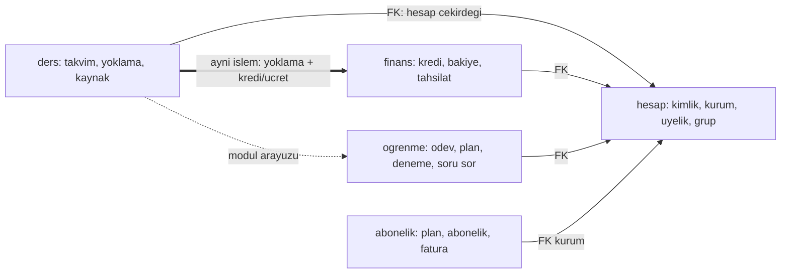
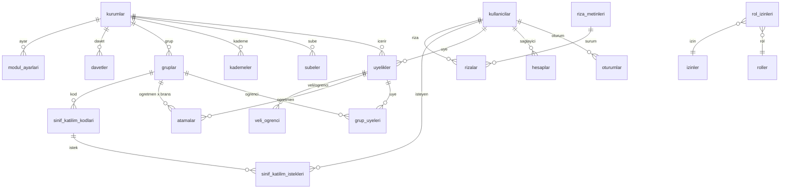
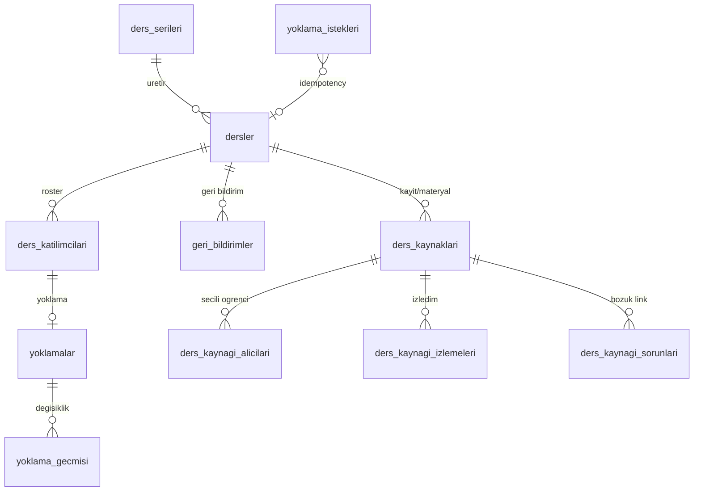
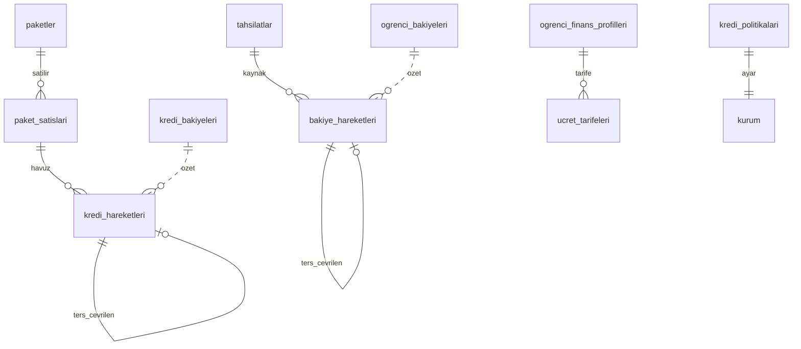
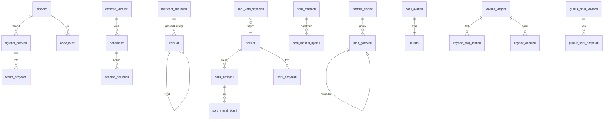
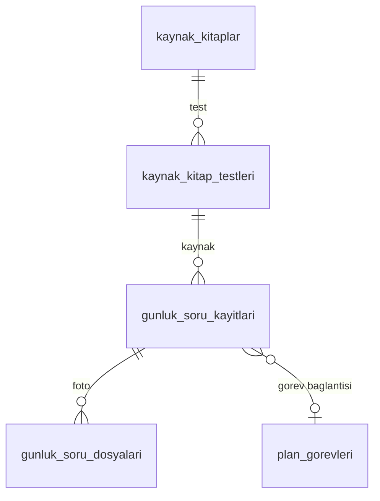
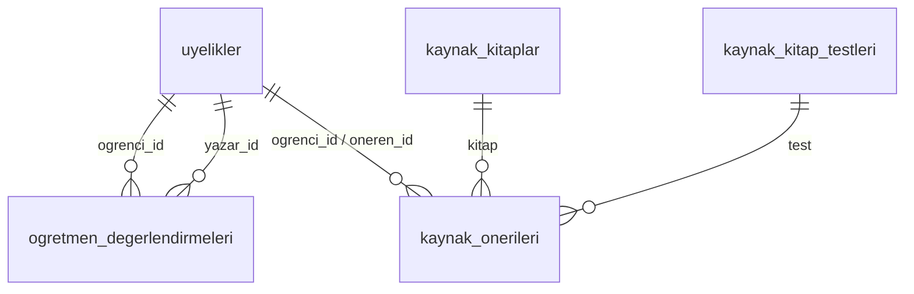
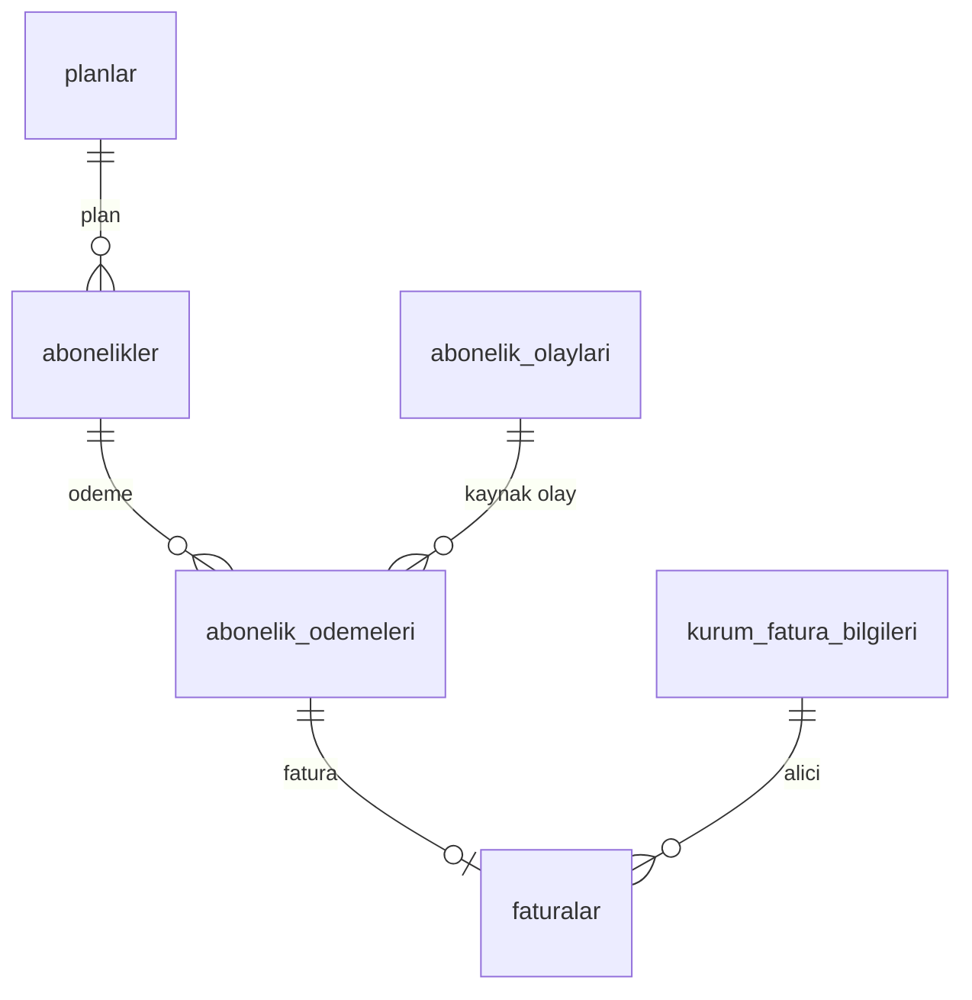

# `api` veritabanı şeması

`api` servisinin PostgreSQL veritabanı. Modüler monolit: her modül ayrı şemadır (`hesap`, `ders`, `finans`, `ogrenme`, `abonelik`) ve ortak yardımcılar `ortak` şemasındadır. Ortak kurallar, profil kodları (`K`, `KS`, `D`, `G`, `GS`), RLS şablonu ve outbox DDL'i [README.md](README.md) içindedir. Olay yükleri [olaylar.md](olaylar.md) içindedir.

Okuma kuralı: Tablo bölümlerinde "Profil" ortak sütunları verir, bu sütunlar sütun tablosunda tekrarlanmaz. "Olaylar" satırı, tablo yazımıyla aynı işlemde outbox'a yazılan olayları listeler.

## İçindekiler

- [Modüller arası ilişki](#modüller-arası-ilişki)
- [`ortak`](#ortak)
- [`hesap`](#hesap)
- [`ders`](#ders)
- [`finans`](#finans)
- [`ogrenme`](#ogrenme)
- [`abonelik`](#abonelik)
- [Çapraz kurallar özeti](#çapraz-kurallar-özeti)

## Modüller arası ilişki



Kural: bir modül başka modülün tablosuna yazmaz. İstisna `ders -> finans`: yoklama işlemi, `finans` modülünün dışa açtığı `krediVeUcretiUygula(tx, yoklama)` fonksiyonunu aynı `tx` ile çağırır. Bu fonksiyon yalnızca `finans` tablolarına yazar.

## `ortak`

### `ortak.bransler`

Ders branşları referans listesi. Tüm modüller `brans_kodu` ile başvurur.

Profil: `G` (RLS: hayır, global referans). PK: `kod`.

| Sütun | Tip | Null | Varsayılan | Not |
| --- | --- | --- | --- | --- |
| `kod` | text | hayır |  | PK. `matematik`, `fizik`, `kimya`, `biyoloji`, `turkce`, `edebiyat`, `tarih`, `cografya`, `felsefe`, `din_kulturu`, `ingilizce`, `fen_bilimleri`, `sosyal_bilgiler`, `geometri`, `inkilap_tarihi`, `almanca`, `diger` |
| `ad` | text | hayır |  | Görünen ad |
| `sira` | smallint | hayır | 100 | |
| `aktif` | boolean | hayır | true | |
| `created_at`, `updated_at` | timestamptz | hayır | now() | `id` yok, PK `kod` |

Kısıtlar: `CHECK (kod ~ '^[a-z_]+$')`. Olaylar: yok (tohum verisi migrasyonla gelir).

### `ortak.medya_dosya_kopyalari`

`medya` servisindeki dosyanın yerel okuma kopyası. Bir dosyayı ödev teslimine ya da soruya bağlamadan önce sahibi, türü ve hazır olduğu doğrulanır.

Profil: `K` eksiği: `id` = medya `dosya_id` (üretici `medya`). RLS: evet (`kurum_id`).

| Sütun | Tip | Null | Varsayılan | Not |
| --- | --- | --- | --- | --- |
| `id` | uuid | hayır | | PK. Medya `dosya_id`. |
| `kurum_id` | uuid | hayır | | |
| `sahip_kullanici_id` | uuid | hayır | | |
| `tur` | text | hayır | | `medya.dosyalar.tur` değeri |
| `durum` | text | hayır | | CHECK `IN ('hazir','islenemedi','silindi')` |
| `mime_tipi` | text | hayır | | |
| `boyut_bayt` | bigint | hayır | | |
| `genislik`, `yukseklik`, `sure_sn` | int | evet | | |
| `kucuk_resim_var` | boolean | hayır | false | |
| `kaynak_olay_id` | uuid | hayır | | Son işlenen olay |
| `created_at`, `updated_at` | timestamptz | hayır | now() | |

İndeks: `(kurum_id, sahip_kullanici_id)`. Tüketilen olaylar: `medya.dosya.hazir.v1` (insert/upsert), `medya.dosya.islenemedi.v1` (`durum`), `medya.dosya.silindi.v1` (`durum='silindi'`). Yarış: ilgili olay henüz gelmemişse bağlama isteği `409 dosya_hazir_degil` döner, istemci yeniden dener.

## `hesap`

Kimlik, kurum yapısı, üyelik, yetki ve ayarlar.



Kavramlar: kullanıcı global kimliktir. Kiracı verisi `uyelik`e bağlanır. `ogrenci_id`, `ogretmen_id`, `veli_id`, `yonetici_id` sütunlarının hepsi `hesap.uyelikler.id` değeridir.

### Kimlik tabloları (Better Auth eşlemesi)

> **Uygulama notları (`feat/hesap-kimlik`).** Aşağıdaki tasarımdan bilinçli sapmalar:
> - `oturumlar`: Better Auth belirteci düz saklar; `belirtec_hash bytea` yerine `belirtec text UNIQUE` kullanılır. İstemciye giden değer Better Auth sırrıyla imzalıdır, veritabanı sızıntısı tek başına oturum açmaya yetmez.
> - `hesaplar`: `saglayici` değerlerine Better Auth'un e-posta/parola sabiti `credential` eklendi; belirteç sütunları `text` (OAuth belirteçleri Better Auth tarafından şifrelenir), `parola_hash` eklendi.
> - `dogrulamalar`: Better Auth'un `identifier/value/expiresAt` yapısı (`tanimlayici`, `deger`, `expires_at`) kullanılır; `kod_hash/amac/deneme_sayisi` yoktur (deneme sayısı ve süre `deger` içinde, 5 dakika / 5 deneme). Telefon başına saatlik OTP sınırı için `hesap.otp_istekleri` tablosu eklendi.
> - `kullanicilar`: Better Auth `image` alanı için `avatar_url`; `eposta_dogrulandi_at` / `telefon_dogrulandi_at` Better Auth'a boolean olarak görünür. Telefonla kayıtta geçici e-posta (`...@telefon.invalid`) veritabanına yazılmaz (`eposta` NULL kalır).
> - Oturum iptali (`feat/guvenlik-sid-iptal`): Better Auth çıkışta `oturumlar` satırını **siler**; `iptal_at` doldurulmaz. Erişim belirteci iptali tabloda değil NATS KV `iptal` kovasında tutulur ([ADR 0008](../adr/0008-erisim-belirteci-iptali-sid-listesi.md)).
> - E-posta doğrulama: `kullanicilar.eposta_dogrulandi_at` doğrulama bağlantısıyla (`GET /auth/eposta/dogrula`) dolar; giriş doğrulamaya zorlanmaz. `GET /v1/hesap/ben` `eposta_dogrulandi` döner.
> - `jwks`: Better Auth `jwt` eklentisi yerine access JWT'yi api kendisi üretir (claim seti ve kurum/üyelik seçimi gerektiği için); anahtarlar bu tabloda, `id` = `kid`. Özel anahtar `BETTER_AUTH_SECRET`'tan HKDF ile türetilen anahtarla AES-256-GCM şifreli.
> - `rizalar.kurum_id` NULL olabilir (hesap düzeyi rıza: ilk girişte henüz kurum yoktur). Politika: kullanıcı kendi kayıtlarını görür/ekler; kurum kayıtlarını ayrıca kurum bağlamı görür.
> - `uyelikler` ve `kurumlar` RLS: kullanıcı kolu yalnızca `SELECT` içindir (yazma yalnızca kurum bağlamında).
> - `davet_coz` / `katilim_kodu_coz`: `FORCE RLS` sahibi de kapsadığı için tablolara yalnızca `api_owner` rolü için `SELECT` politikası eklendi; fonksiyonlar `api_owner` sahipliğinde `SECURITY DEFINER`'dır (api_app bu politikadan yararlanamaz).
> - Kurum `tur` değerleri `bireysel`, `ekip`, `kurum` (ürün dilindeki "butik" = `ekip`). `ayarlar` jsonb'ye `vurgu_rengi` ve `logo_url` eklendi (medya servisi gelene kadar logo adresi).
> - Rıza hata kodu `riza_gerekli` (ADR 0006 alan hata kodu kuralı).
> - Olaylar: mevcut `@kopru/contracts` zarfı (`kurumId`, `type`, `version`) kullanılır; `hesap.kullanici.*` olayları zarf kullanıcı düzeyini desteklemediği için henüz yayımlanmaz. Outbox tablosu service-kit şablonudur (`ortak.outbox`: `subject`, `payload`, `sent_at`).

Better Auth tabloları [ADR 0004](../adr/0004-kimlik-dogrulama-ve-yetkilendirme.md) uyarınca bu adlarla eşlenir. Better Auth'ın kendi zorunlu sütunları (ör. `emailVerified`, `createdAt`) `fields` yapılandırmasıyla aşağıdaki sütunlara bağlanır. Aşağıdaki liste Better Auth sütunlarının üst kümesidir.

#### `hesap.kullanicilar`

Global kullanıcı kimliği (Better Auth `user`). Bir kişi tek satırdır, birden çok kurumda üye olabilir.

Profil: `GS`. RLS: hayır (giriş öncesi sorgulanır; erişim yalnızca `AuthRepository` ve `KullaniciRepository` üzerinden).

| Sütun | Tip | Null | Varsayılan | Not |
| --- | --- | --- | --- | --- |
| `ad` | text | evet | | |
| `soyad` | text | evet | | |
| `gorunen_ad` | text | evet | | Listelerde gösterilen ad |
| `ad_arama` | text | evet | | Küçük harf, Türkçe karakter normalleştirilmiş (`i/ı` tek biçim) |
| `telefon_e164` | text | evet | | `+905xxxxxxxxx`. OTP girişi. |
| `telefon_dogrulandi_at` | timestamptz | evet | | |
| `eposta` | citext | evet | | |
| `eposta_dogrulandi_at` | timestamptz | evet | | |
| `avatar_dosya_id` | uuid | evet | | Medya `dosya_id` |
| `dil` | text | hayır | `'tr'` | |
| `saat_dilimi` | text | hayır | `'Europe/Istanbul'` | |
| `durum` | text | hayır | `'aktif'` | CHECK `IN ('aktif','askida','silindi')` |
| `platform_rolu` | text | hayır | `'yok'` | CHECK `IN ('yok','destek','yonetici')` |
| `son_giris_at` | timestamptz | evet | | |
| `anonimlestirildi_at` | timestamptz | evet | | |

Kısıtlar: `UNIQUE (telefon_e164)` ve `UNIQUE (eposta)` (NULL'lar serbest). `CHECK (telefon_e164 ~ '^\+[1-9][0-9]{7,14}$')`. `CHECK (telefon_e164 IS NOT NULL OR eposta IS NOT NULL OR durum = 'silindi')`. İndeks: `ad_arama gin_trgm_ops`.
Olaylar: `hesap.kullanici.degisti.v1` (oluşturma ve güncelleme), `hesap.kullanici.silindi.v1` (anonimleştirme). Olay yükü yalnızca `kullanici_id`, `dil`, `durum` taşır. Telefon/e-posta/ad `GET /ic/kullanicilar/:id/iletisim` iç uç noktasıyla (yalnızca `scope=iletisim.oku` servis JWT'si, çağrı denetim günlüğüne yazılır) `bildirim`e verilir.

#### `hesap.oturumlar`

Better Auth `session`. Yenileme belirteci oturumu.

Profil: `G`. RLS: hayır.

| Sütun | Tip | Null | Varsayılan | Not |
| --- | --- | --- | --- | --- |
| `kullanici_id` | uuid | hayır | | FK `kullanicilar(id)` ON DELETE CASCADE |
| `belirtec_hash` | bytea | hayır | | SHA-256. Düz belirteç saklanmaz. |
| `etkin_kurum_id` | uuid | evet | | Son seçilen kurum |
| `etkin_uyelik_id` | uuid | evet | | |
| `ip` | inet | evet | | |
| `user_agent` | text | evet | | |
| `cihaz_adi` | text | evet | | |
| `expires_at` | timestamptz | hayır | | Kayan, 30 gün |
| `son_kullanim_at` | timestamptz | hayır | now() | |
| `iptal_at` | timestamptz | evet | | |
| `taklit_kayit_id` | uuid | evet | | Taklit oturumu ise `taklit_kayitlari.id` |
| `ikinci_adim_at` | timestamptz | evet | | Platform kullanıcısının bu oturumda iki adımlı doğrulamayı tamamladığı an (0016); `/platform/*` her istekte bakar |

Kısıtlar: `UNIQUE (belirtec_hash)`. İndeks: `(kullanici_id, iptal_at)`, `(expires_at)` (temizlik). Olaylar: yok.

#### `hesap.hesaplar`

Better Auth `account`: sosyal giriş ve telefon bağlantıları.

Profil: `G`. RLS: hayır.

| Sütun | Tip | Null | Varsayılan | Not |
| --- | --- | --- | --- | --- |
| `kullanici_id` | uuid | hayır | | FK `kullanicilar(id)` ON DELETE CASCADE |
| `saglayici` | text | hayır | | CHECK `IN ('apple','google','telefon')` |
| `saglayici_hesap_id` | text | hayır | | Apple/Google `sub`, telefonda E.164 |
| `erisim_belirteci_sifreli` | bytea | evet | | Uygulama düzeyinde AES-256-GCM, gerekmedikçe boş |

Kısıtlar: `UNIQUE (saglayici, saglayici_hesap_id)`. İndeks: `(kullanici_id)`.

#### `hesap.dogrulamalar`

Better Auth `verification`: OTP ve e-posta doğrulama kodları.

Profil: `G`. RLS: hayır.

| Sütun | Tip | Null | Varsayılan | Not |
| --- | --- | --- | --- | --- |
| `tanimlayici` | text | hayır | | Telefon veya e-posta |
| `kod_hash` | bytea | hayır | | HMAC-SHA-256 (sunucu sırrıyla) |
| `amac` | text | hayır | | CHECK `IN ('giris_otp','telefon_dogrula','eposta_dogrula')` |
| `deneme_sayisi` | smallint | hayır | 0 | CHECK `<= 5` |
| `expires_at` | timestamptz | hayır | | 5 dakika |
| `kullanildi_at` | timestamptz | evet | | |

İndeks: `(tanimlayici, amac, created_at DESC)`. Süresi dolanlar saatlik işle silinir.

#### `hesap.jwks`

JWT imza anahtarları (Better Auth `jwks`).

Profil: `G`. RLS: hayır. Sütunlar: `acik_anahtar text NOT NULL` (JWK JSON), `ozel_anahtar_sifreli bytea NOT NULL` (AES-256-GCM, anahtar ortam sırrında), `algoritma text NOT NULL DEFAULT 'EdDSA'`, `expires_at timestamptz NULL`. Döndürme: 90 gün ([ADR 0004](../adr/0004-kimlik-dogrulama-ve-yetkilendirme.md)).

### Kurum yapısı

#### `hesap.kurumlar`

Kiracı kökü. `id`, diğer tüm tablolardaki `kurum_id`dir.

Profil: `GS` (`kurum_id` sütunu yok, `id` kiracıdır). RLS: evet, `id = ortak.aktif_kurum()`. Yeni kurum oluşturma `withSistem` ile yapılır (kiracı henüz yoktur).

| Sütun | Tip | Null | Varsayılan | Not |
| --- | --- | --- | --- | --- |
| `ad` | text | hayır | | |
| `tur` | text | hayır | | CHECK `IN ('bireysel','ekip','kurum')` |
| `kisa_ad` | citext | evet | | URL dostu, `UNIQUE` |
| `vergi_no` | text | evet | | |
| `telefon_e164`, `eposta` | text | evet | | |
| `adres` | jsonb | evet | | `{il, ilce, acik_adres, posta_kodu}` |
| `logo_dosya_id` | uuid | evet | | |
| `saat_dilimi` | text | hayır | `'Europe/Istanbul'` | |
| `durum` | text | hayır | `'aktif'` | CHECK `IN ('aktif','askida','kapali')`. `askida` iki sebepten olabilir: abonelik askısı (salt okunur, `402 abonelik_gerekli`) ya da platform askısı (`platform_askida_at` dolu; kurum kullanıcıları `403 kurum_askida`). |
| `ayarlar` | jsonb | hayır | `'{}'` | Zod ile doğrulanır: `sessiz_saat_varsayilan`, `ders_hatirlatma_dk`, `yoklama_kilit_gun` |
| `olusturan_kullanici_id` | uuid | hayır | | FK `kullanicilar(id)` |
| `kapatildi_at` | timestamptz | evet | | |
| `platform_askida_at` | timestamptz | evet | | Platform yöneticisi kurumu elle askıya aldığı an (0018). Doluysa abonelik işi (ödeme, aktivasyon) kurumu `aktif`e çeviremez; yalnız `POST /platform/kurumlar/:id/ac` kaldırır |
| `platform_aski_nedeni` | text | evet | | Zorunlu neden; CHECK `(platform_askida_at IS NULL) = (platform_aski_nedeni IS NULL)` |

Olaylar: `hesap.kurum.degisti.v1`. Not: `kurum_id` sütunu olmadığı için olay zarfında `kurum_id = id`.

#### `hesap.subeler`

Profil: `KS`. RLS: evet. Sütunlar: `ad text NOT NULL`, `adres jsonb NULL`, `telefon_e164 text NULL`, `arsivlendi_at timestamptz NULL`. Tekillik: `UNIQUE (kurum_id, ad) WHERE arsivlendi_at IS NULL`. `UNIQUE (kurum_id, id)` (bileşik FK hedefi). Olaylar: yok (şube kopyası gerekmez; üyelik olayında `sube_id` taşınır).

#### `hesap.kademeler`

Sınıf düzeyi. Bireysel öğretmenlerde isteğe bağlıdır.

Profil: `KS`. RLS: evet.

| Sütun | Tip | Null | Varsayılan | Not |
| --- | --- | --- | --- | --- |
| `ad` | text | hayır | | Ör. `8. Sınıf`, `Mezun` |
| `seviye` | smallint | evet | | 1-12 sınıf, 13 = mezun. Müfredat önerisi için. |
| `sira` | smallint | hayır | 100 | |
| `arsivlendi_at` | timestamptz | evet | | |

Kısıtlar: `UNIQUE (kurum_id, ad) WHERE arsivlendi_at IS NULL`, `UNIQUE (kurum_id, id)`, `CHECK (seviye BETWEEN 1 AND 13)`. Olaylar: `hesap.kademe.degisti.v1`.

#### `hesap.uyelikler`

Kullanıcının kurumdaki rolü. Rol ve kapsam kaynağı.

Profil: `KS`. RLS: evet, iki kollu (kurum VEYA kendi kullanıcısı; giriş sonrası kurum listesi için).

| Sütun | Tip | Null | Varsayılan | Not |
| --- | --- | --- | --- | --- |
| `kullanici_id` | uuid | hayır | | FK `kullanicilar(id)` |
| `rol` | text | hayır | | CHECK `IN ('sahip','yonetici','ogretmen','ogrenci','veli')` |
| `durum` | text | hayır | `'aktif'` | CHECK `IN ('davetli','aktif','askida','ayrildi')` |
| `sube_id` | uuid | evet | | Bileşik FK `(kurum_id, sube_id)`. Doluysa yönetici/öğretmen kapsamı `sube`. |
| `kademe_id` | uuid | evet | | Bileşik FK. Öğrenci kademesi. |
| `ogrenci_no` | text | evet | | |
| `gorunen_ad` | text | evet | | Kuruma özel ad (yoksa kullanıcının adı) |
| `katildi_at` | timestamptz | evet | | |
| `ayrildi_at` | timestamptz | evet | | |

Kısıtlar: `UNIQUE (kurum_id, kullanici_id, rol)` (bir kullanıcı aynı kurumda farklı rollerle birden fazla üyelik taşıyabilir). `UNIQUE (kurum_id, id)`. `CHECK (kademe_id IS NULL OR rol = 'ogrenci')`. `CHECK (durum <> 'ayrildi' OR ayrildi_at IS NOT NULL)`. Kurumun en az bir etkin `sahip` üyeliği olmalıdır: uygulama doğrular ve ertelenmiş kısıt tetikleyicisi (`uyelikler_sahip_var_trg`) son sahibin ayrılmasını reddeder.
İndeks: `(kullanici_id)`, `(kurum_id, rol, durum)`, `(kurum_id, kademe_id) WHERE rol = 'ogrenci'`, `(kurum_id, sube_id)`.
Olaylar: `hesap.uyelik.degisti.v1` (oluşturma, rol/durum/kademe değişimi, ayrılma).

#### `hesap.veli_ogrenci`

Veli-öğrenci bağlantısı. Rol veri modelinde vardır, Faz 1'de arayüz yoktur.

Profil: `K`. RLS: evet. Sütunlar: `veli_id uuid NOT NULL`, `ogrenci_id uuid NOT NULL` (ikisi de bileşik FK `uyelikler`), `yakinlik text NULL` (`anne`, `baba`, `vasi`, `diger`), `birincil boolean NOT NULL DEFAULT false`, `onaylandi_at timestamptz NULL`. Kısıtlar: `UNIQUE (veli_id, ogrenci_id)`, `CHECK (veli_id <> ogrenci_id)`. Rol denetimi tetikleyicide: `veli_id` rolü `veli`, `ogrenci_id` rolü `ogrenci` olmalı (`veli_ogrenci_rol_trg`). İndeks: `(ogrenci_id)`. Olaylar: yok (Faz 1).

#### `hesap.gruplar`

Ders gruplarının tümü: birebir, grup, sınıf, etüt.

Profil: `KS`. RLS: evet.

| Sütun | Tip | Null | Varsayılan | Not |
| --- | --- | --- | --- | --- |
| `tur` | text | hayır | | CHECK `IN ('birebir','grup','sinif','etut')` |
| `ad` | text | hayır | | |
| `sube_id` | uuid | evet | | Bileşik FK |
| `kademe_id` | uuid | evet | | Bileşik FK. Modül ayarı çözümünde kullanılır. |
| `kapasite` | smallint | evet | | `birebir` için 1 |
| `renk` | text | evet | | `#RRGGBB` |
| `durum` | text | hayır | `'aktif'` | CHECK `IN ('aktif','arsiv')` |
| `arsivlendi_at` | timestamptz | evet | | |

Kısıtlar: `UNIQUE (kurum_id, id)`. `CHECK (tur <> 'birebir' OR kapasite = 1)`. `CHECK (kapasite IS NULL OR kapasite > 0)`. `CHECK ((durum = 'arsiv') = (arsivlendi_at IS NOT NULL))`. Kapasite aşımı `grup_uyeleri` yazımında uygulama + `SELECT ... FOR UPDATE` ile doğrulanır (bkz. `grup_uyeleri`).
İndeks: `(kurum_id, tur, durum)`, `(kurum_id, kademe_id)`, `(kurum_id, sube_id)`.
Olaylar: `hesap.grup.degisti.v1`. Kapsam süzgeci: `kurum` hepsi, `sube` aynı `sube_id`, `grup` (öğretmen) etkin ataması olan gruplar, `kendi` (öğrenci) etkin üyesi olduğu gruplar.

#### `hesap.grup_uyeleri`

Grubun öğrenci üyeleri (zaman aralıklı).

Profil: `KS`. RLS: evet.

| Sütun | Tip | Null | Varsayılan | Not |
| --- | --- | --- | --- | --- |
| `grup_id` | uuid | hayır | | Bileşik FK `gruplar` |
| `ogrenci_id` | uuid | hayır | | Bileşik FK `uyelikler`; rol `ogrenci` (tetikleyici) |
| `baslangic_tarihi` | date | hayır | `current_date` | |
| `bitis_tarihi` | date | evet | | Dolu = çıkarıldı |
| `katilim_yolu` | text | hayır | `'yonetici'` | CHECK `IN ('yonetici','davet','sinif_kodu')` |

Kısıtlar: `UNIQUE (grup_id, ogrenci_id) WHERE bitis_tarihi IS NULL` (aynı anda tek etkin üyelik). `CHECK (bitis_tarihi IS NULL OR bitis_tarihi >= baslangic_tarihi)`. Kapasite: ekleme işlemi önce `gruplar` satırını kilitler (`FOR UPDATE`), etkin üye sayısını sayar. İndeks: `(kurum_id, grup_id) WHERE bitis_tarihi IS NULL`, `(kurum_id, ogrenci_id) WHERE bitis_tarihi IS NULL`.
Olaylar: `hesap.grup_uyesi.degisti.v1`. Yan etki: yeni etkin üye için açık ödevlerin fan-out'u (`ogrenme` iç işleyicisi, aynı işlemde).

#### `hesap.atamalar`

Öğretmen x grup x branş ataması.

Profil: `KS`. RLS: evet.

| Sütun | Tip | Null | Varsayılan | Not |
| --- | --- | --- | --- | --- |
| `grup_id` | uuid | hayır | | Bileşik FK |
| `ogretmen_id` | uuid | hayır | | Bileşik FK `uyelikler`; rol `ogretmen` (tetikleyici) |
| `brans_kodu` | text | hayır | | FK `ortak.bransler(kod)` |
| `baslangic_tarihi` | date | hayır | `current_date` | |
| `bitis_tarihi` | date | evet | | |
| `ana_ogretmen` | boolean | hayır | false | Soru sor yönlendirmesinde öncelik |

Kısıtlar: `UNIQUE (grup_id, ogretmen_id, brans_kodu) WHERE bitis_tarihi IS NULL`. `CHECK (bitis_tarihi IS NULL OR bitis_tarihi >= baslangic_tarihi)`. Bir `(grup_id, brans_kodu)` için en çok bir `ana_ogretmen`: `UNIQUE (grup_id, brans_kodu) WHERE ana_ogretmen AND bitis_tarihi IS NULL`. İndeks: `(kurum_id, ogretmen_id) WHERE bitis_tarihi IS NULL`, `(kurum_id, grup_id)`.
Olaylar: `hesap.atama.degisti.v1`.

#### `hesap.davetler`

Davet bağlantısı ve SMS davetleri. **Düz belirteç saklanmaz.**

Profil: `KS`. RLS: evet. Belirteçten kiracı bulma: `hesap.davet_coz(token_hash bytea)` (`SECURITY DEFINER`) yalnızca `kurum_id, davet_id, durum, expires_at` döner.

| Sütun | Tip | Null | Varsayılan | Not |
| --- | --- | --- | --- | --- |
| `kanal` | text | hayır | | CHECK `IN ('baglanti','sms','eposta')` (`eposta` migration 0004 ile eklendi) |
| `rol` | text | hayır | | CHECK `IN ('yonetici','ogretmen','ogrenci','veli')` (sahip davet edilmez) |
| `belirtec_hash` | bytea | hayır | | SHA-256(32 bayt rastgele belirteç). UNIQUE. Belirteç yalnızca oluşturma yanıtında ve SMS'te görünür. |
| `hedef_telefon_e164` | text | evet | | `kanal='sms'` ise zorunlu |
| `hedef_eposta` | citext | evet | | `kanal='eposta'` ise zorunlu (migration 0004) |
| `hedef_ad` | text | evet | | |
| `grup_id`, `kademe_id`, `sube_id` | uuid | evet | | Katılımda atanacak bağlam (bileşik FK) |
| `davet_eden_id` | uuid | hayır | | `uyelikler` |
| `max_kullanim` | int | hayır | 1 | `baglanti` kanalında çok kullanımlı olabilir (en çok 100) |
| `kullanim_sayisi` | int | hayır | 0 | |
| `durum` | text | hayır | `'bekliyor'` | CHECK `IN ('bekliyor','kullanildi','iptal','suresi_doldu')` |
| `expires_at` | timestamptz | hayır | | Varsayılan 7 gün |
| `sms_gonderim_sayisi` | smallint | hayır | 0 | CHECK `<= 3`. SMS ve e-posta kanallarında ortak gönderim sayacıdır (ilk gönderim dahil). |
| `son_sms_at` | timestamptz | evet | | |
| `kabul_eden_kullanici_id` | uuid | evet | | Son kabul eden |

Kısıtlar: `UNIQUE (belirtec_hash)`. `CHECK (kullanim_sayisi <= max_kullanim)`. `CHECK (kanal <> 'sms' OR hedef_telefon_e164 IS NOT NULL)`. `CHECK (kanal <> 'eposta' OR hedef_eposta IS NOT NULL)`. `CHECK (max_kullanim BETWEEN 1 AND 100)`. Kabul işlemi `UPDATE ... SET kullanim_sayisi = kullanim_sayisi + 1 WHERE durum='bekliyor' AND expires_at > now() AND kullanim_sayisi < max_kullanim` ile atomik yapılır. Etkilenen satır 0 ise `410 davet_gecersiz`. İndeks: `(kurum_id, durum, expires_at)`.
Olaylar: `hesap.davet.kabul_edildi.v1`. Davet SMS'i/e-postası olay değil, `bildirim` iç çağrısıdır; `bildirim` gelene kadar `SmsGonderici` ve `EpostaGonderici` arayüzleri log uygulamasıyla çalışır (e-posta logunda yalnızca `davet_id`).

Uygulama kuralları:

- Durum `suresi_doldu` okumada türetilir: `durum='bekliyor' AND expires_at <= now()` olan kayıt yanıtlarda ve `durum` süzgecinde `suresi_doldu` sayılır. Periyodik durum güncellemesi yoktur (worker'da iş tanımlı değil); kabul zaten `expires_at > now()` ile korunur.
- Yeniden gönderme düz belirteç saklanmadığı için **yeni belirteç üretir** (`belirtec_hash` değişir, eski bağlantı geçersizleşir), `expires_at` 7 gün uzar, sayaç artar; 4. gönderim `429 gonderim_siniri_asildi`. `baglanti` kanalı yeniden gönderilemez (`422`).
- Tek kullanımlık (`max_kullanim=1`) kanallar `sms` ve `eposta`; çok kullanımlı yalnız `baglanti`. `grup_id`/`kademe_id` yalnız `rol='ogrenci'` davetinde verilebilir; kabulde öğrenci gruba `katilim_yolu='davet'` ile eklenir. Faz 1'de `veli` davet edilmez.
- Bireysel kurumda `grup_id`'siz öğrenci daveti kabul edilince öğrenciye otomatik `birebir` grup açılır (ad sabit: "Birebir ders"; olay yükünde kişisel ad olmasın diye).
- Yetki: `davet.yaz`. `yonetici` davet etmek ayrıca `rol.yonet` (yalnız sahip) ister. Öğretmen (`grup` kapsamı) yalnız atandığı gruba öğrenci davet eder; davet listesi/iptal/yeniden gönderme yalnız atandığı gruplara bağlı davetleri görür (kapsam dışı: 404).

#### `hesap.sinif_katilim_kodlari`

Sınıf (`gruplar.tur='sinif'`) için öğrenci katılım kodu. Düşük entropili kısa koddur, bu yüzden hız sınırı, süre ve yenileme vardır.

Profil: `KS`. RLS: evet. Kod çözme: `hesap.katilim_kodu_coz(kod text)` (`SECURITY DEFINER`, hız sınırı uygulamada) yalnız `kurum_id, grup_id, kod_id` döner; pasif, süresi dolmuş, kullanımı dolu ve bulunamayan kod aynı biçimde boş döner (varlık sızmaz).

| Sütun | Tip | Null | Varsayılan | Not |
| --- | --- | --- | --- | --- |
| `grup_id` | uuid | hayır | | Bileşik FK |
| `kod` | text | hayır | | 8 karakter, Crockford base32 büyük harf, `0O1IL` hariç. Global `UNIQUE`. |
| `aktif` | boolean | hayır | true | |
| `expires_at` | timestamptz | evet | | |
| `max_kullanim` | int | evet | | NULL = sınırsız |
| `kullanim_sayisi` | int | hayır | 0 | |
| `iptal_at` | timestamptz | evet | | |

Kısıtlar: `UNIQUE (kod)`, `UNIQUE (kurum_id, id)` (isteklerin bileşik FK'si için). Bir grup için tek etkin kod: `UNIQUE (grup_id) WHERE aktif`. Yenileme eski kodu `aktif=false` yapar. `grup_id` türü `sinif` olmalıdır (tetikleyici `sinif_katilim_kodlari_tur_trg`). Kod çözme hız sınırı: IP başına dakikada 10, başarısız çözüm 5'te 15 dakika bekleme (IP ve kullanıcı anahtarlı, süreç belleğinde sayılır; ilk sürümde çok kopyalı çalışmada her kopya kendi sayacını tutar).
Olaylar: yok. Öğretmen onayından sonra katılım `grup_uyeleri` yazımıyla (`katilim_yolu='sinif_kodu'`) olay üretir.

**Karar (8 Kasım 2026).** Kod 8 karakterdir ve katılım **öğretmen onaylıdır**: öğrenci kodu girince `sinif_katilim_istekleri`ne bekleyen istek yazılır; sahip/yönetici ya da gruba atanmış öğretmen onaylar (öğrenci gruba `katilim_yolu='sinif_kodu'` ile eklenir) ya da reddeder (eklenmez). `kullanim_sayisi` onayda artar; `max_kullanim` hem katılımda (kod çözme) hem onayda denetlenir (onayda dolmuşsa `409 kod_kullanim_doldu`). Kod kapatılsa ya da yenilense de bekleyen istekler korunur ve onaylanabilir; yeni istek yalnız etkin koda yapılır.

#### `hesap.sinif_katilim_istekleri`

Sınıf koduyla gelen, onay bekleyen/karara bağlanmış katılım istekleri.

Profil: `KS`. RLS: evet (`kiraci_izolasyonu`) + kullanıcı düzeyi iki politika: `kendi_istekleri_okuma` (SELECT, `kullanici_id = aktif_kullanici()`) ve `kendi_istekleri_iptal` (UPDATE; yalnız `bekliyor -> iptal`). Kullanıcı henüz hiçbir kurumun üyesi değilken kendi isteklerini bu politikalarla görür ve iptal eder.

| Sütun | Tip | Null | Varsayılan | Not |
| --- | --- | --- | --- | --- |
| `grup_id` | uuid | hayır | | Bileşik FK `gruplar` |
| `kod_id` | uuid | hayır | | Bileşik FK `sinif_katilim_kodlari` (isteğin geldiği kod) |
| `kullanici_id` | uuid | hayır | | FK `kullanicilar` (üyelik henüz olmayabilir) |
| `durum` | text | hayır | `'bekliyor'` | CHECK `IN ('bekliyor','onaylandi','reddedildi','iptal')` |
| `karar_veren_id` | uuid | evet | | Bileşik FK `uyelikler` (onaylayan/reddeden) |
| `karar_at` | timestamptz | evet | | |

Kısıtlar: `UNIQUE (grup_id, kullanici_id) WHERE durum = 'bekliyor'` (grup başına tek bekleyen istek). `CHECK`: `onaylandi/reddedildi` iken `karar_veren_id` ve `karar_at` dolu, `bekliyor/iptal` iken boş. İndeks: `(kurum_id, grup_id, durum, id)`, `(kullanici_id, durum)`.
Olaylar: yok. Onay, aynı işlemde `ogrenci` üyeliği (yoksa; `hesap.uyelik.degisti`) ve `grup_uyeleri` satırı (`hesap.grup_uyesi.degisti`) üretir; olaylar kişisel veri taşımaz. Onay ve ret `hesap.denetim_kayitlari`na yazılır (`hesap.sinif_katilim_onayla|reddet`), kod yönetimi de (`hesap.sinif_kodu_olustur|kapat`).

#### `hesap.modul_ayarlari`

Modül açık/kapalı ayarları. Öncelik **kurum > kademe > grup** ve alt düzey yalnızca daraltır ([ADR 0004](../adr/0004-kimlik-dogrulama-ve-yetkilendirme.md#modül-açıkkapalı-önceliği)).

Profil: `KS`. RLS: evet.

| Sütun | Tip | Null | Varsayılan | Not |
| --- | --- | --- | --- | --- |
| `modul_kodu` | text | hayır | | CHECK `IN ('takvim','yoklama','geri_bildirim','kayitlar','finans','odev','haftalik_plan','deneme','soru_sor','oyunlastirma','duyuru')` |
| `kapsam` | text | hayır | | CHECK `IN ('kurum','kademe','grup')` |
| `kapsam_id` | uuid | hayır | | `kurum` ise `kurum_id`, `kademe` ise `kademeler.id`, `grup` ise `gruplar.id` |
| `acik` | boolean | hayır | | |
| `degistiren_id` | uuid | evet | | |

Kısıtlar: `UNIQUE (kurum_id, modul_kodu, kapsam, kapsam_id)`. `CHECK (kapsam <> 'kurum' OR kapsam_id = kurum_id)`. Kayıt yok = miras. "Mirasa dön" satırı siler (olay `acik=null` taşır). Alt düzey `acik=true` satırı, üst düzey kapalıyken API tarafında `422 ust_duzey_kapali` ile reddedilir. Çekirdek modüller (hesap, bildirim gelen kutusu, medya) kapatılamaz ve listede yoktur. Plan hakkı olmayan modül açılamaz.

Çözümleme fonksiyonu `hesap.modul_acik_mi(kurum uuid, modul text, kademe uuid, grup uuid) RETURNS boolean`:

```sql
-- sözde kod: etkin = plan_hakki AND kurum_acik AND kademe_acik AND grup_acik
-- her düzey için: satır yoksa true, varsa acik değeri
SELECT coalesce(bool_and(coalesce(acik, true)), true) AND :plan_hakki
FROM (VALUES ('kurum', :kurum), ('kademe', :kademe), ('grup', :grup)) AS d(kapsam, kid)
LEFT JOIN hesap.modul_ayarlari m
  ON m.kurum_id = :kurum AND m.modul_kodu = :modul
 AND m.kapsam = d.kapsam AND m.kapsam_id = d.kid
WHERE d.kid IS NOT NULL;
```

İndeks: `(kurum_id, modul_kodu)`. Olaylar: `hesap.modul_ayari.degisti.v1`. Platform yöneticisi kurum düzeyinde `PUT /platform/kurumlar/:id/moduller/:kod` ile açıp kapatabilir; aynı işlemde aynı olay yayımlanır (`actor` platform kullanıcısıdır, olay yükünde kişisel veri yoktur) ve denetim satırı `platform.modul_ayarla` yazılır.

### Rol ve izin sözlüğü

Global tohum tabloları. Faz 1'de özel rol yoktur. RLS: hayır. `packages/izinler` bu tablolardan üretilir.

- `hesap.roller` (`G`): `kod text UNIQUE` (`sahip`,`yonetici`,`ogretmen`,`ogrenci`,`veli`), `ad text`, `sistem boolean DEFAULT true`.
- `hesap.izinler` (`G`): `kod text UNIQUE` (`yoklama.yaz`, `odev.ver`, ...), `modul_kodu text NULL`, `aciklama text`.
- `hesap.rol_izinleri` (`G`): `rol_kodu text` FK `roller(kod)`, `izin_kodu text` FK `izinler(kod)`, `kapsam text CHECK IN ('kendi','grup','sube','kurum')`. `UNIQUE (rol_kodu, izin_kodu)`. Tek kapsam satırı; en geniş kapsam yazılır, dar kapsamlar ondan türer.

Olaylar: yok. Değişiklik `pv` sürümünü artırır.

### Rıza (KVKK)

#### `hesap.riza_metinleri`

Sürümlü KVKK metinleri. Yayınlanmış sürüm değiştirilemez; düzeltme yeni sürümdür.

Profil: `G`. RLS: hayır (herkese açık içerik).

| Sütun | Tip | Null | Varsayılan | Not |
| --- | --- | --- | --- | --- |
| `tur` | text | hayır | | CHECK `IN ('kvkk_aydinlatma','acik_riza','kullanim_kosullari','veli_onayi')` |
| `surum` | text | hayır | | Ör. `2026-11-01`. Artan sırada sözlüksel sıralanır. |
| `dil` | text | hayır | `'tr'` | |
| `baslik` | text | hayır | | |
| `govde_markdown` | text | hayır | | |
| `govde_sha256` | bytea | hayır | | Yayında hesaplanır; rıza kaydında kanıt |
| `rol_kapsami` | text[] | hayır | `'{ogrenci,ogretmen,yonetici,sahip,veli}'` | Hangi roller onaylamalı |
| `gecerli_baslangic_at` | timestamptz | hayır | | |
| `yayinlandi_at` | timestamptz | evet | | Dolu olunca değiştirilemez (tetikleyici) |

Kısıtlar: `UNIQUE (tur, surum, dil)`. Güncel sürüm: aynı `tur` için `yayinlandi_at <= now()` ve `gecerli_baslangic_at <= now()` olan en yüksek `surum`. İndeks: `(tur, dil, gecerli_baslangic_at DESC)`.

#### `hesap.rizalar`

Rıza kararları. Yalnızca ekleme.

Profil: `D`. RLS: evet, iki kollu (`kurum_id = aktif_kurum() OR kullanici_id = aktif_kullanici()`).

| Sütun | Tip | Null | Varsayılan | Not |
| --- | --- | --- | --- | --- |
| `kullanici_id` | uuid | hayır | | FK `kullanicilar(id)` |
| `riza_metni_id` | uuid | hayır | | FK `riza_metinleri(id)` |
| `karar` | text | hayır | | CHECK `IN ('kabul','ret','geri_cekildi')` |
| `veli_kullanici_id` | uuid | evet | | Reşit olmayan adına onay veren |
| `kaynak` | text | hayır | | CHECK `IN ('web','ios','android')` |
| `ip` | inet | evet | | |
| `user_agent` | text | evet | | |
| `govde_sha256` | bytea | hayır | | Kabul anındaki metin özeti (kopya) |

Güncel durum, `(kullanici_id, riza_metni_id)` için `created_at` en yeni satırdır. Giriş denetimi **hesap düzeyindedir** ([ADR 0004 değişiklik notu](../adr/0004-kimlik-dogrulama-ve-yetkilendirme.md#değişiklik-notu-2026-11-07-kvkk-rızası-hesap-düzeyinde)): kullanıcının zorunlu türlerin (`kvkk_aydinlatma`, `kullanim_kosullari`) güncel sürümünü `kabul` etmiş olması. Bu akışta `kurum_id` NULL yazılır. Dolu `kurum_id` kuruma özgü metinler için ayrılmıştır (Faz 2). Yeni sürüm yayınlanınca bir sonraki istekte `403 riza_gerekli` döner. İndeks: `(kullanici_id, kurum_id, riza_metni_id, created_at DESC)`.
Olaylar: yok (Faz 1'de tüketicisi yoktur).

### Denetim ve taklit

#### `hesap.taklit_kayitlari`

Platform yöneticisinin salt okunur taklit oturumları. En çok 15 dakika.

Profil: `G` (`kurum_id` sütunu `hedef_kurum_id`). RLS: hayır; yalnızca `_sistem` rolü yazar/okur.

| Sütun | Tip | Null | Varsayılan | Not |
| --- | --- | --- | --- | --- |
| `platform_kullanici_id` | uuid | hayır | | `kullanicilar`, `platform_rolu <> 'yok'` |
| `hedef_kullanici_id` | uuid | hayır | | |
| `hedef_kurum_id` | uuid | hayır | | |
| `neden` | text | hayır | | CHECK `char_length(neden) >= 10`. Zorunlu. |
| `baslangic_at` | timestamptz | hayır | now() | |
| `bitis_at` | timestamptz | hayır | | CHECK `bitis_at <= baslangic_at + interval '15 minutes'` |
| `sonlandirildi_at` | timestamptz | evet | | Erken sonlandırma |
| `ip` | inet | evet | | |

İndeks: `(hedef_kurum_id, baslangic_at DESC)`, `(platform_kullanici_id, baslangic_at DESC)`. Olaylar: yok.

#### `hesap.denetim_kayitlari`

Güvenlik ve yönetim eylemlerinin değişmez günlüğü.

Profil: `D` (`kurum_id` NULL olabilir: platform eylemleri). RLS: evet (`kurum_id = aktif_kurum()`; NULL satırları yalnızca `_sistem` görür). Aylık bölümlenir.

| Sütun | Tip | Null | Varsayılan | Not |
| --- | --- | --- | --- | --- |
| `aktor_kullanici_id` | uuid | evet | | |
| `aktor_uyelik_id` | uuid | evet | | |
| `taklit_kayit_id` | uuid | evet | | Taklit sırasındaki işlemler |
| `eylem` | text | hayır | | Ör. `uyelik.rol_degistir`, `taklit.baslat`, `sistem.kurum_olustur`, `veri.disa_aktar` |
| `hedef_turu` | text | evet | | |
| `hedef_id` | uuid | evet | | |
| `once`, `sonra` | jsonb | evet | | Hassas alanlar maskelenir |
| `neden` | text | evet | | `withSistem` çağrılarında zorunlu |
| `istek_id` | uuid | evet | | `korelasyon_id` |
| `ip` | inet | evet | | |

İndeks: `(kurum_id, created_at DESC)`, `(hedef_turu, hedef_id)`, `(aktor_kullanici_id, created_at DESC)`, `(created_at DESC, id DESC)` ve `(eylem, created_at DESC)` (platform denetim listesi, 0016). Olaylar: yok.

**Platform eylemleri** (`platform.*`, `taklit.*`): her `/platform/*` isteği (okuma, reddedilenler ve yazmalar dahil) bir satır yazar: `aktor_kullanici_id`, `ip` (`request.ip`, [ADR 0009](../adr/0009-guvenilir-proxy-ve-istemci-ip.md)), `istek_id`, `kurum_id`/`hedef_*` (varsa) ve `sonra` içinde yalnız kişisel veri içermeyen ayrıntı (`durum`, `kod`, `red`, arama türü, süzgeç adları, modül/beta kodu). Veri değiştirenler satırı değişiklikle **aynı işlemde** yazar (`withSistem`), `neden` istek gövdesinden gelir; diğerleri `onSend` kancasında yazılır. Arama metni (telefon/e-posta olabilir) ve mesaj metni denetime girmez. Taklit belirteciyle gelen **her** istek `taklit.istek` (`taklit_kayit_id`, `kurum_id` = hedef kurum, `aktor_kullanici_id` = platform kullanıcısı, `sonra.yontem|yol|durum`) olarak yazılır; reddedilenler (401 sonlanmış, 403 yazma/IP) dahil. Eylem adları: `platform.ben`, `platform.ikinci_adim_kur|onayla|dogrula|basarisiz`, `platform.kurum_ara|kurum_detay`, `platform.modul_ayarla`, `platform.beta_ayarla`, `platform.kurum_askiya_al|kurum_ac`, `platform.abonelik_oku|kurumsal_aktivasyon|deneme_uzat|ek_sure|plan_degistir|iptal|askiya_al`, `platform.mufredat.*`, `platform.taklit_baslat|taklit_sonlandir`, `platform.denetim_listele`, `platform.sistem_sagligi`, `platform.mesaj_listele|mesaj_yayinla|mesaj_iptal`, `platform.yonetici_ekle` (betik), `taklit.istek`.

### Platform yönetimi tabloları (0016)

#### `hesap.platform_ikinci_adim`

Platform kullanıcılarının TOTP ikinci adımı ([ADR 0004](../adr/0004-kimlik-dogrulama-ve-yetkilendirme.md#değişiklik-notu-2026-11-18-platform-çekirdeği)). Profil: `G`. RLS: hayır; `api_app` erişimi `REVOKE ALL` ile kapalı, yalnız `_sistem` rolü okur/yazar.

| Sütun | Tip | Null | Varsayılan | Not |
| --- | --- | --- | --- | --- |
| `kullanici_id` | uuid | hayır | | FK `kullanicilar`, `UNIQUE` |
| `sir_sifreli` | bytea | hayır | | TOTP sırrı, AES-256-GCM (`iv(12) + etiket(16) + şifreli`); anahtar `BETTER_AUTH_SECRET`'tan HKDF ile türetilir |
| `onaylandi_at` | timestamptz | evet | | Kurulum ilk kodla onaylanınca dolar; dolu kayıt yeniden kurulamaz |
| `son_sayac` | bigint | evet | | En son kabul edilen TOTP adımı (tekrar oynatma koruması) |
| `yedek_kod_ozetleri` | text[] | hayır | `'{}'` | Tek kullanımlık yedek kodların HMAC-SHA-256 özetleri (düz kod saklanmaz); kullanılan kod diziden çıkar |
| `yanlis_deneme` | smallint | hayır | `0` | Art arda yanlış sayısı; 5'te 15 dakika kilit |
| `kilitli_bitis_at` | timestamptz | evet | | Doluysa ve gelecekteyse doğrulama `429` |

Olaylar: yok. Sıfırlama yalnız `platform:yonetici-ekle --2fa-sifirla` betiğiyle.

#### `hesap.platform_mesajlari`

Tüm kullanıcılara görünen bakım/duyuru mesajı. Profil: `G`. RLS: hayır (kiracısız, kişisel veri yok). `api_app` yalnız `SELECT`; yazma `_sistem` ile (`/platform/mesajlar`).

| Sütun | Tip | Null | Varsayılan | Not |
| --- | --- | --- | --- | --- |
| `created_by` | uuid | evet | | Yayınlayan platform kullanıcısı |
| `baslik` | text | hayır | | CHECK `char_length BETWEEN 1 AND 120` |
| `metin` | text | hayır | | CHECK `char_length BETWEEN 1 AND 2000`. Kişisel veri konmaz. |
| `onem` | text | hayır | `'bilgi'` | CHECK `IN ('bilgi','uyari','kritik')` |
| `baslangic_at` | timestamptz | hayır | | |
| `bitis_at` | timestamptz | hayır | | CHECK `bitis_at > baslangic_at` |
| `iptal_at` | timestamptz | evet | | Erken kaldırma |

İndeks: `(baslangic_at, bitis_at) WHERE iptal_at IS NULL`. Etkin mesaj: `iptal_at IS NULL AND baslangic_at <= now() AND bitis_at > now()`; birden çoksa önem (`kritik` > `uyari` > `bilgi`), sonra en yeni. Olaylar: yok.

#### `hesap.kurum_beta_ozellikleri`

Kuruma özel beta özellik bayrakları. Profil: `KS`. RLS: evet (`kurum_id = aktif_kurum()`); kurum yalnız kendi bayraklarını **okur**, `api_app` yazamaz (`REVOKE INSERT, UPDATE, DELETE`); yazma platform yöneticisi `_sistem` ile.

| Sütun | Tip | Null | Varsayılan | Not |
| --- | --- | --- | --- | --- |
| `ozellik_kodu` | text | hayır | | CHECK `~ '^[a-z][a-z0-9_]{1,39}$'`. Kod listesi kodda sabit değildir; özelliği getiren paket kullanıma alır. |
| `acik` | boolean | hayır | | |
| `degistiren_id` | uuid | evet | | Değiştiren platform **kullanıcısı** (`kullanicilar.id`; `modul_ayarlari`ndaki gibi üyelik değil) |

Kısıtlar: `UNIQUE (kurum_id, ozellik_kodu)`. Kayıt yok = kapalı. Olaylar: yok (Faz 1'de yalnız api okur).

Arama indeksi: `kurumlar_ad_trgm_idx` = `GIN (translate(ad, 'İIı', 'iii') gin_trgm_ops)` (`ILIKE` sorgusu aynı `translate` ile yazılır; i/İ/ı farkı yok sayılır).

### Platform yönetimi uçları (`/platform/*`)

Kök yolda (`/v1` değil) ve `hesap` modülünün kök eklentisinde kayıtlıdır; kodu `services/api/src/modules/hesap/platform/`, SQL'i (`withSistem`, ADR 0003) `services/api/src/sistem/platform-*.ts` içindedir. **Kapı sırası** (her istekte; reddedilenler de denetlenir): IP izin listesi (`PLATFORM_IP_IZINLI`, boşsa geliştirmede/testte açık, üretimde **kapalı**) → taklit belirteci olmamalı → `plat` claim'i → veritabanında aktif `platform_rolu` (claim yalnız ipucudur; rol geri alınınca belirteç ömrü beklenmez) → ikinci adım tamamlanmış (`oturumlar.ikinci_adim_at`, `PLATFORM_IKINCI_ADIM_OMRU_SN` = 8 saat; yalnız `ben` ve `ikinci-adim/*` muaf) → rota rolü. KVKK rıza kapısından muaftır (platform kullanıcısı kurum üyesi olmayabilir).

| Yöntem | Yol | Rol | Açıklama |
| --- | --- | --- | --- |
| GET | `/ben` | destek | Platform kimliğim, `ikinci_adim: { kurulu, oturumda_dogrulandi, yedek_kod_kalan }` |
| POST | `/ikinci-adim/kur` | destek | `{ otpauth_uri, sir, yedek_kodlar[10] }` (yalnız burada gösterilir; QR'ı istemci üretir). Onaylı kurulum `409 ikinci_adim_kurulu` |
| POST | `/ikinci-adim/onayla` | destek | `{ kod }`; kurulumu onaylar ve oturumu doğrulanmış sayar |
| POST | `/ikinci-adim/dogrula` | destek | `{ kod }` veya `{ yedek_kod }`; oturumu doğrular. 5 yanlış → `429` (15 dk). Aynı TOTP adımı iki kez kabul edilmez |
| GET | `/kurumlar` | destek | `?q&durum&limit&imlec`; `q` ad (trigram, i/ı farkı yok), kurum kimliği, sahip telefonu (tam) veya e-postası (tam). Sahip iletişimi **maskeli** (`telefon_maskeli`, `eposta_maskeli`) |
| GET | `/kurumlar/:kurum_id` | destek | Üye sayıları (aktif toplam, role göre, diğer durumlar), durum, `platform_aski`, `abonelik` özeti (`abonelik`, `yazma_kilitli`), modül durumları (kurum düzeyi + alt düzey kapalı sayısı), beta bayrakları |
| POST | `/kurumlar/:kurum_id/askiya-al` | yonetici | `{ neden(≥10) }`: platform askısı (`platform_askida_at`, `durum='askida'`, `hesap.kurum.degisti.v1`). Kurum kullanıcıları kiracı uçlarında `403 kurum_askida` alır; taklit okuması açık. Zaten askıdaysa `degisti=false`; `kapali` kurum `409` |
| POST | `/kurumlar/:kurum_id/ac` | yonetici | `{ neden(≥10) }`: platform askısını kaldırır. Abonelik de kilitliyse (`askida`/`sona_erdi`) kurum `askida` kalır (`abonelik_kilitli=true`) |
| GET | `/kurumlar/:kurum_id/abonelik` | yonetici | `{ abonelik, yazma_kilitli, gecmis[≤50], odemeler[≤50] }` |
| POST | `/kurumlar/:kurum_id/abonelik/kurumsal-aktivasyon` | yonetici | `{ plan_kodu, sozlesme_no, periyot?, donem_baslangic_at?, donem_bitis_at?, fiyat_kurus?, neden }` → `kurumsalAboneligiAktiflestir` çekirdeği |
| POST | `/kurumlar/:kurum_id/abonelik/deneme-uzat` | yonetici | `{ gun(1..90), neden }`: etkin deneme uzar, bitmiş deneme yeniden açılır |
| POST | `/kurumlar/:kurum_id/abonelik/ek-sure` | yonetici | `{ gun(1..60), neden }`: `odeme_bekliyor`/`ek_sure`/`askida` (ücretli) abonelik `ek_sure` olur; `aktif`/`deneme` için `409` |
| POST | `/kurumlar/:kurum_id/abonelik/plan-degistir` | yonetici | `{ plan_kodu, periyot?, hemen=true, neden }`; `hemen=false` sahip akışıyla aynı (dönem sonu) |
| POST | `/kurumlar/:kurum_id/abonelik/iptal` | yonetici | `{ hemen=false, neden }`: yenileme iptali ya da hemen `iptal` |
| POST | `/kurumlar/:kurum_id/abonelik/askiya-al` | yonetici | `{ neden }`: ABONELİK askısı (platform kurum askısından ayrı) |
| PUT | `/kurumlar/:kurum_id/moduller/:modul_kodu` | yonetici | `{ acik: boolean veya null, neden(≥10) }`; `null` mirasa döner. Aynı işlemde `hesap.modul_ayari.degisti.v1` |
| PUT | `/kurumlar/:kurum_id/beta/:ozellik_kodu` | yonetici | `{ acik: boolean veya null, neden(≥10) }`; `null` bayrağı siler |
| POST | `/taklit` | destek | `{ hedef_kullanici_id, kurum_id, neden(≥10) }` → 15 dk, yenilenemez, salt okunur JWT. Hedef: aktif, o kurumda aktif üye, platform kullanıcısı değil (`403`/`404`) |
| POST | `/taklit/:taklit_id/sonlandir` | destek | Başlatan veya yönetici; belirteç hemen `401` (DB doğrulaması + `sid` iptal listesi). Zaten bitmişse `200` |
| GET | `/denetim` | yonetici | `?kurum_id&aktor_id&eylem(tam veya onek.*)&baslangic&bitis&limit&imlec`; `(created_at, id)` azalan, imleç mikrosaniye hassasiyetli |
| GET | `/sistem-sagligi` | destek | `outbox` (bekleyen, en eski yaş sn, hatalı), `kuyruklar` (`pgboss_kurulu`, derinlikler, başarısız), `http` (süreç içi son 60 dk istek/5xx/oran) |
| GET | `/mesajlar` | destek | Son 50 mesaj (iptal edilenler dahil) |
| POST | `/mesajlar` | yonetici | `{ baslik, metin, onem, baslangic_at?, bitis_at }` |
| POST | `/mesajlar/:mesaj_id/iptal` | yonetici | Erken kaldırır; yoksa/iptalse `404` |

Herkese açık (kimliksiz): `GET /v1/platform-mesaji` → `{ mesaj: { id, baslik, metin, onem, baslangic_at, bitis_at } veya null }` (`Cache-Control: public, max-age=30`).

**`destek` ve `yonetici` farkı:** `destek` salt okunur gezinir (kurum arama/detay, sistem sağlığı, mesaj listesi) ve **taklit** başlatabilir; kendi taklidini sonlandırır. `yonetici` her şeyi yapar: modül/beta değişikliği, mesaj yayınlama/iptal, denetim listesi, başkasının taklidini sonlandırma. Platform rolü yalnız `pnpm --filter @kopru/api platform:yonetici-ekle -- <telefon|eposta> [--rol destek|yonetici] [--2fa-sifirla]` betiğiyle verilir (HTTP ucu yok; üretimde de tek yol; `platform.yonetici_ekle` denetimi).

**Taklit belirteci:** `sub` = hedef, `sid` = taklit kaydı, `imp` = `{ taklit_id, bitis }`, `aktor` = platform kullanıcısı, `exp` = `bitis_at` (≤15 dk); `plat` taşımaz, `/auth/token` ile yenilenemez. Kök kancada her istekte: kayıt sonlanmamış, süresi dolmamış ve hedef/kurumla eşleşiyor, platform kullanıcısı hâlâ yetkili değilse `401`; yazma yöntemleri (`POST/PUT/PATCH/DELETE`) tüm rotalarda `403 taklit_salt_okunur`; IP izin listesi uygulanır; her istek `taklit.istek` olarak denetlenir. **Salt okunur son güvence:** taklit belirteçli istekte kök kanca `@kopru/service-kit`'in istek bağlamını (`AsyncLocalStorage`) salt okunur işaretler; `withTenant`/`withUser` her işlemi `set transaction read only` ile başlatır, yan etkili bir `GET` bile veritabanında yazamaz. Bilinen yan etkili okumalar taklitte yazmadan çalışır: yoklama listesi katılımcı eşitlemeyi, finans dışa aktarma denetim satırını atlar (taklit isteği zaten `taklit.istek` olarak denetlenir). Bağlamı kullanmayan doğrudan `db.orm` çağrıları (ör. `/auth/token`, POST) `403 taklit_salt_okunur` ile zaten reddedilir.

**Başka servislere 2FA kanıtı:** `/auth/token`, platform kullanıcısının oturumunda taze 2FA doğrulaması varsa belirtece `plat_2fa_exp` (epoch sn = doğrulama + `PLATFORM_IKINCI_ADIM_OMRU_SN`) claim'ini koyar; yoksa koymaz. İstemci `ikinci-adim/onayla|dogrula` sonrası `POST /auth/token` çağırarak yeni belirteç alır. `services/motivasyon` platform uçları bu claim'i zorunlu kılar (`403 ikinci_adim_gerekli`). `/platform/*` (api) claim'e değil her istekte veritabanına bakar.

Hata kodları: `kurum_askida` (kiracı uçları), `ikinci_adim_gerekli`, `platform_ip_yasak`, `platform_yetkisi_yok`, `platform_izin_yok`, `ikinci_adim_kurulu` (ayrıca `400 kod_gecersiz`, `429 cok_fazla_istek`).

## `ders`

Takvim, yoklama, geri bildirim, kayıtlar ve materyaller.



### `ders.ders_serileri`

Tekrarlayan ders kuralı. Dersler, kuraldan 12 hafta ileriye kadar `dersler` satırı olarak üretilir (gece işi + oluşturma anı). Kural değişikliği yalnızca gelecekteki, `seri_istisna=false` dersleri etkiler.

Profil: `KS`. RLS: evet.

| Sütun | Tip | Null | Varsayılan | Not |
| --- | --- | --- | --- | --- |
| `grup_id` | uuid | hayır | | Bileşik FK `hesap.gruplar` |
| `ogretmen_id` | uuid | hayır | | Bileşik FK `hesap.uyelikler` |
| `brans_kodu` | text | hayır | | FK `ortak.bransler` |
| `baslik` | text | evet | | |
| `tekrar_kurali` | text | hayır | | RFC 5545 alt kümesi: `FREQ=WEEKLY;BYDAY=MO,WE;INTERVAL=1`. Yalnızca `WEEKLY` ve `DAILY`. |
| `baslangic_tarihi` | date | hayır | | Yerel tarih |
| `bitis_tarihi` | date | evet | | `adet` ile birlikte kullanılmaz |
| `adet` | int | evet | | Toplam ders sayısı |
| `baslangic_saati` | time | hayır | | Yerel saat (`saat_dilimi`) |
| `sure_dk` | smallint | hayır | | CHECK `BETWEEN 10 AND 480` |
| `saat_dilimi` | text | hayır | `'Europe/Istanbul'` | |
| `online_baglanti` | text | evet | | |
| `yer` | text | evet | | |
| `uretildi_son_tarih` | date | hayır | | Dersleri üretilmiş son yerel gün |
| `durum` | text | hayır | `'aktif'` | CHECK `IN ('aktif','bitti','iptal')` |

Kısıtlar: `CHECK (bitis_tarihi IS NULL OR adet IS NULL)`, `CHECK (adet IS NULL OR adet > 0)`, `CHECK (bitis_tarihi IS NULL OR bitis_tarihi >= baslangic_tarihi)`. `UNIQUE (kurum_id, id)`. İndeks: `(kurum_id, durum, uretildi_son_tarih)`, `(kurum_id, grup_id)`.
Olaylar: yok (üretilen dersler `ders.ders.degisti.v1` yayımlar).

Uygulama notları (migration `0006`, `services/api/src/modules/ders`):

- `tekrar_kurali` kanonik biçimde saklanır: `FREQ=WEEKLY;INTERVAL=1;BYDAY=MO,WE` (`BYDAY` boşsa yazılmaz). `INTERVAL` 1-52. `DAILY` + `BYDAY` günleri süzer. Ayrıştırıcı `packages/contracts/src/ders/tekrar.ts`.
- `saat_dilimi` seri oluşturulurken kurumun `saat_dilimi`nden kopyalanır. Her dersin UTC anı, yerel tarih + `baslangic_saati` ile `saat_dilimi`ne göre hesaplanır (yaz saatine doğru; `Intl.DateTimeFormat`).
- `uretildi_son_tarih`: dersleri üretilmiş son yerel gün, `min(ufuk, bitis_tarihi)`. Oluştururken ufuk `max(bugün, baslangic_tarihi) + 84 gün`; gece işi ufku `bugün + 84 gün`a taşır. Adet dolunca ya da bitiş tarihi geçilince `durum='bitti'` olur. "Bu ve sonrakileri iptal" seriyi bu dersten bir gün öncesine keser (`bitis_tarihi` yazılır, `adet` NULL olur; hiç ders kalmazsa `durum='iptal'`).
- `bu_ve_sonrakiler` ile saat değişince `baslangic_saati`, bilgi değişince `baslangic`/`online_baglanti`/`yer` seri satırında da güncellenir. Bu kapsamda gün değiştirilemez (`422 tarih_degisikligi_yalniz_bu`): `seri_sirasi` ile kural arasındaki eşleşme bozulmasın.

### `ders.dersler`

Takvimdeki tek ders. Hem tekil hem seri dersleri.

Profil: `KS`. RLS: evet.

| Sütun | Tip | Null | Varsayılan | Not |
| --- | --- | --- | --- | --- |
| `grup_id` | uuid | hayır | | Bileşik FK |
| `seri_id` | uuid | evet | | Bileşik FK `ders_serileri` |
| `seri_sirasi` | int | evet | | Serideki yerel tarih sırası |
| `ogretmen_id` | uuid | hayır | | Bileşik FK |
| `brans_kodu` | text | hayır | | |
| `konu_id` | uuid | evet | | `ogrenme.konular.id` (FK yok) |
| `baslik` | text | evet | | |
| `baslangic_at` | timestamptz | hayır | | |
| `bitis_at` | timestamptz | hayır | | |
| `durum` | text | hayır | `'planli'` | CHECK `IN ('planli','tamamlandi','iptal')` |
| `iptal_nedeni` | text | evet | | |
| `iptal_eden_id` | uuid | evet | | |
| `iptal_at` | timestamptz | evet | | |
| `ilk_baslangic_at` | timestamptz | hayır | | İlk planlanan zaman. Erteleme `baslangic_at`'i değiştirir, bu sütun sabit kalır. |
| `ertelendi_sayisi` | smallint | hayır | 0 | |
| `telafi` | boolean | hayır | false | Telafi dersi |
| `telafi_kaynak_ders_id` | uuid | evet | | İptal/gelmedi edilen özgün ders |
| `seri_istisna` | boolean | hayır | false | Seri kuralından elle ayrılmış |
| `online_baglanti` | text | evet | | |
| `yer` | text | evet | | |
| `cakisma_onayli` | boolean | hayır | false | Öğretmen çakışması bilerek onaylandı |
| `iptal_kaynagi` | text | evet | | CHECK `IN ('ogretmen','ogrenci','yonetici')`. İptalde zorunlu. |
| `gec_iptal` | boolean | hayır | false | Öğrenci iptali `baslangic_at - gec_iptal_saat` sınırından sonra yapıldı (sunucu hesaplar) |

Kısıtlar:
- `CHECK (bitis_at > baslangic_at)` (`dersler_zaman_chk`).
- `CHECK (durum <> 'iptal' OR (iptal_at IS NOT NULL AND iptal_kaynagi IS NOT NULL))`.
- `CHECK (NOT gec_iptal OR COALESCE(iptal_kaynagi = 'ogrenci', false))` (`iptal_kaynagi` NULL iken de `gec_iptal` reddedilir; yalın `iptal_kaynagi = 'ogrenci'` NULL'da CHECK'ten geçerdi).
- `CHECK (telafi OR telafi_kaynak_ders_id IS NULL)`.
- `UNIQUE (kurum_id, id)`.
- `UNIQUE (seri_id, seri_sirasi) WHERE seri_id IS NOT NULL` (seri üretiminin idempotent olması).
- `CHECK ((seri_id IS NULL) = (seri_sirasi IS NULL))` (`dersler_seri_sirasi_chk`), `CHECK (ertelendi_sayisi >= 0)`. Bileşik FK: `iptal_eden_id` ve `telafi_kaynak_ders_id` (`(kurum_id, ...)`).
- Öğretmen çakışması: `EXCLUDE USING gist (ogretmen_id WITH =, tstzrange(baslangic_at, bitis_at) WITH &&) WHERE (durum = 'planli' AND NOT cakisma_onayli)`. Uygulama önce çakışmayı sorgular ve `409 ders_cakismasi` (çakışan ders listesiyle) döner. Kullanıcı onaylarsa `cakisma_onayli=true` ile yazılır. Gerekli: `btree_gist`.
- Öğrenci çakışması veritabanı kısıtı değildir. Uygulama uyarı döner.

Zaman davranışı: `baslangic_at` UTC saklanır. Seri dersleri `saat_dilimi` yerel saatine göre üretilir (yaz saati uygulanmıyor olsa da kural tanımlıdır, Türkiye 2016'dan beri UTC+3). Erteleme `baslangic_at`/`bitis_at`'i günceller, `ertelendi_sayisi` artar, `seri_istisna=true` olur.
Uygulama notları:

- `ilk_baslangic_at` ilk planlanan zamandır; `NOT NULL`, oluşturulurken `baslangic_at`e eşitlenir.
- `seri_istisna=true` olan dersler (bir dersi tek başına taşıma, bilgi güncelleme ya da iptal) `bu_ve_sonrakiler` işlemlerinden etkilenmez.
- Çakışma: önce sorgu, `409 ders_cakismasi` (`details.cakisanlar`); yarış durumunda EXCLUDE ihlali (`23P01`) de aynı `409`a çevrilir. Seri üretiminde `INSERT ... ON CONFLICT DO NOTHING` çakışan/yinelenen satırı atlar, `atlanan` olarak döner.
- `gec_iptal` sunucuda hesaplanır: eşik `finans.gecIptalSaatiBul(tx, kurum_id)` (`kredi_politikalari.gec_iptal_saat`, varsayılan 24 saat); `gecIptalSaati()` sabiti kaldırıldı. İptal rotası aynı işlemde katılımcı başına `finans.dersIptalUygula` çağırır (yoklaması alınmamış `planli` derste yalnızca öğrencinin geç iptali bir şey yazar, diğer çağrılar kesin etkisiz olduğu için atlanır).
- **`tamamlandi` (yoklaması alınmış) ders iptal edilebilir**: yoklama kaynaklı kredi düşümü/ücret ters çevrilir (`iade`/`ters_kayit`). Kapsam yalnız `yalniz_bu` (`422 tamamlanmis_ders_yalniz_bu`); yoklama kilidi burada da geçerlidir (öğretmen `403 yoklama_kilitli`, sahip/yönetici serbest). Taşıma ve bilgi güncelleme `planli` ile sınırlı kalır.
- `iptal_kaynagi='ogrenci'` yalnızca `birebir` türündeki grupta kabul edilir (`422 iptal_kaynagi_gecersiz`).

Yoklama kilidi: tamamlanmış ders için yoklama düzenleme `kurumlar.ayarlar.yoklama_kilit_gun` (varsayılan 14) sonra kilitlenir, yalnızca `yonetici` düzeltir.
İndeks: `(kurum_id, baslangic_at)`, `(kurum_id, grup_id, baslangic_at)`, `(kurum_id, ogretmen_id, baslangic_at)`, `(seri_id)`.
Olaylar: `ders.ders.degisti.v1` (`degisim_turu`: `planlandi`, `ertelendi`, `iptal_edildi`, `tamamlandi`, `guncellendi`).

### `ders.ders_katilimcilari`

Dersin beklenen öğrenci listesi. Ders oluşturulurken grubun etkin üyelerinden dondurulur. Telafi veya misafir öğrenci elle eklenir. Yoklama yalnızca katılımcı için girilebilir.

Profil: `K`. RLS: evet.

| Sütun | Tip | Null | Varsayılan | Not |
| --- | --- | --- | --- | --- |
| `ders_id` | uuid | hayır | | Bileşik FK `dersler` |
| `ogrenci_id` | uuid | hayır | | Bileşik FK `uyelikler` |
| `tur` | text | hayır | `'uye'` | CHECK `IN ('uye','misafir','telafi')` |

Kısıtlar: `UNIQUE (ders_id, ogrenci_id)`. İndeks: `(kurum_id, ogrenci_id, ders_id)`. Olaylar: yok (`ders.ders.degisti` yükü `ogrenci_idleri` taşır).
Katılımcılar ders oluşturulurken `grupEtkinOgrencileri` ile dondurulur (seri derslerinde her dersin üretildiği andaki etkin üyeler). Misafir/telafi öğrenci `POST .../katilimcilar` ile eklenir (planlı ya da tamamlanmış derse). `DELETE .../katilimcilar/:ogrenci_id` yoklaması olan katılımcıyı `409 katilimci_yoklamali` ile reddeder.
**Katılımcı eşitleme** (`dersKatilimcilariniEsitle(tx, kurum_id, {dersId} | {grupId, baslangictan} | {dersIdleri})`): yalnız `planli` derslerde, ders satırı kilitlenerek: ders yerel gününde (kurum saat dilimi) etkin üye olup listede olmayan öğrenci `tur='uye'` eklenir (`grup_uyeleri.baslangic_tarihi` ders gününden sonraysa eklenmez); ders gününden önce bitmiş (ya da etkin olmayan üyelikli), yoklaması olmayan `tur='uye'` satırı çıkarılır; `misafir`/`telafi` ve yoklamalı satırlara dokunulmaz. Değişen derste `ders.ders.degisti.v1` (`guncellendi`). İdempotent. Çağrı yerleri: `GET` ve `PUT .../dersler/:id/yoklamalar` başında o ders için; worker'ın saatlik işi (`dersSaatlikIs`, `sistem.ders_katilimci_esitle` denetimiyle, iş yoksa hiçbir şey yazmaz) gelecek ve son 14 günün yoklama bekleyen planlı dersleri için. Sınır: planlı derste grubun etkin bir üyesini elle çıkarmak sonraki eşitlemede geri alınır (gelmeyecek öğrenci `izinli`/`gelmedi` ile işaretlenir). `ders_katilimcilari` `surum` taşımaz (`kiraci_tablosu_koru(..., false)`).

### `ders.yoklamalar`

Öğrenci x ders yoklaması. Tek satır, durum değişince güncellenir; geçmiş `yoklama_gecmisi`nde.

Profil: `KS`. RLS: evet.

| Sütun | Tip | Null | Varsayılan | Not |
| --- | --- | --- | --- | --- |
| `ders_id` | uuid | hayır | | |
| `ogrenci_id` | uuid | hayır | | |
| `durum` | text | hayır | | CHECK `IN ('geldi','gelmedi','izinli','gec')` |
| `gec_dakika` | smallint | evet | | Yalnızca `gec` ise zorunlu, 1-240 |
| `not` | text | evet | | CHECK `char_length <= 500`. Kısa ders notu; **hiçbir olaya, denetim kaydına ve loga girmez.** |
| `not_gorunurluk` | text | hayır | `'ogretmene_ozel'` | CHECK `IN ('ogretmene_ozel','ogrenciye')`. `ogretmene_ozel` not öğrenciye asla dönmez (yanıtta `not: null`); `ogrenciye` olunca öğrenci kendi yoklamasında görür. Not yoksa değer `ogretmene_ozel`e iner. (Şartnamedeki "öğrenciye görünür veya öğretmene özel" işaretinin karşılığı; şartname açığı kapatıldı.) |
| `isaretleyen_id` | uuid | hayır | | `uyelikler` (öğretmen/yönetici) |
| `isaretlenme_at` | timestamptz | hayır | | **İstemci** saati (çevrimdışı). Sunucu doğrulaması: `<= now() + 5 dk`. |
| `sunucu_at` | timestamptz | hayır | now() | Sunucuda işlendiği an |

`surum` (profilden) yoklama değiştikçe artar ve kredi/ücret düşümünün `yoklama_surumu` alanını belirler.
Kısıtlar:
- `UNIQUE (ders_id, ogrenci_id)` (`yoklamalar_ders_id_ogrenci_id_uniq`): idempotency'nin ana dayanağı. İstemci yeniden denese bile ikinci satır oluşmaz.
- Bileşik FK `(ders_id, ogrenci_id)` -> `ders_katilimcilari(ders_id, ogrenci_id)`.
- `CHECK ((durum = 'gec') = (gec_dakika IS NOT NULL))`, `CHECK (gec_dakika IS NULL OR gec_dakika BETWEEN 1 AND 240)`.
- `UNIQUE (kurum_id, id)`.
- `not` ayrılmış sözcüktür: SQL'de her yerde çift tırnakla yazılır (`"not"`).

Güncelleme kuralı (son-yazan-kazanır, istemci zamanıyla). Satır başına `sonuc`:
- `eski`: gelen `isaretlenme_at`, mevcut satırdan eskiyse güncelleme **yapılmaz**, yanıtta mevcut satır döner (çevrimdışı kuyruk eski bir işaretlemeyi yeni işaretlemenin üzerine yazmasın diye). Kredi etkisi yok.
- `ayni`: eşit ya da yeni ama içerik (`durum`, `gec_dakika`, `not`, `not_gorunurluk`) **birebir aynıysa** hiçbir şey yazılmaz: `surum` artmaz, geçmiş ve olay yazılmaz. Böylece farklı `Idempotency-Key` ile yeniden kuyruklanan aynı işaretleme kredi hareketi yaratmaz.
- `yeni` / `guncellendi`: yazılır, `surum` artar, `yoklama_gecmisi` satırı eklenir, `ders.yoklama.kaydedildi.v1` yazılır, `finans.krediVeUcretiUygula` çağrılır.
PUT satırı tam yazar: `not` verilmezse mevcut not silinir. `isaretlenme_at <= sunucu saati + 5 dk` (aksi `422`).
Aynı işlemde (tek `tx`):
1. `yoklamalar` insert/update + `yoklama_gecmisi` insert,
2. `finans.krediVeUcretiUygula` (kredi `dusum`/`iade` veya bakiye `ders_ucreti`/`ters_kayit`),
3. outbox: `ders.yoklama.kaydedildi.v1` (+ finans olayları),
4. `yoklama_istekleri` satırının yanıtının doldurulması.
Hiçbir adım ayrı işlemde yapılmaz.
Aynı ders için toplu istek (`PUT /v1/ders/kurumlar/{kurum_id}/dersler/{id}/yoklamalar`) tek işlemde tüm satırları yazar; tek hata hepsini geri alır. İlk başarılı yazımda ders `durum='tamamlandi'` olur ve aynı işlemde `ders.ders.degisti.v1` (`tamamlandi`) yazılır; düzeltmeler tamamlanmış derste serbesttir (kilit kuralı hariç). Gelecek derse (`baslangic_at > now() + 5 dk`, sunucu saati) yoklama `422 ders_henuz_baslamadi`; iptal edilmiş derse `409 ders_iptal_edildi`; katılımcı olmayan öğrenci `422 ogrenci_katilimci_degil`; kilit (`yoklama_kilit_gun`) sonrası öğretmen `403 yoklama_kilitli`. Öğretmen atandığı gruptaki derste (vekil ders dahil) yoklama alabilir. `yoklama` modülü kapalıysa uçlar kapalı; `finans` kapalıysa yoklama kaydedilir, kredi etkisi olmaz.
İndeks: `(kurum_id, ogrenci_id, ders_id)`, `(kurum_id, ders_id)`.
Olaylar: `ders.yoklama.kaydedildi.v1`.

### `ders.yoklama_gecmisi`

Yoklama değişikliklerinin değişmez günlüğü. Defter: `api_app` ve `api_sistem` için `UPDATE/DELETE` yetkisi alınır ve `ortak.defter_degistirilemez` tetikleyicisi (tablo sahibi dahil) reddeder; yalnız ekleme.

Profil: `D`. RLS: evet. Sütunlar: `yoklama_id uuid NOT NULL`, `ders_id uuid NOT NULL`, `ogrenci_id uuid NOT NULL`, `yoklama_surumu bigint NOT NULL`, `onceki_durum text NULL`, `yeni_durum text NOT NULL`, `degistiren_id uuid NOT NULL`, `istek_id uuid NULL`, `istemci_zamani timestamptz NOT NULL`. Kısıtlar: `UNIQUE (yoklama_id, yoklama_surumu)`. İndeks: `(kurum_id, yoklama_id, yoklama_surumu)`. Olaylar: yok.

### `ders.yoklama_istekleri`

İstemci istek kimliği tablosu (idempotency). Çevrimdışı kuyruk her isteği `Idempotency-Key` başlığıyla (istemcinin ürettiği UUIDv7) gönderir.

Profil: `K` (tekil). RLS: evet.

| Sütun | Tip | Null | Varsayılan | Not |
| --- | --- | --- | --- | --- |
| `istek_id` | uuid | hayır | | `Idempotency-Key` |
| `ders_id` | uuid | hayır | | |
| `kullanici_id` | uuid | hayır | | |
| `govde_sha256` | bytea | hayır | | Normalleştirilmiş gövde özeti |
| `durum_kodu` | smallint | hayır | | İlk yanıtın HTTP durumu |
| `yanit` | jsonb | hayır | | İlk yanıt gövdesi |

Kısıtlar: `UNIQUE (kurum_id, istek_id)`. Akış: istek işlenmeden önce `INSERT ... ON CONFLICT (kurum_id, istek_id) DO NOTHING RETURNING`. Çakışma varsa: aynı `govde_sha256` ise kayıtlı `yanit` aynen döner (`200`, başlık `Idempotent-Replayed: true`), farklıysa `422 idempotency_anahtar_cakismasi`. Satır, yoklama işlemiyle aynı `tx` içinde yazılır (işlem geri alınırsa istek kaydı da gider; aynı anahtarla hata sonrası yeniden denenebilir). Yarışan aynı anahtarlı istekler ikinci `INSERT`te ilkinin commit'ini bekler, sonra kayıtlı yanıtı döner. Ekleme anında `durum_kodu=0`, `yanit='{}'` yer tutucudur (işlem commit olunca gerçek değer yazılmış olur). `govde_sha256`: ders kimliği + çağıran kullanıcı + öğrenciye göre sıralı, normalleştirilmiş satırların (`isaretlenme_at` dahil) SHA-256'sı; farklı kullanıcı ya da ders aynı anahtarda `422 idempotency_anahtar_cakismasi`. Temizlik: saatlik işte (`eskiYoklamaIstekleriniSil`) 14 günden eski satırlar silinir. İndeks: `(created_at)`. Olaylar: yok.

### `ders.geri_bildirimler`

Öğrencinin ders sonrası anlama bildirimi.

Profil: `K`. RLS: evet.

| Sütun | Tip | Null | Varsayılan | Not |
| --- | --- | --- | --- | --- |
| `ders_id`, `ogrenci_id` | uuid | hayır | | Bileşik FK `ders_katilimcilari` |
| `deger` | text | hayır | | CHECK `IN ('anladim','kismen','anlamadim')` |
| `konu_id` | uuid | evet | | |
| `not` | text | evet | | ≤ 500 |

Kısıtlar: `UNIQUE (ders_id, ogrenci_id)`. Güncelleme dersten sonra 24 saat içinde izinli. Yalnızca `yoklamalar.durum IN ('geldi','gec')` olan öğrenci verebilir (uygulama). İndeks: `(kurum_id, ders_id)`, `(kurum_id, ogrenci_id, created_at DESC)`. Olaylar: `ders.geri_bildirim.verildi.v1`.

Uygulama (migration `0013`): `PUT .../dersler/{id}/geri-bildirim` (ilk veriş ya da güncelleme; `geri_bildirim` modülü grup düzeyinde dahil açık olmalı, ders bitmiş ve iptal değil, yoklama `geldi`/`gec`). Hata kodları: `422 geri_bildirim_ders_bitmedi`, `422 geri_bildirim_yoklama_uygun_degil`, `422 geri_bildirim_guncelleme_suresi_doldu` (güncelleme dersin bitişinden sonra 24 saat içinde serbest), `409 ders_iptal_edildi`. **İlk veriş süreye bağlı değildir** (şema yalnız güncelleme penceresini tanımlar); olay yalnız ilk verişte, outbox ile aynı işlemde yazılır. Okuma izni `geri_bildirim.oku` (öğretmen `grup`, sahip/yönetici `kurum`; izin sözlüğü sürümü 6); öğrenci kendi verdiğini `geri_bildirim.ver` ile okur. Bekleyenler: son 24 saatte biten, `geldi`/`gec` olunan, geri bildirimi verilmemiş dersler (`GET .../geri-bildirim/bekleyen`, push yok). Oranlar: `GET .../geri-bildirim/ozet?baslangic&bitis` (ders bitiş günü, kurum yerel saati; en çok 366 gün; sahip/yönetici).

### `ders.ders_kaynaklari`

Ders kayıtları ve materyaller. Dosya yüklemesi değil, **harici bağlantıdır**.

Profil: `KS`. RLS: evet.

| Sütun | Tip | Null | Varsayılan | Not |
| --- | --- | --- | --- | --- |
| `tur` | text | hayır | | CHECK `IN ('kayit','materyal')` |
| `ders_id` | uuid | evet | | Bileşik FK `dersler` |
| `grup_id` | uuid | hayır | | Bileşik FK (derse bağlıysa dersin grubu) |
| `baslik` | text | hayır | | ≤ 200 |
| `saglayici` | text | hayır | | CHECK `IN ('zoom','drive','youtube','onedrive','diger')` |
| `url` | text | hayır | | `https://` zorunlu, ≤ 2000. Sağlayıcı alan adıyla doğrulanır; `diger` için yalnızca şema denetimi. |
| `parola_sifreli` | bytea | evet | | Uygulama düzeyinde AES-256-GCM (görüntülenmesi gerektiği için hash değil). API yalnızca yetkili öğrenciye çözer. |
| `gecerlilik_bitis_at` | timestamptz | evet | | Süre sonu |
| `gorunurluk` | text | hayır | `'grup'` | CHECK `IN ('ogretmen','grup','secili_ogrenciler')` |
| `konu_id` | uuid | evet | | |
| `durum` | text | hayır | `'aktif'` | CHECK `IN ('aktif','suresi_doldu','bozuk','gizli')` |
| `ekleyen_id` | uuid | hayır | | |
| `silindi_at` | timestamptz | evet | | Yumuşak silme |

**Görünürlük kuralı** (öğrenci bir kaynağı ancak hepsi doğruysa görür):
1. `silindi_at IS NULL` ve `durum IN ('aktif','bozuk')` (bozuk işaretli kaynak listelenir, uyarıyla). `suresi_doldu` ve `gizli` öğrenciye gösterilmez.
2. `gecerlilik_bitis_at IS NULL OR gecerlilik_bitis_at > now()`. Süre geçince okuma anında da filtrelenir (iş gecikse bile).
3. `gorunurluk = 'grup'`: `ders_id` doluysa öğrenci o dersin katılımcısıdır (`ders_katilimcilari`, yoklaması `gelmedi` olsa bile, telafi izlemek için); `ders_id` boşsa öğrenci grubun etkin üyesidir.
4. `gorunurluk = 'secili_ogrenciler'`: öğrenci `ders_kaynagi_alicilari`ndadır.
5. `gorunurluk = 'ogretmen'`: yalnızca öğretmen/yönetici.
6. `kayitlar` modülü o öğrenci için açıktır (modül kuralı).
Öğretmen kapsamı: `ekleyen_id` kendisi ya da grup atamasındaki öğretmen. Yönetici kapsam dahilinde hepsi.
Parola yalnızca 1-5 kurallarına uyan öğrenciye ve ekleyene döner.
Süre sonu işi: saatlik, `durum='aktif'` ve `gecerlilik_bitis_at <= now()` olanları `suresi_doldu` yapar.
Kısıtlar: `CHECK (url ~ '^https://')`, `UNIQUE (kurum_id, id)`. İndeks: `(kurum_id, grup_id, created_at DESC) WHERE silindi_at IS NULL`, `(kurum_id, ders_id)`, `(kurum_id, durum, gecerlilik_bitis_at)`.
Olaylar: `ders.kaynak.eklendi.v1`.

Uygulama (migration `0013`, şemadan farklar):
- Ek `CHECK (tur <> 'kayit' OR ders_id IS NOT NULL)`: kayıt her zaman bir derse bağlıdır; materyal dersten bağımsız (`ders_id` boş) ya da derse bağlı olabilir. `grup_id` ve `ekleyen_id` için bileşik FK'ler (`gruplar`, `uyelikler`) eklendi; `UNIQUE (kurum_id, id)` alıcı/izleme/sorun tablolarının bileşik FK'si içindir.
- Ek kısmi indeks `ders_kaynaklari_sure_sonu_idx (gecerlilik_bitis_at) WHERE durum='aktif' AND silindi_at IS NULL AND gecerlilik_bitis_at IS NOT NULL`: süre sonu işi kurum bağlamı olmadan tüm kiracıları taradığı için `kurum_id` ile başlayan şema indeksi yetmez.
- Not alanı şemada yoktur ve eklenmedi. Parola anahtarı ortam değişkeni `KAYNAK_PAROLA_ANAHTARI` (`API_` önekiyle de okunur; 32 bayt base64). Saklama biçimi `iv(12) || GCM etiketi(16) || şifreli metin`. Anahtar yoksa api açılır; parola yazılırken/okunurken `503 kaynak_sifreleme_yapilandirilmamis`.
- Görünürlük kuralı 6 (modül) grup düzeyinde çözülür: aday gruplar için `hesap.modul_acik_mi` birer kez çağrılır, kapalı grupların kaynakları listeden elenir (satır başına fonksiyon çağrısı yok).
- Süre sonu işi worker'ın saatlik ders işine bağlıdır (`services/api/src/sistem/ders-kaynak-sure-sonu.ts`): kurumları yalnız okuyan sorguyla bulur, her kurum için `withSistem` denetimi yazar, satırları `FOR UPDATE SKIP LOCKED` ile seçer (çoklu worker güvenli, idempotent; iş yoksa yazı yok).
- `bozuk` kaynak öğretmen tarafından güncellenince (herhangi bir PATCH) ya da tüm açık bildirimler çözülünce `aktif` olur; `suresi_doldu` kaynak son erişim tarihi uzatılınca `aktif` olur. `gizli` durumu yalnız öğretmen/yönetici değiştirir.
- Uçlar: öğrenci `GET /kayitlarim`, `GET /kayitlarim/{id}`, `POST /kayitlarim/{id}/izledim`, `POST /kayitlarim/{id}/sorunlar`; personel `POST /dersler/{id}/kaynaklar`, `POST /gruplar/{id}/materyaller`, `GET /kaynaklar`, `GET|PATCH|DELETE /kaynaklar/{id}`, `GET /kaynaklar/{id}/izlemeler`, `GET /kaynaklar/{id}/sorunlar`, `POST /kaynaklar/{id}/sorunlar/coz`. Hata kodları: `422 kaynak_url_gecersiz`, `422 kaynak_alici_gecersiz`, `422 kaynak_suresi_gecmis`, `409 kaynak_ders_iptal`, `409 kaynak_sorun_zaten_acik`, `503 kaynak_sifreleme_yapilandirilmamis`.
- `ders.kaynak.eklendi.v1` şemadan sapar: `baslik` olay yükünde yoktur (serbest metin), `brans_kodu` vardır; `ogrenci_idleri` her zaman çözümlenmiş alıcılardır (bkz. `olaylar.md`).

### `ders.ders_kaynagi_alicilari`

`gorunurluk='secili_ogrenciler'` için alıcı listesi. Profil: `K`. RLS: evet. Sütunlar: `kaynak_id uuid`, `ogrenci_id uuid` (bileşik FK'ler). `UNIQUE (kaynak_id, ogrenci_id)`. İndeks: `(kurum_id, ogrenci_id)`.

### `ders.ders_kaynagi_izlemeleri`

"İzledim" işareti. Profil: `K`. RLS: evet. Sütunlar: `kaynak_id uuid NOT NULL`, `ogrenci_id uuid NOT NULL`, `izledi_at timestamptz NOT NULL DEFAULT now()`. `UNIQUE (kaynak_id, ogrenci_id)`: ikinci işaret sessizce yok sayılır (`ON CONFLICT DO NOTHING`), olay yalnızca ilk eklemede yayımlanır. İşareti geri almak yoktur. İndeks: `(kurum_id, ogrenci_id, izledi_at DESC)`. Olaylar: `ders.kaynak.izlendi.v1`.

### `ders.ders_kaynagi_sorunlari`

Bozuk bağlantı bildirimleri.

Profil: `K`. RLS: evet.

| Sütun | Tip | Null | Varsayılan | Not |
| --- | --- | --- | --- | --- |
| `kaynak_id` | uuid | hayır | | |
| `bildiren_id` | uuid | hayır | | Öğrenci üyeliği |
| `neden` | text | hayır | | CHECK `IN ('acilmiyor','parola_yanlis','suresi_doldu','diger')` |
| `aciklama` | text | evet | | ≤ 500 |
| `durum` | text | hayır | `'acik'` | CHECK `IN ('acik','cozuldu')` |
| `cozen_id` | uuid | evet | | |
| `cozuldu_at` | timestamptz | evet | | |

Kısıtlar: `UNIQUE (kaynak_id, bildiren_id) WHERE durum = 'acik'` (aynı öğrenci aynı kaynak için tek açık bildirim). İlk açık bildirim kaynağı `durum='bozuk'` yapar; tüm bildirimler çözülünce (`cozuldu`) ve kaynak güncellenince `aktif`e döner. İndeks: `(kurum_id, kaynak_id, durum)`. Olaylar: `ders.kaynak.sorun_bildirildi.v1`.

## `finans`

Paket/kredi, ücret, tahsilat ve defterler. Kurallar [ADR 0007](../adr/0007-para-ve-defterler.md)'dedir.



Modül bağımlılığı: `finans` modülü kapalıysa (kurum/kademe/grup) kredi ve ücret düşümü yapılmaz; yoklama yine kaydedilir.

### `finans.kredi_politikalari`

**Kurum bazlı** kredi düşüm politikası. Hangi yoklama durumlarının ve iptal türlerinin kredi düşeceğini belirler. Paket bazlı geçersiz kılma `paketler.kredi_politikasi` (jsonb) ile yapılır.

Profil: `KS` (kurum başına tek satır). RLS: evet. `UNIQUE (kurum_id)`. Satır yoksa varsayılanlar kullanılır.

| Sütun | Tip | Null | Varsayılan | Not |
| --- | --- | --- | --- | --- |
| `geldi_dusurur` | boolean | hayır | true | |
| `gec_dusurur` | boolean | hayır | true | |
| `gelmedi_dusurur` | boolean | hayır | true | |
| `izinli_dusurur` | boolean | hayır | false | |
| `ogrenci_gec_iptal_dusurur` | boolean | hayır | true | Öğrenci kaynaklı **geç** iptalde kredi düşer |
| `gec_iptal_saat` | smallint | hayır | 24 | Ders başlangıcına bu kadar saatten az kala yapılan öğrenci iptali "geç"tir. CHECK `BETWEEN 0 AND 168` |
| `dusuk_kredi_esigi` | smallint | hayır | 2 | |

**Politika çözümü** (yoklama veya iptal anında, alan alan): ilgili paket satışının `paketler.kredi_politikasi` anahtarı varsa o, yoksa kurum satırı, yoksa varsayılan. Düşüm hangi paket havuzundan yapılacaksa o havuzun paketi esas alınır; havuz yoksa kurum politikası.

**İptal kuralları** (ders `durum='iptal'` olduğunda, `finans.krediVeUcretiUygula` aynı işlemde çalışır; katılımcı başına):
- `iptal_kaynagi = 'ogretmen'` veya `'yonetici'`: **hiçbir koşulda kredi/ücret düşmez.** Dersin katılımcıları için etkin bir düşüm varsa ters çevrilir (`iade`).
- `iptal_kaynagi = 'ogrenci'` ve `gec_iptal = false`: düşmez.
- `iptal_kaynagi = 'ogrenci'` ve `gec_iptal = true` ve politika `ogrenci_gec_iptal_dusurur`: katılımcı için `tur='iptal_dusum'` kredi satırı eklenir (yoklama olmadığı için `ders_id` + `ogrenci_id` ile tekil: `UNIQUE (ders_id, ogrenci_id) WHERE tur = 'iptal_dusum'`). `ders_basi` modelinde aynı kural ücret satırı için geçerlidir (`tur='ders_ucreti'`, `kaynak_turu='ders_iptal'`).
- Gruplu derste öğrenci tek başına ders iptal edemez; kendi devamsızlığı yoklamada `izinli`/`gelmedi` ile işlenir. Öğrenci iptali `birebir` gruplarda ders iptali olarak çalışır.

Olaylar: yok.

### `finans.ogrenci_finans_profilleri`

Öğrencinin faturalama modeli.

Profil: `KS`. RLS: evet. Sütunlar: `ogrenci_id uuid NOT NULL` (bileşik FK), `model text NOT NULL DEFAULT 'paket'` (CHECK `IN ('paket','ders_basi','yok')`), `odeyen_ad text NULL` (CHECK ≤ 200), `odeyen_telefon text NULL` (CHECK ≤ 32). Faz 1'de veli hesabı olmadığı için ödeyen kişi öğrenci kartında düz bilgidir ([şartname](../urun/ozellik-sartnamesi.md#paket-kredi-ve-tahsilat)). **Ödeyen bilgisi hiçbir olaya, loga, denetim kaydının değerlerine ve Excel dışında dış çıktıya girmez; öğrenci rolüne dönmez.** `UNIQUE (kurum_id, ogrenci_id)`. `paket`: yoklama kredi düşürür. `ders_basi`: yoklama `ucret_tarifeleri`ne göre bakiye borçlandırır. `yok`: hiçbir finans etkisi yoktur. Satır yoksa model `yok`tur. Paket satışı, profil yoksa `paket` modeliyle profil açar; model `paket` değilse `409 ogrenci_modeli_paket_degil` döner (`ders_basi` öğrenci aynı ders için hem ücret hem paket borcu yazardı). Olaylar: yok.

### `finans.paketler`

Satışa sunulan paket şablonları.

Profil: `KS`. RLS: evet.

| Sütun | Tip | Null | Varsayılan | Not |
| --- | --- | --- | --- | --- |
| `ad` | text | hayır | | |
| `kredi_adedi` | int | hayır | | CHECK `> 0` |
| `fiyat_kurus` | bigint | hayır | | CHECK `>= 0` |
| `kredi_politikasi` | jsonb | evet | | Paket bazlı geçersiz kılma: `kredi_politikalari` anahtarlarından (`geldi_dusurur`,`gec_dusurur`,`gelmedi_dusurur`,`izinli_dusurur`,`ogrenci_gec_iptal_dusurur`) bir alt küme. NULL = kurum politikası. |
| `gecerlilik_gun` | int | evet | | NULL = süresiz |
| `grup_turu` | text | evet | | CHECK `IN ('birebir','grup','sinif','etut')`, NULL = hepsi |
| `brans_kodu` | text | evet | | FK `ortak.bransler` |
| `aktif` | boolean | hayır | true | |
| `arsivlendi_at` | timestamptz | evet | | |

Kısıtlar: `UNIQUE (kurum_id, id)`. İndeks: `(kurum_id, aktif)`. Olaylar: yok.

### `finans.paket_satislari`

Bir öğrenciye satılan paket (kredi havuzu).

Profil: `KS`. RLS: evet.

| Sütun | Tip | Null | Varsayılan | Not |
| --- | --- | --- | --- | --- |
| `ogrenci_id` | uuid | hayır | | Bileşik FK `uyelikler` |
| `paket_id` | uuid | evet | | Bileşik FK. Şablon silinse de kayıt kalır (ad/fiyat kopyası). |
| `ad` | text | hayır | | Satış anındaki paket adı |
| `toplam_kredi` | int | hayır | | CHECK `> 0` |
| `fiyat_kurus` | bigint | hayır | | |
| `baslangic_tarihi` | date | hayır | `current_date` | |
| `bitis_tarihi` | date | evet | | `baslangic + gecerlilik_gun` |
| `durum` | text | hayır | `'aktif'` | CHECK `IN ('aktif','tukendi','suresi_doldu','iptal')` |
| `satan_id` | uuid | hayır | | |
| `iptal_at` | timestamptz | evet | | |

Satış, aynı işlemde: `paket_satislari` insert, `kredi_hareketleri` `satin_alma` (+`toplam_kredi`), `bakiye_hareketleri` `paket_satisi` (`-fiyat_kurus`; ücret borcu), `kredi_bakiyeleri` artırımı. Tahsilat ayrı kayıttır. İptal: ters kayıtlar (kredi ve bakiye) + `durum='iptal'`.
Düşüm havuz seçimi: `durum='aktif'` ve bitişi geçmemiş satışlar arasında `bitis_tarihi` en yakın olan (NULL en sona), yetersizse bir sonraki. Havuz bulunamazsa `paket_satisi_id NULL` ile **negatif bakiye** olarak düşülür (yoklama asla kredi yok diye reddedilmez).
Kısıtlar: `UNIQUE (kurum_id, id)`. İndeks: `(kurum_id, ogrenci_id, durum, bitis_tarihi)`.
Olaylar: `finans.paket.satildi.v1`.

### `finans.kredi_hareketleri`

Kredi defteri (yalnızca ekleme).

Profil: `D`. RLS: evet.

| Sütun | Tip | Null | Varsayılan | Not |
| --- | --- | --- | --- | --- |
| `ogrenci_id` | uuid | hayır | | |
| `paket_satisi_id` | uuid | evet | | NULL = havuzsuz (negatif bakiye) |
| `tur` | text | hayır | | CHECK `IN ('satin_alma','dusum','iptal_dusum','iade','duzeltme','son_kullanma','ters_kayit')`. `iade`: yoklama/iptal değişikliğinde ters kayıt; `ters_kayit`: diğer iptaller; `iptal_dusum`: öğrenci kaynaklı geç ders iptali. |
| `miktar` | int | hayır | | İşaretli. CHECK `miktar <> 0`. `satin_alma`/`iade` pozitif, `dusum`/`iptal_dusum`/`son_kullanma` negatif. |
| `ders_id` | uuid | evet | | |
| `yoklama_id` | uuid | evet | | |
| `yoklama_surumu` | bigint | evet | | |
| `ters_cevrilen_id` | uuid | evet | | FK `kredi_hareketleri(id)` |
| `neden` | text | evet | | `duzeltme` ve `ters_kayit` için zorunlu |

Kısıtlar:
- **Kredi düşümü tekilliği:** `UNIQUE (yoklama_id, yoklama_surumu) WHERE tur = 'dusum'` (`kredi_hareketleri_dusum_uniq`). Aynı yoklama sürümü için ikinci düşüm eklenemez.
- **Tek ters kayıt:** `UNIQUE (ters_cevrilen_id) WHERE ters_cevrilen_id IS NOT NULL`.
- `CHECK (tur <> 'dusum' OR (yoklama_id IS NOT NULL AND yoklama_surumu IS NOT NULL AND miktar < 0))`.
- `CHECK (tur NOT IN ('iade','ters_kayit') OR ters_cevrilen_id IS NOT NULL)` ve `CHECK (ters_cevrilen_id IS NULL OR tur IN ('iade','ters_kayit'))`. Ters kayıt özgün satırın tersidir: `miktar = -(özgün.miktar)`.
- Etkin düşüm tanımı: ters çevrilmemiş `dusum` satırı.
- **Satın alma tekilliği:** `UNIQUE (paket_satisi_id) WHERE tur = 'satin_alma'`. Süresi dolan paketin kalanı `son_kullanma` ile düşülür (gece işi, her çalışmada yalnız kalan > 0 ise; tekrar çalışması yeni satır eklemez).
- Ek işaret CHECK'i: `satin_alma`/`iade` pozitif, `dusum`/`iptal_dusum`/`son_kullanma` negatif; `duzeltme`/`ters_kayit` için `neden` zorunlu. `iade` hem `dusum` hem `iptal_dusum` satırını ters çevirir.
Yoklama değişikliği algoritması (aynı `tx`, `yoklamalar` satırı `FOR UPDATE` kilitliyken):
1. Bu yoklamanın ters çevrilmemiş `dusum` satırını bul. Varsa ve yeni durum artık düşürmüyorsa ya da yoklama silindiyse: `iade` ekle (`ters_cevrilen_id = dusum.id`, `miktar = -dusum.miktar`), `kredi_bakiyeleri` +.
2. Yeni durum çözümlenen kredi politikasına (paket > kurum > varsayılan) göre düşürüyorsa ve etkin düşüm yoksa: `yoklama_surumu = yoklamalar.surum` ile `dusum` ekle.
3. Durum değişmediyse (`geldi` -> `geldi`) hiçbir şey eklenmez.
İndeks: `(kurum_id, ogrenci_id, created_at DESC)`, `(kurum_id, paket_satisi_id)`, `(kurum_id, yoklama_id)`.
Görünüm: `v_kredi_hareketleri_net`. Olaylar: `finans.kredi.azaldi.v1` (bakiye eşiğe ya da altına inince, yalnızca eşiği geçtiği hareketle: önceki bakiye > eşik ve yeni bakiye ≤ eşik. Rozet kuralıyla tutarlıdır: eşik 2 iken "2 ders kaldı" uyarı verir).

### `finans.kredi_bakiyeleri`

Öğrenci kredi özeti (türetilmiş).

Profil: `KS` (kurum+öğrenci başına tek satır). RLS: evet. Sütunlar: `ogrenci_id uuid NOT NULL`, `bakiye int NOT NULL DEFAULT 0` (negatif olabilir). `UNIQUE (kurum_id, ogrenci_id)`. Güncelleme: defter yazımıyla aynı işlemde `INSERT ... ON CONFLICT DO UPDATE SET bakiye = kredi_bakiyeleri.bakiye + EXCLUDED.bakiye`. Gece işi `SUM(miktar)` ile karşılaştırır. Olaylar: yok.

### `finans.ucret_tarifeleri`

`ders_basi` modelinde ders başına ücret.

Profil: `KS`. RLS: evet.

| Sütun | Tip | Null | Varsayılan | Not |
| --- | --- | --- | --- | --- |
| `ogrenci_id` | uuid | evet | | En özel |
| `grup_id` | uuid | evet | | |
| `brans_kodu` | text | evet | | |
| `ucret_kurus` | bigint | hayır | | CHECK `>= 0` |
| `gecerlilik_baslangic` | date | hayır | | |
| `gecerlilik_bitis` | date | evet | | |

Seçim önceliği: `ogrenci_id` eşleşen > `grup_id` eşleşen > yalnızca `brans_kodu` eşleşen > üçü de boş olan (kurum varsayılanı). Aynı özgüllükte `gecerlilik_baslangic` en yeni olan. Dersin yerel günü aralıkta olmalı. Eşleşen tarife yoksa ücret 0 (satır yazılmaz) ve yoklama yanıtı `uyari: ucret_tarifesi_yok` taşır. Yoklama anında seçilen tutar `bakiye_hareketleri`ne **kopyalanır** (sonradan tarife değişse geçmiş etkilenmez). Kısıtlar: `CHECK (gecerlilik_bitis IS NULL OR gecerlilik_bitis >= gecerlilik_baslangic)`, aynı kapsamda çakışan aralık uygulama tarafından engellenir. İndeks: `(kurum_id, ogrenci_id)`, `(kurum_id, grup_id)`. Olaylar: yok.

### `finans.tahsilatlar`

Öğrenciden alınan ödeme kaydı.

Profil: `KS`. RLS: evet.

| Sütun | Tip | Null | Varsayılan | Not |
| --- | --- | --- | --- | --- |
| `ogrenci_id` | uuid | hayır | | |
| `tutar_kurus` | bigint | hayır | | CHECK `> 0` |
| `yontem` | text | hayır | | CHECK `IN ('nakit','havale','kart','diger')` |
| `tahsilat_tarihi` | date | hayır | `current_date` | |
| `makbuz_no` | text | evet | | Kurum içinde benzersiz |
| `paket_satisi_id` | uuid | evet | | Hangi satış için alındığı (bilgi) |
| `aciklama` | text | evet | | |
| `alan_id` | uuid | hayır | | Tahsil eden üyelik |
| `durum` | text | hayır | `'gecerli'` | CHECK `IN ('gecerli','iptal')`. Tek yönlü: `gecerli` -> `iptal`. |
| `iptal_at` | timestamptz | evet | | |
| `iptal_nedeni` | text | evet | | |
| `istek_id` | uuid | evet | | Çift gönderim koruması |

Kısıtlar: `UNIQUE (kurum_id, makbuz_no) WHERE makbuz_no IS NOT NULL`, `UNIQUE (kurum_id, istek_id) WHERE istek_id IS NOT NULL`, `CHECK ((durum = 'iptal') = (iptal_at IS NOT NULL))`. Ekleme: `tahsilatlar` insert + `bakiye_hareketleri` `tahsilat` (+tutar). İptal: `durum='iptal'` + `bakiye_hareketleri` `ters_kayit` (-tutar, `ters_cevrilen_id`). Tahsilatın silinmesi yoktur. İndeks: `(kurum_id, ogrenci_id, tahsilat_tarihi DESC)`, `(kurum_id, tahsilat_tarihi)`.
Olaylar: `finans.tahsilat.alindi.v1`.

### `finans.bakiye_hareketleri`

Öğrenci parasal hesabı defteri (yalnızca ekleme). **Negatif bakiye = öğrenci borçlu.**

Profil: `D`. RLS: evet.

| Sütun | Tip | Null | Varsayılan | Not |
| --- | --- | --- | --- | --- |
| `ogrenci_id` | uuid | hayır | | |
| `tur` | text | hayır | | CHECK `IN ('ders_ucreti','paket_satisi','tahsilat','duzeltme','ters_kayit')` |
| `tutar_kurus` | bigint | hayır | | İşaretli. CHECK `<> 0`. `ders_ucreti`/`paket_satisi` negatif, `tahsilat` pozitif. |
| `para_birimi` | text | hayır | `'TRY'` | CHECK `= 'TRY'` |
| `kaynak_turu` | text | hayır | | `yoklama`, `paket_satisi`, `tahsilat`, `elle`, `ders_iptal` |
| `kaynak_id` | uuid | evet | | |
| `ders_id` | uuid | evet | | Eklendi (0007): ders iptali kaynaklı ücretin ders + öğrenci tekilliği ve dersin ücretlerini bulmak için |
| `yoklama_id` | uuid | evet | | |
| `yoklama_surumu` | bigint | evet | | |
| `ters_cevrilen_id` | uuid | evet | | FK `bakiye_hareketleri(id)` |
| `neden` | text | evet | | `duzeltme`, `ters_kayit` için zorunlu |

Kısıtlar: `UNIQUE (yoklama_id, yoklama_surumu) WHERE tur = 'ders_ucreti'` (ücret düşümü tekilliği), `UNIQUE (ters_cevrilen_id) WHERE ters_cevrilen_id IS NOT NULL`, `UNIQUE (kaynak_turu, kaynak_id) WHERE tur IN ('tahsilat','paket_satisi')`, `UNIQUE (ders_id, ogrenci_id) WHERE tur = 'ders_ucreti' AND kaynak_turu = 'ders_iptal'` (öğrenci kaynaklı geç iptal ücreti bir kez), `CHECK (tur NOT IN ('ters_kayit') OR ters_cevrilen_id IS NOT NULL)`. Yoklama değişikliğinde ücret, kredi ile aynı algoritmayla ters çevrilir/yeniden eklenir. İndeks: `(kurum_id, ogrenci_id, created_at DESC)`, `(kurum_id, yoklama_id)`. Olaylar: yok (`tahsilat.alindi` yeterli).

### `finans.ogrenci_bakiyeleri`

Parasal bakiye özeti (türetilmiş). Profil: `KS`. RLS: evet. Sütunlar: `ogrenci_id uuid NOT NULL`, `bakiye_kurus bigint NOT NULL DEFAULT 0`. `UNIQUE (kurum_id, ogrenci_id)`. Kredi özeti ile aynı güncelleme ve denetim kuralları. Olaylar: yok.

## `ogrenme`

Müfredat, ödev, haftalık plan, deneme, "soru sor", günlük soru takibi ve öğretmen değerlendirmeleri.



### Müfredat kataloğu

Sürümlü katalog: LGS, TYT, AYT, YDT ve `okul` (9–12. sınıf okul müfredatı). Konular **silinmez, kullanımdan kaldırılır** (deprecated). Konu kimliği sürümler arasında sabittir. Bir sürüm, o sürümde geçerli konular kümesidir.

#### `ogrenme.mufredat_surumleri`

Profil: `G`. RLS: hayır (global içerik). Sütunlar: `katalog_kodu text NOT NULL` (CHECK `IN ('lgs','tyt','ayt','ydt','okul')`), `surum_no int NOT NULL`, `ad text NOT NULL` (ör. `2026-2027 LGS`), `aciklama text NULL`, `yayinlandi_at timestamptz NULL`. Kısıtlar: `UNIQUE (katalog_kodu, surum_no)`. Yayınlanmış sürüm değiştirilemez (tetikleyici `yayinli_surum_degismez`); yeni sürüm açılır. `api_app` yazamaz; yazma `api_sistem` (BYPASSRLS) veya superuser ile (tohum/platform editörü). Olaylar: yok.

#### `ogrenme.konular`

Konu ağacı. Hem global katalog (`kurum_id IS NULL`) hem kurum özel konuları (`kurum_id` dolu).

Profil: `GS` + `kurum_id uuid NULL`. RLS: evet, karma politika ([README](README.md#rls-politika-sablonu)): herkes global satırları okur, yalnızca kendi kurumunun satırlarını yazar. Global satırları yalnızca RLS'i atlayan rol yazar (`api_sistem` veya superuser; tohum/platform editörü). `FORCE ROW LEVEL SECURITY` nedeniyle `api_owner` da yazamaz. RLS üç politikadır: `konular_oku` (`kurum_id IS NULL OR kurum_id = aktif_kurum()`), `konular_ekle`, `konular_guncelle` (`kurum_id = aktif_kurum()`).

| Sütun | Tip | Null | Varsayılan | Not |
| --- | --- | --- | --- | --- |
| `kurum_id` | uuid | evet | | NULL = global katalog |
| `katalog_kodu` | text | evet | | Global için zorunlu (`lgs`,`tyt`,`ayt`,`ydt`,`okul`) |
| `brans_kodu` | text | hayır | | FK `ortak.bransler` |
| `ust_id` | uuid | evet | | FK `konular(id)`. Hiyerarşi: ünite > konu > alt konu. |
| `seviye` | text | hayır | | CHECK `IN ('unite','konu','alt_konu')` |
| `ad` | text | hayır | | |
| `kazanim_kodu` | text | evet | | Ör. MEB kazanım kodu |
| `sira` | int | hayır | 0 | |
| `sinif_seviyesi` | smallint | evet | | CHECK `BETWEEN 5 AND 12`. Şartname 9–12. sınıf konularını da kapsar (`okul` kataloğu). |
| `gecerli_surum_baslangic` | int | evet | | Global için zorunlu. İlk geçerli `surum_no`. |
| `gecerli_surum_bitis` | int | evet | | Dolu = bu sürümden itibaren **kullanımdan kalktı** (bu sürümde artık yok). NULL = hâlâ geçerli. |
| `yerine_gecen_id` | uuid | evet | | Önerilen yeni konu |
| `arsivlendi_at` | timestamptz | evet | | Kurum konusu için arşiv |

Kısıtlar:
- `CHECK (kurum_id IS NOT NULL OR (katalog_kodu IS NOT NULL AND gecerli_surum_baslangic IS NOT NULL))`.
- `CHECK (kurum_id IS NULL OR (katalog_kodu IS NULL AND gecerli_surum_baslangic IS NULL AND gecerli_surum_bitis IS NULL))`.
- `CHECK (gecerli_surum_bitis IS NULL OR gecerli_surum_bitis >= gecerli_surum_baslangic)` (`=`: taslakta doğup aynı taslakta kaldırılan satır, boş aralık; migration 0017).
- Kullanımdan kaldırma `gecerli_surum_bitis` yazılarak yapılır. `DELETE` yetkisi `api_app`ten alınmıştır. Başka kayıtlar `konu_id` ile başvurmaya devam eder, geçmiş veri bozulmaz.
- Üst-alt aynı kapsamda olmalı: kurum konusunun `ust_id`si global veya aynı kurumun konusu olabilir, global konunun üstü global olmalıdır (tetikleyici).
Sürüm sorgusu: sürüm `v` için geçerli konular: `gecerli_surum_baslangic <= v AND (gecerli_surum_bitis IS NULL OR gecerli_surum_bitis > v)`. Yeni konular yeni sürüm numarasıyla eklenir; ad değişikliği yeni konu + eskinin `yerine_gecen_id` bağlanmasıdır. Mevcut ödev/plan/ders kayıtları eski `konu_id`yi korur; arayüz kullanımdan kalkmış konuyu rozetle gösterir ve yeni seçimde sunmaz.
İndeks: `(katalog_kodu, brans_kodu, ust_id, sira) WHERE kurum_id IS NULL` global için; `(kurum_id, brans_kodu, ust_id) WHERE kurum_id IS NOT NULL`; `(ust_id)`; `translate(ad, 'İIı', 'iii') gin_trgm_ops` (arama: sorgu aynı `translate`ten geçer, `ILIKE` ü/Ü, ş/Ş gibi harfleri katlar; `ad gin_trgm_ops` yerine bu ifade kullanılır çünkü `en_US` harmanında `I`/`ı`/`İ` katlanmaz). `DELETE` `api_app` ve `api_sistem`den alınmıştır.
Olaylar: yok.

#### `ogrenme.mufredat_atamalari`

Kurumun/kademenin/grubun hangi katalog sürümünü kullandığı (liste sabit kalsın diye).

Profil: `KS`. RLS: evet. Sütunlar: `kapsam text NOT NULL` (CHECK `IN ('kurum','kademe','grup')`), `kapsam_id uuid NOT NULL`, `katalog_kodu text NOT NULL`, `surum_no int NOT NULL`. `UNIQUE (kurum_id, kapsam, kapsam_id, katalog_kodu)`. `(katalog_kodu, surum_no)` bileşik FK `mufredat_surumleri`ne. Kayıt yoksa en yüksek yayınlanmış sürüm; çözüm sırası: istenen kapsam (kademe/grup), `kurum` kapsamı, en yüksek yayınlanmış. Yalnız yayınlanmış sürüm atanır. Olaylar: yok.

**Uçlar** (`/v1/ogrenme/kurumlar/:kurum_id/...`; izin `mufredat.oku` tüm roller `kurum`, `mufredat.konu.yaz` sahip/yönetici `kurum`, öğretmen `grup`): `GET /kataloglar`; `GET /konular` (`katalog_kodu`, `surum_no`, `brans_kodu`, `ust_id`, `seviye`, `sinif_seviyesi`, `kaynak`, `q`, `tumu=1`, `limit`, `imlec`; kullanımdan kalkan/arşivli konular `tumu=1` ile `kullanimdan_kalkti: true` rozetiyle); `GET /konular/:id`; `POST /konular`; `PATCH /konular/:id`; `POST /konular/:id/arsivle` ve `/arsivden-cikar`; `GET|PUT /mufredat-atamalari` (PUT yalnız `kurum` kapsamlı yazma izniyle: sahip/yönetici). Global konu yazma denemesi `403 global_konu_yazilamaz`. Kurum konusu seviye kuralı: ünite üstsüz, konu üstü ünite, alt konu üstü konu; üst aynı branşta olmalı. Yazmalar denetim kaydına girer (`konu.olustur|guncelle|arsivle|arsivden_cikar`, `mufredat.ata`). Örnek tohum: `services/api/scripts/mufredat-tohum.sql`.

#### Platform müfredat editörü (`/platform/mufredat/...`, migration 0017)

Platform yöneticisi (rota rolü `yonetici`; P1 kapısı `platformKapisiKur`: IP izin listesi, `plat` claim'i + DB rolü, oturumda 2FA; reddedilenler dahil denetlenir) katalog sürümlerini düzenler ve yayınlar. Yazmalar `api_sistem` işlemidir (`src/sistem/mufredat-editor.ts` → `withSistem`) ve her işlem `hesap.denetim_kayitlari`na `platform.mufredat.<eylem>` olarak, işlemle aynı transaction'da P1 denetim yardımcısıyla (`platformIslem`) düşer (`neden` = değişiklik notu; IP ve istek kimliği dahil). Okumalar RLS'li uygulama rolüyle yapılır (içerik globaldir). Rotalar `rizaMuaf`tır (platform yöneticisinin KVKK onayı kurum bağlamı değildir).

**Tasarım (konu eşleme tablosu yerine).** Konu kimliği sürümler arasında sabittir; bir konu `[gecerli_surum_baslangic, gecerli_surum_bitis)` aralığındaki sürümlerde vardır. Ayrı bir `konu_eslemeleri` tablosu **eklenmedi**: eski → yeni eşleme zaten `yerine_gecen_id` ile (tek yönlü, silinmeyen satır) ve değişiklik günlüğüyle (`mufredat_degisiklikleri`) tutulur; birleştirme çoktan bire olduğundan tek sütun yeter. Kurum verisi (ödev, plan görevi, deneme konu sonuçları: hepsi FK'sız `konu_id`) eski kimlikle okunmaya devam eder: eski satır silinmez, yalnız `gecerli_surum_bitis` alır ve `kullanimdan_kalkti` rozetiyle `yerine_gecen_id`yi gösterir. Kurum alt konuları (`kurum_id` dolu, `ust_id` kapanan global konuyu gösterir) **yayın anında** halefe bağlanır (`yerine_gecen_id` zinciri izlenir; seviye ve branş aynıysa).

**Taslak = yayınlanmamış sürüm `D`.** Katalogda en çok bir taslak (kısmi benzersiz indeks `mufredat_surumleri_tek_taslak_idx`). Taslak açmak satır kopyalamaz: önceki yayınlı sürümün aktif konuları (`gecerli_surum_bitis IS NULL`) `D`de de geçerlidir ("önceki sürümden kopyalama" konu kimliklerinin sabit olmasıyla sağlanır). Kurumlar yayına kadar `D`yi görmez (`surumCoz` yalnız yayınlanmışı seçer; `D`nin başlangıçlı satırları yayınlı sürüm aralığına girmez). Yayınlı sürümlerin gördüğü ağaç değişmesin diye işlemler:

| İşlem | Etki |
| --- | --- |
| ekle | yeni satır (`baslangic = D`); seviye kuralı (ünite > konu > alt konu), aynı branş, üst taslakta aktif |
| adlandir | taslakta doğmamış konu: eski satır `bitis = D` + `yerine_gecen_id`, yeni kimlikli kopya ve aktif alt ağacı kopyalanır; taslakta doğmuş: yerinde |
| tasi | üst değişirse adlandir ile aynı (alt ağaçla kopya); yalnız `sira` değişirse yerinde (sunum bilgisi sürümler arası ortak, konu kimliği/geçerlilik değişmez). Kendi/alt konusunun altına taşıma `400 konu_ust_gecersiz` |
| birlestir | kaynak ve hedef aynı branş ve seviyede, aktif; kaynağın aktif alt konuları hedefe bağlanır (gerekirse kopya), kaynak `bitis = D`, `yerine_gecen_id = hedef`. `400 birlestirme_gecersiz` |
| kaldir | konu ve aktif alt ağacı `bitis = D` (silme yok); isteğe bağlı `yerine_gecen_id` (öneri) |

Taslakta doğup aynı taslakta kapanan satır `bitis = baslangic` (boş aralık) alır; bu yüzden `konular_surum_araligi_chk` `bitis >= baslangic` olarak gevşetildi (sorgu `baslangic <= v AND bitis > v` bu satırı hiçbir sürümde döndürmez). Her işlem zorunlu `not` (1–1000 karakter) ile `ogrenme.mufredat_degisiklikleri`ne yazılır. Taslak silme/iptal yoktur (satır silme kapalı); yanlış işlem ters işlemle düzeltilir.

#### `ogrenme.mufredat_degisiklikleri`

Profil: `G` (RLS yok; kiracı verisi değil). Sütunlar: `id uuid`, `created_at`, `katalog_kodu`, `surum_no` (bileşik FK `mufredat_surumleri`), `tur text` (CHECK `ekle|adlandir|tasi|birlestir|kaldir`), `konu_id uuid` (FK `konular`), `hedef_konu_id uuid NULL` (yeni kopya / birleşilen konu / öneri), `ad_once`, `ad_sonra`, `ayrinti jsonb` (örn. `kopyalanan_konu`, `eski_ust_id`, `yeni_ust_id`, `yalniz_sira`, `tasinan_alt_konu`, `kaldirilan_alt_konu`), `not_metni text NOT NULL` (CHECK 1–1000), `olusturan_id uuid`. İndeks `(katalog_kodu, surum_no, created_at, id)`, `(konu_id)`. `api_app` yalnız okur; `api_sistem` yalnız ekler (UPDATE/DELETE yok). Tetikleyici `yayinli_surum_gunlugu_degismez`: yayınlanmış sürüme kayıt eklenemez. Olaylar: yok (yayın olayı sürüm düzeyinde).

**Uçlar** (kapı gövde doğrulamasından önce çalışır: `plat` yoksa `403 platform_yetkisi_yok`, 2FA yoksa `403 ikinci_adim_gerekli`, IP dışı `403 platform_ip_yasak`, `destek` `403 platform_izin_yok`): `GET /platform/mufredat/kataloglar` (taslaklar dahil sürümler, `en_yuksek_yayinlanmis`, `taslak_surum_no`, değişiklik sayısı); `POST /platform/mufredat/kataloglar/:katalog_kodu/taslak` (`ad`, `aciklama?`; `409 taslak_var`); `GET .../surumler/:surum_no/agac` (sürümde geçerli konular, düz liste, taslakta yeniler `yeni: true`); `GET .../surumler/:surum_no/fark` (eklenen/yeniden adlandırılan/taşınan/birleşen/kaldırılan + notlar + özet sayılar; yayınlı sürüm için de okunur); `POST .../taslak/konular` (ekle), `POST .../taslak/konular/:id/adlandir|tasi|birlestir|kaldir`; `POST .../taslak/yayinla`. Taslak yokken işlem `404 taslak_yok`, değişiklik yokken yayın `409 degisiklik_yok`.

**Yayın** (tek `api_sistem` işlemi): kurum alt konuları halefe bağlanır, `yayinlandi_at` yazılır (bundan sonra `yayinli_surum_degismez` tetikleyicisi sürümü korur), **her aktif kurum için** bir `ogrenme.mufredat.yayinlandi.v1` olayı outbox'a yazılır ([olaylar](olaylar.md): zarf `kurumId` zorunlu olduğundan global olay kurum bazında çoğaltılır; yükte yalnız katalog, sürüm no ve değişiklik sayıları). Bildirim servisi sahip/yöneticilere "Müfredat güncellendi" kutu bildirimi üretir ([bildirim](bildirim.md)).

### Ödev

#### `ogrenme.odevler`

Öğretmenin verdiği ödev tanımı. Hedefe göre öğrenci satırlarına açılır (fan-out).

Profil: `KS`. RLS: evet.

| Sütun | Tip | Null | Varsayılan | Not |
| --- | --- | --- | --- | --- |
| `baslik` | text | hayır | | |
| `aciklama` | text | evet | | |
| `brans_kodu` | text | hayır | | |
| `konu_id` | uuid | evet | | Müfredat konusu; FK yok (müfredat tabloları ayrı pakette) |
| `tur` | text | hayır | `'soru'` | CHECK `IN ('soru','sayfa','serbest')` (şartname: soru sayısı / sayfa / serbest metin) |
| `kaynak` | text | evet | | ≤ 200 (ör. "X Yayınları Test 4") |
| `hedef_turu` | text | hayır | | CHECK `IN ('ogrenci','grup','kademe','kurum')` |
| `hedef_id` | uuid | hayır | | `ogrenci`: `uyelikler.id`, `grup`: `gruplar.id`, `kademe`: `kademeler.id`, `kurum`: `kurum_id` |
| `veren_id` | uuid | hayır | | Öğretmen/yönetici üyeliği |
| `son_teslim_at` | timestamptz | evet | | |
| `hedef_soru_sayisi` | int | evet | | CHECK `> 0` |
| `fotograf_gerekli` | boolean | hayır | false | |
| `durum` | text | hayır | `'taslak'` | CHECK `IN ('taslak','yayinda','kapali')` |
| `yayin_at` | timestamptz | evet | | |
| `fan_out_durum` | text | hayır | `'bekliyor'` | CHECK `IN ('bekliyor','calisiyor','tamamlandi')` |
| `atanan_sayisi` | int | hayır | 0 | Fan-out sonrası öğrenci satırı sayısı |

Kısıtlar: `CHECK (hedef_turu <> 'kurum' OR hedef_id = kurum_id)`, `CHECK (durum = 'taslak' OR yayin_at IS NOT NULL)`, `UNIQUE (kurum_id, id)`. Yetki: öğretmen yalnızca atandığı gruplara/öğrencilere ödev verir; `kademe` ve `kurum` hedefi `yonetici`/`sahip`. İndeks: `(kurum_id, veren_id, created_at DESC)`, `(kurum_id, hedef_turu, hedef_id, durum)`, `(kurum_id, durum, son_teslim_at)`.

**Fan-out kuralı.** Yayın (`durum: taslak -> yayinda`) tek işlemde `fan_out_durum='bekliyor'` yazar. Hedefteki etkin öğrenciler çözülür: `ogrenci` -> tek öğrenci; `grup` -> `grup_uyeleri` etkin üyeleri; `kademe` -> `uyelikler.kademe_id` eşleşen etkin öğrenciler; `kurum` -> tüm etkin öğrenciler. Öğrenci satırları `INSERT INTO ogrenci_odevleri ... ON CONFLICT (odev_id, ogrenci_id) DO NOTHING` ile 500'lük gruplar halinde açılır; ≤ 500 öğrencilik hedefler yayın işleminde, daha büyükleri pg-boss işinde (`odev.fan_out`). İş yeniden çalışsa çoğaltmaz (tekillik). Bittiğinde `fan_out_durum='tamamlandi'`, `atanan_sayisi` yazılır ve `ogrenme.odev.yayinlandi.v1` (öğrenci listesi 200'lük parçalar) yayımlanır. Yayından sonra gruba katılan öğrenci için `grup_uyesi` işleyicisi, açık (`yayinda`, `son_teslim_at` geçmemiş veya NULL) ödevlerin satırını aynı `ON CONFLICT` ile açar. Gruptan/kademeden ayrılan öğrencinin `atandi` durumundaki satırı `iptal` olur; teslim edilmiş satır korunur.
Olaylar: `ogrenme.odev.yayinlandi.v1`.

#### `ogrenme.ogrenci_odevleri`

Öğrenci başına ödev satırı (fan-out çıktısı). Teslim ve inceleme burada.

Profil: `KS`. RLS: evet.

| Sütun | Tip | Null | Varsayılan | Not |
| --- | --- | --- | --- | --- |
| `odev_id` | uuid | hayır | | Bileşik FK `odevler` |
| `ogrenci_id` | uuid | hayır | | Bileşik FK `uyelikler` |
| `durum` | text | hayır | `'atandi'` | CHECK `IN ('atandi','teslim_edildi','incelendi','tekrar_istendi','iptal')` |
| `son_teslim_at` | timestamptz | evet | | Başlangıçta `odevler.son_teslim_at`. Bireysel uzatma burada. |
| `yapilan_soru_sayisi` | int | evet | | Teslim sayısı. CHECK `>= 0` |
| `dogru_sayisi` | int | evet | | İsteğe bağlı. CHECK `>= 0` |
| `yanlis_sayisi` | int | evet | | İsteğe bağlı. CHECK `>= 0` |
| `bos_sayisi` | int | evet | | İsteğe bağlı. CHECK `>= 0` |
| `ogrenci_notu` | text | evet | | ≤ 1000 |
| `teslim_at` | timestamptz | evet | | |
| `gec_teslim` | boolean | hayır | false | `teslim_at > son_teslim_at` |
| `inceleme_sonucu` | text | evet | | CHECK `IN ('tamam','eksik','tekrar')` |
| `inceleme_notu` | text | evet | | ≤ 1000 |
| `inceleyen_id` | uuid | evet | | |
| `incelendi_at` | timestamptz | evet | | |

Kısıtlar: `CHECK (dogru + yanlis + bos <= yapilan_soru_sayisi)` (NULL'lar 0 sayılır; `ogrenci_odevleri_toplam_chk`), `UNIQUE (odev_id, ogrenci_id)` (`ogrenci_odevleri_odev_id_ogrenci_id_uniq`: fan-out idempotency), `UNIQUE (kurum_id, id)`, `CHECK ((durum IN ('teslim_edildi','incelendi','tekrar_istendi')) = (teslim_at IS NOT NULL) OR durum = 'iptal')`, `CHECK ((durum = 'incelendi') = (incelendi_at IS NOT NULL) OR durum IN ('tekrar_istendi','iptal'))`. Teslim yalnızca `atandi` veya `tekrar_istendi` durumunda; `tekrar_istendi` öğrenciyi yeniden teslime açar. En az bir kanıt kuralı: `fotograf_gerekli` ise teslimde `teslim_dosyalari` ≥ 1 (uygulama); aksi halde `yapilan_soru_sayisi` yeterlidir. **Uygulama durumu:** `teslim_dosyalari` tablosu medya bloğunda açılacağından `fotograf_gerekli` şimdilik teslimde zorlanmaz; teslim olayında `dosya_sayisi` 0'dır. Yeniden teslimde (`tekrar_istendi` → `teslim_edildi`) önceki inceleme alanları (`inceleme_*`, `inceleyen_id`, `incelendi_at`) temizlenir; `tekrar` incelemesi `incelendi_at`'ı boş bırakır ve durumu `tekrar_istendi` yapar.
İndeks: `(kurum_id, ogrenci_id, durum, son_teslim_at)`, `(kurum_id, odev_id, durum)`.
Olaylar: `ogrenme.odev.teslim_edildi.v1`, `ogrenme.odev.incelendi.v1`.

#### `ogrenme.odev_sablonlari`

Öğretmen başına tekrar kullanılabilir ödev taslağı (hedef ve tarih içermez). Profil: `K`. RLS: evet.

| Sütun | Tip | Null | Varsayılan | Not |
| --- | --- | --- | --- | --- |
| `ogretmen_id` | uuid | hayır | | Sahibi (bileşik FK `uyelikler`); yalnız sahibi görür ve değiştirir |
| `baslik` | text | hayır | | 1-200 |
| `aciklama` | text | evet | | ≤ 4000 |
| `brans_kodu` | text | hayır | | FK `ortak.bransler` |
| `konu_id` | uuid | evet | | |
| `tur` | text | hayır | `'soru'` | CHECK `IN ('soru','sayfa','serbest')` |
| `kaynak` | text | evet | | ≤ 200 |
| `hedef_soru_sayisi` | int | evet | | CHECK `> 0` |

İndeks: `(kurum_id, ogretmen_id, created_at DESC)`. Olaylar: yok.

**Uygulama notları (api `ogrenme` modülü).**
- Uçlar `/v1/ogrenme/kurumlar/:kurum_id/...`: `POST|GET /odevler`, `GET|PATCH /odevler/:id`, `POST /odevler/:id/yayinla|kapat|atama-esitle`, `GET /odevler/:id/ozet`, `GET /odevlerim`, `GET /teslimler?durum=teslim_edildi&limit&imlec` (inceleme bekleyenler: öğretmen yalnız kendi ödevlerinin, sahip/yönetici kapsamındakilerin satırları; teslim zamanına göre eskiden yeniye, anahtar tabanlı sayfalı; öğrenci 403, `odev` kapalıysa 403 `modul_kapali`), `POST /ogrenci-odevleri/:id/teslim|inceleme`, `POST|GET /odev-sablonlari`, `GET|PATCH|DELETE /odev-sablonlari/:id`.
- Yayın ve atama eşitleme aynı işlemde yapılır (500'lük parçalarla `ON CONFLICT DO NOTHING`); pg-boss işi (`odev.fan_out`) henüz yoktur. Yayındaki ödevde yayın tekrarı etkisizdir (200); kapalı ödevde 409. `atama-esitle` yeni gelen öğrenciye satır açar, gruptan ayrılıp dönenin `iptal` (teslimsiz) satırını `atandi` yapar ve yeni açılanlar için `yayinlandi` olayı yayımlar; gruptan çıkanın satırını iptal etme (`grup_uyesi` işleyicisi) henüz yoktur.
- Okuma kapsamı: öğretmen kendi ödevini, atandığı gruba veya gruptaki öğrenciye verilenleri görür (liste yalnız kendi ödevleridir); değiştirme ve inceleme yalnız `veren_id` sahibine (diğerine 403), sahip/yönetici kapsamındaki tümüne. Kapsam dışı 404. `kademe`/`kurum` hedefi yalnız kurum kapsamlı roller (öğretmene 403). `odev` modülü hedefin grubunda/kademesinde kapalıysa yazma 403 `modul_kapali`.
- Özet (`/ozet`): öğrenci satırları (ad, durum, doğru oranı, geç teslim, öğrenci notu, inceleme) ve sayılar tek istekte döner.

#### `ogrenme.odev_ekleri`

Öğretmenin ödeve eklediği dosyalar. Profil: `K`. RLS: evet. Sütunlar: `odev_id uuid NOT NULL` (bileşik FK), `medya_dosya_id uuid NOT NULL`, `sira smallint NOT NULL DEFAULT 0`. `UNIQUE (odev_id, medya_dosya_id)`. En çok 10 ek (uygulama). Bağlama: `ortak.medya_dosya_kopyalari` doğrulaması + `ortak.dosya.baglandi.v1`. Olaylar: `ortak.dosya.baglandi.v1`.

#### `ogrenme.teslim_dosyalari`

Öğrencinin teslim fotoğrafları. Profil: `K`. RLS: evet. Sütunlar: `ogrenci_odev_id uuid NOT NULL` (bileşik FK), `medya_dosya_id uuid NOT NULL`, `sira smallint NOT NULL DEFAULT 0`. `UNIQUE (ogrenci_odev_id, medya_dosya_id)`. En çok 10 dosya. Dosyanın sahibi teslim eden öğrenci olmalıdır. Olaylar: `ortak.dosya.baglandi.v1`.

### Haftalık plan

Haftalar **Pazartesi** başlar (`Europe/Istanbul` yerel takvimi).

#### `ogrenme.haftalik_planlar`

Öğrenci x hafta plan başlığı.

Profil: `KS`. RLS: evet.

| Sütun | Tip | Null | Varsayılan | Not |
| --- | --- | --- | --- | --- |
| `ogrenci_id` | uuid | hayır | | Bileşik FK |
| `hafta_baslangic` | date | hayır | | **Pazartesi** |
| `hazirlayan_id` | uuid | hayır | | Öğretmen ya da öğrenci üyeliği |
| `durum` | text | hayır | `'taslak'` | CHECK `IN ('taslak','yayinda')` |
| `yayin_at` | timestamptz | evet | | |
| `not` | text | evet | | Öğretmen notu (≤ 2000) |

Kısıtlar: **`CHECK (EXTRACT(ISODOW FROM hafta_baslangic) = 1)`** (`haftalik_planlar_pazartesi_chk`). `CHECK (durum = 'taslak' OR yayin_at IS NOT NULL)`. `CHECK (not IS NULL OR char_length(not) <= 2000)`. `UNIQUE (kurum_id, ogrenci_id, hafta_baslangic)`. `UNIQUE (kurum_id, id)`. `UNIQUE (id, hafta_baslangic)`. Bileşik FK `(kurum_id, ogrenci_id)` ve `(kurum_id, hazirlayan_id)` -> `hesap.uyelikler`. İndeks: `(kurum_id, ogrenci_id, hafta_baslangic DESC)`. Sürümlüdür (`surum`, iyimser kilit).
Olaylar: yok.

#### `ogrenme.plan_gorevleri`

Plan görevleri. Hedef bir soru sayısı ya da dakikadır. **Öğrenci yalnızca gerçekleşen değeri girer.**

Profil: `KS`. RLS: evet.

| Sütun | Tip | Null | Varsayılan | Not |
| --- | --- | --- | --- | --- |
| `plan_id` | uuid | hayır | | Bileşik FK |
| `ogrenci_id` | uuid | hayır | | Plan sahibi (denormalize, indeks için) |
| `hafta_baslangic` | date | hayır | | Plan ile aynı (denormalize; bileşik FK `(plan_id, hafta_baslangic)` -> `haftalik_planlar` için plan tablosunda `UNIQUE (id, hafta_baslangic)`) |
| `gun` | date | hayır | | Haftanın günü |
| `brans_kodu` | text | hayır | | |
| `konu_id` | uuid | evet | | |
| `baslik` | text | evet | | Serbest görev adı |
| `hedef_turu` | text | hayır | | CHECK `IN ('soru','dakika')` |
| `hedef_miktar` | int | hayır | | CHECK `> 0` |
| `gerceklesen_miktar` | int | evet | | Öğrenci girer. CHECK `>= 0` |
| `durum` | text | hayır | `'bekliyor'` | CHECK `IN ('bekliyor','tamam','kismen','yapilmadi','devredildi')` |
| `tamamlandi_at` | timestamptz | evet | | |
| `devreden_gorev_id` | uuid | evet | | Bu görev, başka bir görevin devridir |
| `sira` | smallint | hayır | 0 | |
| `ekleyen_id` | uuid | hayır | | |

Kısıtlar: `CHECK (gun >= hafta_baslangic AND gun < hafta_baslangic + 7)` (`plan_gorevleri_gun_chk`). Bileşik FK `(plan_id, hafta_baslangic)` -> `haftalik_planlar(id, hafta_baslangic)` (görevin haftası planla aynı) ve `(kurum_id, plan_id)` -> `haftalik_planlar(kurum_id, id)` (plan aynı kiracıda). `UNIQUE (devreden_gorev_id) WHERE devreden_gorev_id IS NOT NULL` (bir görev yalnızca bir kez devredilir; `plan_gorevleri_devreden_gorev_id_uniq`). `CHECK (devreden_gorev_id IS NULL OR devreden_gorev_id <> id)`. `CHECK (durum <> 'tamam' OR tamamlandi_at IS NOT NULL)`. `UNIQUE (kurum_id, id)`.
Yetki ayrımı (izin sözlüğü sürümü 5, `plan.yaz` kaldırıldı): görev, plan ve şablon yazımı `plan.gorev.yaz` (öğretmen `grup`; sahip/yönetici `kurum`); `gerceklesen_miktar` ve `durum` yazma ile devretme `plan.gerceklesen.yaz` (**yalnız öğrenci, `kendi`**; sahip ve yönetici de yazamaz); okuma `plan.oku`. Öğrenci `hedef_*` alanlarını değiştiremez ve görev ekleyemez; öğretmen `gerceklesen_miktar`ı değiştiremez. "Öğrencinin kendi planını önermesi" sonraki iyileştirmedir (şartname), bu yüzden `ogrenci_plani` ayarı Faz 1'de yoktur.
Devretme: `durum IN ('bekliyor','kismen','yapilmadi')` görev (`tamam` ve `devredildi` devredilmez) öğrencinin `devret` isteğiyle **sonraki güne** taşınır (öğretmen planda görür). `hedef_gun` isteğe bağlıdır; varsayılan görevin gününden bir sonraki gündür, görevin gününden sonra olmalıdır. Hedef gün Pazartesi'ye düşüyorsa (görev Pazar ise) sonraki haftanın planına eklenir; o hafta planı yoksa **yayında** açılır (`hazirlayan_id` = öğrenci), varsa (taslak olsa da) o plana eklenir. Yeni görev: `hedef_miktar` = kalan (`hedef - gerceklesen`, en az 1), `devreden_gorev_id` = eski görev; eski görev `durum='devredildi'` olur (gerçekleşeni korunur) ve `ogrenme.plan_gorevi.guncellendi` olayı yayımlanır. Tekrar devir 409 `gorev_zaten_devredildi`. Hafta sonu + 14 gün geçen hafta kilitlenir (aşağıda). Hedef gün görevin gününden sonraki en çok 7 gün içinde olmalıdır (aksi `422 hedef_gun_gecersiz`).
Durum hesabı sunucudadır: `gerceklesen_miktar >= hedef_miktar` `tamam` (`tamamlandi_at` dolar), `0 < x < hedef` `kismen`, `0` `yapilmadi`. Öğretmen hedefi değiştirince gerçekleşen girilmişse durum yeniden hesaplanır.
İndeks: `(kurum_id, ogrenci_id, hafta_baslangic, gun)`, `(plan_id, sira)`, `UNIQUE (devreden_gorev_id)`. Sürümlüdür.
Olaylar: `ogrenme.plan_gorevi.guncellendi.v1` (`gerceklesen_miktar` veya `durum` değişince).

#### `ogrenme.plan_sablonlari`

Öğretmen başına tekrar kullanılabilir hafta şablonu (öğrenci, hafta ve gerçekleşen içermez). Şartnamedeki "şablondan kur" için. Profil: `K`. RLS: evet. Sürümsüz.

| Sütun | Tip | Null | Varsayılan | Not |
| --- | --- | --- | --- | --- |
| `ogretmen_id` | uuid | hayır | | Sahibi (bileşik FK `uyelikler`); yalnız sahibi görür ve değiştirir |
| `ad` | text | hayır | | 1-200 |
| `aciklama` | text | evet | | ≤ 2000 |

Kısıtlar: `UNIQUE (kurum_id, id)`. İndeks: `(kurum_id, ogretmen_id, created_at DESC)`. Olaylar: yok.

#### `ogrenme.plan_sablon_gorevleri`

Şablonun görevleri. Profil: `K`. RLS: evet. Sürümsüz.

| Sütun | Tip | Null | Varsayılan | Not |
| --- | --- | --- | --- | --- |
| `sablon_id` | uuid | hayır | | Bileşik FK `(kurum_id, sablon_id)` -> `plan_sablonlari`, `ON DELETE CASCADE` |
| `gun_sirasi` | smallint | hayır | | CHECK `BETWEEN 0 AND 6` (0 = Pazartesi ... 6 = Pazar) |
| `brans_kodu` | text | hayır | | FK `ortak.bransler` |
| `konu_id` | uuid | evet | | |
| `baslik` | text | evet | | 1-200 |
| `hedef_turu` | text | hayır | | CHECK `IN ('soru','dakika')` |
| `hedef_miktar` | int | hayır | | CHECK `> 0` |
| `sira` | smallint | hayır | 0 | |

İndeks: `(kurum_id, sablon_id, gun_sirasi, sira)`. Olaylar: yok.

**Uygulama notları (api `ogrenme` modülü, `plan-*.ts`).**
- Uçlar `/v1/ogrenme/kurumlar/:kurum_id/...` (Zod + OpenAPI). Öğretmen/yönetim (`plan.oku` / `plan.gorev.yaz`, kapsam `grup`): `GET /ogrenciler/:ogrenci_id/plan?hafta=` (plan yoksa `plan: null` ve boş görevlerle iskelet; `hafta` haftanın herhangi bir günü olabilir, verilmezse bu hafta), `POST /planlar` (taslak; Pazartesi dışı 422 `hafta_pazartesi_degil`; aynı hafta 409 `plan_zaten_var`), `GET /planlar/:id`, `PUT /planlar/:id/not` (öğretmen notu), `POST /planlar/:id/yayinla` (yayındaysa etkisiz 200), `POST /planlar/:id/gorevler`, `PATCH|DELETE /gorevler/:id`, `POST /planlar/:id/kopyala` (geçen haftayı çoğalt), `POST /planlar/toplu` (gruba toplu plan), `POST|GET /plan-sablonlari`, `GET|PATCH|DELETE /plan-sablonlari/:id`, `POST /plan-sablonlari/:id/uygula` (şablondan kur), `GET /planlar/:id/ozet`. Öğrenci (`plan.oku` / `plan.gerceklesen.yaz`, `kendi`): `GET /planim?hafta=`, `GET /gorevlerim?gun=` (Bugün ekranı), `PUT /gorevler/:id/gerceklesen`, `POST /gorevler/:id/devret`, `GET /planlar/:id/ozet` (kendi yayındaki planı).
- Öğrenci yalnız kendi ve yalnız `yayinda` planı görür (taslak = yok/404). `gorevlerim` devredilen görevleri listelemez. Öğretmen yalnız atandığı gruptaki öğrenciye yazar/okur (sahip/yönetici kapsamındaki tümüne); kapsam dışı 404. `haftalik_plan` modülü öğrencinin kademesinde ya da (yazanın kapsamındaki) gruplarının hepsinde kapalıysa yazma 403 `modul_kapali`; okuma serbesttir.
- Hafta ve gün `Europe/Istanbul` takvimiyle **sunucuda** hesaplanır (`modules/ders/zaman.ts` ile aynı `Intl.DateTimeFormat` yöntemi; istemci saatine güvenilmez). **Kilit:** hafta sonundan (Pazar) 14 gün sonra (`bugun > hafta_baslangic + 20`) o haftanın görev/plan yazımı 409 `plan_kilitli`; okuma serbest. Kilit gerçekleşen yazımı, görev düzenleme/silme, devretme ve kopyalama hedefi için geçerlidir; kilitli haftada aynı değerin tekrar yazımı (çevrimdışı tekrar) yine zararsızdır.
- Gerçekleşen yazımı: aynı değer tekrar yazılırsa kayıt, sürüm ve olay değişmez (200, mevcut hâl; `surum` bu durumda aranmaz). Farklı değerde `surum` verilmişse eşleşmeli (409 `surum_cakismasi`). Görev düzenleme de `surum` kabul eder. Olay yalnız `gerceklesen_miktar` veya `durum` değişince, aynı işlemde outbox'a yazılır (görev düzenlemede hedef değişip durum yeniden hesaplanınca da; devretmede eski görev `devredildi` olunca da).
- Silme: yalnız yayın öncesi (taslak plan) ya da gerçekleşen girilmemişse; devredilmiş görev (devir yavrusu var) silinemez (409 `gorev_silinemez`). Devredilmiş görev düzenlenemez (409 `gorev_zaten_devredildi`).
- Kopyala: kaynak plandaki görevler hedef haftaya (varsayılan sonraki hafta) aynı gün sırasıyla taşınır; `gerceklesen_miktar`, `durum`, `tamamlandi_at` ve `devreden_gorev_id` sıfırlanır, `devredildi` görevler kopyalanmaz, hedef plan taslaktır. Hedef haftada görevli plan varsa 409 `plan_dolu` (boş plan kullanılır). Şablondan kur de aynı kuralla çalışır.
- Toplu plan: grubun etkin öğrencilerinden o haftada planı olmayanlara aynı görevlerle (`sablon_id` ya da satır içi `gorevler`; ikisi birden değil) plan açılır, `yayinla` true ise yayında. İdempotent: planı olan öğrenciye dokunulmaz (`zaten_var`); `ON CONFLICT DO NOTHING` ile eş zamanlı çağrıda tek plan. Yanıt `olusturulan`, `atlanan` ve öğrenci bazında plan kimliklerini verir.
- Özet (`/ozet`): ders (`brans_kodu`) bazında `soru` ve `dakika` ayrı toplanır (birbirine eklenmez); `planlanan` = hedef toplamı, `devredildi` görevde yalnız yapılan kısım (kalanı devir yavrusunda sayılır); `gorev_sayisi` devredilenleri saymaz, `tamam_sayisi` `tamam` görevlerdir.
- Her yazma `hesap.denetim_kayitlari`na (`plan.*` eylemleri) yazılır; kayıtta serbest metin (not, başlık) yoktur. Olay yükünde ad, telefon, e-posta, görev başlığı ve not yoktur.
- Kapsam dışı (bu paket): PDF/resim plan yükleme (`medya` bloğu), XP ve bildirim (olayı `motivasyon`/`bildirim` tüketir).

### Deneme sınavı

#### `ogrenme.deneme_kurallari`

Sınav türü ve net hesap kuralı.

Profil: `GS` + `kurum_id uuid NULL`. RLS: karma (global okur, kurum özel kuralı yazar). Global satırlar migrasyonla gelir.

| Sütun | Tip | Null | Varsayılan | Not |
| --- | --- | --- | --- | --- |
| `kurum_id` | uuid | evet | | NULL = global |
| `kod` | text | hayır | | Global: `lgs`, `tyt`, `ayt_say`, `ayt_ea`, `ayt_soz`, `ayt_dil`, `ydt`. Kurum: `ozel_*` (CHECK: global kod `ozel_` ile başlayamaz, kurum kodu başlamalıdır). |
| `ad` | text | hayır | | |
| `yanlis_katsayisi` | numeric(5,4) | hayır | | LGS `0.3333`, TYT/AYT/YDT `0.2500`. Net = doğru - yanlış x katsayı. |
| `bolumler` | jsonb | hayır | | `[{bolum_kodu, brans_kodu, ad, soru_sayisi}]` Zod ile doğrulanır. `bolum_kodu` kuralda tekildir; aynı `brans_kodu` iki bölümde geçebilir (AYT Tarih-1/Tarih-2, Coğrafya-1/2). `brans_kodu` `ortak.bransler`'de olmalıdır (JSON içinde FK olmadığından migrasyonda tohum için, API'de kurum kuralı için doğrulanır). |
| `toplam_sure_dk` | int | evet | | |
| `gecerli_yil` | int | evet | | Kural yılı (ör. 2026). Yıl değişince yeni satır, eskisi kalır. |
| `aktif` | boolean | hayır | true | Pasif kural yeni deneme için çözülmez; eski denemeler etkilenmez. |

Ek sütunlar: `id uuid`, `created_at`, `updated_at`, `created_by`, `surum bigint` (iyimser kilit).
Kısıtlar: `UNIQUE (COALESCE(kurum_id, '00000000-0000-0000-0000-000000000000'), kod, COALESCE(gecerli_yil, 0))`. `CHECK (yanlis_katsayisi >= 0 AND yanlis_katsayisi <= 1)`. İndeks: `(kurum_id, aktif)`. Olaylar: yok.
RLS (karma): SELECT `kurum_id IS NULL OR kurum_id = aktif_kurum()`; INSERT/UPDATE/DELETE yalnız `kurum_id = aktif_kurum()`. Global tohum migrasyonda, RLS açılmadan önce yazılır (tablo sahibi zorlanmış RLS altında global satır ekleyemez); tohum sonunda her `brans_kodu`nun `ortak.bransler`'de olduğu doğrulanır, yoksa migrasyon başarısız olur.
**Tohum notu (2026 yer tutucusu, resmi kılavuzdan doğrulanacak):**

| Kod | Yanlış katsayısı | Bölümler (`bolum_kodu`: soru) | Süre |
| --- | --- | --- | --- |
| `lgs` | 1/3 (`0.3333`) | `turkce` 20, `inkilap_tarihi` 10, `din_kulturu` 10, `yabanci_dil` (ingilizce) 10, `matematik` 20, `fen_bilimleri` 20 = 90 | 155 dk |
| `tyt` | 1/4 | `turkce` 40, `sosyal` 20 (`sosyal_bilgiler` branşı), `matematik` 40 (geometri dahil), `fen` 20 (`fen_bilimleri` branşı) = 120 | 135 dk |
| `ayt_say` | 1/4 | `matematik` 40, `fizik` 14, `kimya` 13, `biyoloji` 13 = 80 | 180 dk |
| `ayt_ea` | 1/4 | `edebiyat` 24, `tarih_1` 10, `cografya_1` 6, `matematik` 40 = 80 | 180 dk |
| `ayt_soz` | 1/4 | `edebiyat` 24, `tarih_1` 10, `cografya_1` 6, `tarih_2` 11, `cografya_2` 11, `felsefe` 12 (felsefe grubu), `din_kulturu` 6 = 80 | 180 dk |
| `ayt_dil`, `ydt` | 1/4 | `yabanci_dil` (ingilizce) 80 | 120 dk |

Doğrulama gerekenler: katsayıların kendisi (LGS 1/3, diğerleri 1/4); LGS ve YDT'de yabancı dil branşının ingilizce varsayılması; TYT Sosyal/Fen bölümlerinin tek bölüm (alt branşsız) tutulması ve `ortak.bransler`'de `sosyal_bilimleri` olmadığından `sosyal_bilgiler`e bağlanması; AYT Fen dağılımı (14/13/13), TDE-Sosyal-1 (24/10/6) ve Sosyal-2 (11/11/12/6) soru sayıları; AYT Matematik'in geometri dahil 40 sayılması; süreler; `ayt_dil`in YDT ile aynı yapıda olması.

#### `ogrenme.denemeler`

Öğrencinin girdiği deneme sonucu başlığı.

Profil: `KS`. RLS: evet.

| Sütun | Tip | Null | Varsayılan | Not |
| --- | --- | --- | --- | --- |
| `ogrenci_id` | uuid | hayır | | |
| `kural_id` | uuid | hayır | | FK `deneme_kurallari(id)` |
| `kural_kodu` | text | hayır | | Kopya (olay ve rapor için) |
| `yanlis_katsayisi` | numeric(5,4) | hayır | | Kural anındaki değer (kopya). Sonradan kural değişse eski net değişmez. |
| `ad` | text | hayır | | Ör. `Özdebir TYT-3` |
| `yayinevi` | text | evet | | |
| `sinav_tarihi` | date | hayır | | |
| `toplam_net` | numeric(6,2) | hayır | 0 | Bölüm netlerinin toplamı. Bölüm yazımıyla aynı işlemde hesaplanır. |
| `giren_id` | uuid | hayır | | Giren üyelik (öğrenci veya öğretmen) |
| `kaynak` | text | hayır | | CHECK `IN ('ogrenci','ogretmen')` |
| `sure_dk` | int | evet | | |
| `not_metni` | text | evet | | Serbest not (≤ 2000). Dokümandaki `not` SQL ayrılmış sözcüğü olduğundan bu adla tutulur; API alanı `not`. |
| `onay_durumu` | text | hayır | `bekliyor` | `bekliyor`, `onaylandi`, `reddedildi`. Öğretmen/yönetici girişi doğrudan `onaylandi`; öğrenci girişi `bekliyor`. |
| `onaylayan_id` | uuid | evet | | Onaylayan/reddeden üyelik (öğretmen girişinde girenin kendisi). |
| `onay_at` | timestamptz | evet | | |
| `red_nedeni` | text | evet | | Yalnız `reddedildi`de ve zorunlu (≤ 500). |

Ek sütunlar: `id uuid`, `created_at`, `updated_at`, `created_by`, `surum bigint` (iyimser kilit).
Kısıtlar: `UNIQUE (kurum_id, id)`. `UNIQUE (ogrenci_id, kural_id, sinav_tarihi, ad)` (çift tıklama ve Excel'in yeniden yüklenmesine karşı: 409 `deneme_zaten_var`). `CHECK (kaynak <> 'ogrenci' OR giren_id = ogrenci_id)`. `CHECK (kaynak = 'ogrenci' OR onay_durumu = 'onaylandi')` (`denemeler_ogretmen_onayli_chk`). `denemeler_onay_chk`: `bekliyor` iken `onay_at`/`onaylayan_id`/`red_nedeni` boş; `onaylandi` iken `onay_at` ve `onaylayan_id` dolu, `red_nedeni` boş; `reddedildi` iken üçü de dolu. `sure_dk` 1-1000. FK: `(kurum_id, ogrenci_id)`, `(kurum_id, giren_id)`, `(kurum_id, onaylayan_id)` → `hesap.uyelikler`; `kural_id` → `deneme_kurallari(id)`.
İndeks: `(kurum_id, ogrenci_id, sinav_tarihi DESC)`; gelişim için kısmi `(kurum_id, ogrenci_id, kural_kodu, sinav_tarihi DESC, id DESC) WHERE onay_durumu = 'onaylandi'`; onay kuyruğu için kısmi `(kurum_id, created_at DESC) WHERE onay_durumu = 'bekliyor'`.
Olaylar: `ogrenme.deneme.girildi.v1` (yalnız onaylanmış sonuçta; aşağıdaki "Olay kararı").

#### `ogrenme.deneme_bolumleri`

Bölüm (branş) bazında doğru/yanlış/boş.

Profil: `K`. RLS: evet.

| Sütun | Tip | Null | Varsayılan | Not |
| --- | --- | --- | --- | --- |
| `deneme_id` | uuid | hayır | | Bileşik FK `(kurum_id, deneme_id)` → `denemeler(kurum_id, id)`, `ON DELETE CASCADE` |
| `bolum_kodu` | text | hayır | | Kuralın `bolumler[].bolum_kodu` değeri (kopya). Aynı branş iki bölümde geçebilir (AYT Tarih-1/Tarih-2). |
| `brans_kodu` | text | hayır | | FK `ortak.bransler(kod)` |
| `soru_sayisi` | smallint | hayır | | Kuraldan |
| `dogru` | smallint | hayır | | |
| `yanlis` | smallint | hayır | | |
| `bos` | smallint | hayır | | |
| `katsayi` | numeric(5,4) | hayır | | Başlıktaki `yanlis_katsayisi` kopyası (üretilmiş sütun aynı satırdaki değeri kullansın diye) |
| `net` | numeric(6,2) | hayır | üretilmiş | `GENERATED ALWAYS AS (round(dogru - yanlis * katsayi, 2)) STORED` |

Ek sütunlar: `id uuid`, `created_at`, `updated_at`, `created_by`.
Kısıtlar: `CHECK (dogru >= 0 AND yanlis >= 0 AND bos >= 0)`, `CHECK (dogru + yanlis + bos = soru_sayisi)` (`deneme_bolumleri_toplam_chk`), `UNIQUE (deneme_id, bolum_kodu)` (`brans_kodu` tekilliği **yoktur**: AYT'de iki Tarih/Coğrafya bölümü vardır). `denemeler.toplam_net` bölüm yazımında `SUM(net)` ile güncellenir (uygulama aynı işlemde `UPDATE ... SET toplam_net = coalesce(SUM(net), 0)` çalıştırır; toplam, bölüm netlerinin yuvarlanmış toplamıdır). İndeks: `(kurum_id, deneme_id)`, `(kurum_id, brans_kodu, deneme_id)`. Olaylar: yok.

#### Deneme uçları ve kararlar

Yol öneki `/v1/ogrenme/kurumlar/:kurum_id`. Net, sistemde tam sayı olmayan tek değerdir: veritabanı üretilmiş sütunu esastır, uygulama net hesaplamaz; API net değerlerini `number` (2 ondalık) döner; sıralama ve ortalamalar SQL'de yapılır.

| Uç | Yetki | Not |
| --- | --- | --- |
| `GET /deneme-kurallari` | `deneme.oku` | Global + kurum kuralları (`global` alanı). |
| `POST/PATCH/DELETE /deneme-kurallari[/:id]` | `deneme.yaz` kurum kapsamı | `ozel_*`; global 403 `global_kural_yazilamaz`; `surum` zorunlu (PATCH); kullanımdaki kural silinemez 409 `kural_kullanimda`. |
| `GET/PUT /deneme-ayarlari` | GET `deneme.oku`; PUT `kurum.ayar.yaz` | `ogrenci_deneme_girisi` (kurum ayarı, `kurumlar.ayarlar`; varsayılan true). Kapalıysa öğrenci girişi/düzeltmesi/silmesi 403 `ogrenci_deneme_girisi_kapali`. |
| `POST /denemeler` | `deneme.yaz` | Öğretmen/yönetici: `ogrenci_id` zorunlu, doğrudan `onaylandi`. Öğrenci: yalnız kendi, `bekliyor`. `kural_id` ya da `kural_kodu` (en yeni aktif sürüm). `bos` verilmezse hesaplanır. |
| `PATCH/DELETE /denemeler/:id` | `deneme.yaz` | `surum` zorunlu (PATCH; DELETE'te isteğe bağlı sorgu). `bolumler` tek işlemde değişir. Öğrenci yalnız kendi `bekliyor`/`reddedildi` sonucunu değiştirir (düzeltince yeniden `bekliyor`). Düzeltmede eski katsayı kullanılır. |
| `POST /denemeler/toplu` | `deneme.yaz` grup kapsamı | Bir deneme + N öğrenci (≤ 500), hepsi ya da hiçbiri; hata 422 `toplu_giris_hatali`, `details.hatalar[{satir, ogrenci_id, kod, mesaj}]`. |
| `GET /denemeler/sablon.xlsx?kural&grup_id` | `deneme.yaz` grup kapsamı | `Veri` sayfası: `ogrenci_id`, `ogrenci_no`, `ad` (yalnız bilgi), her bölüm için `<bolum_kodu>_dogru/_yanlis`; `Bilgi` sayfası. |
| `POST /denemeler/excel?kural&ad&sinav_tarihi&yayinevi&sure_dk&grup_id` | `deneme.yaz` grup kapsamı | Gövde ham `.xlsx`, `bodyLimit` 2 MB (413), ≤ 500 satır. Öğrenci `ogrenci_id`, yoksa `ogrenci_no` ile eşleşir. Formül hücresi ve tam sayı olmayan puan satır hatasıdır; puansız satır atlanır; atomik. |
| `GET /denemeler?onay=&ogrenci_id=&kural=` | `deneme.oku` grup kapsamı | `onay=bekliyor` onay kuyruğu. İmleçli sayfalama. |
| `POST /denemeler/:id/onay`, `/red` | `deneme.yaz` grup kapsamı | Onay olayı üretir; ikinci onay etkisiz; red `red_nedeni` ister, olay üretmez. |
| `GET /denemelerim` | öğrenci | Kendi sonuçları, tüm onay durumları. |
| `GET /ogrenciler/:id/deneme-gelisim?kural=&limit=` | `deneme.oku` | Yalnız onaylı. `noktalar` (eskiden yeniye, son `limit`), `son5_ortalama`, `onceki5_ortalama` (6-10. son deneme), `degisim`, `bolum_gelisimi`. Sayılar `limit`ten bağımsızdır. `kural` = kural kodu. |
| `GET /gruplar/:id/deneme-ozet?kural=` | `deneme.oku` grup kapsamı (öğrenciye kapalı) | `sinif_ortalamasi` = öğrencilerin son 5 ortalamalarının ortalaması; bölüm ortalamaları; öğrenci başına son net. |

Yetki: öğretmen yalnız atandığı grubun öğrencisine, öğrenci yalnız kendine; kapsam dışı 404. `deneme` modülü öğrencinin kademesinde ya da tüm gruplarında kapalıysa yazma 403 `modul_kapali`. Her yazma `hesap.denetim_kayitlari`na yazılır (`deneme.olustur/guncelle/sil/onayla/reddet/toplu_olustur/excel_yukle`, `deneme_kurali.*`, `deneme.ayar_guncelle`).

**Olay kararı:** `ogrenme.deneme.girildi.v1` yalnız onaylanmış sonuçta (öğretmen girişinde kayıt anı, öğrenci girişinde onay anı), aynı işlemde outbox. Düzeltme olayı tekrarlamaz (aynı sonuç için XP ikinci kez verilmesin); silinen sonuç için geri alma olayı Faz 1 dışıdır.

### Soru sor

Öğrenci fotoğraflı soru gönderir. Yönlendirme: öğrencinin ilgili branştaki **atanmış öğretmeni** (`atamalar`, `ana_ogretmen` öncelikli), yoksa o branşın **soru masası**, o da yoksa `yonetici` kuyruğu (`masa_id NULL`, `atanan_ogretmen_id NULL`).

#### `ogrenme.soru_masalari`

Branş soru masası. Profil: `KS`. RLS: evet. Sütunlar: `brans_kodu text NOT NULL`, `ad text NOT NULL`, `aktif boolean NOT NULL DEFAULT true`, `arsivlendi_at timestamptz NULL`. `UNIQUE (kurum_id, brans_kodu) WHERE arsivlendi_at IS NULL`, `UNIQUE (kurum_id, id)`. Olaylar: yok.

#### `ogrenme.soru_masasi_uyeleri`

Masada cevap veren öğretmenler. Profil: `K`. RLS: evet. Sütunlar: `masa_id uuid NOT NULL`, `ogretmen_id uuid NOT NULL` (bileşik FK'ler). `UNIQUE (masa_id, ogretmen_id)`. Olaylar: yok.

#### `ogrenme.soru_ayarlari`

Kurum başına kota ve sınırlar. Profil: `KS` (kurum başına tek satır). RLS: evet.

| Sütun | Tip | Null | Varsayılan | Not |
| --- | --- | --- | --- | --- |
| `aylik_soru_limiti` | int | evet | NULL | NULL = sınırsız (proje sahibi kararı: varsayılan aylık sınır yok). Plan limitiyle `LEAST` alınır (abonelik bloğu; kanca `planAylikUstSiniri`). |
| `gunluk_soru_limiti` | int | evet | 3 | NULL = sınırsız. Proje sahibi kararı: günde 3 soru. |
| `soru_basina_takip_limiti` | smallint | hayır | 3 | Öğrencinin takip sorusu sayısı |
| `ses_azami_sn` | smallint | hayır | 180 | Şartname 3 dk; CHECK 10–180. |
| `foto_saklama_gun` | smallint | hayır | 30 | Çözüldükten sonra fotoğraf silinme süresi (30 sabit hedef, değiştirme yalnızca yönetici) |

`UNIQUE (kurum_id)`. Satır yoksa varsayılanlar. Değiştirme: `soru.yonet` (sahip/yönetici). Olaylar: yok.

#### `ogrenme.sorular`

Soru ileti dizisinin kökü.

Profil: `KS`. RLS: evet.

| Sütun | Tip | Null | Varsayılan | Not |
| --- | --- | --- | --- | --- |
| `ogrenci_id` | uuid | hayır | | |
| `brans_kodu` | text | hayır | | |
| `konu_id` | uuid | evet | | |
| `baslik` | text | evet | | ≤ 200 |
| `yonlendirme` | text | hayır | | CHECK `IN ('atanan_ogretmen','masa','yonetici')` |
| `atanan_ogretmen_id` | uuid | evet | | |
| `masa_id` | uuid | evet | | |
| `ustlenen_id` | uuid | evet | | Masada soruyu üstlenen öğretmen (ilk cevap veren) |
| `durum` | text | hayır | `'acik'` | CHECK `IN ('acik','cevaplandi','takip_bekliyor','cozuldu','kapandi')` |
| `kota_donemi` | date | hayır | | Sorulduğu ayın ilk günü (yerel). Kota sayacına bağlar. |
| `son_hareket_at` | timestamptz | hayır | now() | |
| `cozuldu_at` | timestamptz | evet | | Öğrenci "çözüldü" der ya da 7 gün cevaplanmış ve takipsiz kalırsa otomatik |
| `foto_silinme_at` | timestamptz | evet | | `cozuldu_at + 30 gün`; yeniden açılırsa NULL |
| `yeniden_acilma_sayisi` | smallint | hayır | 0 | |

Kısıtlar: `CHECK ((durum = 'cozuldu') = (cozuldu_at IS NOT NULL) OR durum = 'kapandi')`, `CHECK (yonlendirme <> 'atanan_ogretmen' OR atanan_ogretmen_id IS NOT NULL)`, `CHECK (yonlendirme <> 'masa' OR masa_id IS NOT NULL)`, `UNIQUE (kurum_id, id)`. Durum geçişleri: `acik` -> `cevaplandi` (öğretmen cevabı) -> `takip_bekliyor` (öğrenci takip sorusu) -> `cevaplandi` ...; `cevaplandi` -> `cozuldu`; `cozuldu` -> `takip_bekliyor` (yeniden açma, `foto_silinme_at` temizlenir, olay `soru.yeniden_acildi`). Fotoğrafın süresi dolmuşsa (`silindi`) yeniden açma metinle devam eder.
İndeks: `(kurum_id, ogrenci_id, son_hareket_at DESC)`, `(kurum_id, atanan_ogretmen_id, durum)`, `(kurum_id, masa_id, durum)`, `(kurum_id, durum, son_hareket_at)`.
Eklenen sütunlar (şemada yoktu): `istek_id uuid NULL` + `UNIQUE (kurum_id, istek_id)` (soru oluşturmada istemci yeniden denemesi; aynı `istek_id` önceki soruyu döndürür, kota harcanmaz), `ilk_cevap_at`, `ilk_cevaplayan_id` (cevap süresi ölçümü ve tahmini süre; ilk `cevap` mesajında yazılır), `cozuldu_kaynagi` (`ogrenci` | `otomatik`; "anladım oranı" ölçümü). `kota_donemi` ayın ilk günüdür (kurum yerel saat dilimi).
Olaylar: `ogrenme.soru.sorildi.v1`, `ogrenme.soru.cozuldu.v1`, `ogrenme.soru.yeniden_acildi.v1`.

#### `ogrenme.soru_dosyalari`

Sorunun fotoğrafları. Profil: `K`. RLS: evet. Sütunlar: `soru_id uuid NOT NULL`, `medya_dosya_id uuid NOT NULL`, `sira smallint NOT NULL DEFAULT 0`. `UNIQUE (soru_id, medya_dosya_id)`, `UNIQUE (soru_id, sira)`, `UNIQUE (medya_dosya_id)` (bir dosya tek kayda bağlanır). En çok **3** fotoğraf (şartname; `sira` CHECK 0–2; önceki "4" kaldırıldı). Dosya sahibi sorunun öğrencisidir. Olaylar: `ortak.dosya.baglandi.v1`.

#### `ogrenme.soru_mesajlari`

Sorunun ileti dizisi: ilk soru metni, cevaplar, takip soruları.

Profil: `K`. RLS: evet.

| Sütun | Tip | Null | Varsayılan | Not |
| --- | --- | --- | --- | --- |
| `soru_id` | uuid | hayır | | Bileşik FK |
| `yazar_id` | uuid | hayır | | |
| `yazar_rolu` | text | hayır | | CHECK `IN ('ogrenci','ogretmen','yonetici')` |
| `tur` | text | hayır | | CHECK `IN ('soru','cevap','takip')` |
| `metin` | text | evet | | ≤ 4000 |
| `sira` | int | hayır | | Soru içi artan sıra |

Kısıtlar: `UNIQUE (soru_id, sira)`, `CHECK (metin IS NOT NULL OR tur IN ('soru','cevap'))` (cevap yalnızca ekten ya da "derste konuşalım"dan oluşabilir; ilk soru metinsiz olabilir, en az 1 fotoğraf uygulamada zorunlu: şemadaki "yalnız cevap" gevşetildi), `UNIQUE (kurum_id, istek_id)`, `CHECK (NOT derste_konusalim OR tur = 'cevap')`.
Eklenen sütunlar: `derste_konusalim boolean NOT NULL DEFAULT false` ("derste konuşalım" cevabı), `istek_id uuid NULL` (istemci yeniden denemesi; takip ve cevap mesajlarında). İndeks: `(kurum_id, soru_id, sira)`.
Olaylar: `ogrenme.soru_mesaji.eklendi.v1`.

#### `ogrenme.soru_mesaj_ekleri`

Mesaj ekleri: metin cevabın yanında fotoğraf, fotoğraf üzerine çizim, ses.

Profil: `K`. RLS: evet.

| Sütun | Tip | Null | Varsayılan | Not |
| --- | --- | --- | --- | --- |
| `mesaj_id` | uuid | hayır | | Bileşik FK |
| `tur` | text | hayır | | CHECK `IN ('fotograf','cizimli_fotograf','ses')` |
| `medya_dosya_id` | uuid | hayır | | `cizimli_fotograf` için düzleştirilmiş görsel |
| `kaynak_dosya_id` | uuid | evet | | `cizimli_fotograf`: üzerine çizilen özgün fotoğraf (`soru_dosyalari.medya_dosya_id`) |
| `cizim_verisi` | jsonb | evet | | Vektör çizgi verisi (yeniden düzenleme için), ≤ 256 KB |
| `sure_sn` | smallint | evet | | `ses` için, CHECK `1–180` (şartname 3 dk; önceki 120 kaldırıldı) |
| `sira` | smallint | hayır | 0 | |

Kısıtlar: `CHECK (tur <> 'cizimli_fotograf' OR kaynak_dosya_id IS NOT NULL)`, `CHECK (tur <> 'ses' OR sure_sn IS NOT NULL)`, `UNIQUE (mesaj_id, medya_dosya_id)`, `UNIQUE (medya_dosya_id)`, `UNIQUE (mesaj_id, sira)`, `CHECK (cizim_verisi IS NULL OR octet_length(cizim_verisi::text) <= 262144)`. Bir mesajda en çok 4 ek (`sira` CHECK 0–3). Olaylar: `ortak.dosya.baglandi.v1`.

#### `ogrenme.soru_ogretmen_durumlari` (şemaya eklendi)

Öğretmenin "müsait / bugün cevap veremiyorum" durumu. Profil: `K`. RLS: evet. Sütunlar: `ogretmen_id uuid NOT NULL`, `musait_degil_tarihi date NULL` (kurum yerel günü; o gün geçince kendiliğinden geçersiz, temizleme işi gerekmez; NULL = müsait). `UNIQUE (kurum_id, ogretmen_id)`. Gerekçe: şartname "Öğretmen durumu" maddesi; tahmini cevap yanıtında `hedef_musait` buradan gelir. Olaylar: yok.

#### `ogrenme.soru_bildirimleri` (şemaya eklendi)

Uygunsuz içerik bildirimi (şartname: "yönetici yazışmaları görüntüleyebilir; uygunsuz içerik bildirimi"). Profil: `KS`. RLS: evet. Sütunlar: `soru_id`, `mesaj_id NULL`, `bildiren_id`, `neden` (`uygunsuz`,`kisisel_bilgi`,`diger`), `aciklama` (≤ 500, serbest metin: olaya girmez), `durum` (`acik`,`kapandi`), `kapatan_id`, `kapandi_at`, `kapatma_notu`. Kısmi `UNIQUE (soru_id, bildiren_id) WHERE durum = 'acik'`. Olaylar: yok (Faz 1'de tüketicisi yok).

#### `ogrenme.soru_kota_sayaclari`

Soru sorma kota sayaçları (atomik artırım).

Profil: `K`. RLS: evet. PK: `(ogrenci_id, donem_turu, donem)` (UUID `id` yok).

| Sütun | Tip | Null | Varsayılan | Not |
| --- | --- | --- | --- | --- |
| `ogrenci_id` | uuid | hayır | | |
| `donem_turu` | text | hayır | | CHECK `IN ('gun','ay')` |
| `donem` | date | hayır | | Yerel gün ya da ayın ilk günü |
| `kullanilan` | int | hayır | 0 | CHECK `>= 0` |

Ek sütunlar: `kurum_id` (RLS), `created_at`, `updated_at`. Atomik artırım: `INSERT .. ON CONFLICT (ogrenci_id, donem_turu, donem) DO UPDATE SET kullanilan = kullanilan + 1 WHERE limit IS NULL OR kullanilan < limit RETURNING` — satırı kilitler, eşzamanlı isteklerde limit aşılamaz; soruyla aynı işlemde (soru yazılamazsa hak geri döner). Hem `gun` hem `ay` sayacı artar. 400 günden eski sayaçlar worker işiyle silinir.

#### Soru sor uçları ve kararlar

Yol öneki `/v1/ogrenme/kurumlar/:kurum_id`. `soru_sor` modülü kapalıyken (kurum, kademe ya da öğrencinin grupları düzeyinde) 403 `modul_kapali`.

| Uç | Yetki | Not |
| --- | --- | --- |
| `POST /sorular` | `soru.sor` (yalnız öğrenci) | Önce medya'ya yükle; dosyalar `hazir` olunca çağır. Branş+konu doğrulanır, yönlendirme ve kota aynı işlemde. 201 (yinelemede 200, `tekrar: true`). 429 `kota_asildi` (`details.kota`). 409 `dosya_hazir_degil`: istemci yeniden dener. Yanıtta `kota` ve `tahmini_cevap`. |
| `GET /sorularim`, `GET /soru-kotam` | `soru.sor` | Arşiv (branş, konu, durum, Türkçe harf duyarsız `q`; imleç); kalan hak. |
| `GET /sorular/:id` | `soru.sor`/`soru.cevapla`/`soru.yonet` | Ek adresleri medya'dan (10 dk). Öğrenci kendi; öğretmen yönlenen/üstlenen/cevaplayan/masası; yönetim hepsi; aksi 404. |
| `POST /sorular/:id/anladim`, `/takip`, `/bildir` | `soru.sor` (`bildir`: herkes) | `anladim`: `cozuldu` + olay. `takip`: `takip_bekliyor`; çözülmüşse yeniden açar. |
| `GET /gelen-sorular[/sayi]`, `GET /cevapladigim-sorular` | `soru.cevapla` | Kuyruk en eski önce. |
| `POST /sorular/:id/cevap` | `soru.cevapla` | Metin ve/veya ek (≤ 4) ya da `derste_konusalim`. Masada ilk cevaplayan `ustlenen_id`; sonra 409 `masa_ustlenildi` (sahip/yönetici hariç). |
| `GET/PUT /soru-musaitligim` | `soru.cevapla` | "Bugün cevap veremiyorum". |
| `GET/POST/PATCH/DELETE /soru-masalari[/:id]`, `POST/DELETE /soru-masalari/:id/uyeler[/:ogretmen_id]` | `soru.yonet` | Masa CRUD (DELETE = arşiv). |
| `GET/PUT /soru-ayarlari` | `soru.yonet` | Kota vb. |
| `GET /yonetim/sorular`, `GET /soru-bildirimleri`, `POST /soru-bildirimleri/:id/kapat`, `GET /soru-olcum` | `soru.yonet` | Tüm yazışmalar, bildirimler, ölçüm. |

**Yönlendirme:** öğrencinin etkin üyesi olduğu gruplardaki etkin (bitişsiz, etkin üyelikli) atama: `ana_ogretmen` öncelikli, sonra en eski atama; yoksa branşın aktif ve etkin üyesi olan masası; yoksa yönetici kuyruğu. Branş, öğrencinin gruplarında atanmış (geçmiş atama dahil) ya da masası olan bir branş olmalı, yoksa 422 `brans_gecersiz`; **bireysel kurumda** (solo hoca atama akışı henüz yok) her branş kabul edilir ve yönetici (sahip) kuyruğuna düşer. Sahip/yönetici kendi kuyruğunda yönetici kuyruğunu da görür.

**Tahmini cevap süresi:** hedefin (atanan öğretmen, masa ya da yönetici kuyruğu) son 30 günde `ilk_cevap_at - created_at` medyanı; 3'ten az örnek varsa `null`. `hedef_musait: false`: hedef(ler) bugün cevap veremiyorum demiş.

**Dosya bağlama:** kopyada aynı kurum, sahibi çağıran kullanıcı, tür uygun (öğrenci: `soru_fotografi`, `soru_cizim`; personel: `soru_cevap_fotografi`, `soru_cizim`, `soru_ses`), `durum='hazir'`, başka kayda bağlı değil. Kopya yok/hazır değil 409 `dosya_hazir_degil`; `islenemedi` 422 `dosya_islenemedi`; sahip/tür uyumsuz 422 `dosya_gecersiz`; zaten bağlı 409 `dosya_zaten_bagli`; `cizimli_fotograf` kaynağı aynı sorunun fotoğrafı değilse 422 `kaynak_dosya_gecersiz`. Satırlar `FOR UPDATE` ile kilitlenir; her dosya için aynı işlemde `ortak.dosya.baglandi.v1`.

**Worker işleri:** 7 gündür `cevaplandi` ve takipsiz soru otomatik `cozuldu` (`cozuldu_kaynagi='otomatik'`, `soru.cozuldu.v1`); 400 günden eski kota sayaçları silinir; `processed_events` günlük temizlenir. Medya dosya kopyası `api.medya` tüketicisiyle (uygulama rolü, RLS) doldurulur.

Artırım: `INSERT ... VALUES (..., 1) ON CONFLICT (ogrenci_id, donem_turu, donem) DO UPDATE SET kullanilan = soru_kota_sayaclari.kullanilan + 1 WHERE soru_kota_sayaclari.kullanilan < :limit RETURNING kullanilan`. Dönen satır yoksa `429 kota_asildi` (soru yazılmaz). Gün ve ay sayaçları aynı işlemde artırılır; biri aşılırsa işlem geri alınır. Soru oluşturma ile sayaç aynı `tx`tedir. Sorunun sonradan silinmesi/kapanması sayacı azaltmaz. Takip soruları kotaya girmez, `soru_basina_takip_limiti` ile sınırlıdır. Eski dönemler 400 gün sonra silinir. Olaylar: yok.

**Fotoğraf ömrü.** `ogrenme.soru.cozuldu.v1` yükü `dosya_idleri` ve `silinecek_at` taşır; `medya` servisi dosyaların `silinecek_at` değerini ayarlar ve süre dolunca siler. Metin ve ileti dizisi kalır. Yeniden açma `silinecek_at`'i temizler (`soru.yeniden_acildi`).

### Günlük soru takibi ve konu analizi (migration 0022)

Koçluğun günlük takibi: öğrenci her gün hangi dersin hangi konusundan, hangi zorlukta kaç soru çözdüğünü ve kaçını yanlış yaptığını girer; öğretmen konu × zorluk tablosunda eksik konuyu ve zorlandığı zorluk bandını görür. Şartname: [ozellik-sartnamesi.md](../urun/ozellik-sartnamesi.md) "Günlük soru takibi ve konu analizi". **Veli tarafı yoktur** (Faz 2). Ayrı modül kodu açılmadı: izinler çekirdek izinlerdir (`modul: null`), kurum bu özelliği kapatamaz; modül gerekirse `MODUL_KODLARI` + `hesap.modul_ayarlari` CHECK + abonelik planı + i18n birlikte genişler (karar bekliyor).



#### `ogrenme.kaynak_kitaplar`

Profil: `KS`. RLS: evet. Kurum ya da öğretmen tanımı küçük kaynak kitap listesi; kitabın içeriği/PDF'i yüklenmez (telif).

| Sütun | Tip | Null | Varsayılan | Not |
| --- | --- | --- | --- | --- |
| `ad` | text | hayır | | CHECK 1..200 |
| `yayinevi` | text | evet | | CHECK ≤ 200 |
| `brans_kodu` | text | hayır | | FK `ortak.bransler` |
| `kademe_id` | uuid | evet | | Bileşik FK `hesap.kademeler`; boş = tüm kademeler |
| `sahip_uyelik_id` | uuid | evet | | Tanımlayan öğretmen üyeliği; boş = kurum tanımı (sahip/yönetici) |
| `aktif` | boolean | hayır | true | Silinmez, pasifleştirilir (eski kayıtlar bağlı kalır) |

Yetki: `kaynak_kitap.yaz`: sahip/yönetici tüm kitapları, öğretmen yalnız kendi tanımladığını değiştirir (başkasınınki 403); `kaynak_kitap.oku`: herkes (öğrenci yalnız aktifleri). İndeks: `(kurum_id, brans_kodu, aktif)`. Sürümlüdür. Olaylar: yok.

#### `ogrenme.kaynak_kitap_testleri`

Kitabın test/bölüm listesi. Profil: `KS` (sürümsüz). RLS: evet. Sütunlar: `kitap_id` (bileşik FK), `sira int` (CHECK ≥ 1), `ad text` (1..200), `soru_sayisi int` (CHECK 1..500), `konu_id uuid NULL` (müfredat konusu; FK yok, müfredat global). `UNIQUE (kitap_id, sira)`, `UNIQUE (kurum_id, id)`. İndeks: `(kurum_id, kitap_id, sira)`. Bir günlük kayıtta kullanılan test silinemez (409 `kaynak_testi_kullanimda`); yalnız ad/soru sayısı güncellenir. Olaylar: yok.

#### `ogrenme.gunluk_soru_kayitlari`

Öğrencinin "Soru çözdüm" kaydı (kullanıcı girdisi: aynı gün düzeltilebilir ve silinebilir). Profil: `KS`. RLS: evet. `DELETE` yetkisi `api_app`te vardır (aynı gün silme gerçek silmedir; ters XP olayı yayımlanır).

| Sütun | Tip | Null | Varsayılan | Not |
| --- | --- | --- | --- | --- |
| `ogrenci_id` | uuid | hayır | | Bileşik FK `hesap.uyelikler` (öğrenci üyeliği) |
| `gun` | date | hayır | | Çözülen gün (Europe/Istanbul); bugünden en çok 6 gün geriye |
| `brans_kodu` | text | hayır | | FK `ortak.bransler` |
| `konu_id` | uuid | hayır | | Müfredat konusu (FK yok); kurum konusu başka kurumun olamaz (uygulama doğrular) |
| `zorluk` | text | hayır | | CHECK `IN ('kolay','orta','zor')` |
| `kaynak_test_id` | uuid | evet | | Bileşik FK `kaynak_kitap_testleri` |
| `kaynak_metin` | text | evet | | Serbest kaynak, ≤ 200. `CHECK (kaynak_test_id IS NULL OR kaynak_metin IS NULL)` |
| `dogru`, `yanlis`, `bos` | int | hayır | 0 | CHECK ≥ 0 |
| `toplam` | int | hayır | | `GENERATED ALWAYS AS (dogru + yanlis + bos) STORED`; `CHECK (toplam BETWEEN 1 AND 500)` |
| `plan_gorev_id` | uuid | evet | | Bileşik FK `plan_gorevleri` |
| `istek_id` | uuid | evet | | İstemci üretir; çevrimdışı tekrar gönderimde aynı kayıt (`UNIQUE (kurum_id, ogrenci_id, istek_id) WHERE istek_id IS NOT NULL`) |

Kısıtlar: `UNIQUE (kurum_id, id)`. İndeksler (analiz sorguları): `(kurum_id, ogrenci_id, brans_kodu, gun) INCLUDE (konu_id, zorluk, dogru, yanlis, bos)` (konu × zorluk toplamı için dizin-yalnız tarama), `(kurum_id, brans_kodu, gun) INCLUDE (ogrenci_id, konu_id, zorluk, dogru, yanlis, bos)` (grup görünümü), `(kurum_id, ogrenci_id, created_at DESC)` (kendi liste ve "son kullanılanlar"), `(kurum_id, plan_gorev_id) WHERE plan_gorev_id IS NOT NULL`. Sürümlüdür (`surum`: olay sırası ve iyimser kilit).

**Düzeltme/silme penceresi:** kaydın **oluşturulduğu takvim günü** (Europe/Istanbul) içinde. Gün bitince `409 kayit_duzenlenemez`. Düzeltme `brans/konu/zorluk/kaynak/D-Y-B/plan görevi/fotoğraf` alanlarını değiştirir; öğrenci yalnız kendi kaydını (başkasınınki 404).

**Plan görevi bağlantısı:** `plan_gorev_id` verilirse görev, öğrencinin kendi planındaki (yayında) bir `soru` görevi olmalı (aksi 422 `plan_gorevi_gecersiz`); görevin `gerceklesen_miktar`ı, o göreve bağlı kayıtların `toplam` toplamına eşitlenir (kayıt eklenince/düzeltilince/silinince yeniden hesaplanır; durum `durumHesapla` ile, `ogrenme.plan_gorevi.guncellendi.v1` mevcut kuralla yayımlanır).

**Fotoğraf:** en çok 5; `ortak.medya_dosya_kopyalari` (tür `gunluk_soru_fotografi`, sahibi öğrenci, `hazir`, başka kayda bağlı değil) soru-sor'daki `dosyalariDogrula` ile doğrulanır ve kilitlenir; bağlama `ortak.dosya.baglandi.v1` (`bagli_tur = 'gunluk_soru_kaydi'`), çıkarma/silme `ortak.dosya.birakildi.v1` (`hemen_sil=true`; kayıt silinince dosya da silinir). Medya migration 0004: yeni dosya türü `gunluk_soru_fotografi` (10 MB, görsel, saklama 365 gün) ve yeni bağlı tür.

**Kapsam:** öğrenci kendi kayıtlarını (`gunluk_soru.yaz`/`oku`, `kendi`), öğretmen atandığı gruplardaki öğrencileri (`gunluk_soru.oku`, `grup`), sahip/yönetici kurumu görür. Kapsam dışı öğrenci 404 (plan ile aynı `ogrenciKosulu`).

#### `ogrenme.gunluk_soru_dosyalari`

`kayit_id` (bileşik FK), `medya_dosya_id uuid` (UNIQUE), `sira smallint` (0..4), `UNIQUE (kayit_id, sira)`. Profil: `KS` (sürümsüz). RLS: evet. İndeks: `(kurum_id, kayit_id)`.

#### Günlük soru uçları ve kararlar (`/v1/ogrenme/kurumlar/:kurum_id/...`)

| Yöntem | Yol | İzin | Not |
| --- | --- | --- | --- |
| POST | `/gunluk-soru/kayitlar` | `gunluk_soru.yaz` | Kayıt oluştur; `istek_id` tekrarında 200 ve aynı kayıt |
| PATCH | `/gunluk-soru/kayitlar/:id` | `gunluk_soru.yaz` | Aynı gün düzelt (`surum` iyimser kilit) |
| DELETE | `/gunluk-soru/kayitlar/:id` | `gunluk_soru.yaz` | Aynı gün sil (204) |
| GET | `/gunluk-soru/kayitlar` | `gunluk_soru.oku` (kendi) | Kendi kayıtları (`gun` ya da `bas`/`bit`, `brans_kodu`, imleç) |
| GET | `/gunluk-soru/son-kullanilanlar` | `gunluk_soru.oku` (kendi) | Ders → konu → kaynak (son 60 gün, en çok 5 ders × 5 konu × 5 kaynak) |
| POST/GET/PATCH | `/kaynak-kitaplar`, `/kaynak-kitaplar/:id` | `kaynak_kitap.yaz` / `.oku` | Kitap + test listesi; `PATCH` aktif/ad |
| POST/PATCH/DELETE | `/kaynak-kitaplar/:id/testler[/:test_id]` | `kaynak_kitap.yaz` | Test ekle (toplu), güncelle, sil (kullanımdaysa 409) |
| GET | `/gunluk-soru/analiz` | `gunluk_soru.oku` (kendi) | Öğrencinin kendi analizi (**öneri yok**) |
| GET | `/ogrenciler/:ogrenci_id/gunluk-soru/analiz` | `gunluk_soru.oku` (grup) | Öğretmen/yönetici: aynı tablo + `oneriler` |
| GET | `/gunluk-soru/analiz/hucre`, `/ogrenciler/:ogrenci_id/gunluk-soru/analiz/hucre` | aynı | Hücre ayrıntısı: kayıtlar + fotoğraf okuma adresleri (medya iç ucu, soru-sor ile aynı yöntem) |
| GET | `/gunluk-soru/sinif-analizi` | `gunluk_soru.oku` (grup) | Grup/sınıf: konu bazında toplam, zorlanan öğrenci sayısı, en çok zorlanılan 5 konu |
| GET | `/ogrenciler/:ogrenci_id/gunluk-soru/haftalik-ozet` | `gunluk_soru.oku` (grup) | Çözülen, en zayıf 3 konu, bant değişimi |
| POST | `/ogrenciler/:ogrenci_id/gunluk-soru/gorev-ver` | `plan.gorev.yaz` (+ ödev için `odev.ver`) | Öneriden haftalık plana görev (`plan_gorevi`) ya da tek öğrencilik ödev (`odev`); mevcut `planiAcYadaGetir`/`gorevleriEkle` ve ödev yayın fonksiyonları kullanılır |

**Analiz kaynakları (tek tablo, "çözülen = D + Y + B"):** (1) `gunluk_soru_kayitlari` (zorluk bilgili); (2) teslim edilmiş `ogrenci_odevleri` (`odevler.konu_id` dolu, `yapilan_soru_sayisi` > 0; zorluk `belirtilmemis`; doğru sayısı girilmemişse başarıya girmez, yalnız "çözülen" olur); (3) plan görevi gerçekleşenleri **ayrı satır olarak alınmaz**: `plan_gorevleri` D/Y/B tutmaz ve plana bağlı günlük kayıt zaten (1)'dedir (çifte sayım olurdu). Başarı = `dogru / cozulen` (yalnız D/Y/B bilinen satırlar üzerinden; D/Y/B'siz ödev teslimi başarıya ve bant tespitine girmez).

**Dönem:** `donem=7|30|donem` (`donem` = 120 gün, okul yarıyılı) ya da `bas`/`bit` (en çok 366 gün); bitiş varsayılan bugün (Europe/Istanbul).

**Zorluk bandı tespiti ve öneriler:** `services/api/src/modules/ogrenme/gunluk-soru-bant.ts` (saf fonksiyonlar, eşikler tek yerde): bant başına en az 10 soru, yoksa "veri az"; ilk **belirgin düşüş** bandı: bir önceki yeterli banda göre ≥ 20 puan düşüş ve başarı < %70, ya da kolay/orta bantta mutlak başarı < %50; "görev öner" 20 soru; "birebir ders gerekebilir": son 14 günde zor bantta ≥ 10 soru, başarı < %30 ve (iki hafta karşılaştırılabiliyorsa) son hafta önceki haftadan en az 10 puan iyi değil. Öneriler yalnız personel yanıtındadır; hiçbiri öğrenciye otomatik gitmez.

**Performans (testle kilitli, `gunluk-soru-performans.test.ts`):** öğrenci başına 30 gün × günde 5 kayıt; 30 günlük konu analizi < 2 sn, 30 kişilik sınıf görünümü < 3 sn (tek SQL toplama, uygulamada döngü yok).

**Olay:** `ogrenme.gunluk_soru.kaydedildi.v1` (oluşturma, düzeltme, silme; aynı işlemde outbox). Yük yalnız kimlik ve sayı (`kayit_id`, `ogrenci_id`, `brans_kodu`, `konu_id`, `zorluk`, `dogru`, `yanlis`, `bos`, `toplam`, `onceki_toplam`, `kayit_surumu`, `silindi`, `gun`). Tüketici `motivasyon.xp` ([motivasyon.md](motivasyon.md)).

### Öğretmen değerlendirmeleri, önerilen kaynaklar ve koçluk görünümü (migration 0023)

Şartname: [ozellik-sartnamesi.md](../urun/ozellik-sartnamesi.md) "Öğretmen değerlendirmeleri, önerilen kaynaklar ve öğrenci koçluk görünümü". Proje sahibi kararları: **ayrı koç rolü yok**; öğrencinin tüm öğretmenleri (ona ders veren ya da atanmış: öğretmen kapsamı = `ogrenciKosulu`, grup kapsamı) birbirinin değerlendirmesini görür; **öğrenciye görünürlük yorum başına, varsayılan kapalı**; veli yok (Faz 2). Ayrı modül kodu açılmadı: yeni izinler çekirdek izinlerdir (`modul: null`).



#### `ogrenme.ogretmen_degerlendirmeleri`

Profil: `KS`. RLS: evet + **kısıtlayıcı (RESTRICTIVE) öğrenci politikası**. Öğretmenin bir öğrenci hakkında dönemlik (haftalık ya da daha sık) değerlendirmesi. Silinmez, **geri çekilir** (`api_app`ten `DELETE` yetkisi alınmıştır; yalnız KVKK silme işi `api_sistem` ile siler).

| Sütun | Tip | Null | Varsayılan | Not |
| --- | --- | --- | --- | --- |
| `ogrenci_id` | uuid | hayır | | Bileşik FK `hesap.uyelikler` (öğrenci üyeliği) |
| `yazar_id` | uuid | hayır | | Bileşik FK `hesap.uyelikler` (yazan öğretmen/yönetici). Yazar hesabı silinince üyelik anonimleşir, değerlendirme **kalır** |
| `donem_baslangic`, `donem_bitis` | date | hayır | | Tek gün olabilir (`bitis >= baslangic`, en çok 31 gün; başlangıç bugünden sonra olamaz) |
| `brans_kodu` | text | evet | | FK `ortak.bransler`; boş = genel |
| `calisma_duzeni`, `derse_katilim`, `odev_disiplini`, `anlama_duzeyi` | smallint | evet | | CHECK 1..5; hepsi isteğe bağlı |
| `yorum` | text | evet | | CHECK ≤ 4000. `CHECK (yorum IS NOT NULL OR en az bir ölçek dolu)` |
| `ogrenci_gorur` | boolean | hayır | false | Öğrenciye görünürlük (yorum başına, yazar belirler) |
| `ogrenci_bildirildi_at` | timestamptz | evet | | Öğrenciye ilk görünür olduğunda bildirim olayı yayımlandı; ikinci kez yayımlanmaz |
| `geri_cekildi_at`, `geri_cekilen_id` | timestamptz, uuid | evet | | Geri çekme (yazar ya da sahip/yönetici). Geri çekilen öğrenciye hiçbir koşulda görünmez, koçluk görünümünde yer almaz |

Kısıtlar: `UNIQUE (kurum_id, id)`. İndeksler: `(kurum_id, ogrenci_id, created_at DESC)` (zaman çizelgesi), `(kurum_id, ogrenci_id, donem_baslangic) WHERE geri_cekildi_at IS NULL` (4 haftalık ortalama), `(kurum_id, yazar_id, donem_baslangic) WHERE geri_cekildi_at IS NULL` (hatırlatma). Sürümlüdür (iyimser kilit).

**Düzenleme penceresi:** yalnız yazar ve oluşturulmasından sonraki **7 gün** (`created_at + 7 gün`); sonrası `409 degerlendirme_duzenlenemez` (yeni kayıt yazılır). Yazar olmayan (sahip/yönetici dahil) düzenlerse `403`. Geri çekilmiş kayıt düzenlenemez (`409 degerlendirme_geri_cekildi`).

**Öğrenci görünürlüğü (üç katman):** (1) uç yalnız `ogrenci_gorur = true AND geri_cekildi_at IS NULL AND ogrenci_id = kendisi` döner ve yanıt şeması `ogrenci_gorur`/`yazar_id`'yi içermez; (2) öğrenci rolünün **hiçbir** başka ucu değerlendirme döndürmez (`kocluk.oku`, `degerlendirme.yaz` yok); (3) veritabanı: `ogrenci_yalniz_gorunen` RESTRICTIVE SELECT politikası, oturumda `app.roller` `ogrenci` içerirse görünür olmayan satırı okutmaz (uygulama hatası olsa bile). Testle kilitli.

#### `ogrenme.kaynak_onerileri`

Profil: `KS`. RLS: evet + kısıtlayıcı öğrenci politikası (öğrenci yalnız kendine önerilenleri okur). Öğretmenin öğrenciye önerdiği kaynak. Silinmez, geri çekilir (`DELETE` `api_app`te yok).

| Sütun | Tip | Null | Varsayılan | Not |
| --- | --- | --- | --- | --- |
| `ogrenci_id`, `oneren_id` | uuid | hayır | | Bileşik FK `hesap.uyelikler` |
| `tur` | text | hayır | | CHECK `IN ('kaynak_kitap','kaynak_kitap_testi','link','serbest')` |
| `kaynak_kitap_id` | uuid | evet | | Bileşik FK `kaynak_kitaplar` (kitap ve test önerisinde dolu) |
| `kaynak_test_id` | uuid | evet | | Bileşik FK `kaynak_kitap_testleri` (yalnız `kaynak_kitap_testi`) |
| `baglanti_url` | text | evet | | `link` için zorunlu, yalnız `http(s)`, ≤ 2000 |
| `baslik` | text | evet | | `link` ve `serbest` için zorunlu, 1..200 |
| `brans_kodu` | text | evet | | FK `ortak.bransler`; kitap/test önerisinde kitabın dersi |
| `konu_id` | uuid | evet | | Müfredat konusu (FK yok; `bransVeKonuDogrula` ile doğrulanır) |
| `not_metni` | text | evet | | CHECK ≤ 1000 |
| `geri_cekildi_at`, `geri_cekilen_id` | timestamptz, uuid | evet | | Geri çekme (öneren ya da sahip/yönetici) |

CHECK'ler tür/alan tutarlılığını zorlar (örn. `serbest` için URL/kitap/test olamaz). İndeksler: `(kurum_id, ogrenci_id, created_at DESC)`, `(kurum_id, oneren_id)`.

**"Başladı mı":** öneri oluşturulduktan sonra (`created_at >=` öneri zamanı) öğrencinin günlük soru kaydında (`gunluk_soru_kayitlari`) o **kitap** (kitabın herhangi bir testi), o **test** ya da (serbest öneri için) aynı metin (büyük/küçük harf ve baştaki/sondaki boşluk gözetilmez, `kaynak_metin`) kullanıldıysa `basladi = true`, `ilk_kullanim_gun`, `son_kullanim_gun`, `kayit_sayisi` dolar. `link` önerisinde başlama ölçülemez: `basladi = null`.

#### Uçlar (`/v1/ogrenme/kurumlar/:kurum_id/...`)

| Yöntem | Yol | İzin | Not |
| --- | --- | --- | --- |
| POST | `/ogrenciler/:ogrenci_id/degerlendirmeler` | `degerlendirme.yaz` (grup) | Değerlendirme yaz (kapsam dışı öğrenci 404). `ogrenci_gorur=true` ise öğrenciye `ogrenme.degerlendirme.yayimlandi.v1` |
| GET | `/ogrenciler/:ogrenci_id/degerlendirmeler` | `degerlendirme.oku` (grup) | Personel: öğrencinin **tüm** öğretmenlerinin değerlendirmeleri (imleç sayfalı; `geri_cekilenler=true` ile geri çekilenler de) |
| PATCH | `/degerlendirmeler/:id` | `degerlendirme.yaz` | Yalnız yazar, 7 gün; `surum` iyimser kilit. Görünürlük kapalıdan açığa geçince bildirim olayı (bir kez) |
| POST | `/degerlendirmeler/:id/geri-cek` | `degerlendirme.yaz` | Yazar ya da sahip/yönetici; tekrar çağrı 200 (idempotent) |
| GET | `/degerlendirmelerim` | `degerlendirme.oku` (kendi) | **Yalnız öğrenci**; yalnız görünür ve geri çekilmemiş olanlar, sadeleştirilmiş şema |
| POST | `/ogrenciler/:ogrenci_id/kaynak-onerileri` | `kaynak_onerisi.yaz` (grup) | Kaynak öner; öğrenciye `ogrenme.kaynak_onerisi.eklendi.v1` |
| GET | `/ogrenciler/:ogrenci_id/kaynak-onerileri` | `kaynak_onerisi.oku` (grup) | Personel listesi (başlama durumuyla) |
| POST | `/kaynak-onerileri/:id/geri-cek` | `kaynak_onerisi.yaz` | Öneren ya da sahip/yönetici; idempotent |
| GET | `/kaynak-onerilerim` | `kaynak_onerisi.oku` (kendi) | **Yalnız öğrenci**; kendine önerilenler (geri çekilmeyenler) |
| GET | `/ogrenciler/:ogrenci_id/kocluk` | `kocluk.oku` (grup) | Koçluk görünümü (aşağıda) |
| GET | `/degerlendirme-hatirlatma` | `degerlendirme.yaz` (grup) | Bugün kartı: bu hafta değerlendirmesi olmayan öğrencilerim |

**İzinler** (`IZIN_SOZLUGU_SURUMU` 11 → 12): `degerlendirme.yaz` (öğretmen `grup`; sahip/yönetici `kurum`), `degerlendirme.oku` (öğretmen `grup`, **öğrenci `kendi`**, sahip/yönetici `kurum`), `kaynak_onerisi.yaz` (öğretmen `grup`; sahip/yönetici `kurum`), `kaynak_onerisi.oku` (öğretmen `grup`, öğrenci `kendi`, sahip/yönetici `kurum`), `kocluk.oku` (öğretmen `grup`; sahip/yönetici `kurum`; **öğrenci yok**). Veli hiçbirinde yok.

**Koçluk görünümü yanıtı (tek istek, tek `withTenant` işlemi, 2 sn kalite çıtası testle kilitli):**

1. `degerlendirmeler`: son değerlendirmeler (en yeni önce, `limit` varsayılan 20, `sonraki_imlec`; sonrası liste ucundan), her biri öğrenciye görünürlük işaretiyle.
2. `olcek_ortalamalari`: son 4 hafta (Pazartesi başlar, `Europe/Istanbul`; değerlendirmenin `donem_baslangic` haftasına göre); hafta başına `sayi` ve 4 ölçeğin ortalaması (veri yoksa `null`), ayrıca 4 haftanın toplam ortalaması.
3. `kullanilan_kaynaklar`: günlük kayıtlardan (son 90 gün) kitap bazında `cozulen_test/toplam_test` ilerlemesi ve `son_kullanim_gun`; serbest kaynak metinleri (`kayit_sayisi`, son kullanım); ödevlerden (`odevler.kaynak` dolu olanlar, son 90 gün) kaynak adı ve son kullanım.
4. `oneriler`: öğretmenlerin önerdiği kaynaklar (geri çekilmeyenler, son 20) ve `basladi` durumu.
5. `konu_analizi`: son 30 gün; G1 fonksiyonlarıyla (`analizSatirlari`, `konuTablosu`, `onerileriUret`, haftalık özet) ders bazında zayıf konular ve sistem önerileri.
6. `plan_odev`: bu haftanın planı (görev/tamam sayısı, soru ve dakika hedef/gerçekleşen) ve ödev durumu (açık = atandı/tekrar istendi, geciken = açık ve son teslimi geçmiş, son 7 günde teslim edilen, incelenmeyi bekleyen sayıları).

**Hatırlatma ucu:** kapsamdaki (`kapsamdakiOgrenciler`) etkin öğrencilerden bu hafta (Pazartesi..Pazar) **kendi yazdığı** (sahip/yönetici için: herhangi birinin yazdığı) geri çekilmemiş değerlendirmesi olmayanlar; `son_degerlendirme_gun` ile (en eski/hiç olmayan önce, en çok 100). Bildirim yok; Bugün ekranı kartıdır.

**Olaylar** ([olaylar.md](olaylar.md)): `ogrenme.degerlendirme.yayimlandi.v1` (`degerlendirme_id`, `ogrenci_id`, `yazar_id`; yalnız öğrenciye görünür değerlendirme ilk kez görünür olunca) ve `ogrenme.kaynak_onerisi.eklendi.v1` (`oneri_id`, `ogrenci_id`, `oneren_id`, `tur`). **Yorum metni, öneri notu, kaynak adı ve ad olaya girmez.** Tüketici: `bildirim.uretim` (uygulama içi kutu, push yok; kategori `odev`).

**KVKK:** [kvkk-silme.md](kvkk-silme.md) envanterine girdi: öğrencinin hesabı silinince hakkındaki değerlendirmeler ve kendine önerilen kaynaklar **silinir** (yorum/not serbest metin kişisel veri içerebilir); yazar/öneren öğretmen silinince kayıt kalır, yazar üyeliği anonimleştiği için yazar adı boş döner. "Verilerim" dışa aktarımı: öğrenci yalnız **kendine görünen** değerlendirmeleri ve önerileri alır; öğretmen kendi yazdıklarını alır.

## `abonelik`

Planlar, kurum abonelikleri, ödeme olayları ve e-Arşiv faturaları.



### `abonelik.planlar`

Plan kataloğu. Fiyat veya limit değişikliği yeni plan satırıdır; eski satır `aktif=false` olur ve mevcut aboneler eskisinde kalır.

Profil: `G`. RLS: hayır (herkese açık katalog).

| Sütun | Tip | Null | Varsayılan | Not |
| --- | --- | --- | --- | --- |
| `kod` | text | hayır | | Ör. `bireysel_baslangic`, `bireysel_pro`, `ekip`, `kurum_standart` |
| `surum` | int | hayır | 1 | |
| `ad` | text | hayır | | |
| `kurum_turu` | text | hayır | | CHECK `IN ('bireysel','ekip','kurum')` |
| `aylik_fiyat_kurus` | bigint | hayır | | KDV hariç |
| `yillik_fiyat_kurus` | bigint | evet | | |
| `kdv_orani` | smallint | hayır | 20 | |
| `limitler` | jsonb | hayır | | Zod şeması (aşağıda) |
| `moduller` | text[] | hayır | | Plana dahil modül kodları (`hesap.modul_ayarlari.modul_kodu` kümesi) |
| `magaza_urun_kodlari` | jsonb | evet | | `{apple: '...', google: '...'}` |
| `aktif` | boolean | hayır | true | |

`limitler` anahtarları: `max_ogrenci`, `max_ogretmen`, `max_sube`, `medya_kota_bayt`, `sms_aylik`, `soru_aylik_ogrenci`. `-1` = sınırsız. Kısıtlar: `UNIQUE (kod, surum)`. Olaylar: yok.

### `abonelik.abonelikler`

Kurum aboneliği. **Kurum başına en çok bir etkin abonelik.**

Profil: `KS`. RLS: evet (kurum kendi aboneliğini okur). Yazma `_sistem` rolüyle (webhook ve zamanlayıcılar).

| Sütun | Tip | Null | Varsayılan | Not |
| --- | --- | --- | --- | --- |
| `plan_id` | uuid | hayır | | FK `planlar(id)` |
| `kaynak` | text | hayır | | CHECK `IN ('iyzico','apple','google','kurumsal')` |
| `durum` | text | hayır | | CHECK `IN ('deneme','aktif','odeme_bekliyor','ek_sure','askida','iptal','sona_erdi')` |
| `periyot` | text | hayır | `'aylik'` | CHECK `IN ('aylik','yillik')` |
| `donem_baslangic_at` | timestamptz | hayır | | |
| `donem_bitis_at` | timestamptz | hayır | | |
| `deneme_bitis_at` | timestamptz | evet | | |
| `ek_sure_bitis_at` | timestamptz | evet | | Ek süre (grace) bitişi |
| `otomatik_yenileme` | boolean | hayır | true | |
| `iptal_istendi_at` | timestamptz | evet | | Dönem sonunda sona erer |
| `dis_abonelik_id` | text | evet | | Sağlayıcı abonelik/işlem kimliği |
| `dis_musteri_id` | text | evet | | |
| `fiyat_kurus` | bigint | hayır | | Anlaşılan fiyat (plan fiyatından farklı olabilir) |
| `kurumsal_sozlesme_no` | text | evet | | `kaynak='kurumsal'` |

Kısıtlar:
- **Tek etkin abonelik:** `UNIQUE (kurum_id) WHERE durum IN ('deneme','aktif','odeme_bekliyor','ek_sure')` (`abonelikler_tek_etkin_uniq`). `askida`, `iptal` ve `sona_erdi` etkin sayılmaz. Plan değişikliği mevcut satırı günceller (aynı kaynakta) ya da eskiyi `sona_erdi` yapıp yenisini ekler (kaynak değişiminde, aynı işlemde).
- `UNIQUE (kaynak, dis_abonelik_id) WHERE dis_abonelik_id IS NOT NULL`.
- `CHECK (donem_bitis_at > donem_baslangic_at)`, `CHECK (durum <> 'ek_sure' OR ek_sure_bitis_at IS NOT NULL)`, `CHECK (kaynak <> 'kurumsal' OR kurumsal_sozlesme_no IS NOT NULL)`.
Durum makinesi: `deneme` -> `aktif` (ödeme) | `sona_erdi`; `aktif` -> `odeme_bekliyor` (yenileme ödemesi başarısız) -> `ek_sure` (varsayılan 7 gün, tam erişim) -> `askida` (salt okunur; yeni abonelik başlatılabilir) -> `sona_erdi` (90 gün sonra); `aktif` -> `iptal` (`iptal_istendi_at` dönem sonu geldiğinde). Ödeme alınırsa `odeme_bekliyor`/`ek_sure`/`askida` -> `aktif`. Geçişleri zamanlayıcı (saatlik pg-boss) ve webhook işleyici yapar. `askida` ve `sona_erdi`'de `hesap.kurumlar.durum='askida'` olur (ADR 0004 kontrol sırası adım 4).
Sorgu: etkin plan limitleri `abonelikler JOIN planlar` ile bulunur. Etkin abonelik yoksa limitler "ücretsiz" katmanın sabitleridir (kodda).
İndeks: `(kurum_id, durum)`, `(durum, donem_bitis_at)` (zamanlayıcı), `(durum, ek_sure_bitis_at) WHERE durum = 'ek_sure'`.
Olaylar: `abonelik.abonelik.degisti.v1`.

### `abonelik.abonelik_olaylari`

Ödeme sağlayıcılarından gelen ham webhook/olaylar. Değiştirilmez (yalnızca işleme durumu alanları güncellenir).

Profil: `G` (+ `kurum_id uuid NULL`, çözüldükten sonra dolar). RLS: hayır (kurum bilinmeden alınır; yalnızca `_sistem` yazar/okur).

| Sütun | Tip | Null | Varsayılan | Not |
| --- | --- | --- | --- | --- |
| `kaynak` | text | hayır | | CHECK `IN ('iyzico','apple','google')` |
| `dis_olay_id` | text | hayır | | Sağlayıcının olay/bildirim kimliği |
| `tur` | text | hayır | | Sağlayıcı olay türü |
| `ham_govde` | text | hayır | | **Ayrıştırılmamış** istek gövdesi |
| `basliklar` | jsonb | evet | | İmzaya ilişkin başlıklar |
| `imza_dogrulandi` | boolean | hayır | | Doğrulanmayan olay `durum='yoksayildi'` olur |
| `kurum_id` | uuid | evet | | |
| `abonelik_id` | uuid | evet | | |
| `durum` | text | hayır | `'alindi'` | CHECK `IN ('alindi','islendi','hata','yoksayildi')` |
| `hata` | text | evet | | |
| `deneme_sayisi` | smallint | hayır | 0 | |
| `alindi_at` | timestamptz | hayır | now() | |
| `islendi_at` | timestamptz | evet | | |

Kısıtlar: `UNIQUE (kaynak, dis_olay_id)` (sağlayıcı tekrar gönderse bile bir kayıt; tekrar `200` döner). Akış: webhook uç noktası imzayı doğrular, `INSERT ... ON CONFLICT DO NOTHING`, hemen `200` döner; işleme pg-boss işinde yapılır, durum güncellenir. Sıra: sağlayıcı olayları sırasız gelebilir; işleyici `donem_bitis_at` karşılaştırmasıyla eski olayları yok sayar. İndeks: `(durum, alindi_at) WHERE durum IN ('alindi','hata')`, `(kurum_id, alindi_at DESC)`. Ham gövde 180 gün sonra `NULL`lanır (özet alanlar kalır). Olaylar: yok.

### `abonelik.abonelik_odemeleri`

Abonelik ödeme sonuçları. Yalnızca ekleme kuralı (durum geçişi hariç).

Profil: `K`. RLS: evet.

| Sütun | Tip | Null | Varsayılan | Not |
| --- | --- | --- | --- | --- |
| `abonelik_id` | uuid | hayır | | Bileşik FK |
| `kaynak` | text | hayır | | |
| `dis_islem_id` | text | hayır | | |
| `olay_id` | uuid | evet | | `abonelik_olaylari.id` |
| `durum` | text | hayır | | CHECK `IN ('basarili','basarisiz','iade')` |
| `tutar_kurus` | bigint | hayır | | KDV dahil |
| `kdv_kurus` | bigint | hayır | | |
| `donem_baslangic_at`, `donem_bitis_at` | timestamptz | hayır | | Ödemenin karşıladığı dönem |
| `odeme_at` | timestamptz | hayır | | |
| `hata_kodu` | text | evet | | |

Kısıtlar: `UNIQUE (kaynak, dis_islem_id, durum)`, `CHECK (tutar_kurus >= 0)`. `iade` negatif etki yaratmaz; ayrı satırdır ve ilgili `basarili` satıra `ters_cevrilen_id uuid NULL` ile bağlanır. İndeks: `(kurum_id, abonelik_id, odeme_at DESC)`. Olaylar: `abonelik.odeme.islendi.v1`.

### `abonelik.kurum_fatura_bilgileri`

Fatura alıcı bilgileri. Profil: `KS` (kurum başına tek satır). RLS: evet. Sütunlar: `unvan text NOT NULL`, `vergi_no text NOT NULL` (10 haneli VKN veya 11 haneli TCKN; CHECK `~ '^[0-9]{10,11}$'`), `vergi_dairesi text NULL`, `adres jsonb NOT NULL`, `eposta text NOT NULL`, `e_fatura_mukellefi boolean NOT NULL DEFAULT false`. `UNIQUE (kurum_id)`. Olaylar: yok.

### `abonelik.faturalar`

e-Arşiv faturaları. Profil: `KS`. RLS: evet.

| Sütun | Tip | Null | Varsayılan | Not |
| --- | --- | --- | --- | --- |
| `odeme_id` | uuid | hayır | | Bileşik FK `abonelik_odemeleri` |
| `tur` | text | hayır | `'e_arsiv'` | CHECK `IN ('e_arsiv','iade')` |
| `durum` | text | hayır | `'bekliyor'` | CHECK `IN ('bekliyor','kesildi','hata','iptal')` |
| `fatura_no` | text | evet | | Entegratörden |
| `ettn` | uuid | evet | | |
| `alici_unvan`, `alici_vergi_no` | text | hayır | | Kesim anındaki kopya |
| `alici_adres` | jsonb | hayır | | Kopya |
| `matrah_kurus`, `kdv_kurus`, `toplam_kurus` | bigint | hayır | | `toplam = matrah + kdv` (CHECK) |
| `kdv_orani` | smallint | hayır | | |
| `entegrator` | text | evet | | |
| `entegrator_ref` | text | evet | | |
| `pdf_dosya_id` | uuid | evet | | Medya dosyası (`fatura_pdf`) |
| `kesim_at` | timestamptz | evet | | |
| `hata` | text | evet | | |
| `deneme_sayisi` | smallint | hayır | 0 | |

Kısıtlar: `UNIQUE (odeme_id, tur)` (bir ödemeye bir fatura), `UNIQUE (kurum_id, fatura_no) WHERE fatura_no IS NOT NULL`, `CHECK (toplam_kurus = matrah_kurus + kdv_kurus)`, `CHECK (durum <> 'kesildi' OR (fatura_no IS NOT NULL AND ettn IS NOT NULL AND kesim_at IS NOT NULL))`. Kesim, ödeme `basarili` olunca pg-boss işinde yapılır; entegratör hatasında 6 deneme, sonra `hata` ve alarm. Kesilmiş fatura silinmez/değiştirilmez; düzeltme `tur='iade'` faturasıyla. Store (Apple/Google) ödemeleri için fatura kesilmez (mağaza keser); yalnızca `iyzico` ve `kurumsal`. İndeks: `(kurum_id, kesim_at DESC)`, `(durum, created_at) WHERE durum IN ('bekliyor','hata')`.
Olaylar: `abonelik.fatura.kesildi.v1`.

### Uygulama (migration `0015`): çekirdek

Bu bölüm paket A1'in (abonelik çekirdeği) şemadan ve şartnameden farklarını ve davranışını anlatır. Ödeme başlatma, webhook işleyicileri, iyzico/RevenueCat ve e-Arşiv kesimi paket A2'dir (aşağıdaki "Uygulama (migration `0019`)" bölümü); `OdemeSaglayici` arayüzü (`modules/abonelik/saglayici.ts`) ve geliştirme sağlayıcısı `SahteOdemeSaglayici` A1'den gelir.

**Şemadan farklar**

- `abonelikler.kaynak` CHECK'ine `'deneme'` eklendi: kart istemeden başlayan 14 günlük deneme bir ödeme sağlayıcısına bağlı değildir. `durum='deneme'` ise `kaynak='deneme'` ve `deneme_bitis_at` dolu olmalıdır (`abonelikler_deneme_chk`).
- `abonelikler.bekleyen_plan_id` ve `bekleyen_periyot` (NULL): ücretli abonelikte plan değiştirme isteği dönem sonunda uygulanır; yükseltmenin ödemesi sonraki paketin ödeme akışındadır.
- `abonelik_odemeleri.ters_cevrilen_id` (metinde vardı, tabloda yoktu) eklendi; `abonelik_olaylari.abonelik_id` FK, `abonelik_olaylari.updated_at` ve `abonelik_odemeleri.updated_at` eklendi.
- Yazma yetkisi: uygulama rolü (`api_app`) `abonelikler`, `abonelik_odemeleri` ve `faturalar` tablolarına yalnız **okur**; `planlar` için yalnız okur; `abonelik_olaylari` için hiçbir yetkisi yoktur. Yazma `api_sistem` ile `src/sistem/abonelik-sistem.ts` üzerinden yapılır ve her işlem `hesap.denetim_kayitlari`na nedenle yazılır. `kurum_fatura_bilgileri` sahibin yazdığı normal kiracı tablosudur.
- `ortak.uuid_v7_uret()` yalnız migration tohumları içindir.

**Plan kataloğu tohumu (YER TUTUCU, proje sahibi onayı bekliyor)**

Fiyatlar ve limitler karar verilene kadar yer tutucudur; migration ve bu tablo "onay bekliyor" diye işaretlidir. Gerçek değerler **yeni plan sürümü** (aynı kod, `surum=2`) olarak eklenir; eski satır `aktif=false` olur.

| Kod | Ad | Kurum türü | Aylık (kuruş, KDV hariç) | Yıllık | `max_ogrenci` | `max_ogretmen` | `max_sube` |
| --- | --- | --- | --- | --- | --- | --- | --- |
| `baslangic` | Başlangıç | `bireysel` | 29 900 | 299 000 | 15 | 1 | 1 |
| `koc` | Koç | `bireysel` | 69 900 | 699 000 | 60 | 1 | 1 |
| `ekip` | Ekip | `ekip` | 149 900 | 1 499 000 | 150 | 5 | 1 |
| `kurum` | Kurum | `kurum` | 499 900 | 4 999 000 | 500 | 40 | 5 |

Başlangıç'ın 15 öğrencisi şartnamedeki "16. öğrenci" örneğidir. Modül eşleşmesi de kararlaştırılmadı: tüm planlar bütün modülleri içerir (`moduller` tam liste). Şartnamenin üç paketi (Başlangıç / Koç / Kurum) dışında `ekip` türündeki kurumlar için bir yer tutucu `ekip` planı vardır (`kurum_turu` tek değerlidir; `bireysel` kurum Başlangıç'tan Koç'a yükselebilsin diye iki bireysel plan var). Etkin abonelik yokken geçerli **ücretsiz katman** kodda sabittir (`UCRETSIZ_KATMAN`, yer tutucu): 5 öğrenci, 1 öğretmen, 1 şube.

**Deneme.** `POST /v1/hesap/kurumlar` kurum satırıyla aynı işlemde (`api_sistem`) 14 günlük `deneme` aboneliği açar (plan: bireysel -> `baslangic`, ekip -> `ekip`, kurum -> `kurum`; `fiyat_kurus=0`, `otomatik_yenileme=false`) ve `abonelik.abonelik.degisti.v1` yazar. Migration, aboneliği olmayan mevcut `aktif` kurumlara aynı 14 günlük denemeyi açar (geliştirme verisi; üretimde müşteri yoktur).

**Durum makinesi.** Saf geçiş `modules/abonelik/durum-makinesi.ts` (`sonrakiGecis`, `gecisZinciri`), uygulayıcı `yazma.ts: gecisleriUygula`, zamanlayıcı `gecis-isi.ts` (worker'da saatte bir; pg-boss depoda olmadığı için finans gece işiyle aynı `setInterval` örüntüsü, ona taşınabilir). Kurallar: `deneme` -> `sona_erdi` (deneme bitti); `aktif` -> `iptal` (dönem bitti, iptal istenmişti) ya da `odeme_bekliyor` (dönem bitti, yenileme gelmedi; sağlayıcı webhook'u gecikirse güvenlik ağı); `odeme_bekliyor` -> `ek_sure` (dönem bitişinden itibaren 7 gün, `ek_sure_bitis_at` dönem bitişi + 7 gün; tam erişim sürer); `ek_sure` -> `askida` (salt okunur); `askida` -> `sona_erdi` (askıya geçişten, yani `ek_sure_bitis_at`'ten 90 gün sonra). Uzun süre kapalı kalan worker zinciri tek çalışmada tamamlar. `askida`/`sona_erdi` olunca `hesap.kurumlar.durum='askida'` yapılır ve `hesap.kurum.degisti` yayımlanır; ödeme gelince (`aboneligiAktiflestir`) `aktif`e döner (yalnız `askida` kurum geri döner; `kapali` kuruma dokunulmaz). İşler idempotenttir: vadesi gelen yoksa denetim satırı da yazılmaz; `for update skip locked` ile çoklu worker güvenlidir.

**Kontrol sırası adım 4.** `requirePermission` (`hesap/yetki.ts`) yazma isteklerinde (`GET/HEAD/OPTIONS` dışı) kurum `askida`/`sona_erdi` ise `402 abonelik_gerekli` döner. "Kilitli" tanımı: etkin abonelik yok ve en son abonelik `askida`/`sona_erdi`. `abonelik.*` izinli uç noktalar muaftır; okuma her zaman açıktır. `iptal` olmuş kurum kilitli sayılmaz (ücretsiz katman). Kullanıcı düzeyi iki uç da kapıdan geçer: davet kabulü ve `POST /v1/hesap/sinif-kodu/katil` (kurum belirteçte yok, koddan çözülür) kilitli kurumda `402 abonelik_gerekli` döner.

**Plan hakkı (modül).** `hesap.modul_acik_mi` artık `plan_hakki AND kurum_acik AND kademe_acik AND grup_acik` hesaplar. Plan hakkı: kurumun geçerli planının `moduller` listesi (etkin abonelik, yoksa en son `iptal` olmamış abonelik); abonelik yoksa ya da `iptal`se serbest. `modul_ayarlari` satırı yoksa varsayılan plana bağlıdır; satır plan hakkını **aşamaz**, yalnız daraltır. Diğer servislerdeki `modul_ayari_kopyalari` yalnız `hesap.modul_ayari.degisti` olaylarını izler; plan hakkı olaylarında yok. Olay yükündeki `moduller[]` ile tüketici plan hakkını kendisi çözebilir (tüketici tarafı sonraki iş).

**Limitler.** `max_ogrenci` ve `max_ogretmen` (etkin `aktif` üyeliklerde `count(distinct kullanici_id)` rol başına). Dolduğunda yeni (ya da yeniden etkinleşen) öğrenci/öğretmen üyeliği `402 plan_limiti` ile reddedilir; gövde `error.details`: `{ limit: 'max_ogrenci'|'max_ogretmen', mevcut, ust_sinir }`. Denetlenen yerler: davet kabulü (işlem geri alınır, davet kullanılmamış kalır), sınıf kodu katılım isteği açma ve onay. Kurum başına advisory kilit eşzamanlı kabullerin limiti aşmasını önler. Mevcut veri asla silinmez; limit düşerse yalnız yeni ekleme engellenir. Soru kotası kancası `planAylikUstSiniri` plan limiti `soru_aylik_ogrenci`'yi (`-1` = sınırsız) okur ve kurum ayarıyla `LEAST` alınır. Diğer limitler (`max_sube`, `medya_kota_bayt`, `sms_aylik`) bu pakette uygulanmaz (ilgili modüllerin işi).

**Uç noktalar** (`/v1/abonelik/kurumlar/{kurum_id}/...`, yalnız `sahip`; izinler `abonelik.oku`, `abonelik.yonet`, çekirdek; izin sözlüğü sürümü 10; yönetici dahil diğer roller `403 izin_yok`):

| Uç | İzin | Açıklama |
| --- | --- | --- |
| `GET /planlar` | `abonelik.oku` | Kurum türüne uygun aktif planlar |
| `GET /abonelik` | `abonelik.oku` | Etkin/son abonelik, `ucretsiz`, `yazma_kilitli`, geçerli limitler, kullanım (öğrenci/öğretmen sayısı) |
| `GET`/`PUT /fatura-bilgileri` | `abonelik.oku` / `abonelik.yonet` | Fatura alıcı bilgisi (VKN/TCKN 10-11 hane; yoksa `null`; upsert, `surum` artar; denetim kaydı kişisel veri içermez) |
| `POST /abonelik/iptal` | `abonelik.yonet` | Otomatik yenilemeyi iptal: dönem sonunda sona erer, o zamana kadar tam erişim; tekrar çağrı etkisiz. Mağaza aboneliği `409 magaza_uzerinden_yonetilir`, etkin abonelik yoksa `409 etkin_abonelik_yok` |
| `POST /abonelik/plan-degistir` | `abonelik.yonet` | Denemede plan hemen değişir; ücretli abonelikte `bekleyen_plan_id` olur ve dönem sonunda uygulanır (`uygulama: hemen`/`donem_sonu`); hedef limit mevcut kullanımın altındaysa `limit_asimlari`. Tür uymayan/yok plan `404 plan_bulunamadi` |

**Dış yüzey** (`modules/abonelik/index.ts`, platform paneli ve ödeme paketi için): `kurumsalAboneligiAktiflestir(sistemDb, girdi)` (teklif + fatura ile elle aktivasyon; `kaynak='kurumsal'`, sözleşme no zorunlu, `api_sistem` + denetim), `aboneligiAktiflestir(tx, girdi)` (ödeme alındı; aynı kaynakta satırı günceller, kaynak değişiminde eskisini `sona_erdi` yapıp yenisini ekler, `askida` kalıntıları sonlandırır, kurumu `aktif` yapar), `planDegistirIstegi`, `yenilemeyiIptalEt`, `gecisleriUygula`, `abonelikGecisleriCalistir`, platform paneli için `platformAbonelikOku|Eylemi`, `platformDenemeyiUzat`, `platformEkSureVer`, `platformPlanDegistir`, `platformAboneligiIptalEt`, `platformAboneligiAskiyaAl`, `kurumsalAktivasyonIslemi`, `OdemeSaglayici` / `SahteOdemeSaglayici`.

**Olay.** `abonelik.abonelik.degisti.v1` (`packages/contracts/src/abonelik/olaylar.ts`): oluşma, her durum/plan/dönem/iptal isteği değişimi; kişisel veri ve sağlayıcı kimliği yok.

### Uygulama (migration `0019`): ödeme sağlayıcıları ve e-Arşiv

Paket A2. Gerçek sağlayıcı hesabı yoktur: protokoller belgelere göre yazıldı, belge ayrıntısından emin olunmayan her sabit tek yerde toplandı (`iyzico.ts: IYZICO_PROTOKOL`, `revenuecat.ts: REVENUECAT_PROTOKOL`) ve **sandbox'ta doğrulanmalıdır** (başlık adları, imza kuralı, alan adları, olay türleri).

**Şemadan farklar**

- Yeni tablo `abonelik.odeme_oturumlari` (`KS`, RLS var, `api_app` yalnız okur): sahibin başlattığı iyzico ödemesi. `dis_islem_id` (checkout form belirteci) -> kurum + plan + periyot + tutar. Dönüş (callback) ve ilk webhook kuruma bu kayıtla bağlanır. `UNIQUE (kaynak, dis_islem_id) WHERE dis_islem_id IS NOT NULL`. Durum: `bekliyor`/`tamamlandi`/`basarisiz`.
- `abonelik_olaylari`: imzası **geçersiz** istek saklanmaz (`401`, uyarı logu); şemadaki "doğrulanmayan olay `yoksayildi` olur" davranışı spam/depolama riski nedeniyle uygulanmadı (`imza_dogrulandi=false` yalnız elle yazılan satırlarda olabilir ve işlenmez). `basliklar` yalnız imza başlığını saklar (RevenueCat `Authorization` sırrı **hiç** saklanmaz). `durum='hata'`: işleme başarısız, `deneme_sayisi` artar; en çok 8 deneme, geri çekilme 10 sn x 3^(n-1) (en çok 1 saat), sonra alarm logu ve elle müdahale. `hata` sütunu `yoksayildi`/`islendi` olaylarında neden kodunu da taşır (`cift_kanal`, `kurum_bulunamadi`, `sandbox`, `islem_yok`, `etkisiz`, `iade_tekrar`, ...).
- `faturalar`: şema aynı. `deneme_sayisi` en çok 6; geri çekilme 1 dk, 5 dk, 15 dk, 1 sa, 6 sa; 6. deneme de başarısızsa `durum='hata'` + alarm logu (`abonelik_fatura_alarm`). Başarıda `abonelik.fatura.kesildi.v1`.
- Yeni hata kodları: `fatura_bilgisi_gerekli` (422), `abonelik_baska_kanalda` (409, `details.kaynak`), `abonelik_zaten_aktif` (409), `odeme_kanali_kapali` (503).

**Uç noktalar**

| Yöntem ve yol | İzin | Açıklama |
| --- | --- | --- |
| `POST /v1/abonelik/kurumlar/{kurum_id}/odeme/baslat` | `abonelik.yonet` | Gövde `{plan_kodu, periyot}`. Sıra: kanal kapalı `503` -> plan yok/tür uymuyor `404 plan_bulunamadi` -> başka kanalda (apple/google/kurumsal) etkin ücretli abonelik `409 abonelik_baska_kanalda` -> iyzico aboneliği `aktif` `409 abonelik_zaten_aktif` -> fatura bilgisi yok `422 fatura_bilgisi_gerekli`. Yanıt: `oturum_id`, `yonlendirme_url` ya da `form_icerigi`, `tutar_kurus` (KDV dahil), `kdv_kurus`. Deneme sürerken ücretliye geçiş çift sayılmaz; `odeme_bekliyor`/`ek_sure` iyzico aboneliği yeniden ödeme başlatabilir |
| `GET .../odemeler`, `GET .../faturalar` | `abonelik.oku` | Ödeme (başarılı/başarısız/iade) ve fatura geçmişi, en yeni üstte (`limit` 1-200, varsayılan 50). Fatura PDF'i yoksa `pdf_dosya_id: null` (yalnız meta) |
| `POST /v1/abonelik/webhook/iyzico` | kimliksiz | İmza (`X-IYZ-SIGNATURE-V3`) doğrulanır; geçersiz `401`, kanal kapalı `503`. Ham gövde `abonelik_olaylari`na `ON CONFLICT (kaynak, dis_olay_id) DO NOTHING`; yeni `{durum:'alindi'}`, tekrar `{durum:'tekrar'}`, hemen `200` |
| `POST /v1/abonelik/webhook/revenuecat` | kimliksiz | `Authorization` başlığı `REVENUECAT_WEBHOOK_SIRRI` ile (`Bearer` önekli ya da öneksiz) sabit süreli karşılaştırılır. Kaynak mağazadan: `APP_STORE`/`MAC_APP_STORE` -> `apple`, `PLAY_STORE` -> `google`; başka mağaza `{durum:'yoksayildi'}` (saklanmaz) |
| `POST /v1/abonelik/odeme/iyzico/donus` | kimliksiz | iyzico ödeme sayfası dönüşü (form gövdesinde `token`): sonuç sağlayıcıdan sorgulanır, işlenir ve `${WEB_URL}/abonelik?odeme=basarili`, `basarisiz`, `bekliyor`, `bulunamadi` ya da `hata` adresine `303`. Yalnız sahte sağlayıcıda (geliştirme) `GET` eşdeğeri de vardır |

Webhook gövdeleri bu kapsamda ham metin olarak alınır (imza ham gövde üzerinden), en çok 256 KB; uçlar IP başına dakikada 600 istekle sınırlıdır.

**İşleme (`odeme-isleme.ts`).** Webhook alındıktan sonra yanıt beklemeden **hemen işleme denemesi** yapılır (aynı süreçte, `api_sistem`); ayrıca worker'da 5 sn'lik zamanlayıcı (`odeme-isi.ts`) `alindi` ve geri çekilmesi geçmiş `hata` olaylarını yeniden işler. pg-boss depoda olmadığı için `setInterval` örüntüsü (geçiş ve finans işleriyle aynı); `FOR UPDATE SKIP LOCKED` ile çoklu worker güvenlidir. Ölçülen webhook -> `aktif` süresi sahte sağlayıcıyla yüzlerce ms'dir (hedef 10 sn). Tek işlemde: olay satırı kilitlenir, kurum çözülür (olayın taşıdığı kurum kimliği, `odeme_oturumlari` ya da `abonelikler.dis_abonelik_id`), kurum başına advisory kilit alınır, uygulanır, olay `islendi`/`yoksayildi` olur. Her işlem `hesap.denetim_kayitlari`na `sistem.abonelik_odeme_isle` yazar.

- **Başarılı ödeme**: `aboneligiAktiflestir` + `abonelik_odemeleri` (`basarili`) + `abonelik.odeme.islendi.v1`; iyzico ise `faturalar` (`bekliyor`). Mağaza ödemesine fatura kesilmez. Mağaza ücretsiz deneme dönemi (`period_type=TRIAL`) abonelik açar, ödeme satırı yazmaz.
- **Başarısız ödeme**: `abonelik_odemeleri` (`basarisiz`, `hata_kodu`); abonelik `aktif` ise `odeme_bekliyor` (sonrası zamanlayıcıdaki `ek_sure` -> `askida`). Abonelik yokken (ilk ödeme) yalnız oturum `basarisiz` olur.
- **İptal** (sağlayıcı bildirimi / RevenueCat `CANCELLATION`): `otomatik_yenileme=false`, `iptal_istendi_at` dolar; erişim dönem sonuna kadar sürer. **İptal geri alma** (`UNCANCELLATION`) ikisini geri alır. Sahibin `POST .../abonelik/iptal` çağrısı iyzico'da `yenilemeyiDurdur` ile sağlayıcıyı da durdurur (en iyi çabayla).
- **Sona erme** (`EXPIRATION` / sağlayıcı sona erme): `iptal_istendi_at` doluysa `iptal`, değilse `sona_erdi` (kurum `askida`).
- **İade**: `iade` satırı (`ters_cevrilen_id` = iade edilen `basarili` ödeme), iade edilen ödemenin faturası varsa `tur='iade'` faturası; tam iade ve iade edilen ödeme güncel dönemi karşılıyorsa abonelik `sona_erdi` + kurum `askida`. Kısmi iade yalnız kayıt yazar. İade, ödemesinden önce gelirse olay `hata` olur ve yeniden denenir.
- **Ürün değişimi** (`PRODUCT_CHANGE`): `bekleyen_plan_id` yazılır; sonraki `RENEWAL` yeni ürünle uygular.
- **Sırasız olay**: aynı kaynaktaki aboneliğin `donem_bitis_at`i ödeme dönem bitişinden ileri ya da eşitse başarılı ödeme durumu değiştirmez (tarihçe satırı yine yazılır); başarısızlıkta yalnız kesin eski dönem (`<`) yok sayılır; iptal/sona erme olayı eski ise etkisizdir. Aynı sipariş farklı olay kimliğiyle (dönüş + webhook, yeniden gönderim) gelirse `UNIQUE (kaynak, dis_islem_id, durum)` ikinci satırı engeller.

**Çift abonelik engeli.** Kurum başına tek etkin abonelik (`abonelikler_tek_etkin_uniq`) ek olarak kanallar arası uygulanır: (1) ödeme başlatma kapıdır (yukarıdaki `409`); (2) başlatma atlanıp webhook gelirse (mağazadan satın alma önlenemez) ya da aynı kuruma ikinci bir iyzico aboneliği ödeme alırsa **abonelik açılmaz/değişmez**; olay `yoksayildi` + `hata='cift_kanal'` olur (ham gövde saklıdır), `abonelik_cift_kanal_alarm` hata logu ve `sistem.abonelik_cift_kanal` denetim kaydı yazılır; ödeme satırı yazılmaz (bağlanacak abonelik yok). **Elle iade/inceleme gerekir** (otomatik iade yok). Ücretli sayılan durumlar `aktif`, `odeme_bekliyor`, `ek_sure`; `deneme` ücretsizdir, denemeden ücretliye geçiş çift sayılmaz.

**KDV ve fatura.** Plan fiyatı KDV hariçtir; tahsil edilen tutar KDV dahildir (sağlayıcı tutarı `price * 100` kuruşa yuvarlanır). Yuvarlama kuralı **yarıyı yukarı**, yalnız tam sayı aritmetiğiyle (`kdv.ts`): KDV dahil toplamdan `matrah = yuvarla(toplam * 100 / (100 + oran))`, `kdv = toplam - matrah`; matrahtan `kdv = yuvarla(matrah * oran / 100)`. Böylece `matrah + kdv = toplam` her zaman. Fatura `alici_*` alanları `kurum_fatura_bilgileri`nin o anki kopyasıdır (e-posta kopyalanmaz, entegratöre o anki değer gider). `EArsivSaglayici` arayüzü (`earsiv.ts`) ve `log` sağlayıcısı: gerçek entegratör sonraki iş; `log` hiçbir yere göndermez, `fatura_id`'den deterministik numara üretir (`LOG<yıl><9 hane>`, `ettn = fatura_id`), kişisel veri loglamaz. İade faturası asıl faturanın `kdv_orani`yla iade tutarını böler.

**Ortam değişkenleri** (`<SERVIS>_` önekiyle de verilebilir; eksikse kanal kapalıdır ve açılışta `warn` yazılır): `ODEME_IYZICO` (`kapali` varsayılan / `gercek` / `sahte`; `sahte` üretimde reddedilir), `IYZICO_API_KEY`, `IYZICO_SECRET_KEY`, `IYZICO_BASE_URL` (varsayılan sandbox), `IYZICO_PLAN_KODLARI` (JSON `{"kurum:aylik":"<pricingPlanReferenceCode>"}`), `SAHTE_ODEME_SIRRI`, `REVENUECAT_WEBHOOK_SIRRI`, `REVENUECAT_SANDBOX_KABUL` (varsayılan: üretim dışında evet), `EARSIV_SAGLAYICI` (`log`).

**Mağaza ürün eşlemesi.** `GET .../planlar` ve abonelik yanıtındaki plan nesnesi `magaza_urun_kodlari` (`{apple?, google?} | null`) alanını döndürür; mobil mağaza tekliflerini buna göre plana eşler, alan boşsa plan "Yakında" görünür. `planlar.magaza_urun_kodlari` (`{"apple":"...","google":"..."}`) tohumlanmadı (gerçek ürün kodları yok); platform paneli/SQL ile doldurulana kadar mağaza olayı `hata` olur (`mağaza ürünü plana eşlenmedi`) ve doldurulunca yeniden denenerek işlenir. RevenueCat `app_user_id` kurum kimliğidir (mobil uygulama `Purchases.logIn(kurumId)` çağırır); UUID değilse `original_app_user_id`/`aliases` taranır, bulunamazsa `abonelikler.dis_abonelik_id` ile eşleşme denenir. Mağaza tutarı yalnız `TRY` iken kullanılır, değilse plan fiyatı (KDV dahil) yazılır (bilgi amaçlı; mağaza faturalamaz). Mağaza dönem uzunluğu 300 günden fazlaysa `yillik`.

**Dış yüzey eklemeleri** (`modules/abonelik/index.ts`): `odemeKanallariOlustur`/`odemeKanallariPlugin` (`app.abonelikOdeme`), `odemeIsiZamanla`, `odemeIsleriniCalistir`, `bekleyenOlaylariIsle`, `olayiIsle`, `faturalariKes`, `LogEArsivSaglayici`/`EArsivSaglayici`, `IyzicoSaglayici`, `RevenueCatSaglayici`, `kdvAyir`/`kdvEkle`. `OdemeSaglayici` genişledi: `webhookOzeti` (alımda olay kimliği), `webhookAyristir` (asenkron olabilir), `saklanacakBasliklar`, isteğe bağlı `donusCoz`/`yenilemeyiDurdur`/`odemeBaslat`; `AyristirilmisWebhook.islem` (`odeme`/`iptal`/`iptal_geri_alindi`/`sona_erdi`/`plan_degisti`/`yoksay`).

**Sandbox'ta doğrulanacaklar.** iyzico: `IYZWSv2` kimlik başlığı ve `x-iyzi-rnd`; webhook imza başlığı adı ve imzalanan alan sırası (abonelik bildirimi için `secretKey + iyziEventType + subscriptionReferenceCode + orderReferenceCode + customerReferenceCode`); olay türleri (`subscription.order.success/failure`; iade ve iptal olay adları belgede doğrulanamadı: `subscription.order.refund`, `subscription.cancel` varsayıldı); checkout form uçları ve `orders[]` alanları (`price`, `startPeriod`/`endPeriod` milisaniye mi ISO mu, `orderStatus`); `customer.identityNumber`/`gsmNumber` zorunluluğu (VKN için yer tutucu gönderiliyor); fiyat iyzico'da plan referansının içinde olduğundan `IYZICO_PLAN_KODLARI` eşlemesi. RevenueCat: `Authorization` değerinin biçimi, iade bildiriminin `CANCELLATION` + `cancel_reason=CUSTOMER_SUPPORT` mı yoksa ayrı tür mü olduğu, `PRODUCT_CHANGE` alanları, Google `product_id` biçimi (`urun:temel_plan`).

## Çapraz kurallar özeti

| Kural | Nerede uygulanır |
| --- | --- |
| Yoklama idempotency | `ders.yoklamalar` UNIQUE `(ders_id, ogrenci_id)` + `ders.yoklama_istekleri` UNIQUE `(kurum_id, istek_id)` |
| Çevrimdışı eski işaretleme | `yoklamalar.isaretlenme_at` karşılaştırması, "eski" yanıtı |
| Kredi düşümü tekilliği | `finans.kredi_hareketleri` UNIQUE `(yoklama_id, yoklama_surumu) WHERE tur='dusum'`; ters kayıt UNIQUE `ters_cevrilen_id` |
| Yoklama + düşüm atomikliği | Tek `tx`: `ders.yoklamalar` + `finans.*` + outbox |
| Ödev fan-out idempotency | `ogrenci_odevleri` UNIQUE `(odev_id, ogrenci_id)` + `ON CONFLICT DO NOTHING` |
| Haftalık plan Pazartesi | `haftalik_planlar_pazartesi_chk` + görev `gun` aralık CHECK |
| Müfredat sürümleme | `konular.gecerli_surum_baslangic/bitis`, silme yok |
| Kayıt görünürlüğü | `ders_kaynaklari` görünürlük kuralı (6 koşul) |
| Soru sor kota | `soru_kota_sayaclari` koşullu upsert |
| Rıza sürümü | `riza_metinleri` UNIQUE `(tur, surum, dil)`, `rizalar` append-only |
| Davet güvenliği | `davetler.belirtec_hash`; düz belirteç yok |
| Modül önceliği | `modul_ayarlari` + `hesap.modul_acik_mi` (kurum > kademe > grup, alt düzey daraltır) |
| Tek etkin abonelik | `abonelikler_tek_etkin_uniq` |
| Defterler değişmez | `ortak.defter_degistirilemez` tetikleyicisi + `REVOKE UPDATE, DELETE` |

## `hesap` grup, atama ve davet uç noktaları

Hepsi `/v1/hesap` altında; kurum yolu belirteçteki `kurum_id` ile eşleşmelidir. Kapsam dışı kayıt `404`.

| Yöntem | Yol | İzin (kapsam) | Açıklama |
| --- | --- | --- | --- |
| POST | `/kurumlar/:kurum_id/gruplar` | `grup.yaz` (sube) | Grup oluştur |
| GET | `/kurumlar/:kurum_id/gruplar` | `grup.oku` | Listele (`durum`, `tur`, `kademe_id`, `limit`, `imlec`) |
| GET / PATCH | `/kurumlar/:kurum_id/gruplar/:grup_id` | `grup.oku` / `grup.yaz` | Tekil / güncelle (`tur` değişmez) |
| POST | `.../gruplar/:grup_id/arsivle` | `grup.yaz` | Arşivle |
| GET / POST | `.../gruplar/:grup_id/uyeler` | `grup.oku` / `grup.yaz` | Etkin öğrenciler / çoklu ekleme (kapasite `FOR UPDATE`, `409 kapasite_dolu`) |
| DELETE | `.../gruplar/:grup_id/uyeler/:ogrenci_id` | `grup.yaz` | Çıkar (`bitis_tarihi` dolar) |
| GET / POST | `.../gruplar/:grup_id/atamalar` | `grup.oku` / `grup.yaz` | Grubun atamaları / öğretmen x branş ata |
| GET | `/kurumlar/:kurum_id/atamalar` | `grup.oku` | Grup ya da öğretmen bazlı liste |
| POST | `/kurumlar/:kurum_id/atamalar/:atama_id/bitir` | `grup.yaz` | Atamayı bitir |
| POST / GET | `/kurumlar/:kurum_id/davetler` | `davet.yaz` | Davet oluştur (düz belirteç yalnız yanıtta) / listele (`durum`, `grup_id`, sayfalı) |
| POST | `.../davetler/:davet_id/iptal` | `davet.yaz` | İptal |
| POST | `.../davetler/:davet_id/yeniden-gonder` | `davet.yaz` | Yeniden gönder (≤3) |
| POST | `.../davetler/toplu` | `davet.yaz` | Toplu davet (≤100 satır, `400` aşarsa). Aynı yetki/kapsam kuralları; sonuç satır bazlı (`basarili`/`hata` + alan hata kodu, ör. `gecersiz_telefon`, `izin_yok`, `bulunamadi`); hatalı satır diğerlerini geri almaz |
| POST | `/davetler/kabul` | giriş + KVKK | Davet kabulü; geçersiz `410 davet_gecersiz` |
| POST / GET / DELETE | `/kurumlar/:kurum_id/gruplar/:grup_id/katilim-kodu` | `davet.yaz` (`grup` kapsamı) | Sınıf katılım kodu oluştur (yenileme eskisini kapatır; gövde `gecerlilik_gun?`, `max_kullanim?`) / etkin kodu getir (yoksa `404`) / kapat. Yalnız `tur='sinif'` (`422 grup_sinif_degil`), arşivli grup `409` |
| GET | `.../gruplar/:grup_id/katilim-istekleri` | `davet.yaz` | Katılım istekleri (`durum`, sayfalı); yalnız ad, telefon/e-posta dönmez |
| POST | `.../katilim-istekleri/:istek_id/onayla` | `davet.yaz` | Onay: üyelik (yoksa) + gruba ekleme + olaylar + denetim aynı işlemde. `409 kapasite_dolu` / `kod_kullanim_doldu` / `uyelik_askida`; tekrar onay etkisiz |
| POST | `.../katilim-istekleri/:istek_id/reddet` | `davet.yaz` | Ret; tekrar ret etkisiz, karara bağlanmış istek `409 istek_beklemiyor` |
| POST | `/sinif-kodu/katil` | giriş + KVKK (kurum yok) | Gövde `{kod}`; yeni istek `201`, aynı bekleyen istek `200`. Kod yok/pasif/süresi dolmuş/kullanımı dolu `410 kod_gecersiz` (aynı yanıt); zaten üye `409 zaten_uye`. IP başına dakikada 10; 5 başarısız denemede 15 dk `429` |
| GET | `/sinif-kodu/istekler` | giriş + KVKK | Kendi isteklerim (`durum`, varsayılan `bekliyor`), kurum ve grup adıyla |
| POST | `/sinif-kodu/istekler/:istek_id/iptal` | giriş + KVKK | Bekleyen kendi isteğimi iptal et; tekrar iptal etkisiz, karara bağlanmış `409`, başkasının isteği `404` |

Davet bağlantısı `${API_WEB_URL}/davet/<belirtec>` biçimindedir.

Hata kodları: `davet_gecersiz`, `davet_beklemiyor`, `yeniden_gonderilemez`, `gonderim_siniri_asildi`, `zaten_uye`, `uyelik_askida`, `kapasite_dolu`, `grup_arsivde`, `atama_cakisiyor`, `kod_gecersiz`, `kod_kullanim_doldu`, `grup_sinif_degil`, `istek_beklemiyor`. İzin sözlüğü sürümü 2: `ogretmen` rolüne `davet.yaz` (`grup` kapsamı) eklendi.

## `hesap` oturum yönetimi ve toplu modül durumu

`/v1/hesap` altında; kiracısız (kurum seçimi gerekmez), KVKK kapısından muaf değil. Sonlandırma: önce `sid` iptal listesine yazılır ([ADR 0008](../adr/0008-erisim-belirteci-iptali-sid-listesi.md)), sonra `hesap.oturumlar` satırı silinir ve `hesap.denetim_kayitlari`na kurumsuz kayıt (`hesap.oturum_sonlandir`, `hesap.oturumlar_tumunu_kapat`) aynı işlemde yazılır (`api_sistem`). Taklit oturumunda `403 taklit_salt_okunur`.

| Yöntem | Yol | İzin | Açıklama |
| --- | --- | --- | --- |
| GET | `/oturumlar` | giriş + KVKK | Etkin oturumlarım: `id`, `created_at`, `son_kullanim_at`, `expires_at`, `cihaz` (≤80 karakter), `ip_maskeli` (`a.b.*.*`; tam IP dönmez), `bu_oturum` |
| DELETE | `/oturumlar/:oturum_id` | giriş + KVKK | Tek oturumu sonlandır; başkasının/olmayan oturum `404` |
| POST | `/oturumlar/tumunu-kapat` | giriş + KVKK | Gövde `{ mevcut_haric?: boolean }`; `{ kapatilan }` döner |
| GET | `/modul-ayarlari/etkin-tumu` | `modul.ayar.oku` | `?grup_id&kademe_id` → `{ moduller: { [ModulKodu]: boolean } }`; `/modul-ayarlari/etkin` ile aynı çözümleme (`hesap.modul_acik_mi`), tek sorgu |

## `ders` takvim uç noktaları

`/v1/ders/kurumlar/:kurum_id/...` altında; `takvim` modülü kapalıysa tüm uçlar `403 modul_kapali`. Okuma `takvim.oku`, yazma `takvim.yaz` (en az `grup` kapsamı). Liste ve tekil uçlar kapsam süzgecinden geçer, kapsam dışı kayıt `404`: sahip/yönetici kurum (şube bağlıysa şube), öğretmen atandığı grupların ya da kendi dersleri, öğrenci yalnızca katılımcısı olduğu dersler. Tüm yazmalar aynı işlemde outbox'a `ders.ders.degisti.v1` ve `hesap.denetim_kayitlari`na (`ders.olustur`, `ders.seri_olustur`, `ders.guncelle`, `ders.tasi`, `ders.iptal`, `ders.katilimci_ekle`, `ders.katilimci_cikar`) yazar. Yoklama uçları `yoklama` modülü kapalıysa `403 modul_kapali` döner; `PUT` `ders.yoklama_kaydet` denetimi yazar (not metni hiçbir yerde yok).

| Yöntem | Yol | İzin | Açıklama |
| --- | --- | --- | --- |
| POST | `/dersler` | `takvim.yaz` | Tekil ders. `ogretmen_id` isteğe bağlı: boşsa öğretmen rolünde kendisi, sahip/yönetici için aynı kullanıcının aynı kurumdaki etkin `ogretmen` üyeliği (bireysel kurumda hoca iki üyelik taşır), yoksa `422 ogretmen_gerekli`; verilen kimlik etkin `ogretmen` üyeliği değilse `422 ogretmen_gecersiz`; öğretmen rolü yalnız kendi adına ve atandığı gruba ders açar. `brans_kodu` boşsa atamadan. Öğretmen çakışması `409 ders_cakismasi` (`cakisma_onayli: true` ile yazılır); öğrenci çakışması yanıtta `uyari` |
| POST | `/seriler` | `takvim.yaz` | Tekrarlayan ders (`tekrar_kurali`, `baslangic_tarihi`, `bitis_tarihi` ya da `adet`). 12 hafta ileriye üretilir; yanıt `{ seri, dersler, atlanan, cakisanlar, uyari }`. Çakışmada `409` (seri yazılmaz) ya da `cakisma_onayli` |
| GET | `/dersler` | `takvim.oku` | `?baslangic&bitis&ogretmen_id&grup_id&ogrenci_id&durum&limit&imlec`; aralık zorunlu ve en çok 100 gün, anahtar tabanlı sayfalama (`sonraki_imlec`), yanıtta `katilimci_sayisi` (N+1 yok) |
| GET | `/dersler/:id` | `takvim.oku` | Katılımcılarla tekil ders (öğrenci rolünde yalnız kendisi); `online_baglanti` katılımcıya görünür |
| PATCH | `/dersler/:id` | `takvim.yaz` | `surum` zorunlu (eskiyse `409 surum_cakismasi`), `kapsam: yalniz_bu \| bu_ve_sonrakiler`; `baslik`, `konu_id`, `online_baglanti`, `yer` |
| POST | `/dersler/:id/tasi` | `takvim.yaz` | Erteleme: `surum`, `kapsam`, `yeni_tarih`, `yeni_saat`, `cakisma_onayli`. `yalniz_bu` dersi seriden ayırır, `bu_ve_sonrakiler` yalnız saati değiştirir ve seri kuralını günceller |
| POST | `/dersler/:id/iptal` | `takvim.yaz` | `iptal_kaynagi` (`ogrenci` yalnız birebir grupta, aksi `422`), `iptal_nedeni`, `kapsam`, isteğe bağlı `surum`; `gec_iptal` sunucuda hesaplanır |
| POST | `/dersler/:id/katilimcilar` | `takvim.yaz` | `{ ogrenci_id, tur: misafir \| telafi }`; tekrar `409 zaten_katilimci` |
| DELETE | `/dersler/:id/katilimcilar/:ogrenci_id` | `takvim.yaz` | Katılımcıyı çıkarır (planlı ya da tamamlanmış ders); yoklaması olan `409 katilimci_yoklamali` |
| PUT | `/dersler/:id/yoklamalar` | `yoklama.yaz` (`grup`) | **`Idempotency-Key` başlığı zorunlu** (UUID; yoksa `400`). Gövde `{ yoklamalar: [{ ogrenci_id, durum, gec_dakika?, not?, not_gorunurluk?, isaretlenme_at }] }` (1-500 satır). Toplu ve tek işlem. Yanıt `{ ders_id, ders_durumu, sonuclar: [{ ogrenci_id, sonuc: yeni\|guncellendi\|ayni\|eski, yoklama, kalan_kredi, uyari }] }`; `kalan_kredi` yalnız bu işlem bakiyeyi değiştirdiyse dolu (aksi `null`), `uyari: ucret_tarifesi_yok` ders başı modelde tarife yoksa. Aynı anahtar+gövde: `200` + `Idempotent-Replayed: true` + kayıtlı yanıt; aynı anahtar farklı gövde `422 idempotency_anahtar_cakismasi`. Tek denetim kaydı `ders.yoklama_kaydet` (satır ve etkilenen sayısı; not metni yok) |
| GET | `/dersler/:id/yoklamalar` | `yoklama.oku` | Personel: tüm katılımcılar + varsa yoklama + görünen ad (yoklaması olmayan da listelenir). Öğrenci: yalnız kendisi; `ogretmene_ozel` not `null` döner. Listeden önce katılımcı eşitleme çalışır |
| GET | `/yoklama-bekleyen` | `yoklama.yaz` (`grup`) | "Yoklama al" listesi: başlamış (`baslangic_at <= now()`), `durum='planli'`, son 14 gün, en az bir katılımcısının yoklaması eksik, kapsam süzgeçli dersler; `baslangic_at` azalan, `?limit&imlec` sayfalı; her derste `yoklamasi_eksik_sayisi` |

Hata kodları: `ders_cakismasi`, `surum_cakismasi`, `ogretmen_gerekli`, `ogretmen_gecersiz`, `brans_gerekli`, `iptal_kaynagi_gecersiz`, `ders_planli_degil`, `ders_seride_degil`, `tarih_degisikligi_yalniz_bu`, `zaten_katilimci`, `degisiklik_yok`, `tekrar_kapsami_asildi`.

Gece işi: `services/api/src/worker.ts` açılışta ve saatte bir `dersSerileriniUret` (`src/sistem/ders-seri-uret.ts`, `api_sistem`/`withSistem`) çağırır; yalnızca ufku ilerlemesi gereken seriler işlenir, iş idempotenttir ve yapılacak iş yoksa hiçbir satır yazmaz. Çakışan seri dersi atlanır (kullanıcıya sorulamaz). pg-boss henüz depoda olmadığı için zamanlayıcı süreç içi `setInterval`dir; pg-boss gelince aynı fonksiyon günlük işe taşınır.
## `finans` uç noktaları

`/v1/finans` altında, `/kurumlar/:kurum_id/...`; tutarlar kuruş tamsayısı. Modül kapalıysa `403 modul_kapali`. Hata gövdesi standarttır; doğrulama `400`, iş kuralı ihlali `409`/`422`. Her yazma `hesap.denetim_kayitlari`na düşer (ödeyen değerleri ve kişisel veri yazılmaz). İzin sözlüğü sürümü 3: `finans.paket.yaz` eklendi; `ogretmen`e `finans.oku` ve `finans.tahsilat.yaz` (`grup` kapsamı), `ogrenci` `finans.oku: kendi`. Bireysel kurumda hoca `sahip` üyeliğiyle oturum açar (`uyelikSec` rol önceliği), ek kural yoktur.

| Yöntem | Yol | İzin | Açıklama |
| --- | --- | --- | --- |
| GET / POST | `/paketler` | `finans.oku` / `finans.paket.yaz` | Paket şablonları (`?durum=aktif\|arsiv\|hepsi`, sayfalı) / oluştur |
| PATCH | `/paketler/:paket_id` | `finans.paket.yaz` | Güncelle (satılmış paketler satış anı kopyasını korur); arşivli `409 paket_arsivde` |
| POST | `/paketler/:paket_id/arsivle` | `finans.paket.yaz` | Arşivle (tekrar çağrı etkisiz) |
| POST | `/paket-satislari` | `finans.tahsilat.yaz` (`grup`) | `{ogrenci_id, paket_id, odeme: {tur: tamami\|kismi\|sonra, tutar_kurus?, yontem?, makbuz_no?}}`; satış + kredi + borç + tahsilat + olaylar tek işlemde. Kısmi tutar fiyattan az olmalı (`422 odeme_gecersiz`) |
| POST | `/paket-satislari/:satis_id/iptal` | `finans.tahsilat.yaz` (`grup`) | `{neden}` zorunlu; kredi ve borç ters kayıtla geri alınır; kullanılmış/süresi dolmuş `409 paket_kullanilmis`, tekrar `409 paket_iptal_edilmis`. Alınmış tahsilatlar ayrıca iptal edilir |
| POST | `/tahsilatlar` | `finans.tahsilat.yaz` (`grup`) | `Idempotency-Key` (UUID) → `istek_id`; aynı anahtar `200 tekrar: true` aynı kaydı döner, farklı içerik `409 istek_cakismasi`; yinelenen `makbuz_no` `409 makbuz_no_kullanimda`; gelecek tarih `422 odeme_gecersiz` |
| POST | `/tahsilatlar/:tahsilat_id/iptal` | `finans.tahsilat.yaz` (`grup`) | `{neden}` zorunlu; ters kayıt; tekrar `409 tahsilat_iptal_edilmis` (iptalin iptali yoktur) |
| GET | `/tahsilatlar` | `finans.oku` (`grup`) | `?ogrenci_id&ay=YYYY-MM&durum`, yeniden eskiye, sayfalı; kapsam süzgeci |
| GET | `/ogrenciler/:ogrenci_id/finans` | `finans.oku` | Öğrenci kartı. Personel `gorunum: tam` (kalan kredi, bakiye, `borclu`, etkin paketler, son hareketler, ödeyen); öğrenci rolü `gorunum: ogrenci` ve yalnız `kalan_kredi` (kurum ayarı kapalıysa `null`, 403 değil); başkasının kartı `404` |
| GET / PUT | `/ogrenciler/:ogrenci_id/finans-profili` | `finans.oku` / `finans.tahsilat.yaz` (`grup`) | Model (`paket`, `ders_basi`, `yok`) ve ödeyen kişi; PUT kısmi yazar |
| GET | `/ogrenciler/:ogrenci_id/kredi-hareketleri`, `/bakiye-hareketleri` | `finans.oku` (`grup`) | Defter satırları, yeniden eskiye, `imlec` ile sayfalı |
| GET | `/ogrenciler` | `finans.oku` (`grup`) | `?borclu&dusuk_kredi&q`: kalan ders rozeti (`kalan_kredi`, `dusuk_kredi`, `dusuk_kredi_esigi`), kapsam süzgeci |
| GET / POST / PATCH / DELETE | `/ucret-tarifeleri[/:tarife_id]` | `finans.oku` / `finans.paket.yaz` | Ders başı tarifeler; aynı kapsamda çakışan aralık `409 tarife_cakisiyor` |
| GET / PUT | `/kredi-politikasi` | `finans.oku` / `finans.paket.yaz` | Kurum politikası (satır yoksa varsayılan, `varsayilan: true`); PUT kısmi yazar |
| GET / PUT | `/ayarlar` | `finans.oku` / `finans.paket.yaz` | `ogrenci_kalan_ders_gorur` (`hesap.kurumlar.ayarlar`, varsayılan true) |
| GET | `/ozet/aylik?ay=YYYY-MM` | `finans.oku` (`grup`) | Geçerli (iptal edilmemiş) tahsilat toplamı ve yönteme göre kırılım; `Europe/Istanbul` ayı, kapsam süzgeci |
| GET | `/disa-aktar?ay=YYYY-MM` | `finans.oku` (`grup`) | Gerçek `.xlsx`: tahsilatlar ve öğrenci bakiyeleri (ödeyen adı/telefonu yalnız burada); kuruş TL'ye yalnız burada çevrilir; metin hücrelerinde formül kaçırma; indirme denetlenir |

**İç API** (`modules/finans/index.ts`, yoklama paketi aynı işlemde çağırır): `krediVeUcretiUygula(tx, girdi)`, `dersIptalUygula(tx, girdi)`, `gecIptalSaatiBul(tx, kurumId)`. Modül kapalıysa etkisiz; aynı girdi ikinci kez çağrılırsa tekillik indeksleri nedeniyle ikinci satır oluşmaz, istisna fırlamaz; eşzamanlı çağrılar yoklama başına advisory kilidiyle serileşir. Gece işleri (`src/sistem/finans-gece-isleri.ts`, `withSistem`): özet ↔ `SUM(defter)` denetimi (uyuşmazlıkta `error` log `finans_ozet_uyusmazligi`) ve süresi dolan paketlerin `son_kullanma` satırı. Zamanlayıcı worker'da (`geceIsiZamanla`, Europe/Istanbul 03:00); pg-boss henüz depoda olmadığından basit zamanlayıcıdır, aynı fonksiyonlar pg-boss işine taşınabilir.

Hata kodları: `paket_kullanilmis`, `paket_iptal_edilmis`, `tahsilat_iptal_edilmis`, `istek_cakismasi`, `makbuz_no_kullanimda`, `tarife_cakisiyor`, `odeme_gecersiz`, `paket_arsivde`, `ogrenci_modeli_paket_degil`.

## Yönetici paneli ve kurum raporları

Yeni tablo yoktur; göstergeler mevcut tablolardan okunur (RLS ve `withTenant` içinde). **İzin:** `rapor.oku` (çekirdek, modülden bağımsız; izin sözlüğü sürümü 9): sahip/yönetici `kurum`, öğretmen `grup` (yalnız atandığı gruplar; şube kapsamlı yönetici `sube`). Öğrenci ve veli yok. Başka kurumun `kurum_id`'si 403, kapsam dışı `grup_id`/`ogretmen_id` süzgeci boş liste döner.

**Dönem:** `donem=7` (varsayılan, haftalık) ya da `30`; son N takvim günü, bugün dahil, kurumun saat dilimiyle. Yanıt `baslangic`/`bitis` (yerel gün) ve `kapsam` taşır.

**Modül sınırı:** her gösterge kendi modülünde hesaplanır; panel üç özet ucu paralel çağırır, hesap bir kez yazılır, Excel aynı fonksiyonları çağırır.

| Uç | Modül | Gösterge |
| --- | --- | --- |
| `GET /v1/hesap/kurumlar/:k/rapor/ozet`, `/rapor/ogrenciler` | hesap | aktif öğrenci; grup ve öğretmen dizini; aktif öğrenci listesi |
| `GET /v1/ders/kurumlar/:k/rapor/ozet`, `/rapor/devam`, `/rapor/anladim` | ders | devam oranı, ders sonu "anladım" oranı ve alt listeleri |
| `GET /v1/ogrenme/kurumlar/:k/rapor/ozet`, `/rapor/odev`, `/rapor/plan`, `/rapor/soru` | ogrenme | ödev, plan, soru süresi, etkin öğrenci ve alt listeleri |
| `GET /v1/ogrenme/kurumlar/:k/rapor/disa-aktar?donem=` | ogrenme | `.xlsx`: Kurum özeti, Gruplar, Öğretmenler sayfaları (ders ve hesap özetini modül `index.ts`'inden alır) |

Alt listeler `grup_id` ve `ogretmen_id` ile süzülür, en çok 200 satır döner (`toplam_satir` gerçek sayı). Satırlardaki öğrenci kimliği mevcut öğrenci sayfasına gider. Finans özeti için mevcut `finans/ozet/aylik` ve `ogrenciler?borclu=true` kullanılır (yalnız sahip/yönetici).

**Gösterge tanımları (kodda her modülün `rapor.ts` başlık yorumuyla aynı):**

- **Aktif öğrenci:** kurumda `durum='aktif'` öğrenci üyeliği (kapsamdakiler; grupsuzlar dahil). Grup: grubun etkin üyeleri; öğretmen: etkin atandığı gruplardaki farklı öğrenciler. Birden çok grupta olan öğrenci her grupta sayılır.
- **Etkin öğrenci (son 7 gün, dönemden bağımsız):** yoklaması alınan (`geldi`/`gec`), ödev teslim eden, plan görevi tamamlayan veya soru soran öğrenci.
- **Ödev teslim oranı:** teslim tarihi (`ogrenci_odevleri.son_teslim_at`, yoksa ödevin) dönemde ve şimdiye kadar gelmiş, taslak olmayan ödevlerin iptal edilmemiş öğrenci satırlarında teslim edilen (`teslim_edildi`/`incelendi`/`tekrar_istendi`) / toplam. Öğretmen = ödevi veren. Alt liste: hâlâ `atandi` olan satırlar.
- **Plan tamamlama oranı:** yayındaki planların, günü dönemde olan, `devredildi` olmayan görevlerinde `tamam` / toplam; bugünün henüz `bekliyor` görevleri paydaya girmez; `kismen` tamamlanmış sayılmaz. Öğretmen = planı hazırlayan.
- **Soru ilk cevap süresi:** dönemde sorulan sorularda `ilk_cevap_at - created_at`; ortalama ve medyan yalnız cevaplananlar üzerinden (`soru-olcum` ile aynı ölçüt). Öğretmen = ilk cevaplayan.
- **"Anladım" oranı:** dönemde biten derslere verilmiş geri bildirimlerde `anladim` / tümü (`geri-bildirim/ozet` ile aynı ders bitiş günü ölçütü). Grup/öğretmen = dersin grubu/öğretmeni.
- **Devam oranı:** dönemde başlayan, iptal edilmemiş derslerin yoklaması alınmış satırlarında (`geldi`+`gec`) / tümü (`geldi`, `gec`, `gelmedi`, `izinli`). Grup/öğretmen = dersin grubu/öğretmeni.
- Öğrenci tabanlı göstergelerde grup kırılımı öğrencinin etkin grup üyeliğidir. İlgili modül (`yoklama`, `geri_bildirim`, `odev`, `haftalik_plan`, `soru_sor`) kurum düzeyinde kapalıysa gösterge `null`, alt liste `403 modul_kapali`.

**Performans (1.000 öğrenci, 50 grup, 30 öğretmen, 30 günlük veri; `scripts/rapor-tohum.sql`, `src/rapor-performans.test.ts`, `scripts/panel-akisi.sh`):** donem=30 için uç medyanları 18–86 ms (hesap özet 22, ders özet 29, ogrenme özet 86, ogrenciler 18, devam 32, anladim 24, odev 26, plan 31, soru 21); üç özetin paralel toplamı 84 ms; Excel 165 ms. Gerçek HTTP (curl) hepsi < 150 ms; tarayıcıda panel açılışı (tıkla → tüm göstergeler) 548 ms. Yeni indeks gerekmedi. Not: toplu yüklemeden sonra `ANALYZE` yoksa planlayıcı istatistiksiz kalır ve uçlar 1,5–3 sn'ye çıkar; canlıda autovacuum yapar.

## `hesap` KVKK: hesap silme ve veri dışa aktarma (migration `0020`)

Tasarım, veri envanteri ve akış: [kvkk-silme.md](kvkk-silme.md). Kısaca:

### `hesap.silme_talepleri`

Kullanıcı düzeyi (kurum_id yok), RLS `kullanici_kendi` (`kullanici_id = ortak.aktif_kullanici()`); worker `api_sistem` ile okur/yazar, silinemez.

| Sütun | Tür | Not |
| --- | --- | --- |
| `id` | uuid | PK (UUIDv7) |
| `kullanici_id` | uuid | FK `kullanicilar` |
| `durum` | text | `beklemede`, `geri_alindi`, `tamamlandi`, `engellendi` |
| `talep_at`, `planlanan_at` | timestamptz | `planlanan_at = talep_at + 30 gün` |
| `geri_alindi_at`, `tamamlandi_at` | timestamptz | |
| `engel_nedeni` | text | `kurum_sahibi_engeli` |
| `dogrulama_yontemi`, `kaynak` | text | `otp`/`parola`; `web`/`ios`/`android` |

Kısmi benzersiz dizin: `(kullanici_id) WHERE durum='beklemede'`. `rizalar` tetikleyicisi yalnız `ip`/`user_agent` NULL'lanmasına izin verir.

### Uç noktalar

`GET|POST|DELETE /v1/hesap/ben/silme-talebi`, `POST /v1/hesap/ben/silme-talebi/kod-gonder`, `GET /v1/hesap/ben/verilerim`, `PATCH /v1/hesap/ben` (hepsi `rizaMuaf`). Şemalar `packages/contracts/src/hesap/kvkk-api.ts`.
