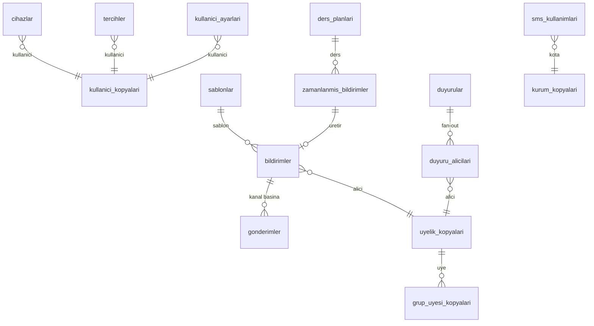

# `bildirim` veritabanı şeması

Bildirim servisi: cihazlar, tercihler, gelen kutusu, duyuru dağıtımı, e-posta/SMS/push gönderim günlüğü. Ortak kurallar [README.md](README.md)'dedir. Olay yükleri [olaylar.md](olaylar.md)'dedir.

Tek şema: `bildirim` (+ `ortak`). Roller: `bildirim_owner`, `bildirim_app`, `bildirim_sistem`.

## Tasarım kuralları

- Bildirimler **üyelik başınadır** (`alici_id` = `hesap.uyelikler.id`), çünkü içerik kurum bağlamındadır. Cihazlar ve iletişim bilgileri **kullanıcı başınadır** (`kullanici_id`). Gönderimde `alici_id` -> `kullanici_id` eşlemesi `uyelik_kopyalari` ile yapılır.
- Servis, içeriği olaydan üretir: olay -> kategori -> şablon -> alıcı çözümü -> tercih ve sessiz saat süzgeci -> kanal başına gönderim.
- **Kanallar:** `kutu` (gelen kutusu, her zaman yazılır), `push`, `eposta`, `sms`.
- **Gizlilik (KVKK):** push ve SMS gövdesi kişisel veri taşımaz (öğrenci adı, not, ödev metni yok). Genel metin + derin bağlantı. Push sağlayıcıları (Expo/APNs/FCM) yurt dışındadır ([ADR 0005](../adr/0005-dagitim-docker-kamal.md)). SMS ve e-posta sağlayıcıları Türkiye'de olmalıdır.
- **İletişim bilgisi saklanmaz.** Telefon, e-posta ve ad olaylarda taşınmaz ve bu serviste kopyalanmaz. Gönderim işi `sms`/`eposta` kanalında, gönderim anında `api`dan `GET /ic/kullanicilar/:id/iletisim` ile (servis JWT'si, `aud=api`) alır; yanıt `{gorunen_ad, telefon_e164, eposta, dil}`; bellekte tutulur, yazılmaz. `api` yanıtı vermezse (`5xx`/zaman aşımı) gönderim geçici hata sayılır ve yeniden denenir; kullanıcı silinmişse (`404`) `atlandi`. `gonderimler.hedef_anahtar` HMAC özetidir, düz adres günlüğe yazılmaz.
- **Gizli içerik** (OTP, davet bağlantısı) olaydan değil, iç uç noktadan gelir: `POST /ic/sms` (servis JWT'si, `aud=bildirim`). Bu içerik `gonderimler.govde`ye yazılmaz (yalnızca `sablon_kodu` ve maske).
- Tercihler ve kota tüketici tarafında uygulanır. Kullanıcı tercihi kapalı kategorilerde `kutu` yazılır, diğer kanallar atlanır (`atlandi`).
- **Üretim hattı** (`src/uretim.ts` `bildirimUret`, olaydan bağımsız çekirdek): `olay -> kategori -> şablon -> alıcı (uyelik) -> bildirimler (kutu) -> süzgeç -> gonderimler (push)`. Süzgeç sırası: kurum askıda/kapalı (`kurum_askida`) -> tercih kapalı (`tercih`) -> etkin cihaz yok (`cihaz_yok`) -> günlük üst sınır (`kota`) -> sessiz saat (ertele / `sessiz_saat` / `bayat`). Tüm "atlandı" nedenleri **kullanıcı düzeyindedir** ve tek satır yazar (`hedef_anahtar = '-'`); gönderilecek bildirim **cihaz başına** bir satır yazar (`hedef_anahtar = cihaz id`). Olay eşlemeleri `src/eslemeler/` altındadır (bir dosya + `index.ts` kayıt listesi); eşleme yalnız alıcıyı ve şablon değişkenlerini çıkarıp `bildirimUret`i çağırır.
- **Günlük push üst sınırı:** `ogrenci` rolündeki alıcıya, kullanıcının yerel gününde (`kullanici_ayarlari.saat_dilimi`, varsayılan `Europe/Istanbul`; gün sınırı yerel 00:00) en çok **5** push; `atlandi` olmayan, `sistem` dışı kategorideki ayrık `bildirim_id` sayısı sayılır. Aşan `atlandi (kota)`. Sayım kurum içidir (RLS); kullanıcı başına işlem kilidiyle yarışsızdır. `sistem` kategorisi sınırdan muaftır ve sayılmaz.
- Duyuru: içeriğin sahibi bu servistir (`api`da duyuru tablosu yoktur).

## Sözlük (kategoriler)

`kategori` değerleri (CHECK, tüm tablolarda aynı): `ders` (hatırlatma, iptal, ertelendi), `yoklama`, `odev`, `soru`, `kayit` (ders kaydı/materyal), `duyuru`, `finans` (düşük kredi, tahsilat), `oyunlastirma`, `abonelik`, `sistem` (güvenlik, davet, zorunlu).

Varsayılan kanal matrisi (kayıt yoksa uygulanır):

| Kategori | kutu | push | eposta | sms |
| --- | --- | --- | --- | --- |
| `ders` | açık | açık | kapalı | kapalı |
| `yoklama` | açık | açık | kapalı | kapalı |
| `odev` | açık | açık | kapalı | kapalı |
| `soru` | açık | açık | kapalı | kapalı |
| `kayit` | açık | açık | kapalı | kapalı |
| `duyuru` | açık | açık | kapalı | kapalı |
| `finans` | açık | açık | kapalı | kapalı |
| `oyunlastirma` | açık | açık | kapalı | kapalı |
| `abonelik` | açık | açık | açık | kapalı |
| `sistem` | açık (zorunlu) | açık (zorunlu) | açık (zorunlu) | açık (zorunlu) |

`sistem` kapatılamaz. SMS yalnızca kurumun açıkça etkinleştirdiği kategorilerde ve plan kotası içinde kullanılır (`sms_kullanimlari`).

## Cihaz, tercih, ayar

### `bildirim.cihazlar`

Push cihaz kayıtları. Kullanıcı başınadır, kiracı bağımsızdır.

Profil: `G` (+ `kullanici_id`). RLS: evet, `kullanici_id = ortak.aktif_kullanici()` (kurum politikası değil). Gönderim işleri `_sistem` rolüyle okur.

| Sütun | Tip | Null | Varsayılan | Not |
| --- | --- | --- | --- | --- |
| `kullanici_id` | uuid | hayır | | `hesap.kullanicilar.id` (FK yok) |
| `platform` | text | hayır | | CHECK `IN ('ios','android','web')` |
| `saglayici` | text | hayır | `'expo'` | CHECK `IN ('expo','fcm','apns','webpush')` |
| `push_belirteci` | text | hayır | | |
| `cihaz_kimligi` | text | hayır | | Uygulamanın ürettiği kalıcı cihaz kimliği |
| `uygulama_surumu` | text | evet | | |
| `dil` | text | hayır | `'tr'` | |
| `aktif` | boolean | hayır | true | |
| `gecersiz_at` | timestamptz | evet | | Sağlayıcı `DeviceNotRegistered` döndürünce |
| `son_gorulme_at` | timestamptz | hayır | now() | Her açılışta güncellenir |

Kısıtlar: `UNIQUE (kullanici_id, cihaz_kimligi)`, **kısmi** `UNIQUE (push_belirteci) WHERE aktif` (sapma: belirteç benzersizliği yalnız etkin satırlar içindir; el değiştiren cihazın eski kaydı pasif olarak kalır). Aynı belirteç başka kullanıcıya geçerse (cihaz el değiştirdi) eski satır `aktif=false` yapılır. Eski satırın pasiflenmesi RLS'i atlamadan yapılır: belirteci sunan istek `app.devir_belirteci` oturum değişkenini ayarlar; `cihaz_devri_okuma`/`cihaz_devri_pasiflestirme` politikaları yalnız o belirteçli satırı görmeye ve **yalnız pasiflemeye** izin verir. `cihazlar_sahip_degismez_trg` satırın `kullanici_id`sini değiştirilemez kılar. Üretim hattı (kurum bağlamı) cihazları okurken `app.kullanici_id`yi kısa süreliğine alıcıya ayarlar ve geri alır. Çıkışta kayıt silinir (`DELETE`). 60 gündür görülmeyen cihaz pasife alınır. İndeks: `(kullanici_id) WHERE aktif`. Olaylar: yok.

### `bildirim.tercihler`

Kullanıcının kurum x kategori x kanal tercihi. Kayıt yoksa varsayılan matris.

Profil: `K` (UUID `id` yok). PK `(kullanici_id, kurum_id, kategori, kanal)`. RLS: evet, iki kollu (`kurum_id = aktif_kurum()` ya da `kullanici_id = aktif_kullanici()`).

| Sütun | Tip | Null | Varsayılan | Not |
| --- | --- | --- | --- | --- |
| `kullanici_id` | uuid | hayır | | |
| `kategori` | text | hayır | | Sözlükteki değerler |
| `kanal` | text | hayır | | CHECK `IN ('kutu','push','eposta','sms')` |
| `acik` | boolean | hayır | | |

Kısıtlar: `CHECK (kategori <> 'sistem')` (zorunlu kategori kaydedilmez), `CHECK (kanal <> 'kutu' OR acik)` (gelen kutusu kapatılamaz). Olaylar: yok.

### `bildirim.kullanici_ayarlari`

Sessiz saatler ve genel ayarlar. Profil: `K` (UUID `id` yok). PK `(kullanici_id, kurum_id)`. RLS: iki kollu (tercihler gibi).

| Sütun | Tip | Null | Varsayılan | Not |
| --- | --- | --- | --- | --- |
| `kullanici_id` | uuid | hayır | | |
| `sessiz_baslangic` | time | evet | | Örn. `22:00` |
| `sessiz_bitis` | time | evet | | Örn. `07:00`. Gece yarısını aşabilir. |
| `sessiz_gunler` | smallint[] | hayır | `'{1,2,3,4,5,6,7}'` | ISO gün numarası |
| `saat_dilimi` | text | hayır | `'Europe/Istanbul'` | |
| `ders_hatirlatma_dk` | smallint | hayır | 60 | Ders öncesi hatırlatma (0 = kapalı). CHECK `IN (0,15,30,60,120,1440)` |

Kısıtlar: `CHECK ((sessiz_baslangic IS NULL) = (sessiz_bitis IS NULL))`, `CHECK (sessiz_gunler <@ {1..7})`. **Varsayılanlar kodda uygulanır** (`src/tercih.ts`): kayıt yoksa ya da `sessiz_baslangic/bitis` NULL ise sessiz saat **22:00-08:00**, `Europe/Istanbul`, her gün, `ders_hatirlatma_dk = 60`. `sessiz_gunler = '{}'` sessiz saati **kapatır** (API'de başlangıç = bitiş reddedilir). `sessiz_gunler`, sessiz aralığın **başladığı** günü belirtir (22:00-08:00 aralığında Salı 03:00 için başlangıç günü Pazartesi'dir). **Sessiz saat kuralı:** `push` ve `sms` gönderimleri sessiz aralığa denk gelirse `gonderimler.durum='ertelendi'`, `zamanlanan_at = sessiz_bitis` olur. `kutu` etkilenmez. `sistem` kategorisi ve `ders` kategorisinde başlangıcına 30 dk kalmış hatırlatma sessiz saati **delmez**; bunlar `atlandi (sessiz_saat)` olur. Erteleme 12 saati aşarsa gönderim iptal edilir (`atlandi (bayat)`; ayrıca gönderim işi, planlanan zamandan 12 saatten fazla gecikmiş satırı da `bayat` yapar). Olaylar: yok.

## Okuma kopyaları

Yalnızca olay tüketicisi yazar. RLS: evet (`kurum_id`), `kullanici_kopyalari` hariç. **Sıralama (sapma):** olay zarfında özne sürümü olmadığından `surum` yerine `(son_olay_at, son_olay_id)` ikilisi (olayın `occurredAt` ve UUIDv7 kimliği) tutulur; daha eski olay kopyayı ezmez, eşit zamanda büyük kimlik kazanır, aynı durumun yeniden yayımı etkisizdir (`motivasyon` ile aynı).

| Tablo | Kaynak olay | Sütunlar | Neden gerekli |
| --- | --- | --- | --- |
| `kullanici_kopyalari` | `hesap.kullanici.degisti.v1` | `kullanici_id` PK, `dil`, `durum`, `son_olay_at`, `son_olay_id` | Dil ve hesap durumu. **İletişim bilgisi (telefon, e-posta, ad) kopyalanmaz.** RLS yok (kullanıcı düzeyi). Silme olayında satır `durum='silindi'` işaretine indirgenir (id kalır; geç gelen `degisti` satırı geri getirmez). **Uygulandı:** `bildirim.kullanici` tüketicisi (sistem rolü, `kiraci:'yok'`); kayıt yokken varsayılanlar (`tr`, `aktif`) uygulanır. |
| `kurum_kopyalari` | `hesap.kurum.degisti.v1`, `abonelik.abonelik.degisti.v1` | `kurum_id` PK, `ad`, `durum`, `saat_dilimi`, `plan_kodu`, `abonelik_durumu`, `sms_aylik_limit`, `son_olay_at`, `son_olay_id`, `abonelik_son_olay_at`, `abonelik_son_olay_id` (abonelik alanları abonelik olayları gelene kadar NULL) | Kurum adı (e-posta), SMS kotası, askıdaki kurumda gönderim durdurma |
| `uyelik_kopyalari` | `hesap.uyelik.degisti.v1` | `uyelik_id` PK, `kurum_id`, `kullanici_id`, `rol`, `durum`, `kademe_id`, `son_olay_at`, `son_olay_id` | Alıcı çözümü (uyelik -> kullanici) ve rol bazlı hedefleme |
| `kademe_kopyalari` | `hesap.kademe.degisti.v1` | `kademe_id` PK, `kurum_id`, `ad`, `arsivlendi`, `son_olay_at`, `son_olay_id` | Duyuru hedefi `kademe` |
| `grup_kopyalari` | `hesap.grup.degisti.v1` | `grup_id` PK, `kurum_id`, `kademe_id`, `tur`, `ad`, `durum`, `son_olay_at`, `son_olay_id` | Duyuru hedefi `grup`, modül çözümü |
| `grup_uyesi_kopyalari` | `hesap.grup_uyesi.degisti.v1` | PK `(grup_id, ogrenci_id)`, `baslangic_tarihi`, `bitis_tarihi`, `son_olay_at`, `son_olay_id` | Grup/kademe duyuru alıcı listesi |
| `atama_kopyalari` | `hesap.atama.degisti.v1` | `atama_id` PK, `grup_id`, `ogretmen_id`, `brans_kodu`, `bitis_tarihi`, `son_olay_at`, `son_olay_id` | Öğretmenin duyuru hedefleme yetkisi (yalnızca atandığı gruplar); soru yönlendirme bildirimi |
| `modul_ayari_kopyalari` | `hesap.modul_ayari.degisti.v1` | PK `(kurum_id, modul_kodu, kapsam, kapsam_id)`, `acik`, `son_olay_at`, `son_olay_id` | `duyuru` modülü kapalıysa duyuru yayını reddedilir |

Kopya ve olay sırası: kopya henüz oluşmamışken gelen bildirim olayı `nak` ile gecikmeli yeniden denenir ([ADR 0002](../adr/0002-olay-sozlesmesi-outbox-idempotent-tuketici.md)). `hesap.kullanici.silindi.v1` işlenince `cihazlar`, `tercihler`, `kullanici_ayarlari`, kullanıcının `bildirimler`, `gonderimler`, `zamanlanmis_bildirimler` ve `duyuru_alicilari` satırları silinir (**sapma:** önceki plan alıcı bağlantısını `hedef_maske` temizleyerek bırakıyordu; yasal saklama nedeni olmadığından satırlar silinir), `kullanici_kopyalari` satırı `silindi` işaretine indirgenir. Dışa aktarma: `POST /ic/kvkk/veri`. Bkz. [kvkk-silme.md](kvkk-silme.md).

## Gelen kutusu

### `bildirim.sablonlar`

Bildirim şablonları. Profil: `GS`. RLS: hayır (global). Tohum verisidir.

| Sütun | Tip | Null | Varsayılan | Not |
| --- | --- | --- | --- | --- |
| `kod` | text | hayır | | Ör. `odev_yayinlandi`, `ders_hatirlatma`, `sifre_otp`. `UNIQUE (kod, kanal, dil)` |
| `kategori` | text | hayır | | |
| `kanal` | text | hayır | | CHECK `IN ('kutu','push','eposta','sms')` |
| `dil` | text | hayır | `'tr'` | |
| `baslik` | text | evet | | `{{degisken}}` yer tutucuları. Yer tutucular olay yükünden doldurulur; yük dışı alan yasak. |
| `govde` | text | hayır | | |
| `derin_baglanti` | text | evet | | Ör. `kopru://odev/{{odev_id}}` |
| `kisisel_veri_iceriyor` | boolean | hayır | false | `true` ise `push` ve `sms` kanalında kullanılamaz (CHECK) |

Kısıtlar: `CHECK (NOT kisisel_veri_iceriyor OR kanal IN ('kutu','eposta'))`. **Kaynak koddur** (`src/sablonlar.ts`; sürüm kodla birlikte dağıtılır): üretim hattı şablonu bellekteki kayıttan okur, worker açılışta tabloya `ON CONFLICT (kod, kanal, dil) DO UPDATE` ile eşler (ayna; içerik değişince `surum` artar). Kayıt yüklenirken doğrulanır: kişisel veri içeren şablon push/sms'te tanımlanamaz; push metninde `ad`, `telefon`, `eposta`, `not`, `ucret`, `tutar`, `bakiye`, `mesaj`... gibi değişken adları yasaktır. `{{degisken}}` yalnız çağıranın verdiği değişkenlerle doldurulur, eksik değişken kalıcı hata sayılır. Bir `kod` için `kutu` şablonu zorunlu, `push` şablonu isteğe bağlıdır (kategorileri aynı olmalı).

### `bildirim.bildirimler`

Gelen kutusu. Üyelik başına bildirim.

Profil: `K`. RLS: evet. Aylık bölümlenebilir; 90 gün saklanır.

| Sütun | Tip | Null | Varsayılan | Not |
| --- | --- | --- | --- | --- |
| `alici_id` | uuid | hayır | | `uyelik_kopyalari.uyelik_id` |
| `kategori` | text | hayır | | |
| `sablon_kodu` | text | hayır | | |
| `baslik` | text | hayır | | Çözülmüş metin (kutuda kişisel veri olabilir; kutu erişimi yalnızca alıcıya) |
| `govde` | text | hayır | | |
| `derin_baglanti` | text | evet | | |
| `veri` | jsonb | hayır | `'{}'` | Nesne kimlikleri |
| `kaynak_olay_id` | uuid | hayır | | |
| `tekil_anahtar` | text | hayır | | `{sablon_kodu}:{ozne_id}[:{ek}]`. Aynı olay iki kez bildirim üretmesin |
| `okundu_at` | timestamptz | evet | | |
| `arsivlendi_at` | timestamptz | evet | | |
| `gecerlilik_bitis_at` | timestamptz | evet | | Geçersiz bildirimler (iptal edilmiş ders hatırlatması) gizlenir |

Kısıtlar: `UNIQUE (kurum_id, alici_id, tekil_anahtar)` (idempotency), `UNIQUE (kurum_id, id)`. İndeks: `(kurum_id, alici_id, created_at DESC)`, `(kurum_id, alici_id) WHERE okundu_at IS NULL AND arsivlendi_at IS NULL` (okunmamış sayısı). Olaylar: yok.

### `bildirim.gonderimler`

Kanal başına gönderim günlüğü (push/e-posta/SMS). Kutu için satır yazılmaz.

Profil: `K`. RLS: evet. Aylık bölümlenir; 180 gün saklanır.

| Sütun | Tip | Null | Varsayılan | Not |
| --- | --- | --- | --- | --- |
| `bildirim_id` | uuid | evet | | `bildirimler.id`. İç uç noktadan gelen OTP/davet için NULL. |
| `alici_kullanici_id` | uuid | hayır | | |
| `kanal` | text | hayır | | CHECK `IN ('push','eposta','sms')` |
| `sablon_kodu` | text | hayır | | |
| `hedef_anahtar` | text | hayır | | Cihaz için `cihaz_id`; e-posta/SMS için hedefin HMAC özeti (tekilleştirme) |
| `hedef_maske` | text | evet | | `+90 5** *** ** 12`, `a***@ornek.com`. Düz adres saklanmaz. |
| `saglayici` | text | evet | | `expo`, `netgsm`, `smtp`... (sağlayıcı seçimi açık) |
| `saglayici_mesaj_id` | text | evet | | |
| `durum` | text | hayır | `'beklemede'` | CHECK `IN ('beklemede','ertelendi','gonderildi','teslim_edildi','basarisiz','atlandi')` |
| `atlama_nedeni` | text | evet | | CHECK `IN ('tercih','sessiz_saat','kota','cihaz_yok','kurum_askida','bayat')` |
| `hata_kodu` | text | evet | | |
| `deneme_sayisi` | smallint | hayır | 0 | En çok 5 |
| `zamanlanan_at` | timestamptz | hayır | now() | Ertelemede sessiz saat bitişi |
| `gonderildi_at` | timestamptz | evet | | |
| `maliyet_kurus` | int | evet | | SMS maliyeti |
| `baslik` | text | evet | | **Sapma.** Push başlığı (kişisel veri içermez). Gizli içerik (OTP, davet) buraya yazılmaz. |
| `govde` | text | evet | | **Sapma.** Push gövdesi (kişisel veri içermez). |
| `derin_baglanti` | text | evet | | **Sapma.** Push derin bağlantısı. |

Kısıtlar: `UNIQUE (bildirim_id, kanal, hedef_anahtar) WHERE bildirim_id IS NOT NULL` (aynı bildirim aynı hedefe iki kez gitmez; tüketici yeniden denemesi güvenli), `CHECK ((durum = 'atlandi') = (atlama_nedeni IS NOT NULL))`, `CHECK (deneme_sayisi BETWEEN 0 AND 5)`; `(kurum_id, bildirim_id)` bileşik FK `ON DELETE SET NULL (bildirim_id)` (bildirim 90 günde silinse de gönderim 180 güne kadar kalır). Push metni sütunları (`baslik`, `govde`, `derin_baglanti`) sayesinde gönderim işi `bildirimler`e bakmaz. Push yükü: `title`, `body`, `data: { derin_baglanti, bildirim_id, kurum_id }` (mobil, dokunulunca bildirimin kurumuna geçer). İş: `gonderim.isle` işi (**sapma: dakikalık değil, 5 sn aralık**, `BILDIRIM_GONDERIM_ARALIK_MS`; olaydan push'a p95 < 30 sn hedefi için) `durum IN ('beklemede','ertelendi') AND zamanlanan_at <= now()` olan satırları `FOR UPDATE SKIP LOCKED` ile çeker. Hata sınıfları: geçici (zaman aşımı, 5xx) -> `deneme_sayisi+1`, `zamanlanan_at` üstel bekleme (1, 5, 30, 120 dk); kalıcı (`DeviceNotRegistered`, geçersiz numara) -> `basarisiz`, cihaz `aktif=false` ve `gecersiz_at`; 5. başarısız denemede `basarisiz`. Garanti en az bir kezdir (gönderim sonrası commit öncesi çökmede aynı push tekrar gidebilir). iOS rozeti = kullanıcının tüm kurumlardaki okunmamış, arşivlenmemiş, geçerli bildirim sayısı. Push sağlayıcısı `BILDIRIM_PUSH_SAGLAYICI=log|expo` ile seçilir (`log`: gönderimi yapılandırılmış log'a yazar ve başarılı sayar; `expo`: 100'lük paketlerle Expo Push API). İndeks: `(durum, zamanlanan_at) WHERE durum IN ('beklemede','ertelendi')`, `(kurum_id, alici_kullanici_id, created_at DESC)`, `(kurum_id, bildirim_id)`. Olaylar: yok.

### `bildirim.zamanlanmis_bildirimler`

Gelecekte üretilecek bildirimler (ders hatırlatması). Ders iptal/erteleme olduğunda iptal edilir.

Profil: `K`. RLS: evet.

| Sütun | Tip | Null | Varsayılan | Not |
| --- | --- | --- | --- | --- |
| `kaynak_turu` | text | hayır | | `ders` |
| `kaynak_id` | uuid | hayır | | `ders_id` |
| `alici_id` | uuid | hayır | | Üyelik |
| `sablon_kodu` | text | hayır | | `ders_hatirlatma` |
| `gonderim_at` | timestamptz | hayır | | `ders.baslangic_at - hatirlatma_dk` (alıcının `ders_hatirlatma_dk`'ı) |
| `veri` | jsonb | hayır | | |
| `iptal_at` | timestamptz | evet | | |
| `iptal_nedeni` | text | evet | | **Sapma (migration 0003).** `ders`, `yoklama`, `teslim`, `gun` kalıcı; `ayar` (kullanıcı hatırlatmayı kapattı) ve `gecmis` (zamanı geçti) **geri alınabilir**: ayar açılınca ya da erteleme yeni zamanı geleceğe taşıyınca satır yeniden etkinleşir. |
| `uretildi_at` | timestamptz | evet | | |

`kaynak_turu` değerleri: `ders` (`kaynak_id` = ders; şablonlar `ders_hatirlatma`, `ders_geri_bildirim`), `odev` (`odev_teslim_yaklasiyor`), `ogretmen_gun` (`ogretmen_sabah`; `kaynak_id` = `(ogretmen_id, yerel gün)`'den türetilmiş belirlenimci UUID). Kısıtlar: `UNIQUE (kurum_id, kaynak_turu, kaynak_id, alici_id, sablon_kodu)`. `ders.ders.degisti.v1` geldiğinde: iptalse `iptal_at`; ertelendiyse `gonderim_at` yeniden hesaplanır (`UPDATE`, `uretildi_at` NULL'a döner); planlandıysa eklenir. İş (`zamanlanmis.uret`, **sapma: dakikalık değil, 30 sn**, `BILDIRIM_ZAMANLANMIS_ARALIK_MS`) `gonderim_at <= now() AND iptal_at IS NULL AND uretildi_at IS NULL` satırlarını kurum başına RLS'li işlemde `FOR UPDATE SKIP LOCKED` ile `bildirimUret`e verir. Geçmişte kalmış hatırlatma **eklenmez** (var olan satır `gecmis` ile iptal); 24 saati aşan gecikmiş satır iptal edilir. İndeks: `(gonderim_at) WHERE iptal_at IS NULL AND uretildi_at IS NULL`, `(kurum_id, kaynak_id)`. Olaylar: yok.

### `bildirim.ders_planlari`

**Eklendi (migration 0003).** `ders.ders.degisti.v1`'den beslenen küçük yerel kopya (ders başına tek satır). Öğretmen sabah özeti (günün ders sayısı ve ilk dersi) ve ders sonu geri bildirimi (ders `tamamlandi` mı?) için gerekir; ders olayında olmayan bir bilgi taşımaz, kişisel veri yoktur.

Profil: `K` (UUID `id` yok; PK `ders_id`). RLS: evet. Sütunlar: `ders_id uuid` PK, `kurum_id`, `ogretmen_id uuid` (üyelik), `baslangic_at`, `bitis_at` (`timestamptz`), `durum` (`planli`/`tamamlandi`/`iptal`), `son_olay_at`, `son_olay_id` (kopya sıralaması: daha eski ve **farklı durumlu** olay yeni durumu ezmez; aynı durumun parçaları her sırada uygulanır). İndeks: `(kurum_id, ogretmen_id, baslangic_at) WHERE durum <> 'iptal'`. Olaylar: yok.

## Duyurular

### `bildirim.duyurular`

Kurum/kademe/grup duyuruları. İçerik ve okunma sayısı bu servistedir.

Profil: `KS`. RLS: evet.

| Sütun | Tip | Null | Varsayılan | Not |
| --- | --- | --- | --- | --- |
| `baslik` | text | hayır | | ≤ 200 |
| `govde` | text | hayır | | ≤ 4000, düz metin + bağlantı |
| `hedef_turu` | text | hayır | | CHECK `IN ('grup','kademe','kurum')` |
| `hedef_id` | uuid | hayır | | `kurum` ise `kurum_id` |
| `hedef_roller` | text[] | hayır | `'{ogrenci}'` | Alıcı roller: `ogrenci`, `ogretmen`, `veli`. Faz 1 varsayılan yalnızca öğrenci ve öğretmen. |
| `yazar_id` | uuid | hayır | | Üyelik |
| `durum` | text | hayır | `'taslak'` | CHECK `IN ('taslak','yayinda','arsiv')` |
| `yayin_at` | timestamptz | evet | | |
| `bitis_at` | timestamptz | evet | | Süre sonu (sonra gizlenir) |
| `sabit` | boolean | hayır | false | |
| `alici_sayisi` | int | hayır | 0 | Fan-out sonrası |
| `okunan_sayisi` | int | hayır | 0 | **Okunma sayacı**, `duyuru_alicilari.okundu_at` ilk dolduğunda artar |
| `push_gonderildi` | boolean | hayır | true | Yayında push üretilsin mi |
| `silindi_at` | timestamptz | evet | | |
| `dagitim_tamam_at` | timestamptz | evet | | **Sapma (0003):** kutu/push bildirimi dağıtımı bittiğinde dolar. `NULL` ve `durum='yayinda'` = worker dağıtım kuyruğu. Küçük hedefte yayın anında dolar. |

Kısıtlar: `CHECK (hedef_turu <> 'kurum' OR hedef_id = kurum_id)`, `CHECK (durum = 'taslak' OR yayin_at IS NOT NULL)`, `CHECK (okunan_sayisi <= alici_sayisi)`, `UNIQUE (kurum_id, id)`. Yetki: `yonetici`/`sahip` her hedefe; `ogretmen` yalnızca `atama_kopyalari`nda aktif atamasının olduğu `grup` hedeflerine. Yayın: tek işlemde alıcılar çözülür (`grup` -> `grup_uyesi_kopyalari` etkin üyeleri; `kademe` -> `uyelik_kopyalari.kademe_id`; `kurum` -> tüm etkin üyelikler; `hedef_roller` süzgeci), `duyuru_alicilari` `ON CONFLICT DO NOTHING` ile 500'lük gruplarla yazılır, `alici_sayisi` yazılır; büyük hedefler (> 2000) pg-boss işinde. Yayından sonra gruba katılan üye duyuruyu `grup_uyesi_kopyalari` olayında alır (süresi geçmemiş ve `sabit` ya da son 14 gün). İndeks: `(kurum_id, durum, yayin_at DESC)`, `(kurum_id, hedef_turu, hedef_id)`. Olaylar: yok (yayın doğrudan `bildirimler` üretir, şablon `duyuru_yayinlandi`).

**Uygulama (`src/duyuru*.ts`, API `/v1/bildirim/kurumlar/:kurum_id/duyurular...`).** Yetki: `izinVarMi(rol, 'duyuru.yaz', 'grup')`; yönetici/sahip her hedef, öğretmen yalnız etkin ataması olan `grup` (kademe/kurum 403); yayında yetki yeniden denetlenir (ataması biten öğretmen yayınlayamaz). Başkasının duyurusu öğretmene 404. `duyuru` modülü kurum > kademe > grup düzeyinde denetlenir (kayıt yoksa açık); kapalıysa yayın `403 modul_kapali`, taslak serbest. Yayın: `duyuru_alicilari` her zaman tek işlemde 500'lük gruplarla yazılır (yazar alıcı sayılmaz; `grup` hedefinde `ogretmen` rolü atamadan çözülür). **Sapma (eşik):** `bildirimUret` alıcı başına ~7 sorgudur (ölçüm: 2.500 alıcı ≈ 10 sn); bu yüzden kutu bildirimi ≤ 300 alıcıda yayın isteğinde, daha büyük hedefte worker'daki `duyuru-dagit` işinde 200'lük partilerle üretilir (belge eşiği 2000'di; 2.500 alıcılı yayın isteği ≈ 130 ms'de döner). İş idempotenttir (`tekil_anahtar = duyuru_yayinlandi:{duyuru_id}`). Okundu: `okundu_at IS NULL` koşullu güncelleme satır kilidiyle serileşir; eşzamanlı çağrılar sayacı bir kez artırır; aynı işlemde kutudaki duyuru bildirimi de okundu olur. Arşiv/silme ve `bitis_at` değişimi kutudaki bildirimlerin `gecerlilik_bitis_at` değerini günceller. Sonradan katılan: `hesap.grup_uyesi.degisti.v1` kopya tüketicisinde (`sonradanKatilanaDagit`) süresi geçmemiş, `ogrenci` rolü hedefleyen ve (sabit ya da son 14 gün) yayındaki `grup` duyuruları push'suz eklenir; idempotent. Liste uçlarında imleç yok, `limit`/`offset` vardır.

**Push metni kararı.** Push yalnız "Yeni duyuru" ve `{{kurum}} için yeni bir duyuru var.` içerir; duyuru başlığı/gövdesi push'a **girmez**. Gerekçe: başlık serbest metindir (öğrenci adı, not, ücret içerebilir, doğrulanamaz) ve kilit ekranında görünür; kişisel veri push'a konmaz kuralı. Başlık kutu bildirimindedir (yalnız alıcı görür). `push_gonderildi=false` ise yalnız kutu şablonu kullanılır.

**Ek dosya (yapılmadı; tasarım önerisi).** Şartname "metin + ek dosya" der. Bağlamak: (1) `duyuru_ekleri(duyuru_id, dosya_id, sira)` tablosu (RLS, en çok 5) + `ek_dosya_idleri` istek alanı; (2) dosya sahipliği/hazır olma denetimi için `ortak.dosya.*` / `medya.dosya.hazir.v1` olaylarını tüketen `medya_dosya_kopyalari` (api'deki gibi); (3) okuma adresleri için `POST /ic/okuma-adresleri` çağrısı, servis JWT'si (`aud=medya`, `scope=medya.okuma`) imzalamak için bildirim servisine servis imza anahtarı ve `MEDYA_URL` yapılandırması (şu an hiçbir yerde yok); (4) tekil duyuru yanıtında `ekler[]` (10 dk geçerli presigned adres) ve duyuru silinince `ortak.dosya.kullanim_bitti` benzeri bir olay. Bu; yeni tablo + olay tüketicisi + servis JWT altyapısı + medya sözleşme (kullanım bildirimi) çalışması olduğundan ayrı pakettir.

### `bildirim.duyuru_alicilari`

Duyuru x üyelik satırı (okundu bilgisi).

Profil: `K`. RLS: evet.

| Sütun | Tip | Null | Varsayılan | Not |
| --- | --- | --- | --- | --- |
| `duyuru_id` | uuid | hayır | | Bileşik FK |
| `alici_id` | uuid | hayır | | Üyelik |
| `okundu_at` | timestamptz | evet | | |

Kısıtlar: `UNIQUE (duyuru_id, alici_id)`. **Okundu işaretleme:** `UPDATE duyuru_alicilari SET okundu_at = now() WHERE duyuru_id = :d AND alici_id = :a AND okundu_at IS NULL`; etkilenen satır 1 ise aynı işlemde `UPDATE duyurular SET okunan_sayisi = okunan_sayisi + 1`. Tekrar okuma sayacı artırmaz. İndeks: `(kurum_id, alici_id, okundu_at)`, `(kurum_id, duyuru_id) WHERE okundu_at IS NULL`. Olaylar: yok.

## Kota

### `bildirim.sms_kullanimlari`

Kurum başına aylık SMS sayacı. Profil: `K` (UUID `id` yok). PK `(kurum_id, donem)`. RLS: evet. Sütunlar: `donem date` (ayın ilk günü), `adet int NOT NULL DEFAULT 0`, `maliyet_kurus bigint NOT NULL DEFAULT 0`. Gönderim öncesi koşullu artırım: `... ON CONFLICT DO UPDATE SET adet = adet + 1 WHERE sms_kullanimlari.adet < :limit`; dönen satır yoksa gönderim `atlandi (kota)` olur. `sistem` kategorisi (OTP, davet) kotadan düşer ama limit aşıldığında **engellenmez** (hesap erişimi için), yalnızca uyarı üretilir. Limit: `kurum_kopyalari.sms_aylik_limit`. Olaylar: yok.

## Tüketilen olaylar ve ürettikleri bildirimler

| Olay | Alıcı | Kategori / şablon |
| --- | --- | --- |
| `ders.ders.degisti.v1` | Katılımcı öğrenciler, öğretmen | `ders`: planlandı (telafi ise), ertelendi, iptal; hatırlatma zamanlaması |
| `ders.yoklama.kaydedildi.v1` | Öğrenci (`gelmedi`/`gec`) | `yoklama` |
| `ders.kaynak.eklendi.v1` | Alıcı öğrenciler | `kayit`: yeni kayıt/materyal |
| `ders.kaynak.sorun_bildirildi.v1` | Kaynağı ekleyen öğretmen | `kayit`: bozuk bağlantı |
| `finans.kredi.azaldi.v1` | Öğrenci (ve öğretmen) | `finans`: kalan kredi |
| `finans.tahsilat.alindi.v1` | Öğrenci | `finans`: makbuz |
| `finans.paket.satildi.v1` | Öğrenci | `finans` |
| `ogrenme.odev.yayinlandi.v1` | Öğrenciler (parçalı) | `odev`: yeni ödev |
| `ogrenme.odev.teslim_edildi.v1` | Veren öğretmen | `odev` |
| `ogrenme.odev.incelendi.v1` | Öğrenci | `odev` |
| `ogrenme.soru.sorildi.v1` | Hedef öğretmenler | `soru` |
| `ogrenme.degerlendirme.yayimlandi.v1` | Öğrenci | `odev` (kategori ayrı açılmadı): "Öğretmeninden yeni bir değerlendirme", **yalnız kutu** |
| `ogrenme.kaynak_onerisi.eklendi.v1` | Öğrenci | `odev`: "Öğretmenin sana yeni bir kaynak önerdi", **yalnız kutu** |
| `ogrenme.soru_mesaji.eklendi.v1` | Karşı taraf | `soru`: cevap/takip |
| `motivasyon.seviye.atladi.v1`, `rozet.kazanildi.v1`, `karakter.evrildi.v1`, `seri.kilometre_tasi.v1`, `seri.bozuldu.v1`, `seri.risk.v1` | Öğrenci | `oyunlastirma` |
| `abonelik.abonelik.degisti.v1` | Kurum `sahip` | `abonelik`: deneme bitiyor, ödeme bekliyor, ek süre, askıya alındı |
| `abonelik.odeme.islendi.v1` | Kurum `sahip` | `abonelik`: ödeme başarısız |
| `abonelik.fatura.kesildi.v1` | Kurum `sahip` | `abonelik`: e-posta ile fatura bağlantısı |
| `hesap.davet.kabul_edildi.v1` | Davet eden | `sistem` |
| `ogrenme.mufredat.yayinlandi.v1` | Kurum `sahip` ve `yonetici` | `duyuru`: "Müfredat güncellendi" (yalnız kutu) |
| `hesap.*` kopya olayları | | Kopya upsert |
| `hesap.kullanici.silindi.v1` | | Veri temizliği |

Tüketici adları: `bildirim.uretim` (bildirim üreten olaylar), `bildirim.kopya` (kopyalar). **Uygulananlar (paket B1):** kopya olayları (kurum, kademe, üyelik, grup, grup üyesi, atama, modül ayarı); `ogrenme.soru_mesaji.eklendi.v1` (`tur = cevap`, öğrenciye `soru_cevaplandi`, `tekil_anahtar = soru_cevaplandi:{mesaj_id}`); `motivasyon.seri.risk.v1` (öğrenciye `seri_hatirlatma`, `gecerlilik_bitis_at = gun_bitis_at`). **Uygulananlar (paket B2):** aşağıdaki tüm Faz 1 eşlemeleri (`src/eslemeler/`, şablonlar `src/sablonlar-eslemeler.ts`):

| Olay | Alıcı | Şablon (kategori) / `tekil_anahtar` |
| --- | --- | --- |
| `ders.ders.degisti` `iptal_edildi` | katılımcı öğrenciler; `iptal_kaynagi <> 'ogretmen'` ise ders öğretmeni | `ders_iptal`, `ders_iptal_ogretmen` (`ders`) / `ders_iptal:{ders_id}` |
| `ders.ders.degisti` `ertelendi` | öğrenciler (öğretmene yok: erteleyen odur) | `ders_ertelendi` (`ders`) / `ders_ertelendi:{ders_id}:{baslangic_ms}` |
| `ders.ders.degisti` `planlandi` + `telafi` | öğrenciler | `telafi_planlandi` (`ders`) / `telafi_planlandi:{ders_id}` |
| `ders.yoklama.kaydedildi` `gelmedi`/`gec` | öğrenci | `yoklama_gelmedi`, `yoklama_gec` (`yoklama`) / `{kod}:{yoklama_id}:{yoklama_surumu}` |
| `ders.kaynak.eklendi` | öğrenciler (parçalı) | `kayit_eklendi`, `materyal_eklendi` (`kayit`) / `kaynak_eklendi:{kaynak_id}` |
| `ders.kaynak.sorun_bildirildi` | `ekleyen_id` | `kaynak_sorun` (`kayit`) / `kaynak_sorun:{sorun_id}` |
| `ogrenme.odev.yayinlandi` | öğrenciler (parçalı) | `odev_yayinlandi` (`odev`) / `odev_yayinlandi:{odev_id}` |
| `ogrenme.odev.teslim_edildi` | `veren_id` | `odev_teslim_edildi` (`odev`) / `odev_teslim_edildi:{ogrenci_odev_id}` (yeniden teslimde `:{olay_id}` eklenir) |
| `ogrenme.odev.incelendi` | öğrenci | `odev_incelendi` (`odev`) / `odev_incelendi:{ogrenci_odev_id}:{sonuc}` |
| `ogrenme.soru.sorildi` | `hedef_ogretmen_idleri` (boşsa yok) | `yeni_soru` (`soru`) / `yeni_soru:{soru_id}` |
| `ogrenme.soru_mesaji.eklendi` `takip` | `alici_idleri` (yazar hariç) | `soru_takip` (`soru`) / `soru_takip:{mesaj_id}` (`cevap` B1'de) |
| `motivasyon.seviye.atladi`, `rozet.kazanildi`, `karakter.evrildi`, `seri.kilometre_tasi`, `seri.bozuldu` | öğrenci | `seviye_atladi`, `rozet_kazanildi`, `karakter_evrildi`, `seri_kilometre_tasi`, `seri_bozuldu`/`seri_onarilabilir` (`oyunlastirma`) |
| `finans.kredi.azaldi`, `tahsilat.alindi`, `paket.satildi` | öğrenci | `kredi_azaliyor`, `tahsilat_alindi`, `paket_satildi` (`finans`) |
| `hesap.davet.kabul_edildi` | `davet_eden_id` | `davet_kabul_edildi` (`sistem`) / `davet_kabul_edildi:{davet_id}` |
| `ogrenme.degerlendirme.yayimlandi` | öğrenci | `degerlendirme_yayimlandi` (`odev`, **yalnız kutu, push yok**) / `degerlendirme_yayimlandi:{degerlendirme_id}` |
| `ogrenme.kaynak_onerisi.eklendi` | öğrenci | `kaynak_onerisi_eklendi` (`odev`, **yalnız kutu, push yok**) / `kaynak_onerisi_eklendi:{oneri_id}` |
| `ogrenme.mufredat.yayinlandi` | kurumun etkin `sahip` ve `yonetici` üyelikleri (`uyelik_kopyalari`; kopya henüz yoksa `YenidenDene`: uyelik olayı başka tüketicide, sıra garantisi yok) | `mufredat_guncellendi` (`duyuru`, **yalnız kutu, push yok**) / `mufredat_guncellendi:{katalog_kodu}:{surum_no}` |

Parçalı olaylarda (`parca_no`) her parça kendi alıcılarını işler; ortak alıcılar (öğretmen) `tekil_anahtar` ile tekillenir. **Alıcı kimlikleri** (`ogrenci_id`, `ogretmen_id`, `veren_id`, `ekleyen_id`, `davet_eden_id`, `alici_idleri`...) hepsi `hesap.uyelikler.id`'dir ([api.md](api.md)); doğrudan `bildirimUret`in `aliciUyelikIdleri`ne verilir. **Finans kararı:** şartname "push metinlerinde ücret, not veya hassas bilgi yer almaz" der; **tutar, yöntem ve makbuz no ne push'ta ne kutuda yazılır** (kutuda yalnız ders sayısı: kalan kredi, paket kredisi). Kişisel/serbest metin (ad, not, ödev başlığı, rozet adı) hiçbir bildirimde yoktur; ayrıntı derin bağlantıdadır (`kopru://ders/{id}`, `odev/{id}`, `soru/{id}`, `kayit/{id}`, `bugun`).

**Zamanlanmış bildirimler** (`src/ders-zamanlama.ts`, `src/zamanlama.ts`, iş `src/zamanlanmis.ts`):

- **Ders hatırlatma** (`ders_hatirlatma`, yalnız öğrenci): ders planlanınca/ertelenince/güncellenince öğrenci başına `gonderim_at = baslangic_at - ders_hatirlatma_dk` (varsayılan 60; `0` = kapalı: satır `iptal_nedeni='ayar'` ile yazılır). Erteleme `gonderim_at`ı yeniden hesaplar ve `uretildi_at`ı sıfırlar; önceki zamanda üretilmiş hatırlatma kutuda gizlenir (`tekil_anahtar` = `ders_hatirlatma:{ders_id}:{baslangic_ms}`). İptalde bekleyen satırlar `iptal_at` (`ders`), üretilmiş hatırlatma gizlenir. `gecerlilik_bitis_at = bitis_at`. Üretim anında `ertelenemez` = başlangıca <= 30 dk kalmış **ya da** sessiz saat dersin başlangıcından sonra bitiyor (ertelemek anlamsız) -> sessiz saatte push `atlandi (sessiz_saat)`, kutu yazılır. Kullanıcı `PUT .../ayarlar` ile `ders_hatirlatma_dk` değiştirince bekleyen satırlar aynı işlemde yeniden hesaplanır (0 -> iptal, sonra açılırsa yeniden etkin).
- **Öğretmen sabah bildirimi** (`ogretmen_sabah`, `ders` kategorisi, tercihle kapatılabilir): öğretmenin yerel günü için tek satır; `gonderim_at = günün ilk dersi - 30 dk`; ders eklenince/iptal/ertelenince (eski ve yeni gün) `ders_planlari`ndan yeniden hesaplanır; ders kalmazsa `iptal (gun)`. Metin: "Bugün N dersin var. İlki saat HH:MM'de." (N iptal olmayan ders sayısı). 30 dk kala olduğundan sessiz saatte ertelenmez (atlanır).
- **Ders sonu geri bildirimi** (`ders_geri_bildirim`, `ders` kategorisi): planlanınca öğrenci başına `bitis_at + 10 dk`; **yalnız ders `tamamlandi` (yoklama alındı) olunca** üretilir (planlı derste iş satırı seçmez; 48 saat sonra iptal); `gelmedi`/`izinli` öğrencinin satırı iptal (`yoklama`), sonradan `geldi`/`gec`e düzeltilirse yeniden etkin; ders iptalinde iptal; `gecerlilik_bitis_at = bitis_at + 24 saat` (API'nin güncelleme penceresi).
- **Ödev teslim yaklaşıyor** (`odev_teslim_yaklasiyor`): `ogrenme.odev.yayinlandi` ile `son_teslim_at - 24 saat` (geçmişse/`son_teslim_at` yoksa eklenmez); o öğrencinin `teslim_edildi` olayı satırı iptal eder (`teslim`) ve üretilmişse kutuda gizler; `gecerlilik_bitis_at = son_teslim_at`. `hesap.kullanici.degisti/silindi.v1` sözleşmeleri henüz yok (kullanıcı kopyası ve veri temizliği bekliyor).

## Üretilen olaylar

Faz 1'de yoktur. `ortak.outbox` tablosu şemada bulunur (ileride `bildirim.gonderim.basarisiz` gibi olaylar için).

## Kullanıcı API'si (JWT; `/v1/bildirim`)

Sözleşmeler `packages/contracts/src/bildirim/`dadır; kurum bağlamlı uçlar `/v1/bildirim/kurumlar/{kurum_id}/...` (başka kurum `403`).

| Uç | İş |
| --- | --- |
| `PUT /v1/bildirim/cihazlar` | Cihaz kaydı/güncelleme (her açılışta); aynı belirteç başka kullanıcıdaysa onunki pasiflenir |
| `DELETE /v1/bildirim/cihazlar/{cihaz_kimligi}` | Çıkışta kaydı siler (idempotent) |
| `GET .../kutu?okunmamis=true&imlec=&limit=` | Gelen kutusu: `alici_id = istekteki üyelik`, yeniden eskiye, imleçli (`created_at`, `id`); arşivli ve `gecerlilik_bitis_at` geçmiş gizli |
| `GET .../kutu/okunmamis-sayisi` | Okunmamış sayısı |
| `POST .../kutu/{id}/okundu`, `POST .../kutu/tumunu-oku`, `POST .../kutu/{id}/arsivle` | Başkasının bildirimi `404` |
| `GET/PUT .../tercihler` | 10 kategori x 4 kanal matrisi (varsayılanlar uygulanmış, `sistem` ve `kutu` `kilitli`); kilitli hücreyi değiştirmek `400 tercih_kilitli` |
| `GET/PUT .../ayarlar` | Sessiz saat, saat dilimi, `ders_hatirlatma_dk` (kayıt yoksa varsayılanlar) |

Web BFF: `/api/bildirim/*` -> `BILDIRIM_URL/v1/bildirim/*` (`apps/web/src/sunucu/bildirim-vekil.ts`).

## İç çağrılar (olay değil)

- Giden: `GET api /ic/kullanicilar/:id/iletisim` (yukarıda). Önbelleğe alınmaz, aynı gönderim işinde bir kez çağrılır.

- `POST /ic/sms`: `{sablon_kodu, telefon_e164, degiskenler}`. Çağıran: `api` (OTP, davet SMS'i). Yanıt: `202`, `gonderim_id`. Hız sınırı çağıran tarafta. `hedef_maske` yazılır, düz numara saklanmaz.
