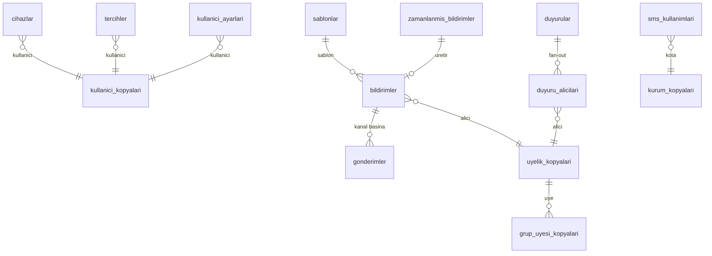

# `bildirim` veritabanı şeması

Bildirim servisi: cihazlar, tercihler, gelen kutusu, duyuru dağıtımı, e-posta/SMS/push gönderim günlüğü. Ortak kurallar [README.md](README.md)'dedir. Olay yükleri [olaylar.md](olaylar.md)'dedir.

Tek şema: `bildirim` (+ `ortak`). Roller: `bildirim_owner`, `bildirim_app`, `bildirim_sistem`.

## Tasarım kuralları

- Bildirimler **üyelik başınadır** (`alici_id` = `hesap.uyelikler.id`), çünkü içerik kurum bağlamındadır. Cihazlar ve iletişim bilgileri **kullanıcı başınadır** (`kullanici_id`). Gönderimde `alici_id` -> `kullanici_id` eşlemesi `uyelik_kopyalari` ile yapılır.
- Servis, içeriği olaydan üretir: olay -> kategori -> şablon -> alıcı çözümü -> tercih ve sessiz saat süzgeci -> kanal başına gönderim.
- **Kanallar:** `kutu` (gelen kutusu, her zaman yazılır), `push`, `eposta`, `sms`.
- **Gizlilik (KVKK):** push ve SMS gövdesi kişisel veri taşımaz (öğrenci adı, not, ödev metni yok). Genel metin + derin bağlantı. Push sağlayıcıları (Expo/APNs/FCM) yurt dışındadır ([ADR 0005](../adr/0005-dagitim-docker-kamal.md)). SMS ve e-posta sağlayıcıları Türkiye'de olmalıdır.
- **Gizli içerik** (OTP, davet bağlantısı) olaydan değil, iç uç noktadan gelir: `POST /ic/sms` (servis JWT'si, `aud=bildirim`). Bu içerik `gonderimler.govde`ye yazılmaz (yalnızca `sablon_kodu` ve maske).
- Tercihler ve kota tüketici tarafında uygulanır. Kullanıcı tercihi kapalı kategorilerde `kutu` yazılır, diğer kanallar atlanır (`atlandi`).
- Duyuru: içeriğin sahibi bu servistir (`api`da duyuru tablosu yoktur).

## Sözlük (kategoriler)

`kategori` değerleri (CHECK, tüm tablolarda aynı): `ders` (hatırlatma, iptal, ertelendi), `yoklama`, `odev`, `soru`, `kayit` (ders kaydı/materyal), `duyuru`, `finans` (düşük kredi, tahsilat), `oyunlastirma`, `abonelik`, `sistem` (güvenlik, davet, zorunlu).

Varsayılan kanal matrisi (kayıt yoksa uygulanır):

| Kategori | kutu | push | eposta | sms |
| --- | --- | --- | --- | --- |
| `ders` | açık | açık | kapalı | kapalı |
| `yoklama` | açık | açık | kapalı | kapalı |
| `odev` | açık | açık | kapalı | kapalı |
| `soru` | açık | açık | kapalı | kapalı |
| `kayit` | açık | açık | kapalı | kapalı |
| `duyuru` | açık | açık | kapalı | kapalı |
| `finans` | açık | açık | kapalı | kapalı |
| `oyunlastirma` | açık | açık | kapalı | kapalı |
| `abonelik` | açık | açık | açık | kapalı |
| `sistem` | açık (zorunlu) | açık (zorunlu) | açık (zorunlu) | açık (zorunlu) |

`sistem` kapatılamaz. SMS yalnızca kurumun açıkça etkinleştirdiği kategorilerde ve plan kotası içinde kullanılır (`sms_kullanimlari`).

## Cihaz, tercih, ayar

### `bildirim.cihazlar`

Push cihaz kayıtları. Kullanıcı başınadır, kiracı bağımsızdır.

Profil: `G` (+ `kullanici_id`). RLS: evet, `kullanici_id = ortak.aktif_kullanici()` (kurum politikası değil). Gönderim işleri `_sistem` rolüyle okur.

| Sütun | Tip | Null | Varsayılan | Not |
| --- | --- | --- | --- | --- |
| `kullanici_id` | uuid | hayır | | `hesap.kullanicilar.id` (FK yok) |
| `platform` | text | hayır | | CHECK `IN ('ios','android','web')` |
| `saglayici` | text | hayır | `'expo'` | CHECK `IN ('expo','fcm','apns','webpush')` |
| `push_belirteci` | text | hayır | | |
| `cihaz_kimligi` | text | hayır | | Uygulamanın ürettiği kalıcı cihaz kimliği |
| `uygulama_surumu` | text | evet | | |
| `dil` | text | hayır | `'tr'` | |
| `aktif` | boolean | hayır | true | |
| `gecersiz_at` | timestamptz | evet | | Sağlayıcı `DeviceNotRegistered` döndürünce |
| `son_gorulme_at` | timestamptz | hayır | now() | Her açılışta güncellenir |

Kısıtlar: `UNIQUE (push_belirteci)`, `UNIQUE (kullanici_id, cihaz_kimligi)`. Aynı belirteç başka kullanıcıya geçerse (cihaz el değiştirdi) eski satır `aktif=false` yapılır. 60 gündür görülmeyen cihaz pasife alınır. İndeks: `(kullanici_id) WHERE aktif`. Olaylar: yok.

### `bildirim.tercihler`

Kullanıcının kurum x kategori x kanal tercihi. Kayıt yoksa varsayılan matris.

Profil: `K` (UUID `id` yok). PK `(kullanici_id, kurum_id, kategori, kanal)`. RLS: evet, iki kollu (`kurum_id = aktif_kurum()` ya da `kullanici_id = aktif_kullanici()`).

| Sütun | Tip | Null | Varsayılan | Not |
| --- | --- | --- | --- | --- |
| `kullanici_id` | uuid | hayır | | |
| `kategori` | text | hayır | | Sözlükteki değerler |
| `kanal` | text | hayır | | CHECK `IN ('kutu','push','eposta','sms')` |
| `acik` | boolean | hayır | | |

Kısıtlar: `CHECK (kategori <> 'sistem')` (zorunlu kategori kaydedilmez), `CHECK (kanal <> 'kutu' OR acik)` (gelen kutusu kapatılamaz). Olaylar: yok.

### `bildirim.kullanici_ayarlari`

Sessiz saatler ve genel ayarlar. Profil: `K` (UUID `id` yok). PK `(kullanici_id, kurum_id)`. RLS: iki kollu (tercihler gibi).

| Sütun | Tip | Null | Varsayılan | Not |
| --- | --- | --- | --- | --- |
| `kullanici_id` | uuid | hayır | | |
| `sessiz_baslangic` | time | evet | | Örn. `22:00` |
| `sessiz_bitis` | time | evet | | Örn. `07:00`. Gece yarısını aşabilir. |
| `sessiz_gunler` | smallint[] | hayır | `'{1,2,3,4,5,6,7}'` | ISO gün numarası |
| `saat_dilimi` | text | hayır | `'Europe/Istanbul'` | |
| `ders_hatirlatma_dk` | smallint | hayır | 60 | Ders öncesi hatırlatma (0 = kapalı). CHECK `IN (0,15,30,60,120,1440)` |

Kısıtlar: `CHECK ((sessiz_baslangic IS NULL) = (sessiz_bitis IS NULL))`. **Sessiz saat kuralı:** `push` ve `sms` gönderimleri sessiz aralığa denk gelirse `gonderimler.durum='ertelendi'`, `zamanlanan_at = sessiz_bitis` olur. `kutu` etkilenmez. `sistem` kategorisi ve `ders` kategorisinde başlangıcına 30 dk kalmış hatırlatma sessiz saati **delmez**; bunlar `atlandi (sessiz_saat)` olur. Erteleme 12 saati aşarsa gönderim iptal edilir (bayat). Olaylar: yok.

## Okuma kopyaları

Yalnızca olay tüketicisi yazar. RLS: evet (`kurum_id`), `kullanici_kopyalari` hariç.

| Tablo | Kaynak olay | Sütunlar | Neden gerekli |
| --- | --- | --- | --- |
| `kullanici_kopyalari` | `hesap.kullanici.degisti.v1` | `kullanici_id` PK, `gorunen_ad`, `telefon_e164`, `eposta`, `dil`, `durum`, `surum` | SMS/e-posta adresi, ad. **KVKK:** PII kopyasıdır; RLS yok (kullanıcı düzeyi), yalnızca `_sistem`/tüketici okur. Silme olayında satır silinir. |
| `kurum_kopyalari` | `hesap.kurum.degisti.v1`, `abonelik.abonelik.degisti.v1` | `kurum_id` PK, `ad`, `durum`, `saat_dilimi`, `plan_kodu`, `abonelik_durumu`, `sms_aylik_limit`, `surum`, `abonelik_surumu` | Kurum adı (e-posta), SMS kotası, askıdaki kurumda gönderim durdurma |
| `uyelik_kopyalari` | `hesap.uyelik.degisti.v1` | `uyelik_id` PK, `kurum_id`, `kullanici_id`, `rol`, `durum`, `kademe_id`, `surum` | Alıcı çözümü (uyelik -> kullanici) ve rol bazlı hedefleme |
| `kademe_kopyalari` | `hesap.kademe.degisti.v1` | `kademe_id` PK, `kurum_id`, `ad`, `arsivlendi`, `surum` | Duyuru hedefi `kademe` |
| `grup_kopyalari` | `hesap.grup.degisti.v1` | `grup_id` PK, `kurum_id`, `kademe_id`, `tur`, `ad`, `durum`, `surum` | Duyuru hedefi `grup`, modül çözümü |
| `grup_uyesi_kopyalari` | `hesap.grup_uyesi.degisti.v1` | PK `(grup_id, ogrenci_id)`, `baslangic_tarihi`, `bitis_tarihi`, `surum` | Grup/kademe duyuru alıcı listesi |
| `atama_kopyalari` | `hesap.atama.degisti.v1` | `atama_id` PK, `grup_id`, `ogretmen_id`, `brans_kodu`, `bitis_tarihi`, `surum` | Öğretmenin duyuru hedefleme yetkisi (yalnızca atandığı gruplar); soru yönlendirme bildirimi |
| `modul_ayari_kopyalari` | `hesap.modul_ayari.degisti.v1` | PK `(kurum_id, modul_kodu, kapsam, kapsam_id)`, `acik`, `surum` | `duyuru` modülü kapalıysa duyuru yayını reddedilir |

Kopya ve olay sırası: kopya henüz oluşmamışken gelen bildirim olayı `nak` ile gecikmeli yeniden denenir ([ADR 0002](../adr/0002-olay-sozlesmesi-outbox-idempotent-tuketici.md)). `hesap.kullanici.silindi.v1` gelince `kullanici_kopyalari` satırı, `cihazlar`, `tercihler`, `kullanici_ayarlari` silinir; `bildirimler`/`gonderimler` içindeki alıcı bağlantısı kalır ama `hedef_maske` temizlenir.

## Gelen kutusu

### `bildirim.sablonlar`

Bildirim şablonları. Profil: `GS`. RLS: hayır (global). Tohum verisidir.

| Sütun | Tip | Null | Varsayılan | Not |
| --- | --- | --- | --- | --- |
| `kod` | text | hayır | | Ör. `odev_yayinlandi`, `ders_hatirlatma`, `sifre_otp`. `UNIQUE (kod, kanal, dil)` |
| `kategori` | text | hayır | | |
| `kanal` | text | hayır | | CHECK `IN ('kutu','push','eposta','sms')` |
| `dil` | text | hayır | `'tr'` | |
| `baslik` | text | evet | | `{{degisken}}` yer tutucuları. Yer tutucular olay yükünden doldurulur; yük dışı alan yasak. |
| `govde` | text | hayır | | |
| `derin_baglanti` | text | evet | | Ör. `kopru://odev/{{odev_id}}` |
| `kisisel_veri_iceriyor` | boolean | hayır | false | `true` ise `push` ve `sms` kanalında kullanılamaz (CHECK) |

Kısıtlar: `CHECK (NOT kisisel_veri_iceriyor OR kanal IN ('kutu','eposta'))`. Şablon sürümü kodla birlikte dağıtılır.

### `bildirim.bildirimler`

Gelen kutusu. Üyelik başına bildirim.

Profil: `K`. RLS: evet. Aylık bölümlenebilir; 90 gün saklanır.

| Sütun | Tip | Null | Varsayılan | Not |
| --- | --- | --- | --- | --- |
| `alici_id` | uuid | hayır | | `uyelik_kopyalari.uyelik_id` |
| `kategori` | text | hayır | | |
| `sablon_kodu` | text | hayır | | |
| `baslik` | text | hayır | | Çözülmüş metin (kutuda kişisel veri olabilir; kutu erişimi yalnızca alıcıya) |
| `govde` | text | hayır | | |
| `derin_baglanti` | text | evet | | |
| `veri` | jsonb | hayır | `'{}'` | Nesne kimlikleri |
| `kaynak_olay_id` | uuid | hayır | | |
| `tekil_anahtar` | text | hayır | | `{sablon_kodu}:{ozne_id}[:{ek}]`. Aynı olay iki kez bildirim üretmesin |
| `okundu_at` | timestamptz | evet | | |
| `arsivlendi_at` | timestamptz | evet | | |
| `gecerlilik_bitis_at` | timestamptz | evet | | Geçersiz bildirimler (iptal edilmiş ders hatırlatması) gizlenir |

Kısıtlar: `UNIQUE (kurum_id, alici_id, tekil_anahtar)` (idempotency), `UNIQUE (kurum_id, id)`. İndeks: `(kurum_id, alici_id, created_at DESC)`, `(kurum_id, alici_id) WHERE okundu_at IS NULL AND arsivlendi_at IS NULL` (okunmamış sayısı). Olaylar: yok.

### `bildirim.gonderimler`

Kanal başına gönderim günlüğü (push/e-posta/SMS). Kutu için satır yazılmaz.

Profil: `K`. RLS: evet. Aylık bölümlenir; 180 gün saklanır.

| Sütun | Tip | Null | Varsayılan | Not |
| --- | --- | --- | --- | --- |
| `bildirim_id` | uuid | evet | | `bildirimler.id`. İç uç noktadan gelen OTP/davet için NULL. |
| `alici_kullanici_id` | uuid | hayır | | |
| `kanal` | text | hayır | | CHECK `IN ('push','eposta','sms')` |
| `sablon_kodu` | text | hayır | | |
| `hedef_anahtar` | text | hayır | | Cihaz için `cihaz_id`; e-posta/SMS için hedefin HMAC özeti (tekilleştirme) |
| `hedef_maske` | text | evet | | `+90 5** *** ** 12`, `a***@ornek.com`. Düz adres saklanmaz. |
| `saglayici` | text | evet | | `expo`, `netgsm`, `smtp`... (sağlayıcı seçimi açık) |
| `saglayici_mesaj_id` | text | evet | | |
| `durum` | text | hayır | `'beklemede'` | CHECK `IN ('beklemede','ertelendi','gonderildi','teslim_edildi','basarisiz','atlandi')` |
| `atlama_nedeni` | text | evet | | CHECK `IN ('tercih','sessiz_saat','kota','cihaz_yok','kurum_askida','bayat')` |
| `hata_kodu` | text | evet | | |
| `deneme_sayisi` | smallint | hayır | 0 | En çok 5 |
| `zamanlanan_at` | timestamptz | hayır | now() | Ertelemede sessiz saat bitişi |
| `gonderildi_at` | timestamptz | evet | | |
| `maliyet_kurus` | int | evet | | SMS maliyeti |

Kısıtlar: `UNIQUE (bildirim_id, kanal, hedef_anahtar) WHERE bildirim_id IS NOT NULL` (aynı bildirim aynı hedefe iki kez gitmez; tüketici yeniden denemesi güvenli). İş: dakikalık `gonderim.isle` işi `durum IN ('beklemede','ertelendi') AND zamanlanan_at <= now()` olan satırları `FOR UPDATE SKIP LOCKED` ile çeker. Hata sınıfları: geçici (zaman aşımı, 5xx) -> `deneme_sayisi+1`, `zamanlanan_at` üstel bekleme (1, 5, 30, 120 dk); kalıcı (`DeviceNotRegistered`, geçersiz numara) -> `basarisiz`, cihaz `gecersiz_at`. İndeks: `(durum, zamanlanan_at) WHERE durum IN ('beklemede','ertelendi')`, `(kurum_id, alici_kullanici_id, created_at DESC)`, `(kurum_id, bildirim_id)`. Olaylar: yok.

### `bildirim.zamanlanmis_bildirimler`

Gelecekte üretilecek bildirimler (ders hatırlatması). Ders iptal/erteleme olduğunda iptal edilir.

Profil: `K`. RLS: evet.

| Sütun | Tip | Null | Varsayılan | Not |
| --- | --- | --- | --- | --- |
| `kaynak_turu` | text | hayır | | `ders` |
| `kaynak_id` | uuid | hayır | | `ders_id` |
| `alici_id` | uuid | hayır | | Üyelik |
| `sablon_kodu` | text | hayır | | `ders_hatirlatma` |
| `gonderim_at` | timestamptz | hayır | | `ders.baslangic_at - hatirlatma_dk` (alıcının `ders_hatirlatma_dk`'ı) |
| `veri` | jsonb | hayır | | |
| `iptal_at` | timestamptz | evet | | |
| `uretildi_at` | timestamptz | evet | | |

Kısıtlar: `UNIQUE (kurum_id, kaynak_turu, kaynak_id, alici_id, sablon_kodu)`. `ders.ders.degisti.v1` geldiğinde: iptalse `iptal_at`; ertelendiyse `gonderim_at` yeniden hesaplanır (`UPDATE`, `uretildi_at` NULL'a döner); planlandıysa eklenir. Dakikalık iş `gonderim_at <= now() AND iptal_at IS NULL AND uretildi_at IS NULL` satırlarını `bildirimler`e dönüştürür. İndeks: `(gonderim_at) WHERE iptal_at IS NULL AND uretildi_at IS NULL`, `(kurum_id, kaynak_id)`. Olaylar: yok.

## Duyurular

### `bildirim.duyurular`

Kurum/kademe/grup duyuruları. İçerik ve okunma sayısı bu servistedir.

Profil: `KS`. RLS: evet.

| Sütun | Tip | Null | Varsayılan | Not |
| --- | --- | --- | --- | --- |
| `baslik` | text | hayır | | ≤ 200 |
| `govde` | text | hayır | | ≤ 4000, düz metin + bağlantı |
| `hedef_turu` | text | hayır | | CHECK `IN ('grup','kademe','kurum')` |
| `hedef_id` | uuid | hayır | | `kurum` ise `kurum_id` |
| `hedef_roller` | text[] | hayır | `'{ogrenci}'` | Alıcı roller: `ogrenci`, `ogretmen`, `veli`. Faz 1 varsayılan yalnızca öğrenci ve öğretmen. |
| `yazar_id` | uuid | hayır | | Üyelik |
| `durum` | text | hayır | `'taslak'` | CHECK `IN ('taslak','yayinda','arsiv')` |
| `yayin_at` | timestamptz | evet | | |
| `bitis_at` | timestamptz | evet | | Süre sonu (sonra gizlenir) |
| `sabit` | boolean | hayır | false | |
| `alici_sayisi` | int | hayır | 0 | Fan-out sonrası |
| `okunan_sayisi` | int | hayır | 0 | **Okunma sayacı**, `duyuru_alicilari.okundu_at` ilk dolduğunda artar |
| `push_gonderildi` | boolean | hayır | true | Yayında push üretilsin mi |
| `silindi_at` | timestamptz | evet | | |

Kısıtlar: `CHECK (hedef_turu <> 'kurum' OR hedef_id = kurum_id)`, `CHECK (durum = 'taslak' OR yayin_at IS NOT NULL)`, `CHECK (okunan_sayisi <= alici_sayisi)`, `UNIQUE (kurum_id, id)`. Yetki: `yonetici`/`sahip` her hedefe; `ogretmen` yalnızca `atama_kopyalari`nda aktif atamasının olduğu `grup` hedeflerine. Yayın: tek işlemde alıcılar çözülür (`grup` -> `grup_uyesi_kopyalari` etkin üyeleri; `kademe` -> `uyelik_kopyalari.kademe_id`; `kurum` -> tüm etkin üyelikler; `hedef_roller` süzgeci), `duyuru_alicilari` `ON CONFLICT DO NOTHING` ile 500'lük gruplarla yazılır, `alici_sayisi` yazılır; büyük hedefler (> 2000) pg-boss işinde. Yayından sonra gruba katılan üye duyuruyu `grup_uyesi_kopyalari` olayında alır (süresi geçmemiş ve `sabit` ya da son 14 gün). İndeks: `(kurum_id, durum, yayin_at DESC)`, `(kurum_id, hedef_turu, hedef_id)`. Olaylar: yok (yayın doğrudan `bildirimler` üretir, şablon `duyuru_yayinlandi`).

### `bildirim.duyuru_alicilari`

Duyuru x üyelik satırı (okundu bilgisi).

Profil: `K`. RLS: evet.

| Sütun | Tip | Null | Varsayılan | Not |
| --- | --- | --- | --- | --- |
| `duyuru_id` | uuid | hayır | | Bileşik FK |
| `alici_id` | uuid | hayır | | Üyelik |
| `okundu_at` | timestamptz | evet | | |

Kısıtlar: `UNIQUE (duyuru_id, alici_id)`. **Okundu işaretleme:** `UPDATE duyuru_alicilari SET okundu_at = now() WHERE duyuru_id = :d AND alici_id = :a AND okundu_at IS NULL`; etkilenen satır 1 ise aynı işlemde `UPDATE duyurular SET okunan_sayisi = okunan_sayisi + 1`. Tekrar okuma sayacı artırmaz. İndeks: `(kurum_id, alici_id, okundu_at)`, `(kurum_id, duyuru_id) WHERE okundu_at IS NULL`. Olaylar: yok.

## Kota

### `bildirim.sms_kullanimlari`

Kurum başına aylık SMS sayacı. Profil: `K` (UUID `id` yok). PK `(kurum_id, donem)`. RLS: evet. Sütunlar: `donem date` (ayın ilk günü), `adet int NOT NULL DEFAULT 0`, `maliyet_kurus bigint NOT NULL DEFAULT 0`. Gönderim öncesi koşullu artırım: `... ON CONFLICT DO UPDATE SET adet = adet + 1 WHERE sms_kullanimlari.adet < :limit`; dönen satır yoksa gönderim `atlandi (kota)` olur. `sistem` kategorisi (OTP, davet) kotadan düşer ama limit aşıldığında **engellenmez** (hesap erişimi için), yalnızca uyarı üretilir. Limit: `kurum_kopyalari.sms_aylik_limit`. Olaylar: yok.

## Tüketilen olaylar ve ürettikleri bildirimler

| Olay | Alıcı | Kategori / şablon |
| --- | --- | --- |
| `ders.ders.degisti.v1` | Katılımcı öğrenciler, öğretmen | `ders`: planlandı (telafi ise), ertelendi, iptal; hatırlatma zamanlaması |
| `ders.yoklama.kaydedildi.v1` | Öğrenci (`gelmedi`/`gec`) | `yoklama` |
| `ders.kaynak.eklendi.v1` | Alıcı öğrenciler | `kayit`: yeni kayıt/materyal |
| `ders.kaynak.sorun_bildirildi.v1` | Kaynağı ekleyen öğretmen | `kayit`: bozuk bağlantı |
| `finans.kredi.azaldi.v1` | Öğrenci (ve öğretmen) | `finans`: kalan kredi |
| `finans.tahsilat.alindi.v1` | Öğrenci | `finans`: makbuz |
| `finans.paket.satildi.v1` | Öğrenci | `finans` |
| `ogrenme.odev.yayinlandi.v1` | Öğrenciler (parçalı) | `odev`: yeni ödev |
| `ogrenme.odev.teslim_edildi.v1` | Veren öğretmen | `odev` |
| `ogrenme.odev.incelendi.v1` | Öğrenci | `odev` |
| `ogrenme.soru.sorildi.v1` | Hedef öğretmenler | `soru` |
| `ogrenme.soru_mesaji.eklendi.v1` | Karşı taraf | `soru`: cevap/takip |
| `motivasyon.seviye.atladi.v1`, `rozet.kazanildi.v1`, `karakter.evrildi.v1`, `seri.kilometre_tasi.v1`, `seri.bozuldu.v1`, `seri.risk.v1` | Öğrenci | `oyunlastirma` |
| `abonelik.abonelik.degisti.v1` | Kurum `sahip` | `abonelik`: deneme bitiyor, ödeme bekliyor, ek süre, askıya alındı |
| `abonelik.odeme.islendi.v1` | Kurum `sahip` | `abonelik`: ödeme başarısız |
| `abonelik.fatura.kesildi.v1` | Kurum `sahip` | `abonelik`: e-posta ile fatura bağlantısı |
| `hesap.davet.kabul_edildi.v1` | Davet eden | `sistem` |
| `hesap.*` kopya olayları | | Kopya upsert |
| `hesap.kullanici.silindi.v1` | | Veri temizliği |

Tüketici adları: `bildirim.uretim` (bildirim üreten olaylar), `bildirim.kopya` (kopyalar).

## Üretilen olaylar

Faz 1'de yoktur. `ortak.outbox` tablosu şemada bulunur (ileride `bildirim.gonderim.basarisiz` gibi olaylar için).

## İç uç noktalar (olay değil)

- `POST /ic/sms`: `{sablon_kodu, telefon_e164, degiskenler}`. Çağıran: `api` (OTP, davet SMS'i). Yanıt: `202`, `gonderim_id`. Hız sınırı çağıran tarafta. `hedef_maske` yazılır, düz numara saklanmaz.
