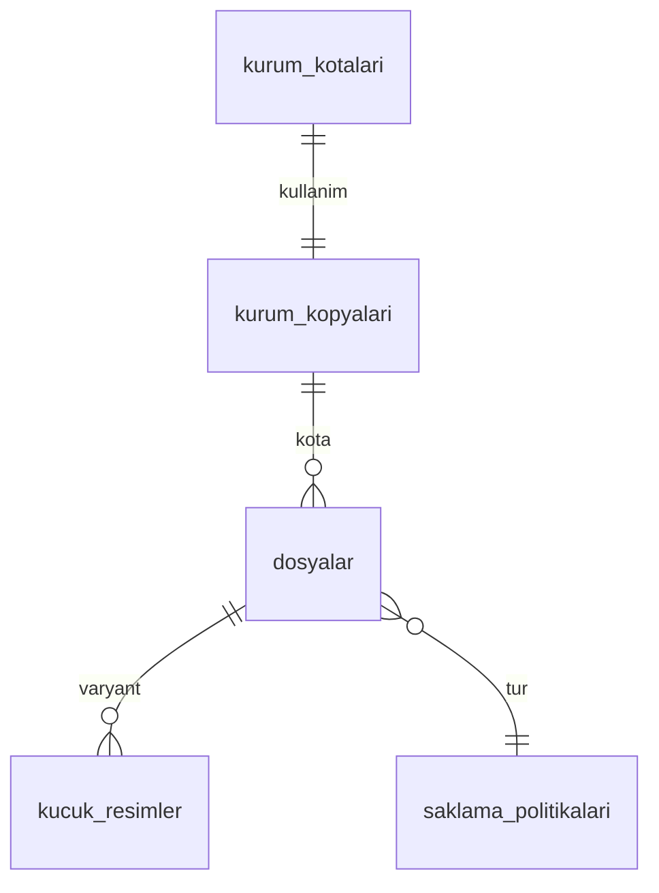

# `medya` veritabanı şeması

Medya servisi: dosya kayıtları, yükleme izinleri (presigned URL), işleme, küçük resimler, saklama ve silme. Dosya baytları S3 uyumlu, Türkiye'deki nesne depolamada tutulur ([ADR 0005](../adr/0005-dagitim-docker-kamal.md)). Ortak kurallar [README.md](README.md)'dedir. Olay yükleri [olaylar.md](olaylar.md)'dedir.

Tek şema: `medya` (+ `ortak`). Roller: `medya_owner`, `medya_app`, `medya_sistem`.

## Tasarım kuralları

- **Yükleme akışı** (3 adım):
  1. İstemci `POST /v1/dosyalar` ile `{tur, mime_tipi, boyut_bayt, sha256, istemci_anahtari}` gönderir. Servis kota, tür ve boyut denetimini yapar, `dosyalar` satırını `yukleme_bekliyor` durumunda açar, presigned `PUT` adresi (15 dk geçerli) döner. `istemci_anahtari` tekrar eden istekte aynı satırı döndürür (idempotency).
  2. İstemci baytları doğrudan depolamaya yükler.
  3. İstemci `POST /v1/dosyalar/{id}/tamam` çağırır. Servis nesneyi `HEAD` ile doğrular (boyut, içerik türü), durumu `yuklendi` yapar ve işleme işini kuyruğa alır. İşleme biter: `hazir` + `medya.dosya.hazir.v1`.
- **Okuma:** İstemciye kalıcı adres verilmez. Okuma adresi kısa ömürlü (10 dk) presigned `GET`'tir. Sahip kendi dosyasını doğrudan, başkasının dosyasını yalnızca `api` aracılığıyla (iç uç nokta `POST /ic/okuma-adresleri`, servis JWT'si) alır; yetki kararı `api`dadır (öğretmen-öğrenci ilişkisi `api` verisidir). Böylece `medya` üyelik kopyası tutmaz.
- **Bağlama (referans):** Yüklenen dosya, bir iş kaydına bağlanana kadar "yetim"dir. `api`, dosyayı bir ödev teslimi/soru/mesajına bağlayınca `ortak.dosya.baglandi.v1` yayımlar. Yetim dosyalar `saklama_politikalari.yetim_saat` sonra silinir.
- **Silme:** Fiziksel silme `silinecek_at` zamanı gelince işlenir. Satır silinmez, `durum='silindi'` olur ve depolama anahtarı `NULL`lanır; `sha256`, boyut, tür ve silme nedeni denetim için kalır.
- **Güvenlik:** Yükleme sonrası içerik türü bayt imzasıyla (magic bytes) doğrulanır, bildirilen `mime_tipi` ile uyuşmazsa dosya reddedilir (`islenemedi`, `mime_uyusmazligi`). Görseller yeniden kodlanır (EXIF konum bilgisi silinir). Virüs taraması Faz 1 dışı.
- **Depolama anahtarı:** `{kurum_id}/{tur}/{yyyy}/{mm}/{dosya_id}` (kullanıcı adı veya özgün dosya adı içermez).

## `medya.saklama_politikalari`

Dosya türü kuralları. Profil: `G`. RLS: hayır. Tohum verisi.

| Sütun | Tip | Null | Varsayılan | Not |
| --- | --- | --- | --- | --- |
| `tur` | text | hayır | | `UNIQUE`. `dosyalar.tur` değerleri (aşağıda) |
| `izinli_mime` | text[] | hayır | | Ör. `{image/jpeg,image/png,image/webp,image/heic}` |
| `azami_boyut_bayt` | bigint | hayır | | Fotoğraf 10 MB, ses 5 MB, PDF 20 MB |
| `varsayilan_saklama_gun` | int | evet | | Bağlandıktan sonra silinme süresi. NULL = süresiz |
| `yetim_saat` | int | hayır | 48 | Bağlanmamış dosya silme süresi |
| `kucuk_resim` | boolean | hayır | true | Küçük resim üretilsin mi |
| `ek_islem` | text | evet | | `gorsel_yeniden_kodla`, `ses_sure_cikar`, `yok` |

Tür değerleri (CHECK, `dosyalar.tur` ile aynı): `soru_fotografi`, `soru_cevap_fotografi`, `soru_cizim`, `soru_ses`, `odev_eki`, `odev_teslim_fotografi`, `kurum_logosu`, `avatar`, `fatura_pdf`. Başlangıç saklama: `soru_*` bağlanma sonrası `NULL` ( `soru.cozuldu` olayı süreyi 30 güne ayarlar); `odev_teslim_fotografi` 365 gün; `odev_eki` 365 gün; `kurum_logosu`, `avatar` süresiz; `fatura_pdf` 3650 gün (10 yıl, vergi mevzuatı için saklama yükümlülüğü teyit edilmeli, bkz. Q7).

## `medya.dosyalar`

Dosya kaydı.

Profil: `KS`. RLS: evet.

| Sütun | Tip | Null | Varsayılan | Not |
| --- | --- | --- | --- | --- |
| `sahip_kullanici_id` | uuid | hayır | | Yükleyen kullanıcı (JWT `sub`) |
| `sahip_uyelik_id` | uuid | hayır | | Yükleyen üyelik (JWT `uyelik_id`) |
| `tur` | text | hayır | | FK `saklama_politikalari(tur)` |
| `mime_tipi` | text | hayır | | Doğrulanmış içerik türü |
| `bildirilen_boyut_bayt` | bigint | hayır | | İstemci beyanı |
| `boyut_bayt` | bigint | evet | | `HEAD` ile doğrulanan gerçek boyut. `bildirilen` ile eşit olmalı. |
| `sha256` | bytea | evet | | Doğrulanan özet |
| `depolama_anahtari` | text | evet | | UNIQUE; silinince NULL |
| `kova` | text | hayır | `'medya-ozel'` | |
| `durum` | text | hayır | `'yukleme_bekliyor'` | CHECK `IN ('yukleme_bekliyor','yuklendi','isleniyor','hazir','islenemedi','silindi')` |
| `hata_kodu` | text | evet | | `mime_uyusmazligi`, `boyut_uyusmazligi`, `bozuk_dosya`, `yukleme_zaman_asimi` |
| `genislik`, `yukseklik` | int | evet | | Görseller |
| `sure_sn` | int | evet | | Ses |
| `istemci_anahtari` | uuid | hayır | | Yükleme idempotency |
| `yukleme_son_at` | timestamptz | hayır | | Presigned URL geçerlilik sonu (`created_at + 15 dk`) |
| `tamamlandi_at` | timestamptz | evet | | İstemci `tamam` dediği an |
| `hazir_at` | timestamptz | evet | | |
| `baglandi` | boolean | hayır | false | `ortak.dosya.baglandi.v1` ile true olur |
| `bagli_tur` | text | evet | | `odev_teslimi`, `odev_eki`, `soru`, `soru_mesaji`, `kurum`, `kullanici`, `fatura` |
| `bagli_id` | uuid | evet | | |
| `baglandi_at` | timestamptz | evet | | |
| `silinecek_at` | timestamptz | evet | | Silme zamanı (retention / `delete_after`). NULL = silme planlı değil. |
| `silme_nedeni` | text | evet | | `yetim`, `saklama_suresi`, `soru_cozuldu`, `kullanici_silindi`, `kurum_kapandi`, `birakildi`, `yukleme_zaman_asimi` |
| `silindi_at` | timestamptz | evet | | |

Kısıtlar:
- `UNIQUE (kurum_id, sahip_kullanici_id, istemci_anahtari)`.
- `UNIQUE (depolama_anahtari) WHERE depolama_anahtari IS NOT NULL`.
- `CHECK (boyut_bayt IS NULL OR boyut_bayt > 0)`.
- `CHECK (durum <> 'hazir' OR (boyut_bayt IS NOT NULL AND sha256 IS NOT NULL AND hazir_at IS NOT NULL))`.
- `CHECK ((durum = 'silindi') = (silindi_at IS NOT NULL))`.
- `CHECK (durum = 'silindi' OR depolama_anahtari IS NOT NULL OR durum = 'yukleme_bekliyor')`.
- `CHECK (baglandi = (bagli_id IS NOT NULL))`.

Durum makinesi: `yukleme_bekliyor` -> `yuklendi` -> `isleniyor` -> `hazir` | `islenemedi`; herhangi bir durumdan -> `silindi`. `yukleme_bekliyor` dosyası `yukleme_son_at + 1 saat` geçince `silinecek_at = now()` ile işaretlenir (`yukleme_zaman_asimi`).

**Silinecek_at kuralları** (hesaplandığı yerler):
1. Yetim: `hazir_at + yetim_saat` (bağlanmadıkça). `dosya.baglandi` bunu temizler (`silinecek_at = NULL` ya da politikanın saklama süresi).
2. Saklama süresi: `baglandi_at + varsayilan_saklama_gun`.
3. `ogrenme.soru.cozuldu.v1`: olaydaki `dosya_idleri` için `silinecek_at = olay.silinecek_at` (api: `cozuldu_at + 30 gün`).
4. `ogrenme.soru.yeniden_acildi.v1`: ilgili `silinecek_at = NULL` (silinmiş olanlara dokunulmaz).
5. `ortak.dosya.birakildi.v1`: `hemen_sil` ise `now()`, değilse yetim kuralı.
6. `hesap.kullanici.silindi.v1`: kullanıcının tüm dosyaları `now()` (`avatar` ve kullanıcı içeriği; `fatura_pdf` hariç, kurum varlığıdır).
7. Kurum `kapali`: kurumun dosyaları 90 gün sonra.

Silme işi: 5 dakikada bir. `WHERE silinecek_at <= now() AND durum <> 'silindi' ORDER BY silinecek_at LIMIT 200 FOR UPDATE SKIP LOCKED`; her dosya için nesne + küçük resimler depolamadan silinir (nesne yoksa hata sayılmaz), sonra `durum='silindi'`, `depolama_anahtari=NULL`, kota düşülür, `medya.dosya.silindi.v1` yayımlanır. Silme başarısızsa satır `silinecek_at` yarın olarak ertelenir ve hata sayacı artar.

İndeks: `(kurum_id, sahip_kullanici_id, created_at DESC)`, `(silinecek_at) WHERE durum <> 'silindi' AND silinecek_at IS NOT NULL`, `(durum, yukleme_son_at) WHERE durum = 'yukleme_bekliyor'`, `(kurum_id, bagli_tur, bagli_id)`, `(durum, hazir_at) WHERE baglandi = false AND durum = 'hazir'`.
Olaylar: `medya.dosya.hazir.v1`, `medya.dosya.islenemedi.v1`, `medya.dosya.silindi.v1`.

## `medya.kucuk_resimler`

Üretilen küçük resim varyantları.

Profil: `K`. RLS: evet.

| Sütun | Tip | Null | Varsayılan | Not |
| --- | --- | --- | --- | --- |
| `dosya_id` | uuid | hayır | | Bileşik FK `dosyalar` ON DELETE CASCADE |
| `varyant` | text | hayır | | CHECK `IN ('kucuk','orta')`. `kucuk` 256 px, `orta` 1024 px (uzun kenar) |
| `depolama_anahtari` | text | hayır | | `{asil_anahtar}.{varyant}.webp` |
| `genislik`, `yukseklik` | int | hayır | | |
| `boyut_bayt` | int | hayır | | |
| `mime_tipi` | text | hayır | `'image/webp'` | |

Kısıtlar: `UNIQUE (dosya_id, varyant)`, `UNIQUE (depolama_anahtari)`. Ana dosya silinince fiziksel nesneler silme işinde silinir ve satırlar `DELETE` edilir (yedek veri değildir). İndeks: `(kurum_id, dosya_id)`. Olaylar: yok.

## `medya.kurum_kotalari`

Kurum başına depolama kullanımı (türetilmiş).

Profil: `KS` (kurum başına tek satır). RLS: evet. Sütunlar: `kullanilan_bayt bigint NOT NULL DEFAULT 0`, `dosya_sayisi int NOT NULL DEFAULT 0`. `UNIQUE (kurum_id)`. Artırım: yükleme izni verilirken **rezervasyon** (`bildirilen_boyut_bayt` eklenir); koşul `kullanilan_bayt + :boyut <= kurum_kopyalari.medya_kota_bayt`, aksi halde `413 kota_asildi`. Yükleme zaman aşımı ve silme rezervasyonu/kullanımı düşürür. Gece işi `SUM(boyut_bayt)` ile denetler. Olaylar: yok.

## Yerel okuma kopyaları

| Tablo | Kaynak olay | Sütunlar | Neden gerekli |
| --- | --- | --- | --- |
| `kurum_kopyalari` | `hesap.kurum.degisti.v1`, `abonelik.abonelik.degisti.v1` | `kurum_id` PK, `durum`, `plan_kodu`, `abonelik_durumu`, `medya_kota_bayt`, `surum`, `abonelik_surumu` | Kota, askıdaki/kapalı kurumda yeni yüklemeyi reddetme |

Üyelik veya grup kopyası **tutulmaz**: yükleme yetkisi JWT rolünden (`ogrenci`, `ogretmen`...) ve `tur` kuralından belirlenir (ör. `kurum_logosu` yalnızca `yonetici`/`sahip`), okuma yetkisi `api`dadır. Kopya RLS: evet (`kurum_id`).

## Tüketilen olaylar

| Olay | İşleme | Tüketici adı |
| --- | --- | --- |
| `ortak.dosya.baglandi.v1` | `baglandi=true`, `bagli_tur/id`, `silinecek_at` politikaya göre | `medya.baglama` |
| `ortak.dosya.birakildi.v1` | Bağlantıyı çöz, yetim/silme kuralı | `medya.baglama` |
| `ogrenme.soru.cozuldu.v1` | `silinecek_at = cozuldu_at + 30 gün` | `medya.saklama` |
| `ogrenme.soru.yeniden_acildi.v1` | `silinecek_at = NULL` | `medya.saklama` |
| `hesap.kullanici.silindi.v1` | Kullanıcı dosyalarını sil | `medya.saklama` |
| `hesap.kurum.degisti.v1` | `kurum_kopyalari` upsert; `kapali` ise silme planı | `medya.kopya` |
| `abonelik.abonelik.degisti.v1` | Kota ve durum güncelle | `medya.kopya` |

`ortak.dosya.baglandi.v1` dosya henüz `hazir` değilken gelirse (yarış: dosya `isleniyor`), bağlama bilgisi yine yazılır (`baglandi` durumdan bağımsız).

## Üretilen olaylar

`medya.dosya.hazir.v1`, `medya.dosya.islenemedi.v1`, `medya.dosya.silindi.v1`. Tüketici: `api` (`ortak.medya_dosya_kopyalari`).

## Açık sorular (bu servis)

- Q7: `fatura_pdf` saklama süresi yasal gerekliliklerle teyit edilmeli (varsayım 10 yıl).
- Q8: Nesne depolama sağlayıcısı ve CDN kullanılmaması (Türkiye içi) performans etkisi.
