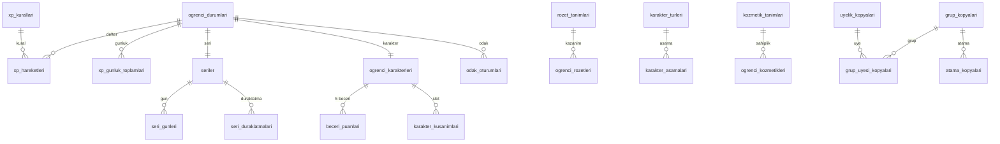

# `motivasyon` veritabanı şeması

Oyunlaştırma servisi: XP, seviye, seri, rozet, karakter, odak oturumları. Servis **yalnızca olaylarla beslenir** (odak oturumları hariç, bunlar istemciden doğrudan gelir). Çekirdek veri kaynağı `api`dır. Ortak kurallar, profil kodları ve RLS şablonu [README.md](README.md)'dedir. Olay yükleri [olaylar.md](olaylar.md)'dedir.

Tek şema: `motivasyon` (+ `ortak`). Roller: `motivasyon_owner`, `motivasyon_app`, `motivasyon_sistem`.

## Tasarım kuralları

- Oyunlaştırma durumu **üyelik (`ogrenci_id` = `hesap.uyelikler.id`) başınadır**. Aynı kullanıcının iki kurumdaki karakteri ayrıdır (bkz. açık soru Q3).
- XP, seri ve rozet hesapları yeniden oynatılabilir olmalıdır. Her XP satırı `kaynak_olay_id` ile bir olaya bağlıdır ve `(kaynak_olay_id, kural_kodu)` tekildir.
- **Gün sınırı** `Europe/Istanbul` yerel günüdür (`gun` sütunları `date`). Gün, olayın `olusma_zamani`ndan sunucuda hesaplanır, istemci saatinden değil.
- Oyunlaştırma modülü kapalıysa (kurum/kademe/grup, bkz. `modul_ayari_kopyalari`) olay işlenir ama XP verilmez ve kullanıcıya gösterilmez (`pasif_olay` sayacı artar). Modül sonradan açılırsa geçmiş XP geriye dönük verilmez.
- Öğretmen/yönetici, öğrencinin XP'sini elle değiştiremez. Tek istisna seri duraklatma (`seri_duraklatmalari`).



## Yapılandırma tabloları (global, RLS: hayır)

Tohum verisidir, migrasyonla gelir. Profil: `G`.

### `motivasyon.xp_kurallari`

Hangi olay ne kadar XP verir.

| Sütun | Tip | Null | Varsayılan | Not |
| --- | --- | --- | --- | --- |
| `kod` | text | hayır | | `UNIQUE`. Ör. `yoklama_geldi`, `odev_teslim`, `odev_tamam`, `plan_gorevi_tamam`, `deneme_girisi`, `kayit_izledi`, `geri_bildirim`, `soru_sorma`, `odak_oturumu` |
| `olay_turu` | text | hayır | | Tüketilen olay (`ders.yoklama.kaydedildi`) |
| `kosul` | jsonb | hayır | `'{}'` | Yük süzgeci, ör. `{"durum":["geldi","gec"]}` |
| `xp` | int | hayır | | CHECK `>= 0` |
| `gunluk_ust_sinir` | int | evet | | Bu kuraldan bir günde en çok toplam XP. NULL = sınırsız. |
| `seri_sayilir` | boolean | hayır | false | Bu kuraldan XP kazanmak o günü seri için "aktif" yapar |
| `aktif` | boolean | hayır | true | |

Başlangıç değerleri (ayar niteliğinde, ürün tarafından onaylanmalı): `yoklama_geldi` 10 (günde 30), `odev_teslim` 15 (günde 60), `plan_gorevi_tamam` 5 (günde 40), `deneme_girisi` 30 (günde 60), `kayit_izledi` 5 (günde 15), `geri_bildirim` 2 (günde 6), `soru_sorma` 3 (günde 9), `odak_oturumu` dakika başı 1 (günde 60). Kısıtlar: `UNIQUE (kod)`, `CHECK (gunluk_ust_sinir IS NULL OR gunluk_ust_sinir >= xp)`. Kural güncellemesi yeni olayları etkiler, geçmiş XP değişmez.

### `motivasyon.seviyeler`

Seviye eşikleri. Sütunlar: `seviye int PK`, `gereken_toplam_xp bigint NOT NULL`, `ad text NULL`. CHECK `seviye >= 1`, `gereken_toplam_xp >= 0`; seviye 1 = 0 XP. Artan, `gereken_toplam_xp` seviye ile kesin artan (uygulama doğrular). Başlangıç eğrisi: `gereken = 50 * (seviye-1)^2` (ayar).

### `motivasyon.rozet_tanimlari`

`kod text UNIQUE`, `ad text`, `aciklama text`, `kategori text` (`devamlilik`,`odev`,`sinav`,`ders`,`ozel`), `sayac_kodu text NOT NULL`, `esik bigint NOT NULL` (rozet, `ogrenci_sayaclari.deger >= esik` olunca kazanılır), `gizli boolean DEFAULT false`, `sira int`, `aktif boolean`. Rozet koşulu sayaç eşiği ile ifade edilir; karmaşık koşullar sayaç türetir.

### `motivasyon.karakter_turleri`

3 tür. `kod text UNIQUE`, `ad text`, `aktif boolean`. Kodlar tohumdur (ürün adlandırması bekleniyor, bkz. Q4).

### `motivasyon.karakter_asamalari`

Tür x aşama (1-5). `tur_kodu text FK`, `asama smallint CHECK BETWEEN 1 AND 5`, `gereken_seviye int NOT NULL`, `ad text`. `PK (tur_kodu, asama)`. `gereken_seviye` aşama ile kesin artar.

### `motivasyon.beceri_tanimlari`

5 beceri. `kod text PK` (başlangıç: `odak`, `azim`, `merak`, `duzen`, `hiz`; ürün onayı bekler, Q4), `ad`, `aciklama`, `kaynak_kural_kodlari text[]` (hangi XP kuralları bu beceriyi besler). Beceri puanı, kaynak kuralların kazandırdığı XP'nin yüzdesidir (aşağıda).

### `motivasyon.kozmetik_tanimlari`

`kod text UNIQUE`, `slot text NOT NULL` (CHECK `IN ('sapka','gozluk','aksesuar','arka_plan','cerceve')`), `ad`, `nadirlik text` (`yaygin`,`nadir`,`efsanevi`), `acilma_kosulu jsonb NOT NULL` (`{"rozet":"kod"}` veya `{"seviye":10}` veya `{"seri":30}`), `aktif boolean`.

## Öğrenci durumu

### `motivasyon.ogrenci_durumlari`

Öğrenci başına özet (türetilmiş, defterden yeniden kurulabilir).

Profil: `KS`. RLS: evet. `UNIQUE (kurum_id, ogrenci_id)`.

| Sütun | Tip | Null | Varsayılan | Not |
| --- | --- | --- | --- | --- |
| `ogrenci_id` | uuid | hayır | | `hesap.uyelikler.id` |
| `toplam_xp` | bigint | hayır | 0 | `SUM(xp_hareketleri.xp)` |
| `seviye` | int | hayır | 1 | `toplam_xp`'ye göre en yüksek `seviyeler` satırı |
| `bu_hafta_xp` | int | hayır | 0 | Pazartesi başlangıçlı hafta; gece işi sıfırlar |
| `son_aktivite_gun` | date | evet | | |
| `pasif_olay_sayisi` | int | hayır | 0 | Modül kapalıyken işlenen olay |

Güncelleme: XP satırı eklenen aynı işlemde `UPDATE ... SET toplam_xp = toplam_xp + :xp`. Seviye atlanırsa `motivasyon.seviye.atladi.v1`. İndeks: `UNIQUE (kurum_id, ogrenci_id)`, `(kurum_id, bu_hafta_xp DESC)` (ileride sıralama).

## XP

### `motivasyon.xp_hareketleri`

XP defteri (yalnızca ekleme).

Profil: `D`. RLS: evet. Aylık bölümlenir (eşik 20 milyon satır).

| Sütun | Tip | Null | Varsayılan | Not |
| --- | --- | --- | --- | --- |
| `ogrenci_id` | uuid | hayır | | |
| `kural_kodu` | text | hayır | | FK `xp_kurallari(kod)` |
| `kaynak_olay_id` | uuid | hayır | | Tetikleyen olay `id` |
| `kaynak_ozne_id` | uuid | evet | | Olayın öznesi (yoklama, ödev vb.) |
| `xp` | int | hayır | | CHECK `> 0`. Verilen XP (günlük tavan nedeniyle kuraldan az olabilir) |
| `gun` | date | hayır | | Yerel gün |
| `kismi` | boolean | hayır | false | Tavan nedeniyle kırpıldı |

Kısıtlar: `UNIQUE (kaynak_olay_id, kural_kodu)` (aynı olay iki kez XP vermez; `processed_events` ile çift emniyet). **Aynı özneden tekrar XP engeli:** `UNIQUE (ogrenci_id, kural_kodu, kaynak_ozne_id) WHERE kaynak_ozne_id IS NOT NULL AND kural_kodu IN ('odev_teslim','deneme_girisi','kayit_izledi','geri_bildirim','yoklama_geldi')`. Aynı ödevi tekrar teslim edip XP kazanmak engellenir. Yoklama düzeltmesinde XP geri alınmaz (hileye açık yan etkiyi kabul ediyoruz, bkz. Q5).
İndeks: `(kurum_id, ogrenci_id, created_at DESC)`, `(kurum_id, ogrenci_id, gun)`.
Olaylar: yok (özet olaylar `seviye.atladi` vb.).

### `motivasyon.xp_gunluk_toplamlari`

Günlük tavan kontrolü için sayaç.

Profil: `K` (UUID `id` yok). PK `(ogrenci_id, gun, kural_kodu)`. RLS: evet. Sütunlar: `ogrenci_id`, `gun date`, `kural_kodu text`, `toplam int NOT NULL DEFAULT 0`.

Tavan algoritması (aynı işlem içinde):

```sql
-- :xp kural değeri, :tavan kuralın gunluk_ust_sinir değeri (NULL = sınırsız)
INSERT INTO motivasyon.xp_gunluk_toplamlari (kurum_id, ogrenci_id, gun, kural_kodu, toplam)
VALUES (:kurum, :ogrenci, :gun, :kural, LEAST(:xp, COALESCE(:tavan, :xp)))
ON CONFLICT (ogrenci_id, gun, kural_kodu) DO UPDATE
  SET toplam = xp_gunluk_toplamlari.toplam + LEAST(:xp, COALESCE(:tavan, :xp) - xp_gunluk_toplamlari.toplam)
  WHERE COALESCE(:tavan, :xp + xp_gunluk_toplamlari.toplam) > xp_gunluk_toplamlari.toplam
RETURNING toplam;
```

Verilen XP = yeni `toplam` - önceki `toplam`; 0 ise `xp_hareketleri` satırı yazılmaz. Kısmi verilirse `kismi=true`. Olaylar: yok.

### `motivasyon.ogrenci_sayaclari`

Rozet koşulları için sayaçlar. Profil: `K` (UUID `id` yok). PK `(ogrenci_id, sayac_kodu)`. RLS: evet. Sütunlar: `sayac_kodu text` (`toplam_odev_teslim`, `toplam_yoklama`, `toplam_deneme`, `en_uzun_seri`, `toplam_odak_dk`, `toplam_kayit_izleme`, `toplam_soru`), `deger bigint NOT NULL DEFAULT 0`. Güncelleme olay işleme işlemindedir, ardından eşiği geçen `rozet_tanimlari` değerlendirilir. Olaylar: yok.

### `motivasyon.beceri_puanlari`

Karakterin 5 beceri değeri. Profil: `K` (UUID `id` yok). PK `(ogrenci_id, beceri_kodu)`. RLS: evet. Sütunlar: `beceri_kodu text FK beceri_tanimlari`, `puan int NOT NULL DEFAULT 0 CHECK (puan >= 0)`. XP satırı yazılırken, kuralın `beceri_tanimlari.kaynak_kural_kodlari` listesinde olduğu becerilerin `puan` değeri verilen XP kadar artırılır. Seviyeyi etkilemez, yalnızca karakter ekranında görünür.

## Seri

Seri: ardışık "aktif" günlerin sayısıdır. Bir gün, o gün `seri_sayilir` kuraldan XP kazanıldığında `aktif` sayılır.

### `motivasyon.seriler`

Öğrenci başına seri durumu.

Profil: `KS`. RLS: evet. `UNIQUE (kurum_id, ogrenci_id)`.

| Sütun | Tip | Null | Varsayılan | Not |
| --- | --- | --- | --- | --- |
| `ogrenci_id` | uuid | hayır | | |
| `mevcut_seri` | int | hayır | 0 | |
| `en_uzun_seri` | int | hayır | 0 | |
| `son_aktif_gun` | date | evet | | Seri sayılan son gün |
| `dondurma_hakki` | smallint | hayır | 2 | Kullanılabilir seri dondurma. CHECK `0..5`. |
| `dondurma_yenileme_haftasi` | date | evet | | Son yenilenen hafta (Pazartesi). Her hafta +1, üst sınır 2. |
| `onarim_hakki` | smallint | hayır | 1 | Ayda bir seri onarımı. CHECK `0..2`. |
| `onarim_yenileme_ayi` | date | evet | | Ayın ilk günü |
| `bozulan_seri` | int | evet | | Son bozulan serinin değeri (onarım için) |
| `bozulma_gunu` | date | evet | | |
| `onarim_son_gun` | date | evet | | Onarım için son gün (bozulma + 2 gün) |

Kurallar:
- **Günlük değerlendirme** (gece 00:10 yerel, pg-boss): dün `aktif` değilse ve `seri_duraklatmalari` o günü kapsamıyorsa: `dondurma_hakki > 0` ise otomatik dondurma kullanılır (`seri_gunleri.durum='dondurma'`, hak -1, seri korunur); yoksa seri bozulur (`bozulan_seri = mevcut_seri`, `mevcut_seri = 0`, `onarim_son_gun = bozulma + 2`). 
- **Onarım:** `onarim_son_gun` içinde ve `onarim_hakki > 0` ise öğrenci onarım isteyebilir: kaçırılan gün `seri_gunleri.durum='onarim'` yazılır, `mevcut_seri = bozulan_seri + 1` (bozulan günün atlanmış kabulü; ürün onayı Q6), hak -1.
- **Öğretmen duraklatması:** Öğretmen, atandığı öğrenci için bir tarih aralığı duraklatır (hastalık, sınav); aralıktaki günler seriyi bozmaz ve sayılmaz (artırmaz).
- Haftalık dondurma yenilemesi ve aylık onarım yenilemesi gece işinde yapılır.
Kısıtlar: `CHECK (mevcut_seri >= 0 AND en_uzun_seri >= mevcut_seri)`. İndeks: `UNIQUE (kurum_id, ogrenci_id)`, `(son_aktif_gun)` (gece işi taraması, `_sistem`).
Olaylar: `motivasyon.seri.bozuldu.v1`, `motivasyon.seri.kilometre_tasi.v1` (7, 14, 30, 60, 100, 200, 365), `motivasyon.seri.risk.v1` (19:30 yerel, bugün henüz aktif olmayan ve `mevcut_seri >= 3` öğrenciler).

### `motivasyon.seri_gunleri`

Gün bazlı seri kaydı (yeniden hesaplama ve geçmiş takvim için).

Profil: `D`-benzeri (UUID `id` yok). PK `(ogrenci_id, gun)`. RLS: evet. Sütunlar: `ogrenci_id uuid`, `gun date`, `durum text NOT NULL` (CHECK `IN ('aktif','dondurma','duraklatma','onarim','kacirildi')`), `kaynak_olay_id uuid NULL`. Tekil gün yazımı `ON CONFLICT (ogrenci_id, gun) DO UPDATE SET durum = ... WHERE seri_gunleri.durum IN ('kacirildi')` ile yalnızca `kacirildi`den yukarı doğru değiştirilir. `aktif` en yüksek önceliktir. İndeks: PK yeterli.

### `motivasyon.seri_duraklatmalari`

Öğretmen duraklatmaları.

Profil: `KS`. RLS: evet.

| Sütun | Tip | Null | Varsayılan | Not |
| --- | --- | --- | --- | --- |
| `ogrenci_id` | uuid | hayır | | |
| `veren_ogretmen_id` | uuid | hayır | | `atama_kopyalari` ile ilişki doğrulanır |
| `baslangic_gun` | date | hayır | | |
| `bitis_gun` | date | hayır | | CHECK `bitis_gun >= baslangic_gun AND bitis_gun - baslangic_gun <= 30` |
| `neden` | text | evet | | ≤ 200 |
| `iptal_at` | timestamptz | evet | | |

Kısıtlar: aynı öğrenci için çakışan aktif aralık yok: `EXCLUDE USING gist (ogrenci_id WITH =, daterange(baslangic_gun, bitis_gun, '[]') WITH &&) WHERE (iptal_at IS NULL)`. Yetki: öğretmenin, öğrencinin grubunda `atama_kopyalari` ile aktif ataması olmalıdır; yönetici kapsamda hepsi. İndeks: `(kurum_id, ogrenci_id, baslangic_gun)`. Olaylar: yok.

## Rozet

### `motivasyon.ogrenci_rozetleri`

Kazanılan rozetler. Profil: `K`. RLS: evet. Sütunlar: `ogrenci_id uuid`, `rozet_kodu text FK rozet_tanimlari(kod)`, `kazanildi_at timestamptz NOT NULL DEFAULT now()`, `kaynak_olay_id uuid NOT NULL`. Kısıtlar: `UNIQUE (ogrenci_id, rozet_kodu)` (rozet bir kez kazanılır). İndeks: `(kurum_id, ogrenci_id, kazanildi_at DESC)`. Olaylar: `motivasyon.rozet.kazanildi.v1` (yalnızca yeni eklemede).

## Karakter

Gelişen yoldaş karakter: 3 tür x 5 aşama, 5 beceri, kozmetikler. Aşama, öğrenci **seviyesine** bağlıdır (`karakter_asamalari.gereken_seviye`); XP kaybı olmadığı için aşama geri dönmez.

### `motivasyon.ogrenci_karakterleri`

Profil: `KS`. RLS: evet. `UNIQUE (kurum_id, ogrenci_id)`.

| Sütun | Tip | Null | Varsayılan | Not |
| --- | --- | --- | --- | --- |
| `ogrenci_id` | uuid | hayır | | |
| `tur_kodu` | text | hayır | | FK `karakter_turleri(kod)` |
| `ad` | text | hayır | | Öğrencinin verdiği ad, ≤ 24; küfür/uygunsuz ad süzgeci uygulamada |
| `asama` | smallint | hayır | 1 | CHECK `BETWEEN 1 AND 5`. Seviye değişince `asama = MAX(asama) WHERE gereken_seviye <= seviye` |
| `secildi_at` | timestamptz | hayır | now() | |
| `tur_degistirme_hakki` | smallint | hayır | 1 | Tür değiştirme tek sefer; değişirse aşama korunur |

Aşama yükselince `motivasyon.karakter.evrildi.v1`. Seviye eşikleri `seviyeler` ve `karakter_asamalari` tohum verisidir. İndeks: `UNIQUE (kurum_id, ogrenci_id)`. İlk giriş: öğrenci tür seçene kadar satır yoktur (arayüz seçim ekranı).

### `motivasyon.ogrenci_kozmetikleri`

Açılan kozmetikler. Profil: `K`. RLS: evet. Sütunlar: `ogrenci_id`, `kozmetik_kodu text FK`, `acildi_at timestamptz DEFAULT now()`, `kaynak_olay_id uuid`. `UNIQUE (ogrenci_id, kozmetik_kodu)`. Açılma, rozet/seviye/seri olayı işlenirken `acilma_kosulu` değerlendirilerek yapılır.

### `motivasyon.karakter_kusanimlari`

Slot başına giyilen kozmetik. Profil: `K`. RLS: evet. PK `(ogrenci_id, slot)`. Sütunlar: `ogrenci_id`, `slot text` (CHECK, `kozmetik_tanimlari.slot` değerleri), `kozmetik_kodu text NOT NULL`. Bileşik FK `(ogrenci_id, kozmetik_kodu)` -> `ogrenci_kozmetikleri` (sahip olunmayan kozmetik giyilemez) ve slot eşleşmesi tetikleyiciyle doğrulanır.

## Odak oturumları

### `motivasyon.odak_oturumlari`

Odak zamanlayıcısı. İstemci doğrudan `motivasyon` servisine yazar (JWT ile).

Profil: `KS`. RLS: evet.

| Sütun | Tip | Null | Varsayılan | Not |
| --- | --- | --- | --- | --- |
| `ogrenci_id` | uuid | hayır | | |
| `istemci_id` | uuid | hayır | | İstemcinin ürettiği UUIDv7 (idempotency) |
| `baslangic_at` | timestamptz | hayır | | |
| `bitis_at` | timestamptz | evet | | |
| `planlanan_dk` | smallint | hayır | | CHECK `BETWEEN 5 AND 180` |
| `gerceklesen_sn` | int | hayır | 0 | CHECK `>= 0`. Sunucu üst sınırı: `LEAST(bitis_at - baslangic_at, planlanan_dk*60 + 60)` |
| `durum` | text | hayır | `'devam'` | CHECK `IN ('devam','tamam','yarida')` |
| `brans_kodu` | text | evet | | |
| `plan_gorev_id` | uuid | evet | | `ogrenme.plan_gorevleri.id` |
| `cihaz` | text | evet | | |

Kısıtlar: `UNIQUE (kurum_id, ogrenci_id, istemci_id)`. Aynı anda tek `devam` oturumu: `UNIQUE (ogrenci_id) WHERE durum = 'devam'`. 6 saatten uzun `devam` oturum gece işiyle `yarida` yapılır. XP: `durum='tamam'` ve `gerceklesen_sn >= 600` olan oturumdan `odak_oturumu` kuralıyla `floor(gerceklesen_sn/60)` XP (günlük tavan), kaynak olay yerine oturum kimliği `kaynak_olay_id`dir (sentetik, `odak:{id}` UUIDv5). İndeks: `(kurum_id, ogrenci_id, baslangic_at DESC)`.
Olaylar: yok (başarılı oturum `ogrenci_sayaclari`'nı etkiler).

## Yerel okuma kopyaları

Yalnızca olay tüketicisi yazar. Her kopya `ozne_surumu` ile eski olayı yok sayar (`surum` karşılaştırması). RLS: evet (`kurum_id`). Profil: `K` benzeri; PK kaynak kimliğidir.

| Tablo | Kaynak olay | Sütunlar | Neden gerekli |
| --- | --- | --- | --- |
| `kurum_kopyalari` | `hesap.kurum.degisti.v1` | `kurum_id` PK, `ad`, `durum`, `saat_dilimi`, `surum` | Gün sınırı saat dilimi, askıdaki kurum için XP durdurma |
| `uyelik_kopyalari` | `hesap.uyelik.degisti.v1` | `uyelik_id` PK, `kurum_id`, `kullanici_id`, `rol`, `durum`, `kademe_id`, `surum` | Yalnızca etkin `ogrenci` için durum açılır; kademe modül çözümlemesi için |
| `grup_kopyalari` | `hesap.grup.degisti.v1` | `grup_id` PK, `kurum_id`, `kademe_id`, `tur`, `durum`, `surum` | Modül çözümleme (grup düzeyi) |
| `grup_uyesi_kopyalari` | `hesap.grup_uyesi.degisti.v1` | `grup_id`, `ogrenci_id`, `baslangic_tarihi`, `bitis_tarihi`, `surum`; PK `(grup_id, ogrenci_id)` | Öğrencinin hangi gruplarda olduğu (modül çözümleme, duraklatma yetkisi) |
| `atama_kopyalari` | `hesap.atama.degisti.v1` | `atama_id` PK, `grup_id`, `ogretmen_id`, `brans_kodu`, `bitis_tarihi`, `surum` | Öğretmenin öğrenciye seri duraklatma yetkisi |
| `modul_ayari_kopyalari` | `hesap.modul_ayari.degisti.v1` | `kurum_id`, `modul_kodu`, `kapsam`, `kapsam_id`, `acik`, `surum`; PK `(kurum_id, modul_kodu, kapsam, kapsam_id)` | `oyunlastirma` modülü açık mı (kurum > kademe > grup, ADR 0004) |

`hesap.kullanici.silindi.v1` gelince: ilgili `kullanici_id`'nin üyelikleri bulunur, o üyeliklerin `ogrenci_durumlari`, `xp_hareketleri`, `seriler`, `seri_gunleri`, `ogrenci_rozetleri`, `ogrenci_karakterleri`, `ogrenci_kozmetikleri`, `karakter_kusanimlari`, `beceri_puanlari`, `ogrenci_sayaclari`, `odak_oturumlari`, `seri_duraklatmalari` satırları silinir (oyunlaştırma verisi tanımlayıcı veridir; defter değişmezliği KVKK silme için istisnadır ve `ortak.anonimlestir(ogrenci_id)` yordamıyla yapılır).

## Tüketilen olaylar

| Olay | İşleme |
| --- | --- |
| `ders.yoklama.kaydedildi.v1` | Durum `geldi`/`gec` ise `yoklama_geldi` XP (özne: `yoklama_id`). |
| `ders.geri_bildirim.verildi.v1` | `geri_bildirim` XP. |
| `ders.kaynak.izlendi.v1` | `kayit_izledi` XP. |
| `ogrenme.odev.teslim_edildi.v1` | `odev_teslim` XP (geç teslimde yarısı). `toplam_odev_teslim` sayacı. |
| `ogrenme.odev.incelendi.v1` | `inceleme_sonucu='tamam'` ise `odev_tamam` XP. |
| `ogrenme.plan_gorevi.guncellendi.v1` | `durum='tamam'` geçişinde `plan_gorevi_tamam` XP (özne: `gorev_id`). |
| `ogrenme.deneme.girildi.v1` | `deneme_girisi` XP. |
| `ogrenme.soru.sorildi.v1` | `soru_sorma` XP. |
| `hesap.*` kopya olayları | Kopya upsert (yukarıdaki tablo). |
| `hesap.kullanici.silindi.v1` | Veri temizliği. |

Her tüketici `ortak.processed_events` ile idempotent çalışır ([ADR 0002](../adr/0002-olay-sozlesmesi-outbox-idempotent-tuketici.md)); tüketici adı `motivasyon.xp` (XP kuralları) ve `motivasyon.kopya` (hesap kopyaları).

## Üretilen olaylar

`motivasyon.seviye.atladi.v1`, `motivasyon.seri.risk.v1`, `motivasyon.seri.bozuldu.v1`, `motivasyon.seri.kilometre_tasi.v1`, `motivasyon.rozet.kazanildi.v1`, `motivasyon.karakter.evrildi.v1`. Yükler [olaylar.md](olaylar.md)'dedir. Tüketicisi `bildirim`dir.

## Açık sorular (bu servis)

- Q3: Gamification durumu üyelik başına mı, kullanıcı başına mı? Varsayım: üyelik başına.
- Q4: Karakter türü adları ve 5 beceri kodları ürün tarafından onaylanmadı. Tohum değerleri yer tutucudur.
- Q5: Yoklama düzeltildiğinde XP geri alınmaz varsayımı.
- Q6: Seri onarımı sonrası seri değeri formülü.
