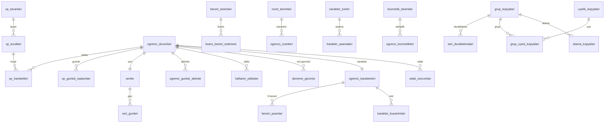

# `motivasyon` veritabanı şeması

Oyunlaştırma servisi: XP, seviye, seri, rozet, karakter, odak oturumları. Servis **yalnızca olaylarla beslenir** (odak oturumları hariç, bunlar istemciden doğrudan gelir). Çekirdek veri kaynağı `api`dır. Ortak kurallar, profil kodları ve RLS şablonu [README.md](README.md)'dedir. Olay yükleri [olaylar.md](olaylar.md)'dedir.

Tek şema: `motivasyon` (+ `ortak`). Roller: `motivasyon_owner`, `motivasyon_app`, `motivasyon_sistem`.

## Tasarım kuralları

- **Karar:** Oyunlaştırma durumu **üyelik (`ogrenci_id` = `hesap.uyelikler.id`) başınadır**, yani kurum başınadır. Aynı kullanıcının iki kurumdaki karakteri, XP'si ve serisi ayrıdır. Gerekçe: kiracı izolasyonu ([ADR 0003](../adr/0003-kiraci-izolasyonu-rls.md)); kurumlar arası veri birleştirmesi yapılmaz.
- XP, seri ve rozet hesapları yeniden oynatılabilir olmalıdır. Her XP satırı `kaynak_olay_id` ile bir olaya bağlıdır ve `(kaynak_olay_id, kural_kodu)` tekildir.
- **Gün sınırı** kurumun saat diliminde **04:00**'tür (bkz. "Gün tanımı"). Gün, olayın `olusma_zamani`ndan sunucuda hesaplanır.
- Oyunlaştırma modülü kapalıysa (kurum/kademe/grup, bkz. `modul_ayari_kopyalari`) olay işlenir ama XP verilmez ve kullanıcıya gösterilmez (`pasif_olay` sayacı artar). Modül sonradan açılırsa geçmiş XP geriye dönük verilmez.
- Öğretmen/yönetici, öğrencinin XP'sini elle değiştiremez. İstisnalar: grup bazlı seri duraklatma (`seri_duraklatmalari`) ve "haftanın yıldızı" (`haftanin_yildizlari`).

## Yapılandırma tabloları (global, RLS: hayır)

Tohum verisidir, migrasyonla gelir. Profil: `G`.

### `motivasyon.xp_tavanlari`

Günlük tavan grupları. `kod text PK`, `gunluk_ust_sinir int NOT NULL CHECK (> 0)`, `aciklama text`. Tohum: `genel` 300 (bütün tavana tabi kurallar toplamı), `plan` 40, `odak` 120, `soru` 20, `kayit` 15.

### `motivasyon.xp_kurallari`

Hangi olay ne kadar XP verir.

| Sütun | Tip | Null | Varsayılan | Not |
| --- | --- | --- | --- | --- |
| `kod` | text | hayır | | `UNIQUE`. Aşağıdaki tohum listesi |
| `olay_turu` | text | hayır | | Tüketilen olay (`ders.yoklama.kaydedildi`) veya `istemci` (odak, haftanın yıldızı) |
| `kosul` | jsonb | hayır | `'{}'` | Yük süzgeci, ör. `{"durum":["geldi","gec"]}` |
| `xp` | int | hayır | | CHECK `>= 0`. Sabit kuralda olay başına XP, birim kuralında birim başına XP |
| `birim` | text | evet | | NULL = sabit; `dakika` (odak), `net` (net artışı) |
| `olay_basi_ust_sinir` | int | evet | | Tek olaydan en çok XP (net artışı için 50) |
| `gec_carpani` | numeric(3,2) | hayır | 1.00 | Geç teslimde çarpan (ödev teslimi 0.50, aşağı yuvarlanır) |
| `tavan_grubu` | text | evet | | FK `xp_tavanlari(kod)` (kural grubu tavanı; NULL = grup tavanı yok) |
| `genel_tavana_tabi` | boolean | hayır | true | `genel` günlük tavanına dahil mi |
| `aktif` | boolean | hayır | true | |

Tohum (ürün şartnamesi):

| `kod` | Olay | XP | Tavan grubu |
| --- | --- | --- | --- |
| `yoklama_geldi` | `ders.yoklama.kaydedildi` (`geldi`,`gec`) | 20 | genel |
| `odev_teslim` | `ogrenme.odev.teslim_edildi` | 15 (geç: 7) | genel |
| `odev_onay` | `ogrenme.odev.incelendi` (`tamam`) | 10 | genel |
| `plan_gorevi_tamam` | `ogrenme.plan_gorevi.guncellendi` | 5 | `plan` (40) |
| `odak_oturumu` | istemci (odak oturumu) | 1 / dakika | `odak` (120) |
| `deneme_girisi` | `ogrenme.deneme.girildi` | 10 | genel |
| `deneme_net_artisi` | `ogrenme.deneme.girildi` | 5 / net, deneme başına en çok 50 | genel |
| `soru_sorma` | `ogrenme.soru.sorildi` | 3 | `soru` (20) |
| `soru_anladim` | `ogrenme.soru.cozuldu` | 5 | `soru` (20) |
| `geri_bildirim` | `ders.geri_bildirim.verildi` | 2 | genel |
| `kayit_izledi` | `ders.kaynak.izlendi` | 5 | `kayit` (15) |
| `haftanin_yildizi` | istemci (öğretmen) | 50 + rozet | yok (`genel_tavana_tabi=false`) |

Kısıtlar: `UNIQUE (kod)`. Tek günde bütün tavana tabi kurallardan en çok 300 XP.

### `motivasyon.motivasyon_ayarlari`

Anahtar/değer yapılandırması. `anahtar text PK`, `deger jsonb NOT NULL`, `aciklama text`. Anahtarlar: `seri.plan_esigi` (1), `seri.odak_dk_esigi` (20), `seri.odev_esigi` (1), `seri.soru_esigi` (1), `seri.dondurma_haftalik` (1), `seri.dondurma_azami` (2), `seri.onarim_aylik` (1), `seri.kilometre_taslari` ([3,7,14,30,60,100,365]), `haftanin_yildizi.ogretmen_haftalik_limit` (3).

### `motivasyon.yapilandirma_gecmisi`

Yapılandırma değişikliklerinin günlüğü (yalnızca ekleme, kiracısız, RLS: hayır). Sütunlar: `tablo text`, `anahtar text`, `once jsonb`, `sonra jsonb`, `degistiren_kullanici_id uuid`, `neden text`, `created_at`.

### `motivasyon.seviyeler`

Seviye eşikleri. Sütunlar: `seviye int PK`, `gereken_toplam_xp bigint NOT NULL UNIQUE`, `ad text NULL`. CHECK `seviye >= 1`, `gereken_toplam_xp >= 0`; seviye 1 = 0 XP; `gereken_toplam_xp` seviye ile kesin artan. **Tohum 1..60 ve `50·(n−1)²` değil**: şartnamenin hedeflerine oturan parçalı eğri (aşağıda "Seviye eğrisi"). Ayar tablosudur, platform yöneticisi değiştirir.

### `motivasyon.rozet_tanimlari`

`kod text UNIQUE`, `ad text`, `aciklama text`, `kategori text` (`devamlilik`,`emek`,`gelisim`,`merak`,`ozel`; şartnamedeki beş kategori), `kademe text` (`bronz`,`gumus`,`altin`), `sayac_kodu text NOT NULL`, `esik bigint NOT NULL` (rozet, `ogrenci_sayaclari.deger >= esik` olunca kazanılır), `gizli boolean DEFAULT false`, `sira int`, `aktif boolean`. Rozet koşulu sayaç eşiği ile ifade edilir; karmaşık koşullar sayaç türetir.

### `motivasyon.karakter_turleri`

3 tür. `kod text UNIQUE`, `ad text`, `aktif boolean`. Tohum kodları: `kivilcim`, `dinamo`, `sedir` (ayrıntı için ana daldaki `docs/karakter`).

### `motivasyon.karakter_asamalari`

Tür x aşama (1-5). `tur_kodu text FK`, `asama smallint CHECK BETWEEN 1 AND 5`, `gereken_seviye int NOT NULL`, `ad text`. `PK (tur_kodu, asama)`. Tohum `gereken_seviye`: aşama 1 = seviye 1, aşama 2 = 5, aşama 3 = 12, aşama 4 = 25, aşama 5 = 40 (üç tür için aynı).

### `motivasyon.beceri_tanimlari`

5 beceri, branş tabanlı. `kod text PK`, `ad`, `sira`. Tohum: `sayisal` (Sayısal), `sozel` (Sözel), `fen` (Fen), `sosyal` (Sosyal), `dil` (Dil).

### `motivasyon.brans_beceri_eslemesi`

Hangi branşta kazanılan XP hangi beceriyi besler. `brans_kodu text PK` (`ortak.bransler.kod`, FK yok), `beceri_kodu text NOT NULL FK beceri_tanimlari(kod)`. Tohum: `matematik`, `geometri` -> `sayisal`; `turkce`, `edebiyat` -> `sozel`; `fizik`, `kimya`, `biyoloji`, `fen_bilimleri` -> `fen`; `tarih`, `cografya`, `felsefe`, `din_kulturu`, `sosyal_bilgiler`, `inkilap_tarihi` -> `sosyal`; `ingilizce`, `almanca` -> `dil`. `diger` eşlenmez. Yeni branş eklenince eşleme eklenir; eşlemesi olmayan branş becerisiz XP verir. Platform yöneticisi tarafından değiştirilebilir (`yapilandirma_gecmisi`).

### `motivasyon.kozmetik_tanimlari`

`kod text UNIQUE`, `slot text NOT NULL` (CHECK `IN ('sapka','gozluk','aksesuar','arka_plan','cerceve')`), `ad`, `nadirlik text` (`yaygin`,`nadir`,`efsanevi`), `acilma_kosulu jsonb NOT NULL` (`{"rozet":"kod"}` veya `{"seviye":10}` veya `{"seri":30}`), `aktif boolean`.

## Öğrenci durumu

### `motivasyon.ogrenci_durumlari`

Öğrenci başına özet (türetilmiş, defterden yeniden kurulabilir).

Profil: `KS`. RLS: evet. `UNIQUE (kurum_id, ogrenci_id)`.

| Sütun | Tip | Null | Varsayılan | Not |
| --- | --- | --- | --- | --- |
| `ogrenci_id` | uuid | hayır | | `hesap.uyelikler.id` |
| `toplam_xp` | bigint | hayır | 0 | `SUM(xp_hareketleri.xp)` |
| `seviye` | int | hayır | 1 | `toplam_xp`'ye göre en yüksek `seviyeler` satırı |
| `bu_hafta_xp` | int | hayır | 0 | Pazartesi başlangıçlı hafta; gece işi sıfırlar |
| `son_aktivite_gun` | date | evet | | |
| `pasif_olay_sayisi` | int | hayır | 0 | Modül kapalıyken işlenen olay |

Güncelleme: XP satırı eklenen aynı işlemde `UPDATE ... SET toplam_xp = toplam_xp + :xp`. Seviye atlanırsa `motivasyon.seviye.atladi.v1`. İndeks: `UNIQUE (kurum_id, ogrenci_id)`, `(kurum_id, bu_hafta_xp DESC)` (ileride sıralama).

## XP

XP **geçmişe dönük düzeltilebilir ama defter değişmezdir**: düzeltme, ters çeviren bir satırdır (negatif XP).

### `motivasyon.xp_hareketleri`

XP defteri (yalnızca ekleme).

Profil: `D`. RLS: evet. Aylık bölümlenir (eşik 20 milyon satır).

| Sütun | Tip | Null | Varsayılan | Not |
| --- | --- | --- | --- | --- |
| `ogrenci_id` | uuid | hayır | | |
| `kural_kodu` | text | hayır | | FK `xp_kurallari(kod)` |
| `kaynak_olay_id` | uuid | hayır | | Tetikleyen olay `id` |
| `kaynak_ozne_id` | uuid | evet | | Olayın öznesi (yoklama, ödev vb.) |
| `kaynak_ozne_surumu` | bigint | hayır | 0 | Yoklamada `yoklama_surumu`, diğerlerinde 0 |
| `brans_kodu` | text | evet | | Beceri puanı için (olay yükünden) |
| `xp` | int | hayır | | CHECK `<> 0`. Pozitif = kazanım (günlük tavan nedeniyle kuraldan az olabilir), negatif = ters kayıt |
| `gun` | date | hayır | | Gün (04:00 kuralı, aşağıda) |
| `kismi` | boolean | hayır | false | Tavan nedeniyle kırpıldı |
| `ters_cevrilen_id` | uuid | evet | | FK `xp_hareketleri(id)`; yalnızca negatif satırlarda dolu |
| `neden` | text | evet | | Ters kayıtta zorunlu (`yoklama_degisti`) |

Kısıtlar: `UNIQUE (kaynak_olay_id, kural_kodu)` (aynı olay iki kez işlenmez). `UNIQUE (ters_cevrilen_id) WHERE ters_cevrilen_id IS NOT NULL` (bir kazanım bir kez ters çevrilir). `CHECK ((xp < 0) = (ters_cevrilen_id IS NOT NULL))`. **Aynı özneden tekrar XP engeli:** `UNIQUE (ogrenci_id, kural_kodu, kaynak_ozne_id, kaynak_ozne_surumu) WHERE xp > 0 AND kaynak_ozne_id IS NOT NULL`. Aynı ödevi yeniden teslim ederek XP kazanılamaz. Yoklamada her `yoklama_surumu` ayrı özne sürümüdür, böylece geldi -> izinli -> geldi sırasında ters kayıttan sonra yeniden kazanım mümkündür.

**Yoklama ters kaydı.** `ders.yoklama.kaydedildi.v1` işlenirken: (a) bu `yoklama_id` için `yoklama_geldi` kuralında ters çevrilmemiş pozitif satır var ve yeni durum `geldi`/`gec` değil ise, `xp = -(özgün.xp)` ve `ters_cevrilen_id` ile ters kayıt eklenir; (b) ters çevrilmemiş satır yok ve yeni durum `geldi`/`gec` ise kazanım eklenir. Durum `geldi` -> `gec` gibi XP etkisiz geçişlerde hiçbir şey yazılmaz. Ters kayıt, orijinal `gun` için tavan sayaçlarından aynı miktarı düşer (en az 0). `ogrenci_durumlari.toplam_xp` azalabilir; `seviye` ve karakter aşaması **geri düşmez** (ulaşılan en yüksek seviye korunur), XP yeniden kazanılınca yeniden artış olmaz (seviye atlama olayı yalnızca daha önce ulaşılmamış seviyede yayımlanır).

İndeks: `(kurum_id, ogrenci_id, created_at DESC)`, `(kurum_id, ogrenci_id, gun)`, `(kurum_id, ogrenci_id, kural_kodu, kaynak_ozne_id)`.
Olaylar: yok (özet olaylar `seviye.atladi` vb.).

### Gün tanımı

Tüm "gün" alanları (`xp_hareketleri.gun`, tavan sayaçları, seri) **kurumun saat diliminde 04:00'te** değişir: `gun = ((olusma_zamani AT TIME ZONE kurum.saat_dilimi) - interval '4 hours')::date`. Gün sunucuda olayın `olusma_zamani`ndan hesaplanır, istemci saatine güvenilmez. Haftalık sayaçlar Pazartesi 04:00'te başlar.

### `motivasyon.xp_gunluk_toplamlari`

Günlük tavan sayaçları. Profil: `K` (UUID `id` yok). PK `(ogrenci_id, gun, tavan_grubu)`. RLS: evet. Sütunlar: `ogrenci_id`, `gun date`, `tavan_grubu text` (FK `xp_tavanlari(kod)`; `genel` dahil), `toplam int NOT NULL DEFAULT 0 CHECK (toplam >= 0)`.

Tavan algoritması (aynı işlem içinde, `ogrenci_id` için `pg_advisory_xact_lock`):
1. Kuralın `tavan_grubu` (varsa) ve, kural `genel_tavana_tabi` ise `genel` grubu için satırları `INSERT ... ON CONFLICT DO NOTHING` ile aç, `FOR UPDATE` ile kilitle.
2. `verilecek = LEAST(hesaplanan_xp, grup_tavani - grup_toplam, genel_tavan - genel_toplam)`, en az 0.
3. `verilecek = 0` ise satır yazılmaz. Aksi halde `xp_hareketleri` (kısmi ise `kismi=true`) yazılır ve ilgili sayaçlar `verilecek` kadar artar.

### `motivasyon.ogrenci_gunluk_aktivite`

Seri ve onarım için günlük aktivite sayaçları. Profil: `K` (UUID `id` yok). PK `(ogrenci_id, gun)`. RLS: evet. Sütunlar: `plan_gorevi_sayisi int`, `odak_sn int`, `odev_teslim_sayisi int`, `soru_anladim_sayisi int` (hepsi `NOT NULL DEFAULT 0`). Her ilgili olay/oturum işlenirken aynı işlemde artar. Plan görevi tamamlama bir `ters` ile geri alınırsa (durum `tamam`dan çıkarsa) azalır.

### `motivasyon.ogrenci_sayaclari`

Rozet koşulları için sayaçlar. Profil: `K` (UUID `id` yok). PK `(ogrenci_id, sayac_kodu)`. RLS: evet. Sütunlar: `sayac_kodu text` (`toplam_odev_teslim`, `toplam_yoklama`, `toplam_deneme`, `en_uzun_seri`, `toplam_odak_dk`, `toplam_kayit_izleme`, `toplam_soru`, `haftanin_yildizi`), `deger bigint NOT NULL DEFAULT 0`. Güncelleme olay işleme işlemindedir, ardından eşiği geçen `rozet_tanimlari` değerlendirilir.

### `motivasyon.beceri_puanlari`

Karakterin 5 beceri değeri (`sayisal`, `sozel`, `fen`, `sosyal`, `dil`). Profil: `K` (UUID `id` yok). PK `(ogrenci_id, beceri_kodu)`. RLS: evet. Sütunlar: `beceri_kodu text FK beceri_tanimlari`, `puan int NOT NULL DEFAULT 0 CHECK (puan >= 0)`. Bir branşta kazanılan XP, `brans_beceri_eslemesi` ile eşleşen becerinin puanını **verilen XP kadar** artırır (ters kayıt aynı miktarda azaltır, en az 0). `brans_kodu` boş olan veya eşlemesi olmayan kazanım (ör. deneme girişi, haftanın yıldızı) beceriyi etkilemez. Beceri puanı seviyeyi etkilemez, karakter ekranında görünür.

## Seri

**Gün tanımı** yukarıdadır (04:00). Bir gün, `ogrenci_gunluk_aktivite` değerleri şu koşullardan **en az birini** sağlıyorsa seri için `aktif` sayılır:
- `plan_gorevi_sayisi >= 1`,
- `odak_sn >= 1200` (20 dakika),
- `odev_teslim_sayisi >= 1`,
- `soru_anladim_sayisi >= 1` (cevaplanan soru "anladım" ile çözüldü).

Eşikler `motivasyon_ayarlari` tablosundadır (`seri.plan_esigi`, `seri.odak_dk_esigi`, `seri.odev_esigi`, `seri.soru_esigi`). Gün koşulu ilk sağlandığında anında `seri_gunleri` yazılır (gece işi beklenmez).

### `motivasyon.seriler`

Öğrenci başına seri durumu.

Profil: `KS`. RLS: evet. `UNIQUE (kurum_id, ogrenci_id)`.

| Sütun | Tip | Null | Varsayılan | Not |
| --- | --- | --- | --- | --- |
| `ogrenci_id` | uuid | hayır | | |
| `mevcut_seri` | int | hayır | 0 | `seri_gunleri`nden türetilir (aşağıda) |
| `en_uzun_seri` | int | hayır | 0 | |
| `son_aktif_gun` | date | evet | | |
| `dondurma_stogu` | smallint | hayır | 0 | Biriken dondurma. CHECK `BETWEEN 0 AND 2`. |
| `dondurma_son_hafta` | date | evet | | Son tahakkuk edilen hafta (Pazartesi) |
| `onarim_hakki` | smallint | hayır | 1 | Ayda bir. CHECK `BETWEEN 0 AND 1` |
| `onarim_son_ay` | date | evet | | Hakkın yenilendiği ayın ilk günü |
| `bozulan_seri` | int | evet | | Son bozulan serinin değeri |
| `bozulan_gun` | date | evet | | Kaçırılan gün |
| `onarim_bitis_at` | timestamptz | evet | | Onarım penceresi sonu = kaçırılan günü izleyen günün sonu (kaçırılan gün + 2 gün 04:00) |

Kurallar:
- **Dondurma:** haftada 1 tahakkuk eder (Pazartesi 04:00 işi), en çok 2 birikir. Gün kaçırılınca **otomatik** kullanılır (`seri_gunleri.durum='dondurma'`, stok -1). Dondurma günü seriyi korur ama artırmaz.
- **Kaçırma:** gece işi (her kurumun 04:10'unda) bir önceki günü değerlendirir. Gün `aktif` değil, öğretmen duraklatması yok ve dondurma stoğu yoksa gün `kacirildi` olur, `bozulan_seri`/`bozulan_gun`/`onarim_bitis_at` yazılır.
- **Onarım:** `onarim_hakki = 1` ve `now() < onarim_bitis_at` iken, kaçırılan günü izleyen gün (yani kaçırılandan sonraki 24 saatlik pencerede) aktivite **günlük hedefin 2 katına** ulaşırsa kaçırılan gün `onarim` olur, hak 0 olur. Günlük hedefin 2 katı: `plan_gorevi_sayisi >= 2 * plan_esigi` veya `odak_sn >= 2 * odak_dk_esigi * 60` veya `odev_teslim_sayisi >= 2 * odev_esigi` veya `soru_anladim_sayisi >= 2 * soru_esigi`. Hak her ayın ilk günü 1'e döner. Bozulmuş seri onarımla geri gelir.
- **Türetme:** `mevcut_seri` = bugünden geriye doğru ardışık `aktif`/`onarim` günlerinin sayısı; `dondurma` ve `duraklatma` günleri sayılmaz ama zinciri kırmaz; `kacirildi` kırar. Her `seri_gunleri` değişiminde aynı işlemde yeniden hesaplanır.
- **Öğretmen duraklatması (grup bazlı):** bir grup için duraklatma aralığı varsa, o aralıktaki günlerde grubun etkin üyeleri için `duraklatma` yazılır; seri bozulmaz, dondurma harcanmaz.
- Kilometre taşları: 3, 7, 14, 30, 60, 100, 365.
Kısıtlar: `CHECK (mevcut_seri >= 0 AND en_uzun_seri >= mevcut_seri)`. İndeks: `UNIQUE (kurum_id, ogrenci_id)`, `(son_aktif_gun)` (gece işi taraması, `_sistem`).
Olaylar: `motivasyon.seri.bozuldu.v1`, `motivasyon.seri.kilometre_tasi.v1`, `motivasyon.seri.risk.v1` (21:00 yerel, bugün henüz `aktif` olmayan ve `mevcut_seri >= 3` öğrenciler).

### `motivasyon.seri_gunleri`

Gün bazlı seri kaydı. Profil: `D`-benzeri (UUID `id` yok). PK `(ogrenci_id, gun)`. RLS: evet. Sütunlar: `ogrenci_id uuid`, `gun date`, `durum text NOT NULL` (CHECK `IN ('aktif','dondurma','duraklatma','onarim','kacirildi')`), `kaynak_olay_id uuid NULL`. Yazım: `ON CONFLICT (ogrenci_id, gun) DO UPDATE SET durum = EXCLUDED.durum WHERE seri_gunleri.durum = 'kacirildi'` (yalnızca `kacirildi` gün yükseltilebilir; `aktif` en yüksek öncelikli).

### `motivasyon.seri_duraklatmalari`

Öğretmen duraklatmaları (grup başına tarih aralığı).

Profil: `KS`. RLS: evet.

| Sütun | Tip | Null | Varsayılan | Not |
| --- | --- | --- | --- | --- |
| `grup_id` | uuid | hayır | | `grup_kopyalari` |
| `veren_ogretmen_id` | uuid | hayır | | `atama_kopyalari` ile ilişki doğrulanır |
| `baslangic_gun` | date | hayır | | |
| `bitis_gun` | date | hayır | | CHECK `bitis_gun >= baslangic_gun AND bitis_gun - baslangic_gun <= 30` |
| `neden` | text | evet | | ≤ 200 |
| `iptal_at` | timestamptz | evet | | |

Kısıtlar: `EXCLUDE USING gist (grup_id WITH =, daterange(baslangic_gun, bitis_gun, '[]') WITH &&) WHERE (iptal_at IS NULL)`. Yetki: öğretmenin `atama_kopyalari`nda grupta aktif ataması olmalı; yönetici kapsamda hepsi. Değerlendirme gece işinde `grup_uyesi_kopyalari` ile yapılır. İndeks: `(kurum_id, grup_id, baslangic_gun)`. Olaylar: yok.

### `motivasyon.haftanin_yildizlari`

Öğretmenin seçtiği "haftanın yıldızı". Öğretmen doğrudan `motivasyon` servisine yazar (JWT; atama doğrulaması `atama_kopyalari`). Profil: `K`. RLS: evet.

| Sütun | Tip | Null | Varsayılan | Not |
| --- | --- | --- | --- | --- |
| `ogrenci_id` | uuid | hayır | | |
| `veren_ogretmen_id` | uuid | hayır | | |
| `grup_id` | uuid | hayır | | Öğrencinin bu öğretmenle ortak grubu |
| `hafta_baslangic` | date | hayır | | Pazartesi (04:00 kuralı) |
| `gerekce` | text | evet | | ≤ 200 |

Kısıtlar: `UNIQUE (ogrenci_id, hafta_baslangic)` (öğrenci haftada bir kez). **Öğretmen haftalık sınırı:** öğretmen başına haftada en çok `motivasyon_ayarlari['haftanin_yildizi.ogretmen_haftalik_limit']` (varsayılan 3, ürün onayı gerekir) kayıt; ekleme işleminde `pg_advisory_xact_lock(ogretmen)` ile sayılır, aşımda `409 haftalik_limit_asildi`. Ekleme: 50 XP (`haftanin_yildizi` kuralı, tavandan muaf) + `haftanin_yildizi` sayacı +1 (rozet). İndeks: `(kurum_id, veren_ogretmen_id, hafta_baslangic)`. Olaylar: yok.

### `motivasyon.deneme_gecmisi`

Net artışı hesabı için öğrencinin kendi deneme geçmişi. Profil: `K`. RLS: evet. Sütunlar: `ogrenci_id`, `deneme_id uuid NOT NULL`, `kural_kodu text NOT NULL`, `sinav_tarihi date NOT NULL`, `toplam_net numeric(6,2) NOT NULL`. `UNIQUE (deneme_id)`. İndeks: `(kurum_id, ogrenci_id, kural_kodu, sinav_tarihi DESC)`. `net artışı = max(0, toplam_net - ortalama(aynı kural_kodu'ndaki en son 3 önceki deneme))`; önceki deneme yoksa 0. Kazanım: `deneme_net_artisi` kuralı, net başına 5 XP, deneme başına en çok 50.

## Yapılandırma ve kural tabloları

Tüm XP değerleri, tavanlar ve seri eşikleri bu tablolardadır, **platform yöneticisi tarafından değiştirilebilir** (`PUT /platform/motivasyon/*`, `_sistem` rolü). Her değişiklik `motivasyon.yapilandirma_gecmisi`ne (yalnızca ekleme; `tablo`, `anahtar`, `once jsonb`, `sonra jsonb`, `degistiren_kullanici_id`, `neden`) yazılır. Değişiklik yeni olayları etkiler, geçmiş XP değişmez.

## Rozet

### `motivasyon.ogrenci_rozetleri`

Kazanılan rozetler. Profil: `K`. RLS: evet. Sütunlar: `ogrenci_id uuid`, `rozet_kodu text FK rozet_tanimlari(kod)`, `kazanildi_at timestamptz NOT NULL DEFAULT now()`, `kaynak_olay_id uuid NOT NULL`. Kısıtlar: `UNIQUE (ogrenci_id, rozet_kodu)` (rozet bir kez kazanılır). İndeks: `(kurum_id, ogrenci_id, kazanildi_at DESC)`. Olaylar: `motivasyon.rozet.kazanildi.v1` (yalnızca yeni eklemede).

## Karakter

Gelişen yoldaş karakter: 3 tür x 5 aşama, 5 branş tabanlı beceri, kozmetikler. Aşama, öğrenci **seviyesine** bağlıdır (`karakter_asamalari.gereken_seviye`: 1, 5, 12, 25, 40). Ters XP kaydı seviyeyi düşürmediği için aşama geri dönmez.

### `motivasyon.ogrenci_karakterleri`

Profil: `KS`. RLS: evet. `UNIQUE (kurum_id, ogrenci_id)`.

| Sütun | Tip | Null | Varsayılan | Not |
| --- | --- | --- | --- | --- |
| `ogrenci_id` | uuid | hayır | | |
| `tur_kodu` | text | hayır | | FK `karakter_turleri(kod)` |
| `ad` | text | hayır | | Öğrencinin verdiği ad, ≤ 24; küfür/uygunsuz ad süzgeci uygulamada |
| `asama` | smallint | hayır | 1 | CHECK `BETWEEN 1 AND 5`. Seviye değişince `asama = MAX(asama) WHERE gereken_seviye <= seviye` |
| `secildi_at` | timestamptz | hayır | now() | |
| `tur_degistirme_hakki` | smallint | hayır | 1 | Tür değiştirme tek sefer; değişirse aşama korunur |

Aşama yükselince `motivasyon.karakter.evrildi.v1`. Seviye eşikleri `seviyeler` ve `karakter_asamalari` tohum verisidir. İndeks: `UNIQUE (kurum_id, ogrenci_id)`. İlk giriş: öğrenci tür seçene kadar satır yoktur (arayüz seçim ekranı).

### `motivasyon.ogrenci_kozmetikleri`

Açılan kozmetikler. Profil: `K`. RLS: evet. Sütunlar: `ogrenci_id`, `kozmetik_kodu text FK`, `acildi_at timestamptz DEFAULT now()`, `kaynak_olay_id uuid`. `UNIQUE (ogrenci_id, kozmetik_kodu)`. Açılma, rozet/seviye/seri olayı işlenirken `acilma_kosulu` değerlendirilerek yapılır.

### `motivasyon.karakter_kusanimlari`

Slot başına giyilen kozmetik. Profil: `K`. RLS: evet. PK `(ogrenci_id, slot)`. Sütunlar: `ogrenci_id`, `slot text` (CHECK, `kozmetik_tanimlari.slot` değerleri), `kozmetik_kodu text NOT NULL`. Bileşik FK `(ogrenci_id, kozmetik_kodu)` -> `ogrenci_kozmetikleri` (sahip olunmayan kozmetik giyilemez) ve slot eşleşmesi tetikleyiciyle doğrulanır.

## Odak oturumları

### `motivasyon.odak_oturumlari`

Odak zamanlayıcısı. İstemci doğrudan `motivasyon` servisine yazar (JWT ile).

Profil: `KS`. RLS: evet.

| Sütun | Tip | Null | Varsayılan | Not |
| --- | --- | --- | --- | --- |
| `ogrenci_id` | uuid | hayır | | |
| `istemci_id` | uuid | hayır | | İstemcinin ürettiği UUIDv7 (idempotency) |
| `baslangic_at` | timestamptz | hayır | | |
| `bitis_at` | timestamptz | evet | | |
| `planlanan_dk` | smallint | hayır | | CHECK `BETWEEN 5 AND 180` |
| `gerceklesen_sn` | int | hayır | 0 | CHECK `>= 0`. Sunucu üst sınırı: `LEAST(bitis_at - baslangic_at, planlanan_dk*60 + 60)` |
| `durum` | text | hayır | `'devam'` | CHECK `IN ('devam','tamam','yarida')` |
| `brans_kodu` | text | evet | | |
| `plan_gorev_id` | uuid | evet | | `ogrenme.plan_gorevleri.id` |
| `cihaz` | text | evet | | |

Kısıtlar: `UNIQUE (kurum_id, ogrenci_id, istemci_id)`. Aynı anda tek `devam` oturumu: `UNIQUE (ogrenci_id) WHERE durum = 'devam'`. 6 saatten uzun `devam` oturum gece işiyle `yarida` yapılır. XP: `durum='tamam'` (veya `yarida` ama `gerceklesen_sn >= 60`) oturumdan `odak_oturumu` kuralıyla `floor(gerceklesen_sn/60)` XP (`odak` günlük tavanı 120). `odak_sn` aktivite sayacı oturum kapanışında artar (20 dakika seri koşulu). Kaynak olay yerine oturum kimliği `kaynak_olay_id`dir (sentetik, `odak:{id}` UUIDv5). İndeks: `(kurum_id, ogrenci_id, baslangic_at DESC)`.
Olaylar: yok.

## Yerel okuma kopyaları

Yalnızca olay tüketicisi yazar. Olay zarfında `ozne_surumu` olmadığından her kopya, `(son_olay_at, son_olay_id)` = olayın (`occurredAt`, UUIDv7 kimliği) ikilisiyle eski olayı yok sayar; eşit zamanda büyük kimlik kazanır. Aynı durumun yeniden yayımı (api `olaylari-yeniden-yayimla`) upsert olarak etkisizdir. RLS: evet (`kurum_id`). Profil: `K` benzeri; PK kaynak kimliğidir.

| Tablo | Kaynak olay | Sütunlar | Neden gerekli |
| --- | --- | --- | --- |
| `kurum_kopyalari` | `hesap.kurum.degisti.v1` | `kurum_id` PK, `tur`, `durum`, `saat_dilimi`, `son_olay_at`, `son_olay_id` | Gün sınırı saat dilimi, askıdaki kurum için XP durdurma |
| `uyelik_kopyalari` | `hesap.uyelik.degisti.v1` | `uyelik_id` PK, `kurum_id`, `kullanici_id`, `rol`, `durum`, `kademe_id`, `son_olay_at`, `son_olay_id` | Yalnızca etkin `ogrenci` için durum açılır; kademe modül çözümlemesi için |
| `grup_kopyalari` | `hesap.grup.degisti.v1` | `grup_id` PK, `kurum_id`, `kademe_id`, `tur`, `durum`, `son_olay_at`, `son_olay_id` | Modül çözümleme (grup düzeyi) |
| `grup_uyesi_kopyalari` | `hesap.grup_uyesi.degisti.v1` | `grup_id`, `ogrenci_id`, `grup_uyesi_id`, `baslangic_tarihi`, `bitis_tarihi`, `son_olay_at`, `son_olay_id`; PK `(grup_id, ogrenci_id)` | Öğrencinin hangi gruplarda olduğu (modül çözümleme, duraklatma yetkisi) |
| `atama_kopyalari` | `hesap.atama.degisti.v1` | `atama_id` PK, `grup_id`, `ogretmen_id`, `brans_kodu`, `baslangic_tarihi`, `bitis_tarihi`, `son_olay_at`, `son_olay_id` | Öğretmenin öğrenciye seri duraklatma yetkisi |
| `modul_ayari_kopyalari` | `hesap.modul_ayari.degisti.v1` | `kurum_id`, `modul_kodu`, `kapsam`, `kapsam_id`, `acik` (boş olamaz; `acik: null` olayı satırı siler), `son_olay_at`, `son_olay_id`; PK `(kurum_id, modul_kodu, kapsam, kapsam_id)` | `oyunlastirma` modülü açık mı (kurum > kademe > grup, ADR 0004) |

`hesap.kullanici.silindi.v1` gelince: ilgili `kullanici_id`'nin üyelikleri bulunur, o üyeliklerin `ogrenci_durumlari`, `xp_hareketleri`, `seriler`, `seri_gunleri`, `ogrenci_rozetleri`, `ogrenci_karakterleri`, `ogrenci_kozmetikleri`, `karakter_kusanimlari`, `beceri_puanlari`, `ogrenci_sayaclari`, `odak_oturumlari`, `seri_duraklatmalari` satırları silinir (oyunlaştırma verisi tanımlayıcı veridir; defter değişmezliği KVKK silme için istisnadır ve `ortak.anonimlestir(ogrenci_id)` yordamıyla yapılır).

## Tüketilen olaylar

| Olay | İşleme |
| --- | --- |
| `ders.yoklama.kaydedildi.v1` | `yoklama_geldi` XP kazanımı ya da **ters kaydı** (XP bölümü). Özne: `yoklama_id`, özne sürümü `yoklama_surumu`. |
| `ders.geri_bildirim.verildi.v1` | `geri_bildirim` XP. |
| `ders.kaynak.izlendi.v1` | `kayit_izledi` XP. |
| `ogrenme.odev.teslim_edildi.v1` | `odev_teslim` XP (`gec_teslim` ise yarısı); `odev_teslim_sayisi` aktivite sayacı; `toplam_odev_teslim` sayacı. |
| `ogrenme.odev.incelendi.v1` | `inceleme_sonucu='tamam'` ise `odev_onay` XP. |
| `ogrenme.plan_gorevi.guncellendi.v1` | `durum='tamam'` geçişinde `plan_gorevi_tamam` XP; `plan_gorevi_sayisi` sayacı. |
| `ogrenme.deneme.girildi.v1` | `deneme_girisi` + `deneme_net_artisi` XP; `deneme_gecmisi` satırı. |
| `ogrenme.soru.sorildi.v1` | `soru_sorma` XP. |
| `ogrenme.soru.cozuldu.v1` | `soru_anladim` XP; `soru_anladim_sayisi` sayacı. |
| `hesap.*` kopya olayları | Kopya upsert (yukarıdaki tablo). |
| `hesap.kullanici.silindi.v1` | Veri temizliği. |

Her tüketici `ortak.processed_events` ile idempotent çalışır ([ADR 0002](../adr/0002-olay-sozlesmesi-outbox-idempotent-tuketici.md)); tüketici adı `motivasyon.xp` (XP kuralları) ve `motivasyon.kopya` (hesap kopyaları).

## Üretilen olaylar

`motivasyon.seviye.atladi.v1`, `motivasyon.seri.risk.v1`, `motivasyon.seri.bozuldu.v1`, `motivasyon.seri.kilometre_tasi.v1`, `motivasyon.rozet.kazanildi.v1`, `motivasyon.karakter.evrildi.v1`. Yükler [olaylar.md](olaylar.md)'dedir. Tüketicisi `bildirim`dir.

## Açık sorular (bu servis)

- Rozet listesi ve kozmetik tanımları yer tutucudur (ad, açıklama, eşik); ürün/tasarım onayı bekler.
- `haftanin_yildizi.ogretmen_haftalik_limit` varsayılanı (3) ürün onayı bekler (orkestratör kararı: 3 kalsın).
- Net artışı referansı: öğrencinin aynı sınav türündeki önceki 3 denemesinin ortalaması ve 50 XP sınırı yalnızca net artışı bonusu için varsayıldı (toplam deneme XP'si en çok 60).
- `oyunlastirma.oku` izni öğretmene verilmedi (izin sözlüğü sürüm 7); öğretmen özeti şimdilik uçta rol + atama kapsamıyla açılıyor. Sözlüğe `ogretmen: oyunlastirma.oku = grup` eklenip sürüm artırılmalı.
- `hesap.kullanici.silindi.v1` sözleşmesi yok; KVKK temizliği (`ortak.anonimlestir`) yazılmadı.

## Uygulama notları (paket M1, çekirdek)

Bu bölüm şemadan **bilinçli sapmaları** ve orkestratör/uygulama kararlarını gerekçesiyle listeler. Tüm değerler ayar tablolarındadır, sonradan değiştirilebilir.

### Seviye eğrisi (tohum 1..60)

Üretici: `services/motivasyon/src/seviye-egrisi.ts` (`pnpm --filter @kopru/motivasyon egri` tabloyu yazdırır); testler tohumun fonksiyonla aynı olduğunu ve hedefleri denetler. Şemadaki `50·(n−1)²` hedefleri tutmuyordu: seviye 5 için 800 XP (haftalık ~393 XP ile ~14 gün), seviye 12 için 6.050 XP (~108 gün), seviye 40 için 76.050 XP (~7 yıl).

**"Düzenli çalışan öğrenci" varsayımları** (`services/motivasyon/src/duzenli-ogrenci.ts`, XP değerleri `xp_kurallari` tohumundan): haftada 3 ders (yoklama 20 + geri bildirim 2), 2 ödev (zamanında teslim 15 + onay 10), 5 gün × 3 plan görevi (5 XP, günlük tavan 40 altında), 5 gün × 30 dk odak (1 XP/dk, tavan 120 altında), 4 gün × (1 soru sorma 3 + 1 "anladım" 5), haftada 2 ders kaydı (5), iki haftada bir deneme (10 + ortalama 2 net artışı × 5). **Haftalık 393 XP, günlük ortalama ~56 XP**; ders gününde ilk gün XP'si 75 (20+2+15+30+8). Günlük 300 genel tavanı bu modelin çok üstündedir.

| Hedef               | Seviye | Toplam XP | Düzenli öğrencide gün     | Şartname hedefi          |
| ------------------- | ------ | --------- | ------------------------- | ------------------------ |
| İlk gün             | 3      | 60        | 1 (ilk gün XP'si 75)      | ilk gün 2 seviye         |
| İlk evrim (aşama 2) | 5      | 380       | 7                         | ilk hafta                |
| 3. aşama            | 12     | 3.300     | 59                        | ~2 ay                    |
| 4. aşama            | 25     | 7.500     | 134                       | dönem sonu, ~4,5 ay      |
| Efsane (aşama 5)    | 40     | 20.000    | 356                       | bir yıl                  |
| Üst sınır           | 60     | 57.210    | 1019                      |                          |

Çapa noktalarından aralık içinde `T0 + ΔT·((n−n0)/(n1−n0))^1,15` (maliyet aralık içinde artar); seviye 41–60 her seviye öncekinin %6 fazlası. **Sınırlama:** hedefler sabit günlük hızda tek bir düzgün (maliyeti hep artan) eğriye oturmaz; seviye 12'ye geçişte maliyet kısa süre düşer (11→12: 470 XP, 12→13: 220 XP; "evrim sonrası hızlı seviye"), 25→26'da yeniden artar. Eğri `seviyeler` tablosunda ayardır.

### Rozet listesi (33 rozet, 5 kategori × bronz/gümüş/altın)

Her rozet bir sayaç eşiğidir. Gizli (`gizli=true`) olanlar kazanılana kadar listelenmez: `odak_altin`, `yildiz_*`.

| Kategori      | Aileler (sayaç; bronz/gümüş/altın eşiği)                                                                                                                                                                | Sayacı güncelleyen                 |
| ------------- | ------------------------------------------------------------------------------------------------------------------------------------------------------------------------------------------------------- | ---------------------------------- |
| `devamlilik`  | `seri_*` (`en_uzun_seri`; 7/30/100), `aktif_gun_*` (`toplam_aktif_gun`; 10/50/150)                                                                                                                      | seri paketi                        |
| `emek`        | `odev_*` (`toplam_odev_teslim`; 5/25/100), `odak_*` (`toplam_odak_dk`; 300/1500/6000), `soru_cozum_*` (`toplam_cozulen_soru` = ödevlerdeki `yapilan_soru_sayisi` toplamı; 100/500/2000)                  | XP tüketicisi (odak: odak paketi)  |
| `gelisim`     | `net_*` (`net_artisi_deneme` = net artışı > 0 olan deneme sayısı; 1/5/15), `net_toplam_*` (`toplam_net_artisi` = artışların tam kısımlarının toplamı; 10/50/150)                                         | XP tüketicisi                      |
| `merak`       | `merak_soru_*` (`toplam_soru`; 3/15/50), `merak_anladim_*` (`toplam_anladim`; 3/15/50), `merak_kayit_*` (`toplam_kayit_izleme`; 3/15/50)                                                                | XP tüketicisi                      |
| `ozel`        | `yildiz_*` (`haftanin_yildizi`; 1/3/10)                                                                                                                                                                 | yıldız ucu                         |

Ek sayaçlar: `toplam_yoklama` (rozeti yok; yoklama etkin duruma göre artar/azalır), `toplam_deneme`. Rozet bir kez kazanılır ve sayaç azalsa da geri alınmaz. Kozmetik tanımları (12 yer tutucu): `seri` 3/7/14/30/60/100/365, rozet (`odev_bronz`, `merak_soru_gumus`, `yildiz_bronz`), seviye 5 ve 10.

### Şemadan sapmalar ve ek tablolar

- **`kod` doğal anahtar** (`xp_kurallari`, `xp_tavanlari`, `rozet_tanimlari`, `kozmetik_tanimlari`, `karakter_turleri` vb.): `id uuid` profili yerine metin PK; FK'ler koda bağlanır.
- **Kopya tabloları `surum` yerine (`son_olay_at`, `son_olay_id`)**: olay zarfında özne sürümü yok. `kurum_kopyalari`'nda `ad` saklanmaz (gereksiz kişisel veri riski), `tur` saklanır.
- **`xp_hareketleri.olusma_at`** (tetikleyen olayın zamanı) eklendi: `created_at` işleme zamanıdır, `gun` olay zamanından hesaplanır.
- **`ogrenci_durumlari.hafta_baslangic`** eklendi: `bu_hafta_xp`'in haftası. XP yazımı hafta değişmişse sıfırlayıp yazar (eski haftanın gecikmiş olayı yeni haftaya eklenmez); haftalık iş (10 dakikada bir, Pazartesi 04:00'ü geçmiş kurumlar için) sıfırlar ve idempotenttir.
- **`xp_ozne_durumlari`** (yeni tablo): yoklama (`geldi`/`gec` mi) ve plan görevi (tamam mı) gibi durumu değişen öznelerin son işlenen sürümü/zamanı ve "etkin" durumu. Eski olayı yok saymak (yoklama: `yoklama_surumu`, plan: `occurredAt`), sayaçları XP tavanından bağımsız doğru tutmak (`toplam_yoklama`; `plan_gorevi_sayisi` tamamlanan günden azalır) ve şüpheli örüntü sayımı için gerekli. Ayrıca soru, "anladım", kayıt izleme ve ödev teslim ödülü/sayaçları özne başına bir kez çalışır.
- `seri_gunleri`, `seri_duraklatmalari`, `haftanin_yildizlari`, `odak_oturumlari`, karakter ve kozmetik tabloları şemadaki gibidir; **mantıkları yok**, yalnız tablolar (sonraki paketler migration eklemeden çalışsın diye).
- `rozet_tanimlari.kademe`, `rozet_tanimlari.kategori` listesi ve `kozmetik_tanimlari.acilma_kosulu` CHECK'i eklendi. Yapılandırma tabloları `motivasyon_app`'e salt okunurdur (değişiklik `motivasyon_sistem` ile).
- `btree_gist` uzantısı migration bootstrap'inde etkinleştirilir (`seri_duraklatmalari` EXCLUDE).
- `xp_hareketleri` bölümlenmedi (eşik 20 milyon satır; README kuralı).

### XP tüketicisi kuralları (uygulanan)

- **Gün** = `((occurredAt AT TIME ZONE kurum.saat_dilimi) − 4 saat)::date`; kurum kopyası yoksa `Europe/Istanbul`.
- **Modül/kurum çözümlemesi**: kurum durumu `aktif` değilse veya `oyunlastirma` modülü kurum > kademe > grup düzeyinde kapalıysa olay işlenir ama XP yazılmaz, `pasif_olay_sayisi` artar (sayaç/rozet/aktivite de işlenmez; `deneme_gecmisi` modül kapalıyken de tutulur). Grup bağlamı olan olayda (yoklama, kayıt izleme) o grup; olmayanda öğrencinin o günkü etkin grupları: **tümü kapalıysa** kapalı (grubu olmayan öğrenci yalnız kurum ve öğrencinin kademesine bakar). Kopya yoksa modül açık. `uyelik_kopyası` var ve (rol ≠ `ogrenci` ya da durum ≠ `aktif`) ise olay tümüyle yok sayılır; kopya yoksa öğrenci etkin sayılır.
- **Tavan**: öğrenci başına `pg_advisory_xact_lock`; kuralın grup tavanı ve (tabiyse) `genel`; `verilecek = min(ham, kalanlar)`; kırpılmışsa `kismi=true`; 0 ise satır yok. Ters kayıt orijinal günün sayaçlarından (en az 0) düşer.
- **Net artışı**: `floor(artış × 5)` (numeric, SQL'de), deneme başına en çok 50; önceki en son 3 deneme (aynı `kural_kodu`, `sinav_tarihi` ≤ bu denemenin tarihi) ortalaması, yoksa artış 0. Düşüşte 0.
- **Geç teslim**: `floor(15 × 0,50) = 7`. Yeniden teslimde (bayrak ya da ikinci kez) XP ve sayaç yok.
- **Şüpheli örüntü**: aynı öğrencinin `motivasyon_ayarlari['supheli.plan_gorevi_pencere_sn']` (60) saniye içinde `['supheli.plan_gorevi_esik']` (10) değerinden **fazla** plan görevini tamamlaması: o tamamlama XP almaz (aktivite sayacı artar). Ayarlanabilir.
- **Seviye**: `seviye = max(seviye, hedef)`; ters kayıt seviyeyi/aşamayı düşürmez; çoklu seviye atlayışı tek olay (`eski_seviye` → `yeni_seviye`). Karakter varsa aşama yükselince `karakter.evrildi`; seviye/rozet sonrası kozmetikler açılır.
- **Rozet**: sayaç eşiği geçilince `ogrenci_rozetleri` + `motivasyon.rozet.kazanildi.v1` (tek kez).
- Seri paketi için yeniden kullanılabilir yardımcılar: `aktiviteArtir`, `sayacArtir`, `sayacEnAz`, `rozetleriDegerlendir`, `kozmetikleriAc`, `durumuGarantile`, `ogrenciKilitle`, `xpKazan` (`services/motivasyon/src/xp-cekirdek.ts`, `ortak.ts`).

### Okuma uçları

`GET /v1/motivasyon/kurumlar/{kurum_id}/benim` (rol `ogrenci`) ve `GET .../ogrenciler/{ogrenci_id}/ozet` (aynı gövde; öğrenci kendini, `sahip`/`yonetici` kurumdakini, `ogretmen` atama + grup üyeliği kopyalarıyla atandığı gruptakini görür, kapsam dışı 404; veli 403). Kurum yolu JWT'deki kurumla uyuşmazsa 403. Modül kapalıysa `403 modul_kapali`. Gizli rozetler kazanılana kadar yok. Şema: `packages/contracts/src/motivasyon/api.ts`.
